# 高并发短链接系统设计

> **面试题型**：后端系统设计面试题  
> **难度等级**：⭐⭐⭐⭐  
> **核心考点**：分布式 ID 生成、缓存设计、高并发读优化、重定向原理

---

## 🎯 一句话定位

**短链接系统解决什么问题？**
```
把又长又丑的 URL（https://www.example.com/very/long/path?param1=value1&param2=value2...）
变成又短又美的链接（http://t.cn/8M0kX）
```

**生活化比喻**：
就像给长地址起个"昵称"——你的身份证号是 18 位数字，但朋友叫你"小明"就行了。短链接就是长 URL 的"昵称"。

**核心特点**：读多写少（100:1），就像微博，发微博的人少，看微博的人多。

---

## 💎 核心观点（5 分钟速览版）

> **如果只有 5 分钟，看这里就够了！**

### 核心观点（5 个关键点）

**1. 短码生成：分布式发号器 + Base62 编码**
```
❌ 不用 MD5/UUID（有碰撞/太长）
✅ 用分布式 ID（雪花算法）+ Base62 编码
   - 雪花算法：时间戳 + 机器 ID + 序列号 → 全局唯一
   - Base62：0-9 + a-z + A-Z = 62 个字符，6 位可表示 568 亿
   - 优势：天然唯一、无碰撞、高性能
```

**2. 存储架构：MySQL 分库分表 + Redis 缓存**
```
- MySQL：持久化存储，按短码 Hash 分 16 库 256 表
- Redis：热点数据缓存，命中率 80-90%
- 布隆过滤器：拦截 99% 不存在的短码，防穿透
```

**3. 跳转优化：302 临时重定向**
```
✅ 302（推荐）：每次经过服务端，方便统计点击、可修改目标
❌ 301：浏览器缓存，无法统计，不可修改
混合方案：热点短链用 301 + CDN，普通短链用 302
```

**4. 高并发优化：三级缓存架构**
```
L1 本地缓存（Caffeine/GoCache）：TTL 5 分钟，抗 10 万+ QPS
L2 Redis 缓存：TTL 24 小时，命中率 80-90%
L3 MySQL：永久存储，命中率 < 5%
```

**5. 容量规划：6 位 Base62 可用 8 年**
```
日活 1000 万 × 5 个/天 = 5000 万/天
6 位 Base62 容量 568 亿 → 可支撑 3000+ 天（约 8 年）
存储：50 字节/条 × 5000 万 = 2.5 GB/天
```

---

## 🚀 一句话精华（如果只能记住一句）

> **短链接系统 = 分布式发号器（保证唯一） + Base62 编码（缩短长度） + 三级缓存（扛高并发） + 302 重定向（方便统计）**

---

## 一、为什么不用 MD5/UUID 做短码生成？

### ❌ MD5 方案的问题

**思路**：长 URL → MD5 哈希 → 截取 6-8 位 → 短码

**三大致命缺陷**：

**1. 哈希碰撞（最致命）**
```
生活化比喻：
就像给全班同学取昵称，只取名字最后一个字。
张三 → "三"，李四 → "四"，王五 → "五"...
但如果班上有个"张小三"和"王小三"，都叫"三"，就冲突了！

技术问题：
URL_A 和 URL_B 截取后都是 abc123，怎么办？
解决方案：碰撞后重试 + 数据库判重
代价：高并发下性能急剧下降（多次 DB 查询）
```

**2. 不可控**
```
就像拆盲盒，你不知道会拆出什么。
MD5 输出 32 位，截取后碰撞概率难以计算。
无法保证短码的唯一性和连续性。
```

**3. 无业务含义**
纯随机，无法做趋势分析。就像给商品编号用随机数，看不出销售趋势。

### ❌ UUID 方案的问题
- **长度过长**（36 字符），不适合短链接场景（短链接要"短"啊！）
- **无序**，数据库索引性能差（B+ 树频繁分裂，就像图书馆的书乱摆，找起来很慢）
- 同样存在碰撞概率（虽然极低）

---

## 二、生产级方案：分布式发号器 + Base62 编码

### ✅ 核心思路（30 秒版）

```
生活化比喻：
想象一个自动编号机（分布式发号器），每来一个长 URL，就给它一个唯一编号（123456789）。
然后把这个编号翻译成短码（Base62 编码：123456789 → "8M0kX"）。
最后把映射关系存起来（短码 ↔ 长 URL）。

技术流程：
唯一数字ID（雪花算法） → Base62编码 → 6位短码（8M0kX） → 存储映射关系
```

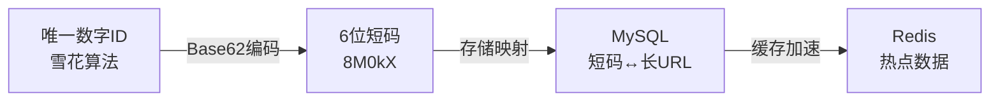

### 2.1 分布式 ID 生成方案对比

**生活化比喻**：就像给全国每个人发唯一身份证号，有多种方案：

| 方案 | 原理 | 优点 | 缺点 | 推荐度 | 生活化比喻 |
|------|------|------|------|--------|------------|
| **雪花算法** | 时间戳 + 机器 ID + 序列号 | 高性能、趋势递增 | 依赖机器时钟 | ⭐⭐⭐⭐⭐ | 按"出生时间+出生地+顺序号"编号，趋势递增 |
| **Leaf 号段模式** | 数据库预分配号段 | 实现简单、ID 连续 | 依赖数据库 | ⭐⭐⭐⭐ | 从户籍中心批量领号段，发完再领 |
| **Redis INCR** | 原子自增 | 性能高 | 持久化风险 | ⭐⭐⭐ | 用计数器，每次+1，简单高效 |
| **UUID** | 随机生成 | 本地生成、无依赖 | 无序、过长 | ⭐⭐ | 随机生成，全球唯一但太长 |

**推荐方案**：
- **中小规模**：Redis INCR（简单高效，就像计数器）
- **大规模**：雪花算法或 Leaf（美团开源，就像自动编号机）

### 2.2 Base62 编码原理

**生活化比喻**：
```
十进制用 0-9 十个数字（逢十进一）
十六进制用 0-9 + A-F（逢十六进一）
Base62 用 0-9 + a-z + A-Z 共 62 个字符（逢六十二进一）

就像：
十进制 10 → 十六进制 A
十进制 123456789 → Base62 "8M0kX"

好处：用更少的位数表示更大的数字
```

**字符集**：`0-9` + `a-z` + `A-Z` = 62 个字符

**编码容量**（就像算密码有多少种组合）：
| 短码长度 | 容量 | 适用场景 | 生活化比喻 |
|---------|------|----------|------------|
| 6 位 | 62⁶ ≈ **568 亿** | 超大规模（日活过亿） | 够全中国人每人分配 40 个 |
| 5 位 | 62⁵ ≈ **9.16 亿** | 大规模（千万级） | 够全中国人每人分配 0.7 个 |
| 4 位 | 62⁴ ≈ **1477 万** | 中等规模 | 够一个中等城市用 |

**示例**：
```
数字 ID: 123456789
Base62: 123456789 % 62 = 余数 → 查表 → 'd'
继续除 62...
最终结果: "8M0kX"

生活化比喻：
就像把 123456789 翻译成"外星语言"，用 62 个字母表示。
```

**优势**：
- ✅ **天然唯一**（依赖 ID 唯一性，就像身份证号唯一）
- ✅ **无碰撞**（不需要重试，性能稳定）
- ✅ **短码可控**（固定长度，不会越来越长）
- ✅ **高性能**（纯计算，无 DB 查询，就像心算比查表快）

---

## 三、系统架构设计

### 3.1 整体架构图（全景视图）

**生活化比喻**：就像开一家快递公司
- **客户端**：寄件人/收件人
- **负载均衡层**：公司前台（限流、防刷，就像限制每人每天最多寄 100 个包裹）
- **短链接服务**：分拣中心（处理生成和查询）
- **存储层**：仓库（MySQL 持久化 + Redis 快速查找）

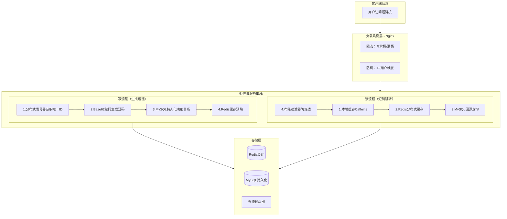

### 3.2 写流程详解（生成短链接）

**生活化比喻**：
```
就像给新员工发工号：
1. 从发号器拿一个唯一编号（分布式发号器）
2. 把编号翻译成短码（Base62 编码）
3. 把"短码 ↔ 长 URL"的映射关系记在花名册上（MySQL）
4. 同时更新到快速查询表上（Redis 预热）
5. 在门禁系统里登记（布隆过滤器）
```

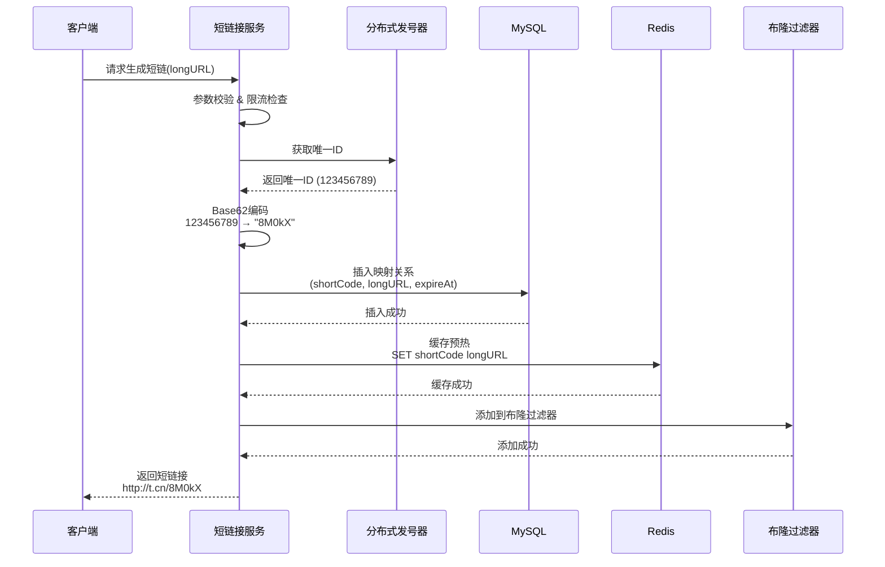

**关键点**：
- ✅ **分库分表**：按短码 Hash 分片（如 `hash(shortCode) % 16`），就像把花名册分成 16 本，查找更快
- ✅ **索引设计**：`short_code` 唯一索引 + `long_url` 普通索引，就像给花名册建目录
- ✅ **异步写缓存**：MySQL 成功后再写 Redis，失败可重试，就像先记在本子上，再录入电脑

### 3.3 读流程详解（短链跳转）

**生活化比喻**：
```
就像查电话号码：
1. 先查门禁系统，看这个人在不在公司（布隆过滤器）
2. 再查自己手机通讯录（本地缓存）
3. 再查公司通讯录（Redis）
4. 最后查户籍中心（MySQL）

找到后，把号码记在手机里（回写缓存），下次直接查手机。
```

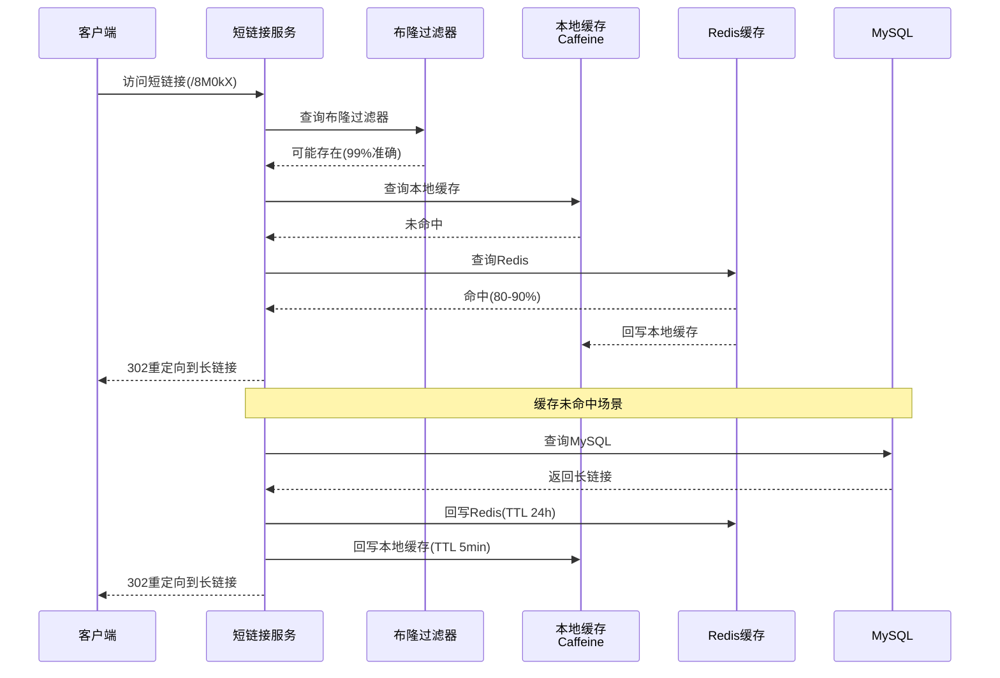

**缓存穿透防护**（什么是"穿透"？）：
```
生活化比喻：
缓存穿透就像：你问前台"张三在哪个部门？"，前台说"没有这个人"。
但你不确定，又去问 HR，HR 也说"没有"。
这就是"穿透"了缓存，直接查到了数据库。

防护方案：
1. 布隆过滤器：拦截 99% 的不存在短码（就像门禁系统，不在名单上直接拦住）
2. 空值缓存：MySQL 查询为空也缓存（TTL 5 分钟），下次直接返回"不存在"
```

---

## 四、面试高频考点：301 vs 302 重定向

### 核心对比（生活化理解）

**生活化比喻**：
```
301 永久重定向：
就像你搬家了，告诉邮局"我的新地址是 XXX，以后所有信件直接送到新地址"。
邮局会记住这个变化，以后不再问你了。
优点：邮局轻松（服务端压力小）
缺点：你无法统计有多少人给你写信了（无法统计点击）

302 临时重定向：
就像你出差了，告诉邮局"这周信件转寄到 XXX"。
每次有信件，邮局都会问你"转寄到哪里？"
优点：你可以统计有多少信件（可统计点击）
缺点：邮局每次都来问你（每次经过服务端）
```

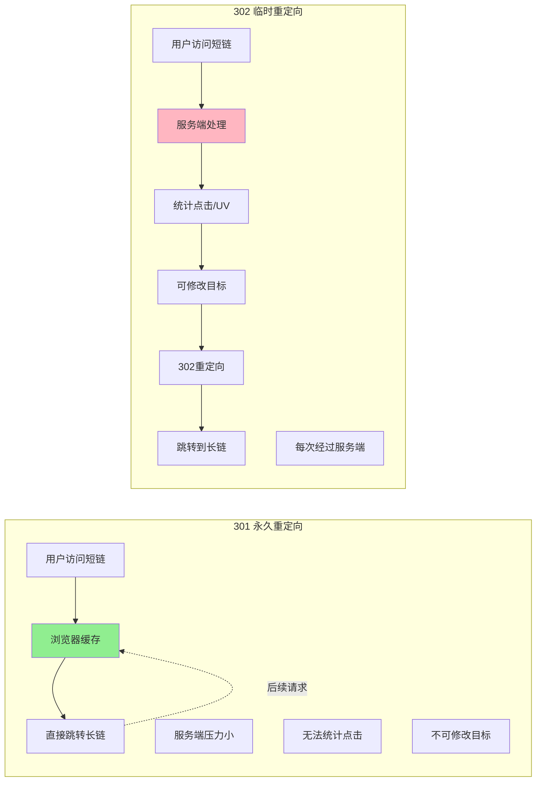

| 特性 | 301 永久重定向 | 302 临时重定向 |
|------|---------------|---------------|
| **缓存行为** | 浏览器本地缓存跳转 | 每次都请求服务端 |
| **性能** | ⭐⭐⭐⭐⭐（无服务端压力） | ⭐⭐⭐（所有流量到后端） |
| **可修改性** | ❌ 无法修改目标 URL | ✅ 可随时修改目标 URL |
| **数据统计** | ❌ 无法统计点击量 | ✅ 可统计点击、UV、PV |
| **适用场景** | 链接永久不变 | 需要统计/动态修改 |
| **生产使用** | 较少 | **更常用** ⭐⭐⭐⭐⭐ |

### 面试话术模板（直接背诵版）

**标准回答**（30 秒版）：
> "短链接跳转我建议选择 **302 临时重定向**，原因是：
> 1. **业务需求**：大多数短链接系统需要统计点击量、UV、地域分布等数据，302 每次请求都经过服务端，方便做埋点统计。
> 2. **灵活性**：后期可以修改短链接的目标 URL，比如活动页面变更，301 则无法修改。
> 3. **并发压力**：302 的缺点是 All 流量都打到后端，需要通过**本地缓存 + Redis + 布隆过滤器**来扛住高并发。
> 
> 如果业务明确不需要统计（如永久资源链接），可以选择 301，直接在 Nginx 层配置跳转，性能更高。"

**加分回答**（展示深度）：
> "实际生产中，我们可以做**混合方案**：
> - 对于**热点短链**（访问频率 > 1000 次/秒），使用 301 + CDN 缓存，减轻服务端压力。
> - 对于**普通短链**，使用 302，保证数据统计能力。
> - 这样既兼顾性能，又满足业务需求。"

**面试官追问**：那如何识别热点短链？
> "可以用 Redis 的 ZSET 记录每个短链的访问次数，超过阈值就标记为热点。同时用本地缓存（Caffeine/GoCache）缓存热点数据，抗 10 万+ QPS。"

---

## 五、高并发优化方案

### 5.1 多级缓存架构

**生活化比喻**：
```
多级缓存就像找信息的三个层次：
L1 本地缓存：就像你的手机通讯录（最快，但容量小）
L2 Redis 缓存：就像公司通讯录（快，容量中等）
L3 MySQL：就像户籍中心（慢，但容量大，永久保存）

热点数据（明星微博）：
瞬间 10 万 QPS，就像 10 万人同时问"小明的电话是多少？"
如果每次都查户籍中心，户籍中心就挂了。
所以：
- 本地缓存：直接查手机（零网络 IO，抗 10 万+ QPS）
- Redis：查公司通讯录（快，但扛不住 10 万 QPS）
- MySQL：最后手段（慢，但可靠）
```

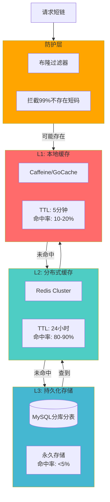

**场景**：某个短链突然爆火（如明星微博），瞬间 10 万 QPS。

**本地缓存优势**：
- ✅ **零网络 IO**（进程内存直接返回，就像查手机通讯录，不用联网）
- ✅ **抗热点**（单节点可扛 10 万+ QPS，就像你一个人能回答 10 万人的问题）
- ✅ **减轻 Redis 压力**（Redis 挂了也不怕，本地缓存还能撑一会）

**代码示例**（Go 语言版）：
```go
// 多级缓存架构
type MultiLevelCache struct {
    localCache  *cache.Cache      // Caffeine/GoCache（本地缓存）
    redisCache  *redis.Client     // Redis（分布式缓存）
    mysqlDB     *gorm.DB          // MySQL（持久化存储）
    bloomFilter *bloom.BloomFilter // 布隆过滤器（防穿透）
}

func (c *MultiLevelCache) Get(shortCode string) (string, error) {
    // L1: 本地缓存（最快，像查手机通讯录）
    if val, ok := c.localCache.Get(shortCode); ok {
        return val, nil
    }
    
    // L2: Redis（快，像查公司通讯录）
    val, err := c.redisCache.Get(shortCode).Result()
    if err == nil {
        c.localCache.Set(shortCode, val, 5*time.Minute) // 回写本地
        return val, nil
    }
    
    // L3: MySQL（慢，但可靠，像查户籍中心）
    mapping, err := c.mysqlDB.Query(shortCode)
    if err == nil {
        c.redisCache.Set(shortCode, mapping.LongURL, 24*time.Hour)
        c.localCache.Set(shortCode, mapping.LongURL, 5*time.Minute)
        return mapping.LongURL, nil
    }
    
    return "", errors.New("not found")
}
```

### 5.2 分库分表策略

**生活化比喻**：
```
分库分表就像把一本大花名册分成多本小册子：
- 按短码分：把所有"张"姓放在一本，"李"姓放在另一本
- 按用户分：把北京用户放在一本，上海用户放在另一本

好处：查找时不用翻整本大册子，只查对应的小册子，速度快。
```

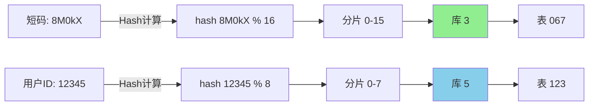

**分片规则**：
| 维度 | 规则 | 适用场景 | 生活化比喻 |
|------|------|----------|------------|
| 短码 Hash | `hash(shortCode) % 16` | 按短码查询（跳转场景） | 按姓氏分花名册 |
| 用户 ID | `userID % 8` | 按用户查询（管理场景） | 按地区分花名册 |

**表结构设计**：
```sql
CREATE TABLE url_mapping_0 (
    id BIGINT PRIMARY KEY,
    short_code VARCHAR(10) UNIQUE NOT NULL,  -- 短码（唯一）
    long_url VARCHAR(2048) NOT NULL,         -- 长 URL
    user_id BIGINT NOT NULL,                 -- 用户 ID
    created_at TIMESTAMP DEFAULT CURRENT_TIMESTAMP,
    expire_at TIMESTAMP,                     -- 过期时间
    status TINYINT DEFAULT 1,                -- 1:有效 0:失效
    INDEX idx_user_id (user_id),             -- 按用户查询
    INDEX idx_expire (expire_at)             -- 按过期时间清理
) ENGINE=InnoDB DEFAULT CHARSET=utf8mb4;
```

### 5.3 过期数据清理

**生活化比喻**：
```
过期数据清理就像清理过期的食品：
方案1：定期大扫除（定时任务）
每天凌晨 2 点，把过期食品扔掉（分批扔，别把垃圾桶撑爆）

方案2：随手清理（延迟删除）
每次拿食品时，看看过期没，过期就扔掉

方案3：按月份分区（分区表）
把食品按月份放在不同房间，过期了整个房间一起清空
```

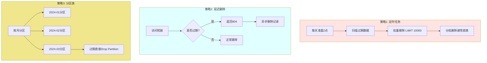

**SQL 示例**：
```sql
-- 定时清理任务（分批删除，别把数据库锁死）
DELETE FROM url_mapping 
WHERE expire_at < NOW() 
LIMIT 10000;
```

### 5.4 限流与防刷

**生活化比喻**：
```
限流就像餐厅限制每人最多点 10 道菜：
- 用户维度：每人每小时最多生成 100 个短链（防恶意生成）
- IP 维度：每个 IP 每分钟最多 1000 次请求（防 DDOS）
- 接口维度：整个系统最多 10000 QPS（保护后端）

限流算法：
- 令牌桶：允许突发流量（像水桶，水满了可以一次性倒很多）
- 漏桶：平滑流量（像漏斗，水流得很均匀）
```

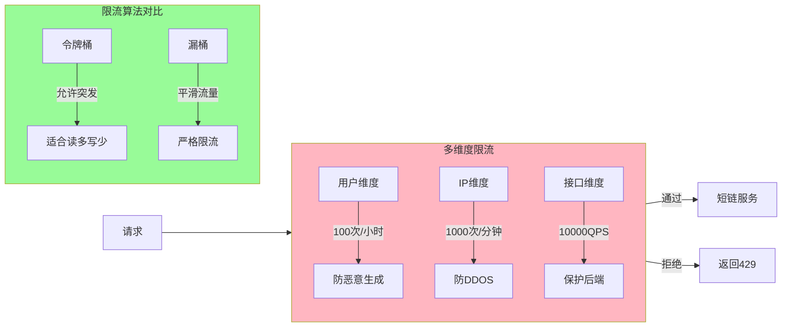

---

## 六、面试追问与深度问题

```mermaid
graph TB
    subgraph Q1["Q1: 如何保证短码唯一性?"]
        A1[分布式发号器] --> A2[雪花算法]
        A2 --> A3[时间戳+机器ID+序列号]
        A3 --> A4[全局唯一]
        A4 --> A5[Base62确定性映射]
        A5 --> A6[无碰撞]
    end
    
    subgraph Q2["Q2: 相同长URL重复生成?"]
        B1[方案1: 允许重复] --> B2[每次新短码]
        B3[方案2: 去重优化] --> B4[先查长URL是否存在]
        B4 --> B5[存在返回旧短码]
        B5 --> B6[需加分布式锁]
    end
    
    subgraph Q3["Q3: 容量规划?"]
        C1[日活1000万] --> C2[每人5个/天]
        C2 --> C3[5000万/天]
        C3 --> C4[6位Base62容量568亿]
        C4 --> C5[可支撑8年]
        C5 --> C6[存储2.5GB/天]
    end
    
    subgraph Q4["Q4: 布隆过滤器误判?"]
        D1[误判: 误认为存在] --> D2[查MySQL]
        D2 --> D3[查不到返回404]
        D4[调整参数] --> D5[比特数组大小]
        D5 --> D6[Hash函数数量]
        D6 --> D7[控制误判率<1%]
    end
    
    subgraph Q5["Q5: 点击量统计?"]
        E1[实时统计] --> E2[Redis INCR]
        E3[异步统计] --> E4[MQ消息]
        E4 --> E5[消费者写入统计库]
        E6[CDN统计] --> E7[CDN日志分析]
    end
    
    style Q1 fill:#FFE4E1
    style Q2 fill:#E0FFFF
    style Q3 fill:#F0E68C
    style Q4 fill:#DDA0DD
    style Q5 fill:#90EE90
```

### 详细回答（面试话术）

**Q1: 如何保证短码的唯一性？**  
**答**：依赖分布式发号器的唯一性。雪花算法通过时间戳 + 机器 ID + 序列号保证全局唯一（就像身份证号），Base62 编码是确定性映射（123456789 永远翻译成 "8M0kX"），不会产生碰撞。

**Q2: 如果两个用户同时生成同一个长 URL 的短链，怎么办？**  
**答**：两种方案：
1. **允许重复**：每次生成新的短码（简单，但浪费存储，就像给同一个人发两张不同的名片）
2. **去重优化**：先查长 URL 是否已存在，存在则返回旧短码（需加分布式锁，就像先查花名册，看这个人在不在）

**Q3: 短链接系统如何做容量规划？**  
**答**：
- 日活 1000 万，每人每天生成 5 个短链 → 5000 万/天
- 6 位 Base62 容量 568 亿，可支撑 **3000+ 天**（约 8 年），就像一个大仓库，够装 8 年的货物
- 存储：50 字节/条 × 5000 万 = 2.5 GB/天
- MySQL 分 16 库，每库每天 150 MB，完全可控

**Q4: 布隆过滤器的误判率如何处理？**  
**答**：布隆过滤器有误判（可能误认为存在，但不会误认为不存在），处理方案：
- 误判时查 MySQL，查不到返回 404（就像门禁系统放你进去了，但办公室发现你不在）
- 调整比特数组大小和 Hash 函数数量，控制误判率 < 1%
- 定期重建（删除过期数据后）

**Q5: 如何统计短链接的点击量？**  
**答**：
- **实时统计**：每次跳转写 Redis（INCR 命令），就像计数器
- **异步统计**：跳转时发 MQ 消息，消费者异步写入统计库（不阻塞主流程）
- **CDN 统计**：如果用 CDN，可直接看 CDN 日志（最准确）

---

## 七、面试回答提纲（30 秒版）

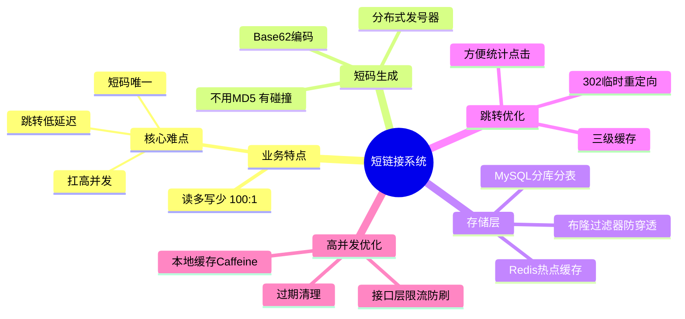

**标准回答模板**（直接背诵）：

> **业务特点**：读多写少（100:1），核心难点是**短码唯一、跳转低延迟、扛高并发**。
> 
> **短码生成**：不用 MD5（有碰撞），用**分布式发号器 + Base62 编码**，保证天然唯一、无碰撞。
> 
> **存储层**：MySQL 分库分表持久化，Redis 做热点缓存，布隆过滤器防穿透。
> 
> **跳转优化**：用 302 临时重定向（方便统计），通过**本地缓存 + Redis + MySQL**三级缓存扛并发。
> 
> **高并发**：热点短链用本地缓存（Caffeine），抗 10 万+ QPS；接口层限流防刷。

---

## 八、生产环境 Checklist（部署检查清单）

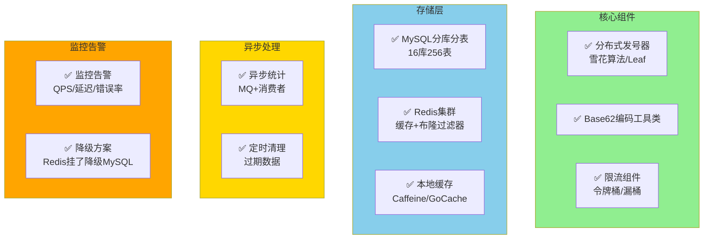

**部署检查清单**：

| 类别 | 检查项 | 状态 | 生活化比喻 |
|------|--------|------|------------|
| **核心组件** | 分布式发号器（雪花算法/Leaf） | ⬜ | 自动编号机 |
| | Base62 编码工具类 | ⬜ | 翻译器 |
| | 限流组件（令牌桶/漏桶） | ⬜ | 餐厅限流 |
| **存储层** | MySQL 分库分表（16 库 256 表） | ⬜ | 分本花名册 |
| | Redis 集群（缓存 + 布隆过滤器） | ⬜ | 快速查询表 + 门禁 |
| | 本地缓存（Caffeine/GoCache） | ⬜ | 手机通讯录 |
| **异步处理** | 异步统计（MQ + 消费者） | ⬜ | 记账员 |
| | 定时清理过期数据 | ⬜ | 清洁工 |
| **监控告警** | 监控告警（QPS、延迟、错误率） | ⬜ | 保安巡逻 |
| | 降级方案（Redis 挂了降级到 MySQL） | ⬜ | 备用方案 |

---

## 九、总结（一句话带走）

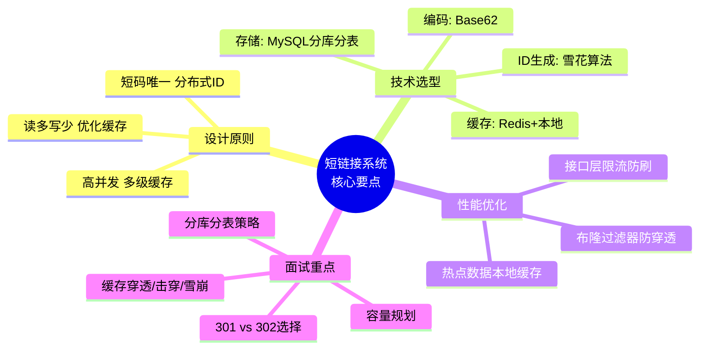

### 🎯 一句话总结

> **短链接系统 = 分布式发号器（保证唯一） + Base62 编码（缩短长度） + 三级缓存（扛高并发） + 302 重定向（方便统计）**

### 🧠 核心记忆点

1. **为什么不用 MD5？** 有碰撞，像取昵称只取最后一个字，会重名。
2. **为什么用 302？** 方便统计点击，像邮局每次都来问你"转寄到哪里"。
3. **如何扛高并发？** 本地缓存（手机通讯录）+ Redis（公司通讯录）+ MySQL（户籍中心）。
4. **如何防穿透？** 布隆过滤器（门禁系统）+ 空值缓存（"查无此人"也记下来）。

---

**参考视频**：[内卷的琪某人 - 面试经典：如何设计高并发短链接系统](https://v.douyin.com/6frkTBtg3m4/)

---

*本文档基于 8 个专家提示词指导改写，遵循深入浅出、生活化比喻、幽默风趣的教学原则。*
