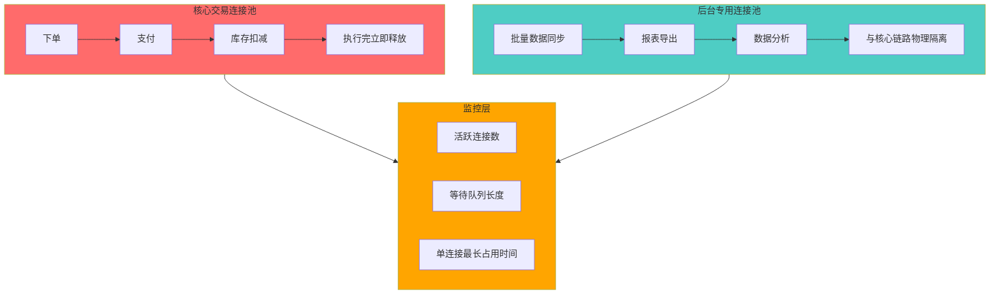
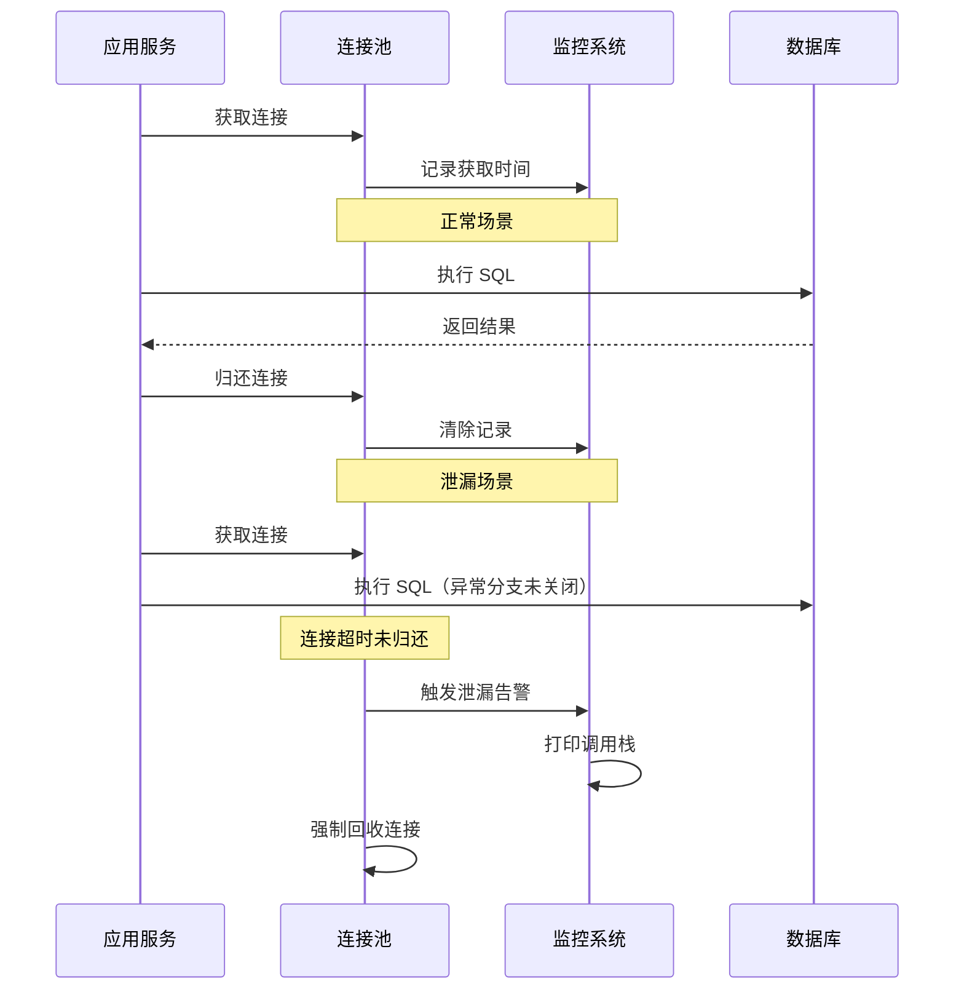
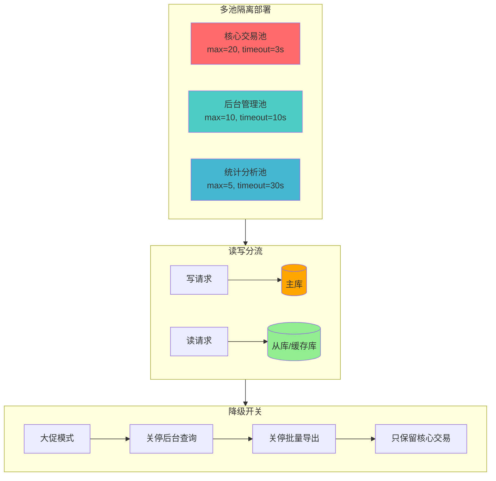
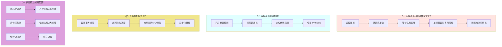

# 数据库连接池优化

> **场景定位**：数据库性能优化技术场景  
> **核心设计要点**：连接泄漏、长事务、业务分级隔离、监控告警、架构层优化

---

## 🎯 一句话定位

**数据库连接池优化解决什么问题？**
```
你以为配好几个参数就能用好连接池，
却没想到长事务占用、异常分支漏释放、嵌套事务未及时提交
都会慢慢耗光连接，最终拖垮整个服务。
```

**生活化比喻**：
就像一家银行只有 5 个柜台，如果每个客户办完业务不及时离开，后面排队的人就永远等不到。连接池优化就是让"柜台"高效周转——短业务快速办完走人，长业务去专用窗口，再装个监控发现"占着茅坑不拉屎"的人直接请出去。

**核心特点**：连接池不是越大越好，而是全生命周期治理。

---

## 💎 核心观点（5 分钟速览版）

> **快速概览**

### 核心观点（3 个关键点）

**1. 第一层防御：业务分级隔离连接占用**
```
短事务核心场景（下单/支付/库存扣减）：
  → 严格收敛事务范围，执行完立即释放连接
  → 杜绝长事务和大事务

长耗时场景（批量同步/报表导出）：
  → 单独分配专用连接池
  → 与核心交易链路物理隔离
  → 避免长连接挤占核心资源
```

**2. 第二层防御：兜底监控与泄漏治理**
```
全维度连接监控：
  → 实时追踪活跃连接数、等待队列长度、单连接最长占用时间
  → 超标立即告警并摘除异常节点

连接泄露检测：
  → 开启连接池泄露检测开关
  → 超出阈值未释放的连接自动打印调用栈 + 强制回收

事务超时强制回滚：
  → 设置全局事务最大执行时长
  → 超时自动回滚并释放连接
```

**3. 第三层防御：架构层优化**
```
多池隔离部署：
  → 核心交易/后台/管理/统计/分析 分别配置独立连接池

读写分流减负：
  → 读请求优先走缓存库连接池，分摊主库压力

核心场景降级开关：
  → 大促高峰期自动关停非核心的后台查询/批量导出接口
  → 宁可牺牲运营效率，也要保证核心交易链路连接充足
```

---

## 🚀 一句话精华（如果只能记住一句）

> **连接池优化 = 业务分级隔离（短事务/长事务分开） + 兜底监控（泄漏检测+超时回滚） + 架构优化（多池隔离+读写分流+降级开关）**

---

## 一、真实线上事故：连接池被打满的噩梦

### 事故场景

```
电商平台核心服务高峰期突然大面积报错：
- 用户下单超时 ❌
- 查订单失败 ❌
- 健康检查都拿不到连接 ❌

监控显示：
- 数据库主库连接池被彻底打满
- 所有新请求都在排队等连接
- 运维紧急重启后暂时恢复
- 不到半小时连接又被占满

排查发现：
- ✅ 没有慢查询
- ✅ CPU 执行效率正常
- ✅ 代码里都规范关闭了连接

问题到底出在哪？
```

**生活化比喻**：
```
就像一家餐厅，厨师做菜速度正常，
但服务员端着菜在厨房不出来（连接被占用不释放），
外面的顾客永远等不到菜。

重启服务 = 把服务员都叫出来重新排队，
但如果不解决"端着菜不出来"的根本问题，
过一会儿又会堵满。
```

### 根因分析

| 隐形陷阱 | 说明 | 生活化比喻 |
|----------|------|------------|
| **长事务占用** | 事务执行时间过长，连接迟迟不释放 | 客户在柜台办大额贷款，后面排队的人干等 |
| **异常分支漏释放** | try-catch 中没有正确 close 连接 | 接了电话忘记挂，线路一直被占着 |
| **嵌套事务未提交** | 内层事务未提交导致外层连接挂起 | 俄罗斯套娃，最里面的没关上，外面全打不开 |
| **连接泄漏** | 代码路径中有未关闭的连接 | 水龙头没关紧，水一直在流 |

---

## 二、三层防御体系详解

### 2.1 第一层：业务分级隔离

**生活化比喻**：
```
就像银行分窗口：
- 快速业务窗口：存取款、转账（30 秒搞定）
- 复杂业务窗口：贷款、开户（可能需要 30 分钟）

如果让办贷款的人和存取款的人排同一个队，
存取款的人就会被堵死。

连接池也要这样分：
- 核心交易池：短事务，快进快出
- 后台任务池：长事务，慢慢处理
- 两套池子互不影响
```



**关键配置原则**：
```
核心交易池：
  - 最大连接数：根据 CPU 核心数计算（CPU * 2 + 磁盘数）
  - 连接超时：1~3 秒，超时快速失败
  - 事务超时：设置全局最大执行时长

后台任务池：
  - 独立配置，不影响核心交易
  - 可以设置更大的连接超时
  - 允许较长的执行时间
```

### 2.2 第二层：兜底监控与泄漏治理

**生活化比喻**：
```
就像给每个柜台装摄像头 + 计时器：
- 摄像头：实时监控每个窗口有没有人
- 计时器：记录每个人办了多久
- 保安：发现有人超过 30 分钟还没办完，直接上去问

连接池监控也一样：
- 监控面板 = 摄像头（实时看连接状态）
- 泄漏检测 = 计时器（超时自动报警）
- 强制回收 = 保安（超时直接收回连接）
```



**代码示例**（HikariCP 泄漏检测配置）：
```java
HikariConfig config = new HikariConfig();

// 核心参数
config.setMaximumPoolSize(20);          // 最大连接数
config.setMinimumIdle(5);               // 最小空闲连接
config.setConnectionTimeout(3000);      // 获取连接超时 3 秒
config.setIdleTimeout(600000);          // 空闲连接存活 10 分钟
config.setMaxLifetime(1800000);         // 连接最大存活 30 分钟

// 泄漏检测（关键！）
config.setLeakDetectionThreshold(30000); // 超过 30 秒未归还，打印调用栈

// 事务超时
config.setValidationTimeout(5000);      // 连接有效性检测超时 5 秒
```

### 2.3 第三层：架构层优化

**生活化比喻**：
```
架构优化就像城市规划：
- 多池隔离 = 不同区域建不同的医院（社区医院/三甲医院）
- 读写分流 = 看病和体检分开（减少排队）
- 降级开关 = 疫情期间暂停非紧急门诊（保重症）
```



---

三、技术深入探讨

### 3.1 为什么连接数不是越大越好？

**生活化比喻**：
```
就像餐厅不是厨师越多越好：
- 厨师太多，厨房挤不下（线程上下文切换）
- 抢锅抢灶台（锁竞争加剧）
- 真正做菜的效率反而下降

数据库也一样：
- 连接数远超 CPU 核心数 → 线程频繁切换
- 并发连接越多 → 锁等待队列越长
- 最终结果：吞吐量不升反降
```

| 连接数 | CPU 利用率 | 吞吐量 | 说明 |
|--------|-----------|--------|------|
| CPU 核心数 × 1~2 | 最高 | 最优 | 🟢 最佳区间 |
| CPU 核心数 × 4 | 较高 | 开始下滑 | 🟡 警告区间 |
| CPU 核心数 × 10+ | 大量浪费在切换 | 断崖下跌 | 🔴 危险区间 |

3.2 技术方案（直接应用版）

**方案参考**（30 秒版）：
> "连接池优化我建立三层防御：
> 1. **业务分级隔离**：短事务核心场景（下单/支付）严格收敛事务范围，执行完立即释放连接；长耗时场景（批量同步/报表导出）单独分配专用连接池，物理隔离。
> 2. **兜底监控与泄漏治理**：开启连接池泄漏检测，超时未归还的连接自动打印调用栈并强制回收；设置全局事务超时，超时自动回滚释放连接。
> 3. **架构层优化**：核心交易/后台/统计分别配置独立连接池，读写分离分摊主库压力，大促期间降级非核心接口，保核心交易链路。"

**加分回答**（展示深度）：
> "实际项目中我还发现，很多团队出了问题只会调大连接数，这是典型的'头痛医头'。连接池的瓶颈往往不在连接数，而在事务管理。一个长事务占着连接 30 秒，比你加 10 个连接的危害还大。所以核心是**事务治理**，不是连接数调优。"

---

## 四、技术追问与深度问题



### 详细回答

**Q1: 连接池耗尽如何快速定位？**  
**答**：先看监控面板——活跃连接数是否打满、等待队列是否堆积、单连接最长占用时间是否异常。如果开启泄漏检测，直接看调用栈日志，定位是哪段代码获取了连接没归还。

**Q2: 连接泄漏怎么排查？**  
**答**：HikariCP 开启 `leakDetectionThreshold`（如 30 秒），超过时间未归还的连接会打印完整调用栈。根据调用栈定位代码路径，通常是 try-catch 中没有 finally 关闭连接，或者异常分支遗漏了 close。

**Q3: 长事务如何处理？**  
**答**：三个手段——①设置全局事务超时（如 30 秒），超时自动回滚；②大事务拆小事务，能异步的异步化；③批量操作分批提交，不要一个事务处理 10 万条数据。

**Q4: 多连接池如何配置？**  
**答**：核心交易池（max=20, timeout=3s）、后台任务池（max=10, timeout=10s）、统计分析池（max=5, timeout=30s）。核心池优先级最高，保证核心链路连接充足；非核心池隔离部署，即使出问题也不影响核心交易。

---

## 五、生产环境 Checklist

| 类别 | 检查项 | 状态 | 生活化比喻 |
|------|--------|------|------------|
| **业务分级** | 核心交易/后台任务连接池隔离 | ⬜ | 银行分窗口 |
| **连接监控** | 活跃连接数/等待队列/占用时间告警 | ⬜ | 摄像头+计时器 |
| **泄漏检测** | 开启 leakDetectionThreshold | ⬜ | 保安巡逻 |
| **事务超时** | 全局事务超时自动回滚 | ⬜ | 柜台限时服务 |
| **读写分离** | 读请求走从库/缓存库 | ⬜ | 体检和看病分开 |
| **降级开关** | 大促期间关停非核心接口 | ⬜ | 疫情暂停非紧急门诊 |
| **连接池选型** | HikariCP/Druid 配套参数合理 | ⬜ | 选对工具 |

---

## 六、总结（一句话带走）

> **连接池优化 = 业务分级隔离 + 兜底监控（泄漏检测+超时回滚） + 架构优化（多池隔离+读写分流+降级开关）**

### 🧠 核心记忆点

1. **连接池不是越大越好**——连接数远超 CPU 核心数会导致线程切换开销和锁竞争加剧，吞吐量反降。
2. **三层防御缺一不可**——业务分级隔离（短事务/长事务分开）→ 兜底监控（泄漏检测+超时回滚）→ 架构优化（多池隔离+读写分流+降级开关）。
3. **核心是事务治理，不是连接数调优**——一个长事务的危害比加 10 个连接还大。

---

**参考视频**：[内卷的琪某人 - 场景提问：数据库连接池怎么优化？](https://www.douyin.com/video/7659367536047181102)

---

*本文档基于 8 个专家提示词指导改写，遵循深入浅出、生活化比喻、幽默风趣的教学原则。*
