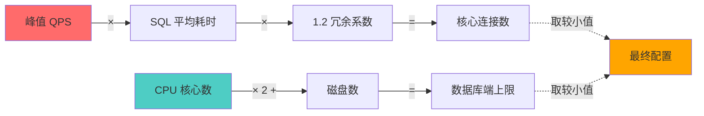
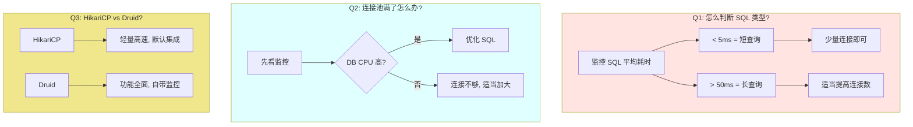

# 数据库连接池参数计算

> **场景定位**：数据库性能调优技术场景  
> **核心设计要点**：连接数计算公式、SQL 类型判断、连接数过大后果、连接池选型

---

## 🎯 一句话定位

**数据库连接池参数计算解决什么问题？**
```
场景提问：核心连接数 10 是怎么来的？20 的上限依据是什么？
你：经验值，网上教程都这么配...

❌ 背答案的当场现原形！
核心要求是推导过程，不是"行业惯例"。
```

**生活化比喻**：
就像开餐厅，不是厨师越多越好——厨房就这么大，厨师太多反而互相撞、抢锅灶。连接数的计算也一样，要根据"厨房大小"（CPU 核心数）和"做菜速度"（SQL 执行时长）来算，不是拍脑袋填个数。

---

## 💎 核心观点（5 分钟速览版）

> **快速概览**

### 核心观点（4 个关键点）

**1. 核心连接数的底层计算公式**
```
数据库端基准公式：
  最优活跃连接数 ≈ CPU 核心数 × 2 + 磁盘数

业务端估算公式（更实用）：
  核心连接数 ≈ 业务峰值 QPS × 单条 SQL 平均执行时长 × 1.2（20%冗余）

举例：
  峰值 QPS = 500
  平均 SQL 耗时 = 10ms = 0.01s
  核心连接数 = 500 × 0.01 × 1.2 = 6

所以"核心连接数 10"在低 QPS 场景下是合理的，
但它不是万能的！
```

**2. SQL 类型决定连接数配置**
```
短查询密集型（单表查询/毫秒级耗时）：
  → 连接占用时间极短
  → 少量连接就能支撑很高 QPS
  → 不需要大连接数

长查询 IO 密集型（多表连查/大范围分页/排序聚合）：
  → 连接占用时间长
  → 可以适当提高连接数
  → 但依然有明确上限
```

**3. 连接数过大的真实后果**
```
线程上下文切换开销：
  → 每个连接对应一个工作线程
  → 连接数远超 CPU 核心数 → 频繁线程调度
  → 大量 CPU 时间耗在"切换"而不是"执行"

锁竞争加剧：
  → 并发连接越多，争抢行锁/元数据锁概率越高
  → 锁等待队列拉长，吞吐量不升反降

行业实测数据：
  → MySQL 单实例最优活跃连接数 = CPU 核心数的 1~2 倍
  → 达到 4 倍时性能开始明显下滑
  → 超过 10 倍后吞吐量断崖式下跌
```

**4. 连接池选型与配套参数**
```
HikariCP：
  → 轻量高速，Spring Boot 默认集成
  → 适合绝大多数常规业务

Druid：
  → 功能全面，自带监控/防火墙/统计/分析
  → 适合需要精细化管控的项目

关键配套参数：
  → 连接超时：1~3 秒（超时快速失败）
  → 空闲回收：定时回收闲置连接
  → 有效性检测：心跳 SQL 定期校验
```

---

## 🚀 一句话精华（如果只能记住一句）

> **连接池参数 = 峰值 QPS × SQL 平均耗时 × 1.2（冗余） → 但不是越大越好，超过 CPU×2 性能就下滑**

---

## 一、核心问题是什么？

### 经典技术对话还原

```
场景提问：你们数据库连接池核心连接数设了多少？
候选人：核心 10，最大 20，行业通用配置。

场景提问：那我问你——
  10 是怎么来的？
  20 的上限依据是什么？
  你们的 SQL 是短查询多还是长查询多？
  把核心连接数拉到 50，吞吐量会不会翻倍？

候选人：......（支支吾吾）
```

**生活化比喻**：
```
场景提问你"工资多少"，你说"月薪一万"。
技术追问"一万怎么算的？按什么标准？你的市场价是多少？"
你说"网上都这么开"——这不就露馅了吗？

连接池参数也一样，
背一个"10"谁都会，
但说不出"10 怎么来的"，
就能判断出你是抄的。
```

---

## 二、核心连接数的底层推导逻辑

### 2.1 数据库端基准公式

**生活化比喻**：
```
想象一个厨房：
- CPU 核心数 = 灶台数量
- 磁盘数 = 帮手数量
- 连接 = 同时做菜的厨师

一个灶台最多配 2 个厨师（一个炒菜、一个备料），
再加几个帮手（磁盘 IO），
这就是厨房的最大合理人手。

厨师再多？厨房挤不下，互相撞！
```

```
公式：最优活跃连接数 ≈ CPU 核心数 × 2 + 磁盘数

举例：
  数据库服务器 8 核 CPU + 4 块磁盘
  → 最优连接数 = 8 × 2 + 4 = 20

这就是数据库端的"天花板"。
业务端配置不能超过这个值。
```

### 2.2 业务端估算公式（更实用）

```
核心连接数 ≈ 业务峰值 QPS × 单条 SQL 平均执行时长 × 1.2（20%冗余）

推导过程：
  假设峰值每秒 500 个请求
  每个 SQL 平均执行 10ms = 0.01 秒
  那么同一时刻正在执行的 SQL = 500 × 0.01 = 5 条
  再加 20% 冗余 → 5 × 1.2 = 6 个连接

  所以核心连接数设 6~10 就够了
```



### 2.3 实战判断方法

```
怎么知道你的 SQL 是什么类型？

看监控：
  1. SQL 平均耗时 < 5ms → 短查询密集
  2. 活跃连接常年打满但 DB CPU 很低 → 连接不够用，但不是 SQL 慢
  3. 活跃连接打满且 DB CPU 很高 → SQL 本身就慢，优化 SQL 优先

判断决策树：
  SQL 平均耗时 < 5ms？
    → 是：短查询密集，少量连接即可
    → 否：继续看
  多表连查/大范围扫描？
    → 是：IO 密集型，适当提高连接数
    → 否：优化 SQL 才是正道
```

---

## 三、连接数过大的真实后果

### 3.1 线程上下文切换

**生活化比喻**：
```
你是一个老师，同时教 5 个班（5 个连接），
每个班问一个问题，你轮流回答——很高效。

但如果同时教 100 个班（100 个连接），
你在 100 个班之间来回跑，
光跑的时间就累死了，
真正讲课的时间反而很少。

这就是"上下文切换"的代价。
```

| 连接数 vs CPU 核心数 | CPU 时间用于执行 SQL | CPU 时间用于线程切换 | 效果 |
|---------------------|--------------------|--------------------|------|
| 1:1 | 95% | 5% | 🟢 最优 |
| 2:1 | 85% | 15% | 🟢 可接受 |
| 4:1 | 60% | 40% | 🟡 性能下滑 |
| 10:1 | 20% | 80% | 🔴 断崖下跌 |

### 3.2 锁竞争加剧

```
并发连接越多：
  → 争抢行锁的概率越高
  → 争抢元数据锁的概率越高
  → 锁等待队列越来越长
  → 最终结果：连接多了，吞吐量反而降了

就像 10 个人同时挤一个窗口取钱，
不是人多了就快，
而是大家都在排队等锁。
```

### 3.3 行业实测数据

```
常规 OLTP 业务下：
  MySQL 单实例最优活跃连接数 = CPU 核心数的 1~2 倍 ✅
  达到 4 倍时 → 性能开始明显下滑 ⚠️
  超过 10 倍后 → 吞吐量断崖式下跌 ❌

所以如果你的数据库是 8 核：
  最优连接数：8~16
  警告线：32
  危险线：80+
```

---

## 四、连接池选型与配套参数

### 4.1 主流连接池对比

| 连接池 | 特点 | 适用场景 | 生活化比喻 |
|--------|------|----------|------------|
| **HikariCP** | 轻量高速，Spring Boot 默认 | 绝大多数常规业务 | 经济型轿车——省油、好开 |
| **Druid** | 功能全面，自带监控/防火墙/统计 | 需要精细化管控的项目 | SUV——功能多、能越野 |
| **C3P0** | 老旧，性能一般 | 遗留系统 | 老爷车——还能跑，但别追求性能 |

### 4.2 关键配套参数

```java
// HikariCP 推荐配置
HikariConfig config = new HikariConfig();

// 核心参数（根据公式计算）
config.setMaximumPoolSize(20);          // 最大连接数
config.setMinimumIdle(5);               // 最小空闲连接

// 超时参数（关键！防止请求堆积）
config.setConnectionTimeout(3000);      // 获取连接超时 3 秒
                                        // 不宜过长，超时快速失败

// 回收参数
config.setIdleTimeout(600000);          // 空闲连接存活 10 分钟
config.setMaxLifetime(1800000);         // 连接最大存活 30 分钟

// 有效性检测
config.setValidationTimeout(5000);      // 连接有效性检测超时 5 秒
config.setConnectionTestQuery("SELECT 1"); // 心跳 SQL
```

**参数设计原则**：
```
连接超时：1~3 秒
  → 不宜过长，超时快速失败，避免请求堆积拖垮服务

空闲回收：10 分钟
  → 定时回收闲置连接，避免无效占用

有效性检测：心跳 SQL 定期校验
  → 防止业务拿到失效连接直接报错
```

---

五、技术方案

### 方案参考

> "连接池参数的设置不是拍脑袋，而是有推导过程的。
> 
> **核心连接数** = 业务峰值 QPS × 单条 SQL 平均执行时长 × 1.2（冗余）。比如峰值 500 QPS，SQL 平均 10ms，核心连接数 = 500 × 0.01 × 1.2 = 6，配 10 足够。
>
> **上限依据**是数据库端的基准公式：CPU 核心数 × 2 + 磁盘数。超过这个值，线程上下文切换和锁竞争会加剧，吞吐量反降。
>
> **连接池选型**我们用的 HikariCP，配套参数：连接超时 3 秒（快速失败）、空闲回收 10 分钟、心跳检测定期校验。"

### 加分回答（展示深度）

> "实际项目中我还发现，判断 SQL 类型比计算连接数更重要。短查询密集型（毫秒级单表查询）不需要大连接数，少量连接就能支撑高 QPS；长查询 IO 密集型（多表连查、大范围分页）才需要适当提高连接数。但如果活跃连接常年打满而 DB CPU 很低，优先优化 SQL，而不是盲目加连接。"

---

## 六、技术追问与深度问题



**Q1: 把核心连接数拉到 50，吞吐量会不会翻倍？**  
**答**：不会。连接数远超 CPU 核心数时，线程上下文切换和锁竞争会抵消增加连接带来的收益，吞吐量反而下降。实测超过 CPU×4 性能就开始明显下滑。

**Q2: 你们项目用的什么连接池？为什么？**  
**答**：HikariCP，因为轻量高速，Spring Boot 默认集成，运行开销低。如果需要更全面的监控和防火墙能力，可以选 Druid。

**Q3: 连接超时设多长合适？**  
**答**：1~3 秒。超时快速失败，避免请求堆积拖垮服务。设太长会导致大量请求排队等待，最终雪崩。

---

## 七、总结（一句话带走）

> **连接池参数 = 峰值 QPS × SQL 平均耗时 × 1.2 → 但不能超过 CPU×2+磁盘数 → 超过就适得其反**

### 🧠 核心记忆点

1. **公式记住**：核心连接数 = 峰值 QPS × SQL 平均耗时 × 1.2
2. **上限记住**：数据库端最优 = CPU×2 + 磁盘数，超过 4 倍就下滑
3. **核心认知**：连接池不是越大越好，瓶颈永远在数据库本身

---

**参考视频**：[内卷的琪某人 - 场景提问：你们数据库连接池核心连接数设了多少？怎么算出来的？](https://www.douyin.com/video/7658249340627979558)

---

*本文档基于 8 个专家提示词指导改写，遵循深入浅出、生活化比喻、幽默风趣的教学原则。*
