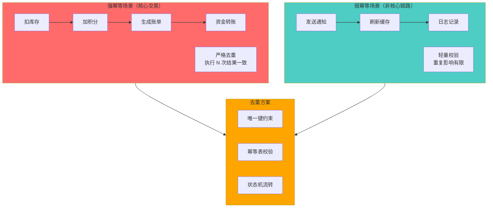
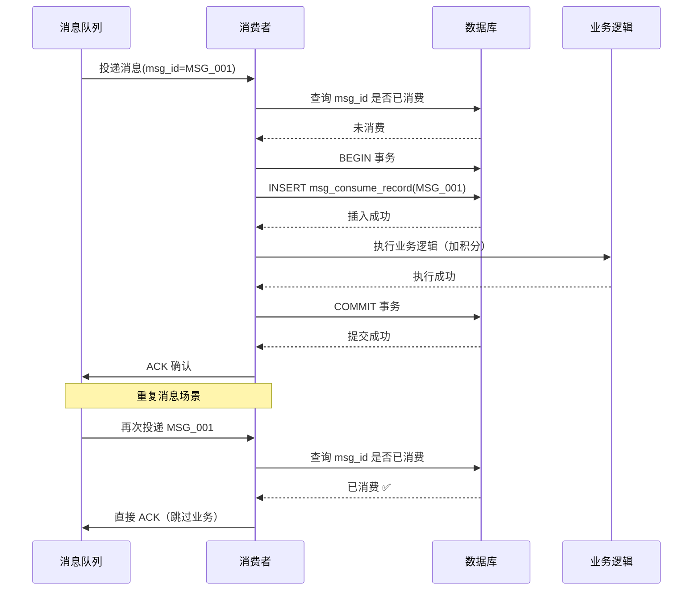
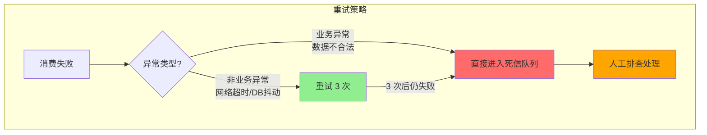
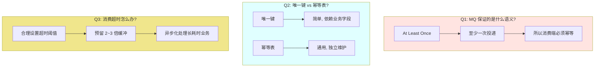

# 消息队列可靠性

> **场景定位**：消息中间件技术场景  
> **核心设计要点**：幂等性、消息去重、死信队列、消费超时、分布式场景

---

## 🎯 一句话定位

**消息队列可靠性解决什么问题？**
```
你以为开启持久化 + 生产者确认 + 消费者手动 ACK 就不会丢消息了。
却没想到网络重传、消费超时、服务重启
都会导致消息重复消费，引发业务数据异常。
```

**生活化比喻**：
就像快递系统——你寄了一个包裹（发消息），快递公司保证送到（持久化+确认机制）。但如果快递员送了两份（重复投递），收件人签收了两次，你就尴尬了。消息队列的可靠性不只是"不丢"，还有"不重"。

---

## 💎 核心观点（5 分钟速览版）

> **快速概览**

### 核心观点（3 个关键点）

**1. 第一层：业务分级，区分强幂等与弱幂等场景**
```
强幂等场景（核心交易链路）：
  → 加积分、扣库存、生成账单
  → 必须严格去重
  → 同一条消息执行多少次结果都一致

弱幂等场景（非核心链路）：
  → 发送通知、刷新缓存
  → 重复执行影响有限
  → 轻量校验或容错处理即可
```

**2. 第二层：消费端兜底与去重校验**
```
数据库唯一键约束：
  → 业务唯一 ID 建唯一索引
  → 重复插入直接报错
  → 从底层杜绝重复数据

幂等表校验：
  → 单独维护消息消费记录表
  → 消费前先查是否已处理
  → 业务逻辑 + 插入记录放在同一事务内

状态机流转：
  → 只允许状态向前流转
  → 重复消息遇到"已完成"状态直接忽略
```

**3. 第三层：架构层优化，减少重复消费概率**
```
生产端去重：
  → 发送消息时携带唯一业务标识
  → 配合 MQ 端去重能力
  → 从源头降低重复投递

消费超时优化：
  → 合理设置消费超时阈值
  → 避免业务执行慢导致 MQ 误判失败而重发

失败分级重试：
  → 非业务异常才触发重试
  → 业务逻辑异常直接进入死信队列
  → 避免无限重试放大问题
```

---

## 🚀 一句话精华（如果只能记住一句）

> **消息队列可靠性 = 业务分级（强/弱幂等） + 消费端去重（唯一键/幂等表/状态机） + 架构优化（生产端去重+超时优化+死信队列）**

---

## 一、真实线上事故：双倍积分灾难

### 事故场景

```
业务场景：
  用户支付成功后 → 订单服务发一条 MQ 消息 → 积分服务发放积分

问题：
  用户反馈：只付了一次款，账户里到了双倍积分 💰💰
  财务对账：多处数据不平

排查日志：
  ✅ 订单服务只投递了一次消息
  ❌ 积分服务却执行了两次消费逻辑

问题出在哪？
```

**生活化比喻**：
```
就像你给老板发了一封请假邮件（发了一条消息），
但老板收到了两封（网络重传），
批了两次假（消费了两次），
HR 给你算了双倍工资（双倍积分）。

你说你只请了一天假，
但系统记录你请了两天——
这就是消息重复消费的灾难。
```

### 根因分析

| 重复原因 | 说明 | 发生概率 |
|----------|------|----------|
| **网络重传** | 生产者发送后没收到 ACK，重新发送 | 高 |
| **消费超时** | 消费者处理太慢，MQ 认为失败了重发 | 中 |
| **服务重启** | 消费者处理到一半宕机，重启后重新消费 | 中 |
| **Broker 故障** | 主节点挂了，从节点有重复消息 | 低 |

---

## 二、三层幂等防线详解

### 2.1 第一层：业务分级

**生活化比喻**：
```
就像医院分诊：
- 急诊（强幂等）：手术、抢救 → 必须精确，不能出错
- 门诊（弱幂等）：感冒开药 → 多开一次影响不大

消息队列也一样：
- 核心交易（强幂等）：扣库存、加积分、生成账单 → 严格去重
- 非核心链路（弱幂等）：发通知、刷新缓存 → 轻量校验即可
```



### 2.2 第二层：消费端去重校验

#### 方案一：数据库唯一键约束

```sql
-- 积分表加唯一索引
CREATE TABLE user_points (
    id BIGINT PRIMARY KEY,
    user_id BIGINT NOT NULL,
    points INT NOT NULL,
    order_no VARCHAR(64) UNIQUE NOT NULL,  -- 订单号唯一索引
    created_at TIMESTAMP DEFAULT CURRENT_TIMESTAMP
);

-- 重复插入会报错，天然幂等
INSERT INTO user_points (user_id, points, order_no) 
VALUES (123, 100, 'ORDER_20240101_001');

-- 第二次插入同样的 order_no → Duplicate entry → 忽略
```

**生活化比喻**：就像身份证号码唯一，一个人不可能办两张身份证号一样的身份证。

#### 方案二：幂等表校验

```sql
-- 消息消费记录表
CREATE TABLE msg_consume_record (
    id BIGINT PRIMARY KEY,
    msg_id VARCHAR(128) UNIQUE NOT NULL,  -- 消息唯一 ID
    status TINYINT DEFAULT 0,             -- 0:处理中 1:已完成
    created_at TIMESTAMP DEFAULT CURRENT_TIMESTAMP
);

-- 消费逻辑（同一事务内）
BEGIN;
  -- 1. 插入消费记录（唯一键防重）
  INSERT INTO msg_consume_record (msg_id, status) VALUES ('MSG_001', 1);
  
  -- 2. 执行业务逻辑
  UPDATE user_points SET points = points + 100 WHERE user_id = 123;
COMMIT;

-- 如果 msg_id 重复 → 插入失败 → 整个事务回滚 → 天然幂等
```



#### 方案三：状态机流转

```java
// 订单状态机
public enum OrderStatus {
    CREATED(0),      // 待支付
    PAID(1),         // 已支付
    SHIPPED(2),      // 已发货
    COMPLETED(3),    // 已完成
    CANCELLED(-1);   // 已取消
    
    // 只允许状态向前流转
    public boolean canTransitTo(OrderStatus target) {
        return this.ordinal() < target.ordinal();
    }
}

// 消费逻辑
public void handlePaymentMsg(String orderNo) {
    Order order = orderMapper.selectByOrderNo(orderNo);
    
    // 状态校验：只有"待支付"才能转为"已支付"
    if (order.getStatus() != OrderStatus.CREATED) {
        // 重复消息或状态异常，直接忽略
        log.info("订单状态不合法，跳过处理: {}", orderNo);
        return;
    }
    
    // 更新状态（乐观锁防并发）
    int rows = orderMapper.updateStatus(
        orderNo, 
        OrderStatus.PAID, 
        OrderStatus.CREATED  // WHERE status = CREATED
    );
    
    if (rows == 0) {
        // 并发场景下状态已被更新，跳过
        log.info("状态已被更新，跳过: {}", orderNo);
    }
}
```

### 2.3 第三层：架构层优化

#### 生产端去重

```java
// 发送消息时携带唯一业务标识
Message msg = new Message("TOPIC_ORDER", 
    "TAG_PAYMENT",
    orderNo.getBytes());  // 用订单号作为去重 key

msg.setKeys(orderNo);  // RocketMQ 的 key

// 配合 MQ 端的去重能力
// RocketMQ: 支持消息轨迹追踪
// Kafka: 配合幂等 producer（enable.idempotence=true）
```

#### 消费超时优化

```
消费超时 = MQ 认为消费者处理太慢，判定失败，重新投递

合理设置消费超时阈值：
  → 根据业务平均处理时间设置
  → 预留 2~3 倍缓冲
  → 避免业务执行慢导致误判

举例：
  业务平均处理时间 = 200ms
  消费超时设置 = 500ms ~ 1s
  → 正常波动不会触发重投
```

#### 失败分级重试



```
死信队列（DLQ）：
  → 存放多次重试仍然失败的消息
  → 人工排查后重新处理
  → 避免无限重试堵塞正常队列
```

---

三、技术方案

### 方案参考

> "消息队列可靠性我建立三层幂等防线：
> 1. **业务分级**：核心交易链路（扣库存/加积分）做强幂等，严格去重；非核心链路（发通知/刷缓存）做弱幂等，轻量校验。
> 2. **消费端去重**：数据库唯一键约束 + 幂等表校验 + 状态机流转，三重防护保证同一条消息执行多少次结果都一致。
> 3. **架构层优化**：生产端携带唯一业务标识做去重，合理设置消费超时避免误判重投，失败消息分级处理——非业务异常重试 3 次后进死信队列，业务异常直接进死信队列人工处理。"

---

## 四、技术追问与深度问题



**Q1: MQ 能保证消息不重复吗？**  
**答**：不能。MQ 保证的是 At Least Once（至少一次投递），即消息不会丢但可能重复。所以消费端必须做幂等处理，这是设计前提。

**Q2: 唯一键和幂等表选哪个？**  
**答**：如果业务有天然的唯一字段（如订单号），用唯一键最简单。如果没有，用幂等表更通用。两者可以组合使用——幂等表做第一道防线，唯一键做兜底。

**Q3: 消费者处理太慢导致超时怎么办？**  
**答**：三个手段——①合理设置超时阈值（预留 2~3 倍缓冲）；②异步化处理，先把消息存下来再慢慢处理；③优化消费逻辑，减少 DB 查询和网络调用。

---

## 五、总结（一句话带走）

> **消息队列可靠性 = 业务分级（强/弱幂等） + 消费端去重（唯一键/幂等表/状态机） + 架构优化（生产端去重+超时优化+死信队列）**

### 🧠 核心记忆点

1. **MQ 保证至少一次投递**——不丢但可能重复，消费端必须幂等。
2. **三层幂等防线**——业务分级 → 消费端去重 → 架构优化。
3. **死信队列是最后防线**——多次重试失败的消息人工处理，避免无限重试。

---

**参考视频**：[内卷的琪某人 - 场景提问：消息队列怎么保证消息可靠？](https://www.douyin.com/video/7658248343881059634)

---

*本文档基于 8 个专家提示词指导改写，遵循深入浅出、生活化比喻、幽默风趣的教学原则。*
