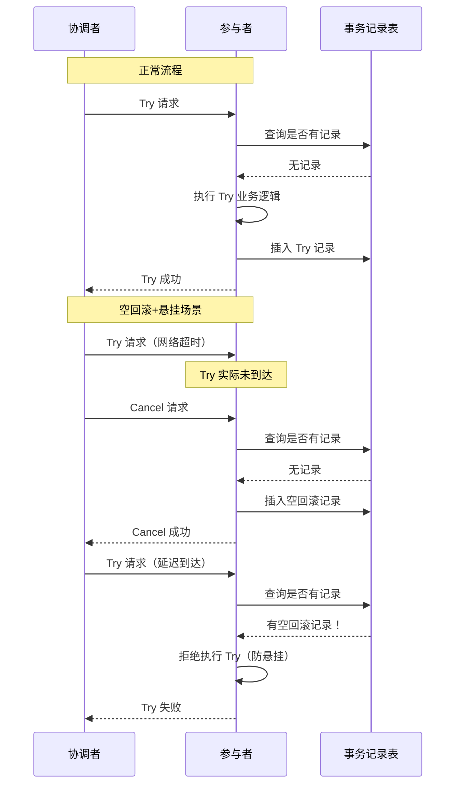
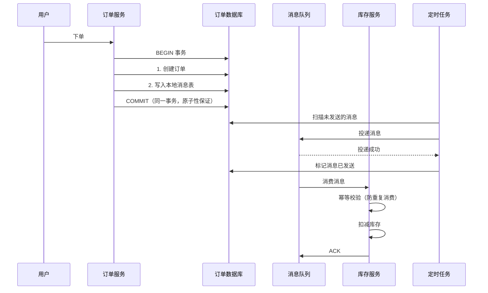
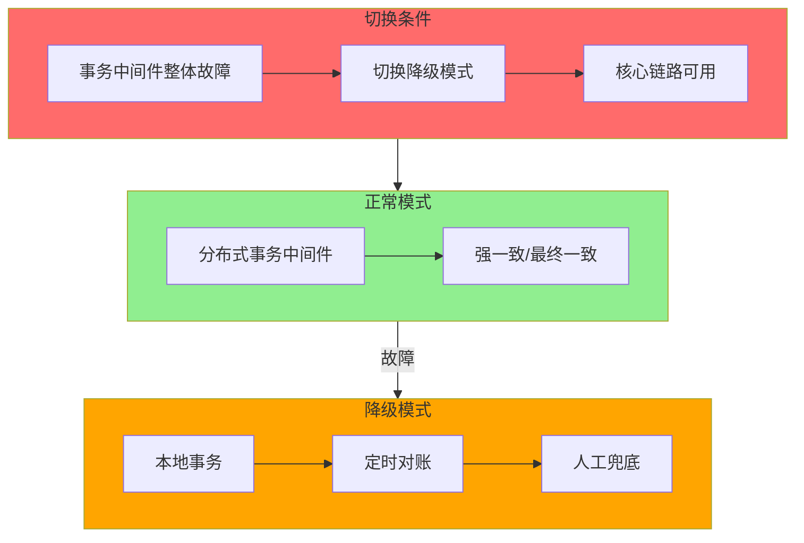

# 分布式事务踩坑

> **场景定位**：分布式系统技术场景  
> **核心设计要点**：空回滚、事务悬挂、幂等控制、消息丢失、事务状态机

---

## 🎯 一句话定位

**分布式事务踩坑解决什么问题？**
```
你以为加个 @GlobalTransactional 就解决了分布式事务，
却没想到空回滚、事务悬挂、网络分区、消息丢失
都会让数据出现偏差。
```

**生活化比喻**：
就像三个人合作拼一幅拼图——你拼了左上角（订单服务），小明拼了中间（库存服务），小红拼了右下角（积分服务）。如果小明那块拼错了要拆掉，但小红已经完成了，怎么保证整幅画要么全对、要么全还原原样？这就是分布式事务的核心难题。

---

## 💎 核心观点（5 分钟速览版）

> **快速概览**

### 核心观点（3 个关键点）

**1. 第一层：明确事务一致性等级和失效场景**
```
不是所有场景都要强一致！

强一致场景（核心交易链路）：
  → 支付、扣库存、资金转账
  → 选 TCC 或同步强校验
  → 同一时间点数据必须完全对齐

最终一致场景（非核心链路）：
  → 发积分、发短信、日志记录
  → 短暂延迟不影响主业务
  → 选最终一致性方案

五大失效场景：
  1. 网络超时 → 事务状态未知
  2. 服务宕机 → 二阶段断裂
  3. 重复调用 → 空回滚与事务悬挂
  4. 消息丢失 → 下游业务未执行
  5. 幂等失效 → 数据重复扣减
```

**2. 第二层：选一套核心方案落地多种场景**
```
方案一：本地消息表 + 可靠消息最终一致性（最通用基线）
  → 业务操作和消息写入放同一数据库事务
  → 异步任务负责投递消息
  → 消费端做幂等校验

方案二：TCC + 事务状态机（强一致场景）
  → Try-Confirm-Cancel 三阶段
  → 事务状态表记录每笔事务的阶段状态
  → 每次执行前先校验状态，拦截非法操作
  → 状态变更基于前置状态条件更新
```

**3. 第三层：生产落地的异常处理细节**
```
空回滚问题：
  → 执行 cancel 前先校验是否有事务记录
  → 没有则直接返回成功，不执行业务回滚

事务悬挂问题：
  → 执行 try 前先校验是否已有回滚记录
  → 有则拒绝执行

消息丢失问题：
  → 本地消息表定时扫描超时未确认的消息重发
  → 消费端基于业务主键做幂等

高并发优化：
  → 优先选最终一致方案
  → 拆分大事务为小事务，缩短锁持有时间
```

---

## 🚀 一句话精华（如果只能记住一句）

> **分布式事务 = 事务分级（强一致/最终一致） + 核心方案（本地消息表/TCC+状态机） + 异常处理（空回滚/悬挂/幂等/消息丢失）**

---

## 一、真实技术场景：四年经验被问卡壳

### 经典技术对话还原

```
场景提问：订单服务扣余额，库存服务扣库存，积分服务加积分，
        跨三个服务怎么保证数据要么全成功、要么全回滚？

候选人：用 Seata 的 AT 模式，加个全局事务注解就搞定。

技术追问：
  1. AT 模式会大锁行数据，高并发下会不会锁冲突甚至死锁？
  2. 一阶段执行完，二阶段某个服务宕机了，空回滚和悬挂怎么处理？
  3. 不用 AT 模式，TCC 的三个阶段怎么保证幂等？
  4. 可靠消息方案怎么保证消息一定不丢、一定被消费？
  5. 下游消费反复失败一直重试不生效怎么兜底？

候选人：可以把事务超时时间设长点...然后人工对账处理...

场景分析：方案讨论到此。
```

**生活化比喻**：
```
候选人就像只会用微波炉热饭的人，
问他"如果微波炉坏了怎么办？停电了怎么办？
饭热过头炸了怎么办？"——完全没思路。

分布式事务也一样，
会用注解 ≠ 能设计高可靠事务方案。
```

---

## 二、五大失效场景详解

### 2.1 空回滚

```
场景：
  1. Try 请求网络超时，实际上 Try 根本没执行
  2. 但协调者以为 Try 超时了，发起 Cancel
  3. Cancel 到达参与者，但本地没有 Try 的执行记录
  4. 这就是"空回滚"——Cancel 了一个没执行过的事务

问题：
  如果不处理，Cancel 可能执行了错误的回滚逻辑
  比如：Try 没扣库存，但 Cancel 执行了"加回库存"
  → 凭空多出库存！
```

**解决方案**：
```java
// Cancel 执行前校验
public boolean cancel(String txId) {
    // 1. 查询是否有 Try 执行记录
    TransactionRecord record = recordMapper.selectByTxId(txId);
    
    if (record == null) {
        // 空回滚：没有 Try 记录，直接返回成功
        // 同时记录"已空回滚"状态，防止后续 Try 到达（悬挂）
        recordMapper.insertEmptyRollback(txId);
        return true;
    }
    
    // 2. 有 Try 记录，正常执行 Cancel
    return doCancel(record);
}
```

**生活化比喻**：
```
就像你点了一份外卖（Try），
但网络不好，商家没收到订单。
平台自动帮你取消（Cancel）。
商家收到取消请求时发现"我根本没收到过这个订单啊"。

正确处理：商家直接说"好的，已取消"（返回成功），
而不是"给你退菜"（错误回滚）。
```

### 2.2 事务悬挂

```
场景：
  1. Try 请求网络超时，协调者发起 Cancel
  2. Cancel 执行了空回滚（上面说的场景）
  3. 但这时，原来的 Try 请求又慢悠悠地到了（网络延迟）
  4. 如果 Try 正常执行了，就出现了"悬挂"——
     一个已经被 Cancel 的事务又执行了 Try

问题：
  事务状态不一致，Try 执行了但全局事务已经回滚了
```

**解决方案**：
```java
// Try 执行前校验
public boolean try(String txId) {
    // 1. 查询是否已有记录（包括空回滚记录）
    TransactionRecord record = recordMapper.selectByTxId(txId);
    
    if (record != null) {
        if (record.getStatus() == EMPTY_ROLLBACK) {
            // 已空回滚，拒绝执行 Try（防悬挂）
            return false;
        }
        // 其他状态也做相应校验
    }
    
    // 2. 没有记录，正常执行 Try
    return doTry(txId);
}
```



### 2.3 幂等失效

```
场景：
  网络抖动导致重复调用，同一笔扣款被执行了两次。
  如果没有幂等控制，用户就被扣了双倍的钱。

解决方案：
  事务状态表 + 条件更新
  
  UPDATE transaction_record 
  SET status = 'CONFIRMED' 
  WHERE tx_id = 'TX001' AND status = 'TRY_SUCCESS'
  
  如果返回 rows = 0，说明状态已被更新（重复请求），直接返回成功
```

---

## 三、两套核心方案落地

### 3.1 方案一：本地消息表 + 最终一致性（最通用）



**生活化比喻**：
```
就像你在淘宝下单：
1. 你在订单系统下单（本地事务）
2. 同时写一张"便签条"（本地消息表）
3. 快递小哥（定时任务）定期来取便签条
4. 把便签条送到仓库（MQ 投递）
5. 仓库按便签条发货（消费消息）

即使快递小哥一时没来，便签条还在，
迟早会送到——这就是"最终一致性"。
```

### 3.2 方案二：TCC + 事务状态机（强一致场景）

```
TCC 三阶段：
  Try：预留资源（如冻结库存）
  Confirm：确认执行（如真正扣减库存）
  Cancel：取消释放（如解冻库存）

事务状态机：
  INIT → TRY_SUCCESS → CONFIRM_SUCCESS
       → TRY_FAILED  → 结束
       → CANCEL_SUCCESS → 结束
  
  每次状态变更必须基于前置状态条件更新
  并发请求更新返回 0 → 判定为重复 → 跳过
```

```java
// TCC 状态机
public enum TxStatus {
    INIT(0),           // 初始
    TRY_SUCCESS(1),    // Try 成功
    CONFIRM_SUCCESS(2),// Confirm 成功
    CANCEL_SUCCESS(3); // Cancel 成功
    
    // 状态流转规则
    public boolean canTransitTo(TxStatus target) {
        switch (this) {
            case INIT: 
                return target == TRY_SUCCESS;
            case TRY_SUCCESS:
                return target == CONFIRM_SUCCESS || target == CANCEL_SUCCESS;
            default:
                return false; // 终态，不能再流转
        }
    }
}

// Confirm 执行逻辑
public boolean confirm(String txId) {
    // 条件更新：只有 TRY_SUCCESS 才能转为 CONFIRM_SUCCESS
    int rows = txRecordMapper.updateStatus(
        txId, 
        TxStatus.CONFIRM_SUCCESS,
        TxStatus.TRY_SUCCESS  // WHERE status = TRY_SUCCESS
    );
    
    if (rows == 0) {
        // 状态不是 TRY_SUCCESS → 重复请求或状态异常
        return false;
    }
    
    // 执行 Confirm 业务逻辑
    return doConfirm(txId);
}
```

---

## 四、生产落地异常处理细节

### 4.1 高并发优化

```
原则：能最终一致就不强一致

1. 优先选最终一致方案
   → 性能比强一致高一个数量级
   
2. 拆分大事务为小事务
   → 缩短锁持有时间
   → 减少锁冲突概率

3. 监控关键指标
   → 事务成功率
   → 回滚/悬挂触发次数
   → 消息积压量

4. 降级预案
   → 事务中间件整体故障时
   → 降级为本地事务 + 定时对账
   → 人工兜底修复差额数据
```

### 4.2 降级策略



---

五、技术方案

### 方案参考

> "分布式事务不是加个注解就完事的。我的方案分三层：
> 1. **事务分级**：核心链路（支付/库存/订单）做强一致，选 TCC 模式；非核心链路（积分/通知）做最终一致，选本地消息表。
> 2. **方案落地**：TCC 场景建事务状态表，记录每笔事务的阶段状态，每次执行前校验状态拦截非法操作，状态变更基于条件更新保证幂等。最终一致场景用本地消息表，业务操作和消息写入同一事务，异步投递。
> 3. **异常处理**：空回滚——Cancel 前校验有无 Try 记录，没有就直接返回成功；悬挂——Try 前校验有无回滚记录，有就拒绝执行；消息丢失——定时扫描超时未确认的消息重发。"

---

## 六、总结（一句话带走）

> **分布式事务 = 事务分级（强一致/最终一致） + 核心方案（本地消息表/TCC+状态机） + 异常处理（空回滚/悬挂/幂等/消息丢失）**

### 🧠 核心记忆点

1. **不是所有场景都要强一致**——能最终一致就最终一致，性能差一个数量级。
2. **空回滚和悬挂必须处理**——Cancel 前校验 Try 记录（防空回滚），Try 前校验回滚记录（防悬挂）。
3. **事务状态机是核心**——每次状态变更基于前置状态条件更新，天然幂等。

---

**参考视频**：[内卷的琪某人 - 四年后端经验，被一个"分布式事务"问题问卡壳了](https://www.douyin.com/video/7658247324438727942)

---

*本文档基于 8 个专家提示词指导改写，遵循深入浅出、生活化比喻、幽默风趣的教学原则。*
