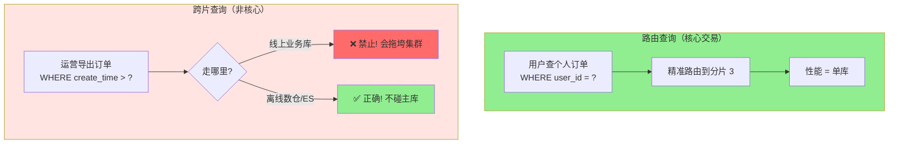
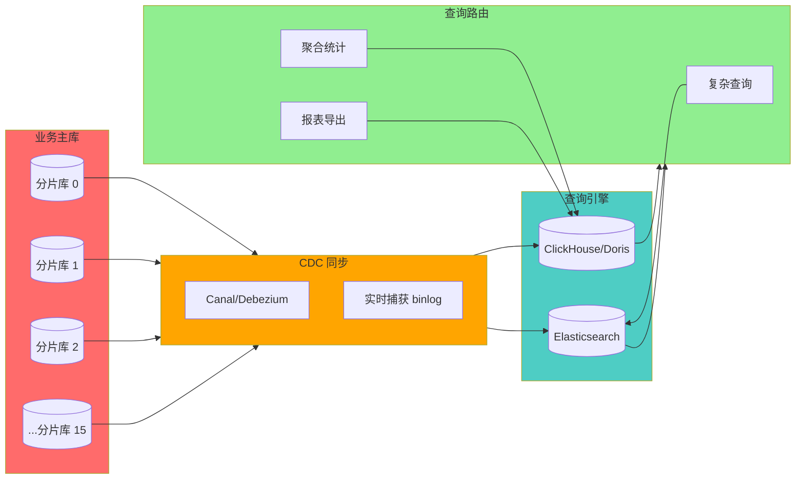
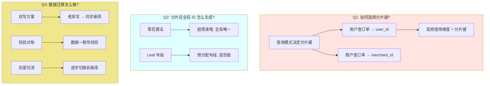

# 分库分表落地实战

> **场景定位**：数据库架构场景  
> **核心设计要点**：路由查询、跨片查询、异构索引、CDC 同步、架构优化

---

## 🎯 一句话定位

**分库分表落地解决什么问题？**
```
你以为把大表拆成小表就能解决海量数据瓶颈，
却没想到无分片键的跨库查询、分页排序、聚合统计
都会变成性能灾难。
```

**生活化比喻**：
就像把一本 10000 页的电话簿拆成 16 本小册子——按姓氏分，"张王李赵"一本，"陈刘杨黄"一本。按姓氏查很快（路由查询），但如果老板说"把最近一周新增的人全列出来"，你就得翻遍 16 本册子（跨片查询），慢得要死。

---

## 💎 核心观点（5 分钟速览版）

> **快速概览**

### 核心观点（3 个关键点）

**1. 第一层：业务分级，区分路由查询与跨片查询**
```
路由查询（核心交易链路）：
  → 必须携带分片键
  → 直接精准路由到对应分片
  → 性能和单库无差异
  → 例：用户查个人订单、按用户 ID 查记录

跨片查询（非核心链路）：
  → 后台统计、报表导出类需求
  → 全部走离线数仓或专用查询组件
  → 禁止直接在线上业务分片库执行全分片扫描
```

**2. 第二层：查询兜底与性能优化**
```
跨片请求限流：
  → 不可避免的跨片查询设置严格的并发数与超时阈值
  → 避免单条请求拖垮整个集群

冗余索引表：
  → 针对高频非分片键查询场景
  → 建立专用索引映射表
  → 查询先查索引表再路由到对应分片

分页聚合优化：
  → 深分页禁用 offset，改用游标式分页
  → 限制每次查询返回数据量
  → 减少跨分片数据合并开销
```

**3. 第三层：架构层优化，剥离复杂查询压力**
```
异构数据同步（CDC）：
  → 分片库数据实时同步到 Elasticsearch / OLAP 引擎
  → 多维度筛选、聚合统计、报表导出全部走查询引擎
  → 不碰业务主库

从库聚合查询：
  → 轻量跨片查询统一走从库集群
  → 隔离主库交易流量

核心场景开关：
  → 大促期间关停所有后台跨片查询入口
  → 只保留带分片键的核心交易请求
```

---

## 🚀 一句话精华（如果只能记住一句）

> **分库分表落地 = 路由查询（带分片键） + 跨片兜底（限流/索引表/游标分页） + 架构优化（CDC→ES 承接复杂查询）**

---

## 一、真实线上事故：跨片全表扫描拖垮集群

### 事故场景

```
背景：
  订单量破亿 → 做了水平分库分表
  分片键：用户 ID
  分片规则：user_id % 16 → 16 个分片库

事故：
  运营要导出近一周的成交订单做数据分析
  导出 SQL 只带了时间范围，没传分片键
  
  结果：
  ❌ 请求遍历了所有库所有表做聚合
  ❌ 所有分片库的连接池全被打满
  ❌ 正常用户下单也出现卡顿
  
问题出在哪？
```

**生活化比喻**：
```
就像 16 个图书馆，每个馆藏 100 万本书。
你按书名查（带分片键）→ 直接去对应的图书馆，很快。
但你说"把 16 个图书馆最近一周借出的书全列出来"（不带分片键）→ 
每个图书馆都要翻一遍借阅记录，16 个一起翻，
图书馆的工作人员全被你一个人占了，其他读者干等着。
```

---

## 二、三层防御体系详解

### 2.1 第一层：业务分级



**路由查询**：
```sql
-- ✅ 带分片键，直接路由
SELECT * FROM orders WHERE user_id = 12345 AND order_no = 'ORD001';
-- 计算：12345 % 16 = 9 → 直接去分片 9 查询
-- 性能：和单库完全一样
```

**跨片查询**：
```sql
-- ❌ 不带分片键，遍历所有分片
SELECT * FROM orders WHERE create_time > '2024-01-01';
-- 16 个分片全扫一遍 → 性能灾难

-- ✅ 正确做法：走 ES 或从库
-- 先在 ES 中查询，再按结果回源
```

### 2.2 第二层：查询兜底与性能优化

#### 跨片请求限流

```
规则：
  → 跨片查询最大并发数 = 10（可配置）
  → 单请求超时 = 5 秒
  → 超过并发数 → 直接拒绝，返回"系统繁忙"
  
目的：
  避免一条慢查询拖垮整个集群
```

#### 冗余索引表

```sql
-- 订单号 → 分片位置 映射表
CREATE TABLE order_shard_mapping (
    order_no VARCHAR(64) PRIMARY KEY,
    shard_id INT NOT NULL,        -- 分片 ID
    user_id BIGINT NOT NULL       -- 冗余用户 ID
);

-- 按订单号查询：先查索引表，再路由
SELECT shard_id FROM order_shard_mapping WHERE order_no = 'ORD001';
-- 得到 shard_id = 9
-- 再去分片 9 查详情
```

**生活化比喻**：
```
就像图书馆的索引卡片柜：
你要找一本书，先查卡片（索引表）知道在哪个图书馆哪个架子，
再直接去拿，不用把 16 个图书馆都翻一遍。
```

#### 分页聚合优化

```sql
-- ❌ 深分页 offset 性能灾难
SELECT * FROM orders LIMIT 1000000, 20;
-- 跨 16 个分片各查 1000020 条 → 合并 → 取 20 条
-- 数据量：16 × 1000020 = 1600 万条 → 合并排序 → 慢！

-- ✅ 游标式分页（基于上一批最后一条的 ID）
SELECT * FROM orders 
WHERE user_id = 12345 AND id > 1000000 
ORDER BY id 
LIMIT 20;
-- 每个分片只查 20 条 → 合并 → 取前 20 条
-- 数据量：16 × 20 = 320 条 → 快！
```

### 2.3 第三层：架构层优化

#### 异构数据同步（CDC → ES）



```
CDC 同步流程：
  1. Canal/Debezium 监听 MySQL binlog
  2. 实时捕获数据变更
  3. 写入 Elasticsearch / OLAP 引擎
  4. 所有复杂查询走查询引擎，不碰业务主库

优势：
  ✅ 主库只处理核心交易（带分片键的路由查询）
  ✅ 复杂查询（多维度筛选/聚合/报表）全走 ES/OLAP
  ✅ 互不影响，各走各的路
```

---

三、技术方案

### 方案参考

> "分库分表落地我分三层：
> 1. **业务分级**：核心交易链路必须携带分片键，直接路由到对应分片，性能等于单库。非核心的后台统计、报表导出全部走离线数仓或 ES，禁止在线上分片库做全分片扫描。
> 2. **查询兜底**：不可避免的跨片查询做限流（严格并发数+超时阈值）；高频非分片键查询建冗余索引映射表，先查索引再路由；深分页禁用 offset，改用游标式分页。
> 3. **架构优化**：通过 CDC 工具（Canal/Debezium）将分片库数据实时同步到 ES/OLAP，所有多维度筛选、聚合统计走查询引擎，不碰业务主库。大促期间关停所有后台跨片查询，只保核心交易。"

### 加分回答（展示深度）

> "实际项目中最容易踩的坑是分页。跨分片深分页的性能灾难是指数级的——16 个分片各查 100 万条数据再合并排序，光数据传输量就是 1600 万条。我们的解决方案是游标式分页（基于上一批最后一条的 ID），每个分片只查 20 条，合并后才 320 条，性能提升了几个数量级。"

---

## 四、技术追问与深度问题



**Q1: 如何选择分片键？**  
**答**：根据最高频的查询维度。用户查订单用 user_id，商户查订单用 merchant_id。如果多个维度都很高频，建冗余索引映射表或者走 ES。

**Q2: 分库分表后全局 ID 怎么生成？**  
**答**：雪花算法（趋势递增、全局唯一、无需外部依赖）或 Leaf 号段模式（预分配号段、高性能）。雪花算法最常用。

**Q3: 数据迁移怎么做？**  
**答**：双写方案——老库写 → CDC 同步新库 → 校验对账（数据一致性） → 灰度切流（逐步切换到新库）。核心是保证数据不丢不错。

---

## 五、总结（一句话带走）

> **分库分表落地 = 路由查询（带分片键） + 跨片兜底（限流/索引表/游标分页） + 架构优化（CDC→ES 承接复杂查询）**

### 🧠 核心记忆点

1. **路由查询 vs 跨片查询**——带分片键走路由（快），不带分片键走 ES/数仓（隔离主库）。
2. **深分页是灾难**——跨分片 offset 分页数据量指数级增长，用游标式分页替代。
3. **CDC 同步是标配**——复杂查询全走 ES/OLAP，业务主库只处理核心交易。

---

**参考视频**：[内卷的琪某人 - 场景提问：分库分表怎么落地？](https://www.douyin.com/video/7657876872327466303)

---

*本文档基于 8 个专家提示词指导改写，遵循深入浅出、生活化比喻、幽默风趣的教学原则。*
