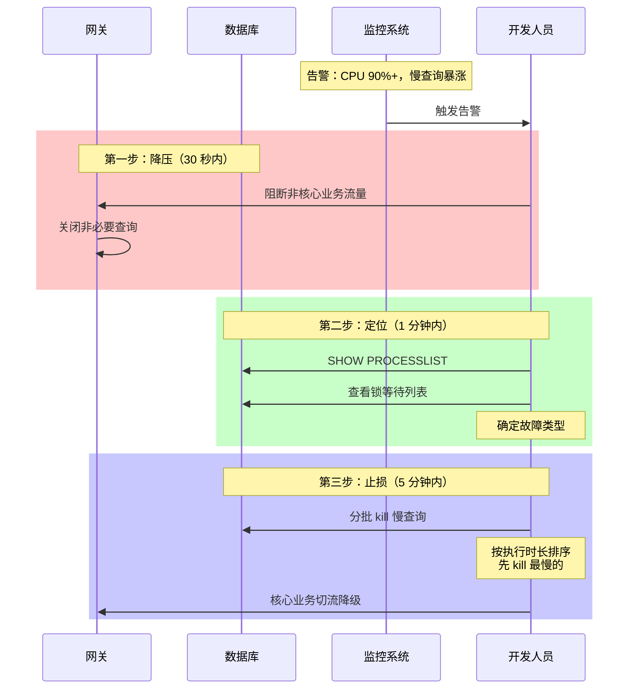
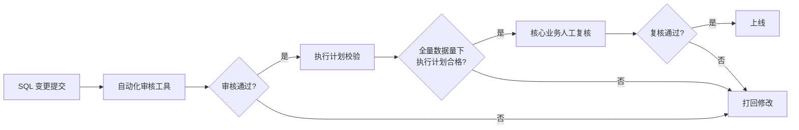

# MySQL 慢 SQL 雪崩

> **场景定位**：数据库稳定性技术场景  
> **核心设计要点**：应急止损、索引失效排查、锁等待、主从延迟、长效治理

---

## 🎯 一句话定位

**MySQL 慢 SQL 雪崩解决什么问题？**
```
线上业务高峰期数据库 CPU 突然打满，
连接池被占满，核心接口大面积超时，
慢查询数量一分钟暴涨百倍——
你怎么第一时间止损并精准定位根因？
```

**生活化比喻**：
就像高速公路——平时车流量正常，突然一辆大货车在超车道上以 20km/h 慢悠悠开着（慢 SQL），后面所有车都被堵住了（连接池耗尽），整条高速瘫痪（全链路雪崩）。你的任务不是等货车自己走，而是第一时间把它拖走（止损），然后查清楚它为什么上高速的（根因治理）。

---

## 💎 核心观点（5 分钟速览版）

> **快速概览**

### 核心观点（3 个关键点）

**1. 第一层：慢 SQL 故障应急体系**
```
黄金操作顺序：
  1. 网关阻断非核心业务流量（降压）
  2. 按执行时长分批 kill 慢查询（避免批量回滚风暴）
  3. 通过 processlist / 锁等待列表 一分钟定位故障类型
  4. 核心业务切流到读写分离/缓存/降级开关

四类典型故障快速区分：
  → 索引失效：全表扫描，扫描行数 >> 返回行数
  → 锁等待：processlist 状态 = Waiting for lock
  → 大事务：事务执行时间超长
  → 笛卡尔积：JOIN 缺少关联条件
```

**2. 第二层：数据库风险量化分析**
```
五大核心指标：
  1. 慢查询占比（> 5% 告警）
  2. 平均锁等待时长（> 1s 告警）
  3. 连接活跃率（> 80% 告警）
  4. SQL 扫描行数 / 返回行数比值（> 100 倍需优化）
  5. 主从延迟时长（> 3s 告警）

三级风险区分：
  低风险：非核心报表变慢 → 排期优化索引
  中风险：核心接口性能下降 → 加缓存 + 优化
  高风险：CPU 持续 90%+ → 立即限流降级止损
```

**3. 第三层：数据库稳定性长效治理**
```
SQL 上线强制准入标准：
  → 索引设计规范
  → 分页查询规范
  → 单事务最大时长
  → 禁止使用的 SQL 语法红线

自动化审核 + 执行计划校验：
  → 慢查询日志常态化巡检
  → 全量 SQL 审计平台定期索引健康度扫描
  → 核心业务 SQL 变更必须人工 100% 复核
```

---

## 🚀 一句话精华（如果只能记住一句）

> **慢 SQL 雪崩 = 应急止损（网关阻断+分批 kill+切流降级） + 根因定位（processlist+锁等待+执行计划） + 长效治理（准入标准+自动审核+巡检机制）**

---

## 一、普通后端 vs 高级后端的分水岭

### 普通后端回答
```
场景提问：线上数据库 CPU 打满，慢查询暴涨，你怎么处理？
普通后端：先 kill 慢查询，重启数据库就恢复了。

技术追问：
  - 批量 kill 会不会引发回滚风暴？
  - 怎么区分索引失效、锁等待、大事务？
  - 主从延迟叠加慢查询怎么切流？
  
普通后端：......靠挨个查慢查询日志，事后加索引。
```

### 高级后端回答
```
高级后端：
  1. 先通过网关阻断非核心流量降压
  2. 按执行时长分批 kill，避免批量回滚加重负载
  3. 通过 processlist 一分钟定位故障类型
  4. 核查核心业务是否有读写分离/降级开关
  5. 事后建立 SQL 上线准入标准 + 自动化审核 + 常态化巡检
```

**差距在哪？**
```
普通后端：出了问题 → kill → 重启 → 事后加索引
高级后端：应急止损 → 根因定位 → 长效治理 → 全链路闭环
```

---

## 二、第一层：慢 SQL 故障应急体系

### 2.1 黄金操作顺序



### 2.2 四类典型故障快速区分

| 故障类型 | processlist 特征 | 快速判断方法 | 处理策略 |
|----------|-----------------|-------------|----------|
| **索引失效** | State = Sending data<br/>Time 很长 | `EXPLAIN` 看 type=ALL<br/>扫描行数 >> 返回行数 | 优化索引 |
| **锁等待** | State = Waiting for lock | `SHOW ENGINE INNODB STATUS`<br>查看锁等待队列 | kill 持锁事务 |
| **大事务** | State = executing<br/>Time > 30s | 事务执行时间超长 | 拆分事务 |
| **笛卡尔积** | State = Sending data<br/>Rows Examined 极大 | JOIN 缺少关联条件 | 修复 SQL |

```sql
-- 快速定位慢查询
SHOW PROCESSLIST;
-- 看 State 和 Time 列

-- 查看锁等待
SELECT * FROM information_schema.innodb_lock_waits;

-- 查看当前正在执行的 SQL
SELECT * FROM information_schema.processlist 
WHERE command != 'Sleep' 
ORDER BY time DESC;
```

### 2.3 分批 kill 的正确姿势

```
❌ 错误做法：
  一次性 kill 所有慢查询 → 大量事务同时回滚 → 回滚风暴 → 数据库更卡

✅ 正确做法：
  1. 按执行时长排序，先 kill 执行最久的
  2. 每次 kill 1~3 个，观察数据库负载
  3. 等回滚完成后再 kill 下一批
  4. 如果回滚本身也在占资源，考虑设 innodb_fast_shutdown
```

---

## 三、第二层：数据库风险量化分析

### 3.1 五大核心指标

| 指标 | 正常值 | 告警阈值 | 危险阈值 | 说明 |
|------|--------|----------|----------|------|
| **慢查询占比** | < 1% | > 5% | > 10% | 慢查询 / 总查询 |
| **平均锁等待时长** | < 100ms | > 1s | > 5s | 锁竞争程度 |
| **连接活跃率** | < 50% | > 80% | > 95% | 活跃连接 / 最大连接 |
| **扫描/返回行数比** | < 10 | > 100 | > 1000 | 索引效率 |
| **主从延迟** | < 1s | > 3s | > 10s | 数据一致性 |

### 3.2 三级风险区分

```
低风险（非核心报表变慢）：
  → 不影响核心交易
  → 排期优化索引即可
  → 可以"等一等"

中风险（核心接口性能随数据量下降）：
  → 用户体验变差
  → 需排期优化 + 加缓存
  → 本周内解决

高风险（核心库 CPU 持续 90%+）：
  → 连接池即将耗尽
  → 必须立即限流降级止损
  → 5 分钟内必须行动
```

---

## 四、第三层：长效治理规范

### 4.1 SQL 上线强制准入标准

```
索引设计规范：
  ✅ WHERE/JOIN/ORDER BY 字段必须有索引
  ✅ 联合索引遵循最左前缀原则
  ❌ 禁止在索引列上做函数运算
  ❌ 禁止 %开头的模糊查询（走全表扫描）

分页查询规范：
  ✅ 深分页用游标式（WHERE id > last_id）
  ❌ 禁止 OFFSET > 10000

单事务最大时长：
  ✅ 核心事务 < 5 秒
  ❌ 禁止事务中包含 RPC/HTTP 调用
  ❌ 禁止批量操作单事务超 1 万条

禁止使用的 SQL：
  ❌ SELECT *（必须指定字段）
  ❌ 不带 LIMIT 的全表查询
  ❌ 子查询嵌套超过 3 层
```

### 4.2 自动化审核流程



### 4.3 常态化巡检

```
每日巡检：
  → 慢查询日志 Top 10 分析
  → 新增 SQL 执行计划校验

每周巡检：
  → 索引健康度扫描（是否有未使用的索引）
  → 大表数据量增长趋势

每月巡检：
  → 全量 SQL 审计
  → 数据库容量规划
```

---

五、技术方案

### 方案参考

> "慢 SQL 雪崩我分三层处理：
> 1. **应急止损**：先通过网关阻断非核心流量降压，然后按执行时长分批 kill 慢查询（避免批量回滚风暴），同时通过 processlist 和锁等待列表一分钟定位故障类型。
> 2. **根因定位**：区分四类典型故障——索引失效（扫描行数远大于返回行数）、锁等待（processlist 状态 Waiting for lock）、大事务（执行时间超长）、笛卡尔积（JOIN 缺关联条件），然后量化五大核心指标判断风险等级。
> 3. **长效治理**：建立 SQL 上线准入标准（索引规范、分页规范、事务时长限制），所有上线 SQL 必须经过自动化审核 + 执行计划校验，核心业务变更人工 100% 复核，配合慢查询日志常态化巡检。"

---

## 六、总结（一句话带走）

> **慢 SQL 雪崩 = 应急止损（网关阻断+分批 kill+切流降级） + 根因定位（processlist+锁等待+执行计划） + 长效治理（准入标准+自动审核+巡检机制）**

### 🧠 核心记忆点

1. **黄金操作顺序**——先降压（阻断非核心流量） → 再定位（processlist） → 最后止损（分批 kill）。
2. **不要一次性 kill 所有慢查询**——批量回滚会让数据库更卡。
3. **长效治理比应急更重要**——准入标准 + 自动化审核 + 常态化巡检，从根源杜绝慢 SQL。

---

**参考视频**：[内卷的琪某人 - 场景提问：MySQL 慢 SQL 雪崩怎么应急止损？](https://www.douyin.com/video/7657497338482642219)

---

*本文档基于 8 个专家提示词指导改写，遵循深入浅出、生活化比喻、幽默风趣的教学原则。*
