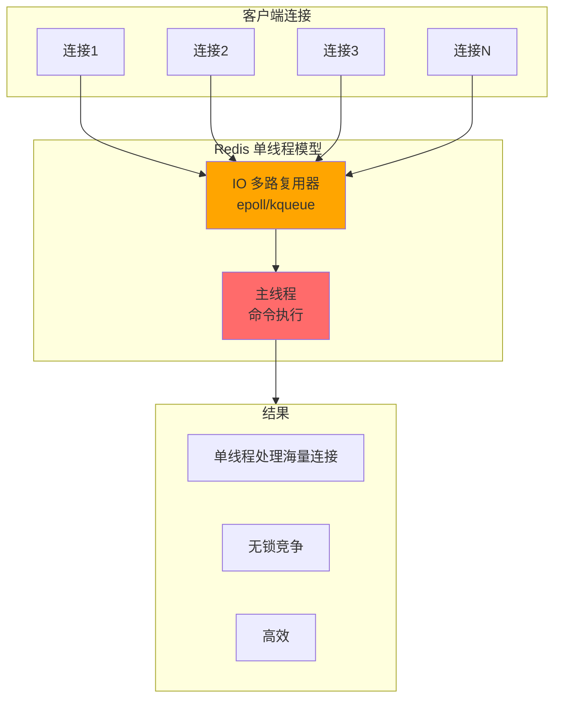
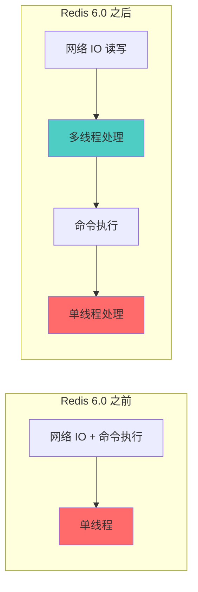

# Redis 单线程高性能

> **场景定位**：Redis 核心原理技术场景  
> **核心设计要点**：IO 多路复用、单线程本质、Redis 6.0 多线程、性能瓶颈

---

## 🎯 一句话定位

```
场景提问：Redis 是单线程的，为什么能达到 10 万+ QPS？
你：因为基于内存，内存比磁盘快几个数量级。

场景提问：那为什么不设计成多线程利用多核 CPU 让它更快？
你：因为单线程避免上下文切换和锁竞争。

场景提问：上下文切换代价真有这么大？所有高性能服务器都应该单线程？
       Redis 6.0 为什么又引入多线程了？

你：......
```

**生活化比喻**：
就像一个超级厨师（Redis 主线程）——他一个人能炒 10 万份菜，不是因为手快，而是因为他只用一个锅但效率极高（IO 多路复用），而且不用跟别人抢锅（无锁竞争）。但后来菜太复杂了，他一个人处理不过来配菜（网络 IO），所以请了几个帮厨（Redis 6.0 多线程处理网络 IO），但炒菜还是他一个人。

---

## 💎 核心观点

**三个本质**：
1. **核心瓶颈是网络 IO，不是 CPU**——IO 多路复用让单线程高效处理海量连接
2. **Redis 6.0 多线程只处理网络 IO**——核心命令执行依然是单线程，保证线程安全
3. **真正拖垮 Redis 的是慢查询**——keys*、大集合运算等让单线程长时间阻塞

---

## 🚀 一句话精华

> **Redis 快 = 内存基础 + IO 多路复用（单线程处理海量连接） + 无锁竞争 → 6.0 后多线程只加速网络 IO，核心执行仍单线程 → 真正瓶颈是慢查询和内存**

---

## 一、三个层面的深度理解

### 1.1 本质一：瓶颈从来不是 CPU，而是网络 IO

```
Redis 的高性能关键：
  → 基于内存（基础，但不是全部）
  → IO 多路复用（核心！）
  → 单线程高效处理海量连接

IO 多路复用原理：
  → 一个线程同时监听多个客户端连接
  → 有事件才处理，没事件就干别的
  → 非阻塞 IO
  
  → 单个线程高效处理成千上万并发连接
  → 不需要创建大量线程
```



**为什么不用多线程？**
```
多线程的问题：
  → 共享数据结构需要加锁
  → 锁竞争开销大
  → 上下文切换消耗 CPU

单线程的优势：
  → 无锁竞争
  → 无上下文切换
  → 实现简单，不易出错

关键点：
  Redis 的瓶颈是网络 IO 而非 CPU
  单线程恰恰是解决网络 IO 并发最高效的方式之一
```

### 1.2 本质二：Redis 6.0 的多线程

```
为什么要引入多线程？
  → 网络硬件发展，IO 延迟降低
  → 数据结构越来越复杂
  → 某些操作的 CPU 消耗开始显现
  → 单线程处理慢操作会阻塞后续请求

Redis 6.0 的多线程设计：
  ❌ 不是把命令执行变成多线程
  ✅ 只用多线程处理网络 IO 的读写
  ✅ 核心命令执行依然是单线程

精妙之处：
  → 利用多核 CPU 加速网络包解析
  → 保持核心数据结构的线程安全
  → 避免锁竞争
```



### 1.3 本质三：真正拖垮 Redis 的是什么？

```
❌ 不是 QPS
✅ 是慢查询！

慢查询的杀伤力：
  → keys *：遍历所有 key，单线程阻塞
  → 大集合交集运算：O(N²) 复杂度
  → 大 key 删除：阻塞主线程

真正影响性能的因素：
  1. 命令复杂度（慢查询让单线程长时间阻塞）
  2. 内存（内存不够 → 淘汰策略 → 性能下降）
  3. 持久化（RDB/AOF 磁盘 IO 开销）
```

| 瓶颈因素 | 影响 | 解决方案 |
|----------|------|----------|
| **慢查询** | 单线程长时间阻塞 | 禁用 keys*、拆分大 key、用 SCAN 替代 |
| **内存不足** | 频繁淘汰、内存碎片 | 合理设置 maxmemory、定期清理 |
| **持久化** | 磁盘 IO 影响响应 | 合理配置 AOF 刷盘策略、从节点做 RDB |

---

二、技术方案

### 方案参考

> "Redis 高性能的核心不是'内存快'三个字能概括的，要从三个层面理解：
> 1. **IO 多路复用**：Redis 的核心瓶颈是网络 IO 而非 CPU，通过 epoll 机制让单线程高效处理海量连接，无锁竞争、无上下文切换。
> 2. **6.0 多线程演进**：随着数据复杂度提升，6.0 引入多线程只处理网络 IO 读写，核心命令执行依然是单线程，既利用多核加速网络包解析，又保持数据结构的线程安全。
> 3. **真正瓶颈**：不是 QPS，而是慢查询（keys*、大集合运算）、内存不足（淘汰策略）、持久化开销（AOF 刷盘）。生产环境要重点关注这三点。"

---

## 三、技术追问

**Q1: 为什么单线程避免锁竞争就能快这么多？**  
**答**：多线程共享数据结构需要加锁，锁竞争和上下文切换的开销在高并发下会远超实际计算开销。单线程无需加锁，所有命令串行执行，简单高效。

**Q2: Redis 6.0 的多线程和传统多线程有什么区别？**  
**答**：传统多线程是命令执行也并行，需要加锁。Redis 6.0 只有网络 IO 读写并行（解析请求、写回响应），命令执行依然单线程，所以不需要对数据结构加锁。

**Q3: 如何评估 Redis 性能瓶颈？**  
**答**：看慢查询日志（`slowlog get`）、监控内存使用率、观察持久化开销。禁用 `keys*`、拆分大 key、用 `SCAN` 替代遍历。

---

## 四、总结

> **Redis 快 = IO 多路复用（单线程处理海量连接） + 无锁竞争 → 6.0 多线程只加速网络 IO → 真正瓶颈是慢查询、内存、持久化**

### 🧠 核心记忆点

1. **瓶颈是网络 IO 不是 CPU**——IO 多路复用让单线程高效处理海量连接。
2. **6.0 多线程只处理网络 IO**——核心命令执行依然单线程，保证线程安全。
3. **真正拖垮 Redis 的是慢查询**——禁用 keys*、拆分大 key、用 SCAN。

---

**参考视频**：[内卷的琪某人 - 场景提问：Redis 单线程为啥快，90% 后端都只答对了皮毛](https://www.douyin.com/video/7655549016385637659)

*本文档基于 8 个专家提示词指导改写*
