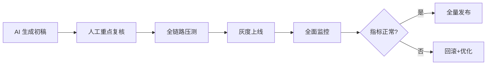

# AI 代码事故复盘

> **场景定位**：系统稳定性技术场景  
> **核心设计要点**：AI 代码风险、稳定性准入、压测验证、灰度上线、全链路监控

---

## 🎯 一句话定位

```
AI 写代码上线快，
但 AI 最容易出的问题：
  → 单机跑得飞快，一到真实流量就全面崩盘
  → 忘记加缓存/限流 → 全站血崩
  → 没有降级策略 → 连锁故障
```

**生活化比喻**：
就像 AI 帮你写了一份菜谱——看着挺像那么回事，但没经过厨师试菜（压测），没考虑客流量（高并发），没准备备用方案（降级）。一上来就营业（全量发布），结果客人一多厨房就着火了。

---

## 💎 核心观点

**三层防护**：
1. **AI 上线链路稳定性拆解**：网关层/服务层/数据层 7 类稳定性核对
2. **AI 代码稳定性量化评估**：压测达标率、慢接口占比、缓存命中率等
3. **AI 上线治理体系**：AI 初稿 → 人工压测 → 灰度上线 → 全面监控

---

## 🚀 一句话精华

> **AI 代码治理 = 稳定性拆解（网关/服务/数据层） + 量化评估（压测/慢接口/缓存） + 治理流程（AI初稿→人工验证→灰度→监控）**

---

## 一、AI 代码的典型风险

| 风险类型 | 表现 | 后果 |
|----------|------|------|
| **无限流/熔断** | 高流量直接打穿 | 服务雪崩 |
| **无缓存** | 每次查 DB | DB 被打挂 |
| **慢 SQL** | 无索引、全表扫描 | CPU 打满 |
| **无降级** | 依赖服务挂了连锁故障 | 全站不可用 |
| **连接池不当** | 参数不合理 | 连接耗尽 |

---

## 二、三层防护详解

### 2.1 第一层：稳定性拆解

```
网关层：
  → 限流配置
  → 熔断策略
  → 超时设置

服务层：
  → 缓存设计
  → 降级开关
  → 重试策略

数据层：
  → SQL 执行计划
  → 连接池参数
  → 索引健康度

每层 7 类稳定性核对，确保不突破流量上限
```

### 2.2 第二层：量化评估

| 指标 | 达标标准 | 说明 |
|------|----------|------|
| 压测达标率 | > 95% | 峰值流量下正常响应 |
| 慢接口占比 | < 1% | P99 < 200ms |
| 缓存命中率 | > 90% | 避免 DB 穿透 |
| DB 连接水位 | < 70% | 留足缓冲 |
| 异常流量承载 | 2x 峰值 | 弹性能力 |

**区分代码等级**：
- ✅ **可上线**：压测达标，指标合格
- ⚠️ **需加固**：部分指标不达标，优化后上线
- ❌ **高风险**：核心指标不合格，禁止上线

### 2.3 第三层：治理体系

```
标准化流程：
  1. AI 生成初稿
  2. 人工重点复核（支付/订单/库存/登录等高风险模块）
  3. 全链路压测验证
  4. 灰度上线（1% → 10% → 100%）
  5. 全面监控

禁止：直接全量发布 AI 原生代码
```



---

## 三、事故复盘方法

```
定位步骤：
  1. 监控告警：哪条链路异常？
  2. 代码 diff：是不是 AI 生成的代码？
  3. 根因分析：无限流？无缓存？慢 SQL？
  4. 修复验证：压测通过后灰度上线

预防机制：
  → 沉淀历史事故做 AI 提示词
  → AI 生成代码自动检查限流/缓存/降级
  → 高风险模块人工 100% 复核
```

---

## 四、技术方案

> "AI 时代后端的核心能力从'写接口'升级为'守稳定性'。我建三层防护：第一层拆解 AI 上线链路的网关/服务/数据层稳定性；第二层量化评估压测达标率、慢接口占比、缓存命中率等指标；第三层建立标准化流程——AI 初稿 → 人工复核 → 全链路压测 → 灰度上线 → 全面监控。高风险模块（支付/订单/库存）必须人工 100% 复核，禁止直接全量发布 AI 原生代码。"

---

**参考视频**：[内卷的琪某人 - 场景提问：AI 写后端代码，该如何做线上事故复盘和快速止损？](https://www.douyin.com/video/7654436519364660506)

*本文档基于 8 个专家提示词指导改写*
