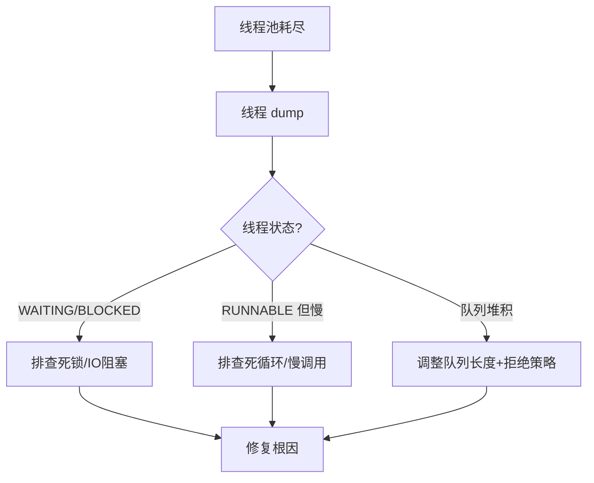

# 线程池耗尽应急

> **场景定位**：并发编程与性能调优技术场景  
> **核心设计要点**：线程 dump 分析、线程隔离、任务堆积、动态调参、异步化改造

---

## 🎯 一句话定位

```
线上所有接口响应缓慢甚至无响应，
CPU 使用率不高但请求全部超时——
排查发现线程池被占满，服务陷入"假死"。
```

**生活化比喻**：
就像餐厅所有服务员都在忙——有的在等菜（IO 阻塞）、有的在跟客人吵架（死锁）、有的在打扫卫生（死循环），新来的客人没人接待（请求超时）。加更多服务员（调大线程数）没用，因为问题不是人少，而是现有的人都在干不该干的事。

---

## 💎 核心观点

**三层治理**：
1. **故障分级**：核心链路立即止损，非核心链路暂停
2. **标准排查**：线程 dump → 监控指标 → 精准定位根因
3. **生产防控**：全维度监控 + 开发规约 + 压测验证 + 动态调参

---

## 🚀 一句话精华

> **线程池治理 = 故障分级（核心止损/非核心暂停） + 精准排查（dump+监控+定位根因） + 生产防控（监控+规约+压测+动态调参+异步化）**

---

## 一、普通后端 vs 大厂后端

```
普通后端：
  → 加大线程池参数
  → 不行就重启服务
  → 遇到复杂问题束手无策

大厂后端：
  → 精准定位根因（死锁？阻塞？堆积？泄漏？）
  → 应急止损 + 场景优化 + 源头管控
  → 独立搭建完整并发治理体系
```

---

## 二、三层治理详解

### 2.1 第一层：故障分级

```
核心链路（下单/支付/登录）：
  → 第一时间限流
  → 滚动重启故障节点
  → 隔离问题节点

非核心链路（后台统计/定时任务/数据同步）：
  → 直接暂停任务执行
  → 优先保证主业务正常
  → 低风险时再优化整改
```

### 2.2 第二层：标准排查流程

```
排查工具：
  1. 线程 dump（jstack）→ 看线程状态
  2. 线程池监控指标 → 活跃线程数、队列长度
  3. 应用日志 → 异常信息
  4. 链路追踪 → 慢调用定位

常见根因：
  → 线程阻塞：死锁、死循环、长耗时 IO
  → 任务堆积：队列无限制、拒绝策略不当
  → 线程泄漏：线程创建未销毁

优化方向：
  → CPU 密集型：核心线程数 = CPU 核心数 + 1
  → IO 密集型：核心线程数 = CPU 核心数 × 2~4
  → 同步改异步
  → 多业务线程池隔离
```



### 2.3 第三层：生产防控

**全维度监控**：
```
监控指标：
  → 活跃线程数
  → 队列长度
  → 任务执行时间
  → 拒绝次数
  
配置告警，提前发现隐患
```

**开发规约**：
```
❌ 禁止使用 Executors 创建线程池
   → newFixedThreadPool / newCachedThreadPool 都有坑
   
✅ 强制使用 ThreadPoolExecutor 手动配置
   → 明确核心参数
   
✅ 统一线程池命名规范
   → 便于问题定位
```

**压测验证 + 动态调参**：
```
上线前：高并发压测验证线程池配置合理性
线上：支持线程池参数动态调整，无需重启
```

**异步化改造**：
```
复杂业务场景：
  → 采用异步化、事件驱动架构
  → 从根本上减少线程占用
```

---

## 三、技术方案

> "线程池耗尽我分三层：第一层故障分级，核心链路立即限流 + 滚动重启隔离问题节点，非核心直接暂停保主业务。第二层标准排查，通过线程 dump + 监控指标精准定位根因——是死锁、IO 阻塞、任务堆积还是线程泄漏，针对性优化。第三层生产防控，全维度监控告警，禁止用 Executors 强制用 ThreadPoolExecutor，统一命名规范，上线前压测验证，线上支持动态调参，复杂业务异步化改造减少线程占用。"

---

## 四、总结

> **线程池治理 = 故障分级（核心止损） + 精准排查（dump+定位根因） + 生产防控（监控+规约+压测+动态调参+异步化）**

### 🧠 核心记忆点

1. **不要盲目调大线程数**——先定位根因（死锁？阻塞？堆积？）。
2. **禁止用 Executors**——强制用 ThreadPoolExecutor 手动配置。
3. **异步化是根本解**——减少线程占用，事件驱动架构。

---

**参考视频**：[内卷的琪某人 - 场景提问：线程池耗尽，服务全线阻塞崩溃？](https://www.douyin.com/video/7654066220395695403)

*本文档基于 8 个专家提示词指导改写*
