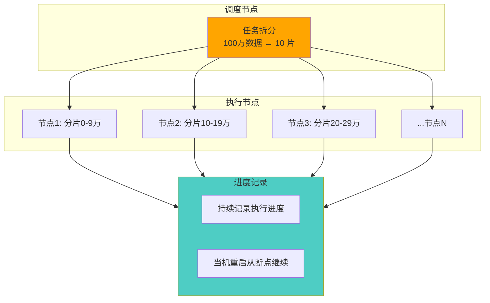

# 集群任务调度治理

> **场景定位**：分布式系统技术场景  
> **核心设计要点**：分布式锁、任务分片、断点续跑、时钟偏差、失败补偿

---

## 🎯 一句话定位

```
集群多实例部署下定时任务：
  → 任务重复执行（多节点同时抢）
  → 任务丢失（服务宕机中断）
  → 调度堆积（长任务阻塞线程池）

你以为用 XXL-Job 开个互斥就完事了？
```

**生活化比喻**：
就像多个闹钟同时响——你有 3 个手机都设了 7 点闹钟（3 个节点），结果三个一起响（重复执行），你被吵醒了但不知道关哪个（冲突）。如果一个手机没电了（服务宕机），闹钟就没响（任务丢失）。更麻烦的是，3 个手机时间不一样（时钟偏差），响的时间还不一样。

---

## 💎 核心观点

**三层方案**：
1. **主流方案拆解**：单机 Quartz、数据库锁、Redisson 分布式锁、XXL-Job 各有缺陷
2. **生产可用方案**：数据库乐观锁抢占 + 任务分片并行 + 断点续跑
3. **异常兜底**：执行时长管控 + 时钟偏差适配 + 全链路监控 + 失败补偿

---

## 🚀 一句话精华

> **集群调度 = 方案选型（乐观锁抢占） + 任务分片（并行+断点续跑） + 异常兜底（超时管控+时钟适配+监控+补偿）**

---

## 一、主流方案拆解

| 方案 | 优点 | 致命缺陷 |
|------|------|----------|
| **单机 Quartz** | 简单 | 多实例必然重复执行 ❌ |
| **数据库锁** | 集群可用 | 大流量锁等待，性能差 ⚠️ |
| **Redisson 分布式锁** | 高性能 | 锁过期 → 任务重复 ❌ |
| **XXL-Job/ElasticJob** | 功能全面 | 学习成本高，老旧系统改造难 ⚠️ |

---

## 二、生产可用方案

### 2.1 数据库乐观锁抢占

```sql
-- 任务表新增字段
ALTER TABLE schedule_task ADD COLUMN (
    exec_status TINYINT DEFAULT 0,    -- 0:待执行 1:执行中 2:已完成
    exec_machine VARCHAR(128),         -- 执行机器标识
    exec_time TIMESTAMP                -- 执行时间戳
);

-- 抢占执行权（乐观锁）
UPDATE schedule_task 
SET exec_status = 1, 
    exec_machine = 'node-1',
    exec_time = NOW()
WHERE task_id = 123 AND exec_status = 0;

-- rows = 1 → 抢占成功，执行任务
-- rows = 0 → 被其他节点抢了，跳过
```

**优势**：锁竞争开销小，适合大多数场景。

### 2.2 任务分片并行处理

```
大数据量任务：
  → 分片拆分，多节点并行处理
  → 如：100 万数据分 10 片，每节点处理 10 万

长耗时任务：
  → 分段执行 + 断点续跑
  → 执行过程持续记录进度
  → 当机重启后从上次断点继续
  → 不用全量重跑
```



---

## 三、异常兜底与运维防护

### 3.1 执行时长管控

```
限制单任务最大执行时间
超时自动中断，释放工作线程
防止线程池耗尽
```

### 3.2 时钟偏差适配

```
问题：多台服务器时钟不一致 → 同一任务重复触发

方案：
  → 调度时间增加几秒容错区间
  → 机器定时同步时间（NTP）
  → 规避时钟漂移导致重复触发
```

### 3.3 全链路监控告警

```
监控指标：
  → 任务失败次数
  → 堆积数量
  → 执行耗时
  
超时、失败实时推送告警
```

### 3.4 失败任务补偿机制

```
执行失败 → 写入重试表
分阶梯定时重试：
  → 第 1 次：1 分钟后
  → 第 2 次：5 分钟后
  → 第 3 次：30 分钟后
  
多次失败 → 转入人工处理队列
```

---

## 四、技术方案

> "集群任务调度我分三层：第一层拆解主流方案——单机 Quartz 会重复执行，数据库锁大流量性能差，Redisson 锁过期会重复，XXL-Job 改造成本高。第二层生产方案用数据库乐观锁抢占（轻量高效）+ 任务分片并行 + 断点续跑（记录进度，当机从断点继续）。第三层异常兜底：执行时长管控防线程池耗尽，时钟偏差 NTP 同步 + 容错区间，全链路监控告警，失败任务阶梯重试 + 人工兜底。"

---

## 五、总结

> **集群调度 = 乐观锁抢占 + 任务分片并行 + 断点续跑 + 异常兜底（超时/时钟/监控/补偿）**

### 🧠 核心记忆点

1. **乐观锁抢占**——最轻量的分布式调度方案。
2. **断点续跑**——长任务必须记录进度，当机从断点继续。
3. **时钟偏差不能忽视**——NTP 同步 + 容错区间。

---

**参考视频**：[内卷的琪某人 - 集群多实例部署下任务重复执行、任务丢失、调度堆积该怎么解决？](https://www.douyin.com/video/7652645817005739299)

*本文档基于 8 个专家提示词指导改写*
