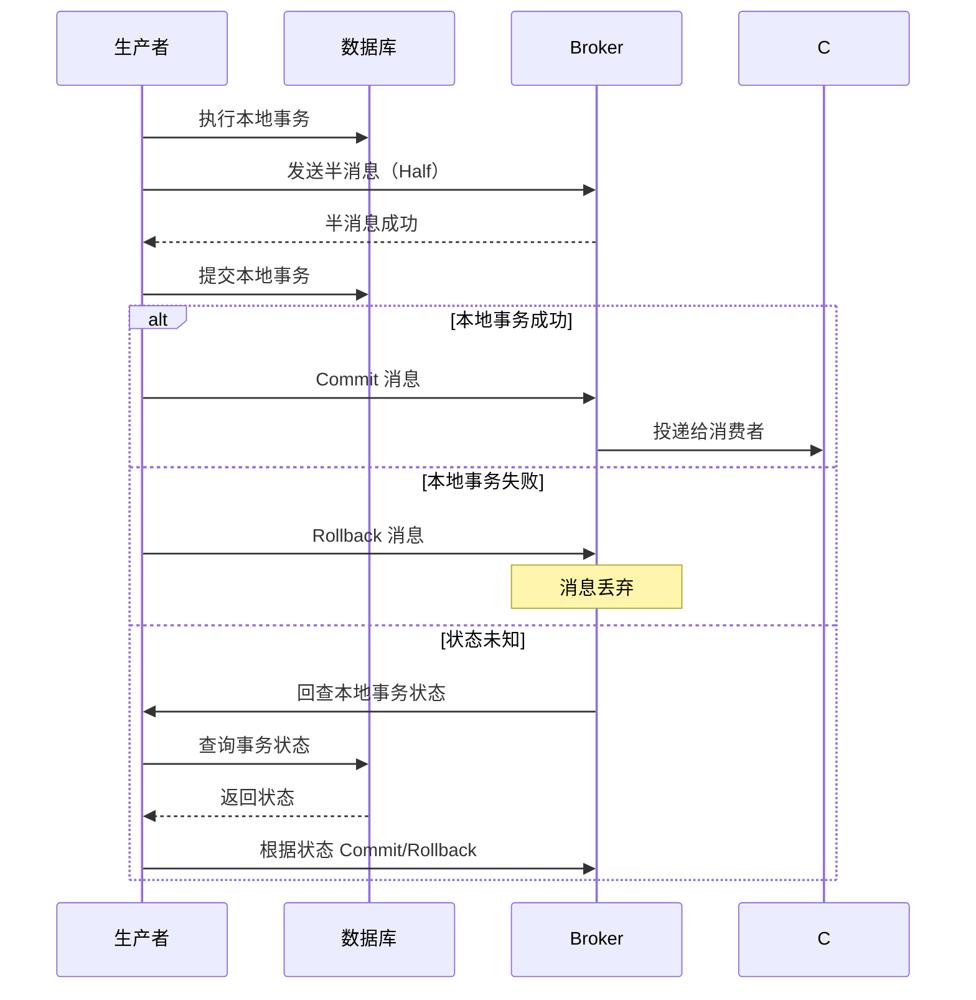

# RocketMQ 消息丢失

> **场景定位**：消息中间件高级技术场景  
> **核心设计要点**：全链路消息可靠性、生产端/Broker/消费端可信、监控兜底

---

## 🎯 一句话定位

```
场景提问：线上 RocketMQ 消息凭空消失了，怎么排查？
你：开启持久化，生产者确认，消费者手动 ACK。

场景提问：持久化就一定不丢？Broker 刷盘失败呢？
        主从同步失败呢？消费者 ACK 了但业务异常呢？
        
你：......
```

**生活化比喻**：
就像快递系统——你寄了 1000 个包裹，结果有 200 个凭空消失了。快递公司说"我们开了持久化、确认机制、手动签收"，但你问"仓库着火了呢？运输途中丢了呢？签收后东西坏了吗？"——他们就答不上来了。消息可靠性不是开几个开关就完事的。

---

## 💎 核心观点

**四层全链路防护**：
1. **生产端可信**：确认机制 + 事务消息 + 本地消息表
2. **Broker 端可信**：持久化策略 + 主从同步 + 死信队列
3. **消费端可信**：手动 ACK + 幂等设计 + 重试策略
4. **监控兜底**：全链路追踪 + 堆积告警 + 对账系统

---

## 🚀 一句话精华

> **RocketMQ 消息可靠 = 生产端（确认+事务消息+消息表） + Broker（持久化+主从同步+死信队列） + 消费端（手动ACK+幂等+重试） + 监控兜底（追踪+告警+对账）**

---

## 一、四层全链路防护详解

### 1.1 第一层：生产端可信

```
生产者确认机制：
  → 同步确认：适合关键业务（强可靠）
  → 异步确认：适合高发场景（高性能）
  → 回调处理：发送失败的消息重新投递

事务消息：
  → 解决本地事务执行和发消息的原子性
  → 避免"扣了库存没发消息"

本地消息表兜底：
  → 定时任务扫描补发未发送的消息
  
注意：必须设置合理的重试次数和超时时间
     避免无限重试打垮 Broker
```



### 1.2 第二层：Broker 端可信

```
持久化策略：
  同步刷盘：牺牲性能换绝对可靠
    → 适合金融级业务
  异步刷盘：兼顾性能和可靠
    → 通用场景首选 ⭐

主从同步：
  → 同步复制模式
  → 主节点宕机时从节点有完整副本

死信队列：
  → 处理消费失败超过次数的消息
  → 避免无限重试堵塞队列
  
注意：定期清理过期消息，防止磁盘占满
```

### 1.3 第三层：消费端可信

```
强制手动 ACK：
  → 业务执行成功后才提交确认
  → 避免自动 ACK 导致消息丢失

幂等性设计（核心！）：
  → MQ 保证 At Least Once（至少一次）
  → 用唯一消息 ID 或业务主键去重

重试策略：
  → 合理配置重试间隔和次数
  → 失败消息先进死信队列
  → 人工排查后再处理
  
注意：批量消费时逐条处理异常
     避免一条失败导致整批丢失
```

### 1.4 第四层：监控兜底

```
全链路监控追踪：
  → 每条消息从发送、存储到消费的完整状态
  
监控告警：
  → 消息堆积量
  → 消费失败率
  → Broker 节点健康度
  
消息回溯：
  → 支持按时间或消息 ID 补发丢失的消息
  
对账系统：
  → 每天核对业务数据和 MQ 消息
  → 保证数据一致性
```

---

二、技术方案

### 方案参考

> "RocketMQ 消息可靠我建四层防护：
> 1. **生产端**：同步确认 + 事务消息保证本地事务和消息原子性 + 本地消息表兜底补发。
> 2. **Broker 端**：通用场景异步刷盘兼顾性能可靠，金融级同步刷盘；主从同步复制保证副本完整；死信队列处理消费失败消息。
> 3. **消费端**：强制手动 ACK，业务成功才确认；幂等设计用消息 ID 或业务主键去重；失败消息进死信队列人工处理。
> 4. **监控兜底**：全链路追踪每条消息状态，堆积/失败率实时告警，每天对账系统核对数据一致性。"

---

## 三、技术追问

**Q1: 开启持久化就一定不丢消息？**  
**答**：不一定。同步刷盘才能保证消息落盘不丢，异步刷盘在主节点宕机时可能丢失未刷盘的消息。金融级业务必须同步刷盘。

**Q2: 主从同步失败怎么办？**  
**答**：用同步复制模式，主节点写入必须等从节点确认成功才返回。如果从节点不可用，同步复制会阻塞，需要配合主从切换策略。

**Q3: 消费者 ACK 了但业务异常怎么办？**  
**答**：必须先执行业务逻辑，业务成功后才 ACK。如果业务异常，不 ACK 让 MQ 重试。配合幂等设计保证重试安全。

---

## 四、总结

> **RocketMQ 消息可靠 = 生产端（确认+事务消息+消息表） + Broker（持久化+主从同步+死信队列） + 消费端（手动ACK+幂等+重试） + 监控兜底（追踪+告警+对账）**

### 🧠 核心记忆点

1. **四层全链路**——生产端/Broker/消费端/监控，缺一不可。
2. **幂等是消费端核心**——MQ 保证至少一次，消费端必须幂等。
3. **对账是最后防线**——每天核对业务数据和 MQ 消息，发现不一致立即修复。

---

**参考视频**：[内卷的琪某人 - 场景提问：线上 RocketMQ 消息凭空消失？怎么排查根因？](https://www.douyin.com/video/7652644547578662170)

*本文档基于 8 个专家提示词指导改写*
