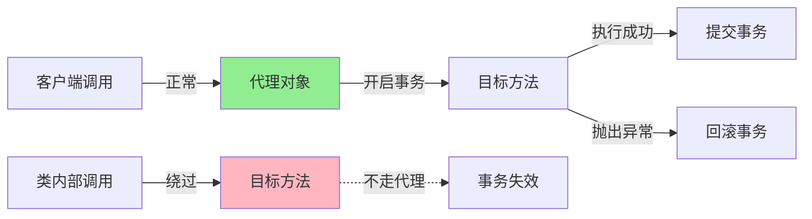
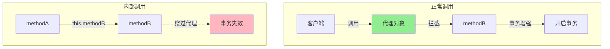
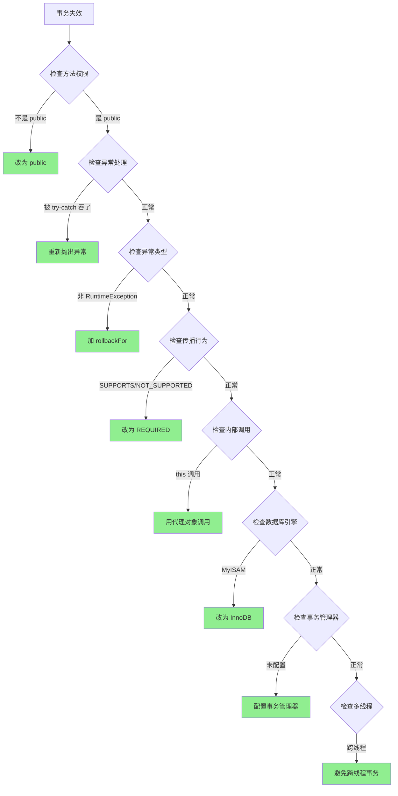
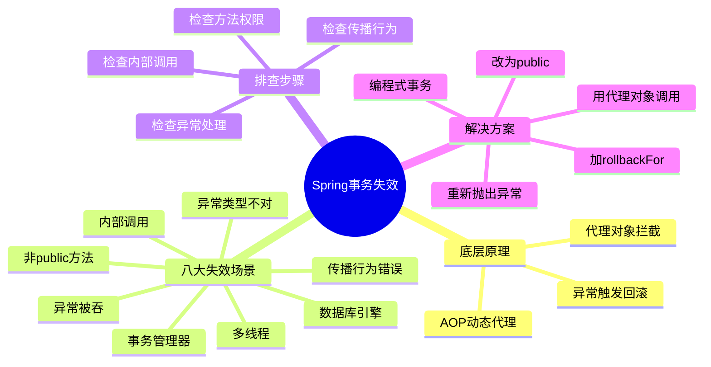
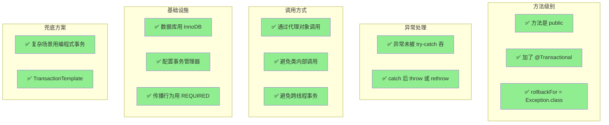
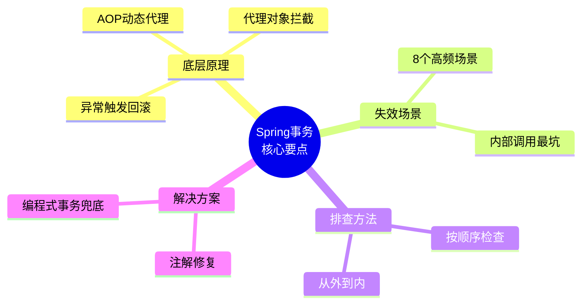

# Spring 事务失效的八大坑与底层原理

> **场景定位**：Spring 框架核心场景  
> **核心设计要点**：AOP 动态代理、事务传播行为、异常处理机制、代理对象调用

---

## 🎯 一句话定位

**Spring 事务失效解决什么问题？**
```
你明明加了 @Transactional 注解，以为万事大吉，
结果数据没回滚，线上出事故了！
就像你给门锁上了，但小偷还是进来了——锁是假的！
```

**生活化比喻**：
就像你请了个保姆（Spring 事务管理器），告诉她"我出门时锁门，回来时开门"。但如果：
- 你没告诉她钥匙在哪（方法不是 public）
- 她自己把门打开了（异常被 try-catch 吞了）
- 她只防贼不防火（异常类型不对）
- 你从窗户爬进去没经过她（内部方法调用）

保姆就失效了！

**核心特点**：Spring 事务基于 **AOP 动态代理**，只有通过代理对象调用的方法才会被事务拦截器增强。

---

## 💎 核心观点（5 分钟速览版）

> **快速概览**

### 核心观点（8 个失效场景 + 底层原理）

**1. 方法不是 public**
```
❌ Spring AOP 只能拦截 public 方法
✅ 原因：JDK 动态代理要求方法必须是 public
   类比：保姆只能看正门，后门她管不了
```

**2. 异常被 try-catch 吞了**
```
❌ 异常被捕获未抛出，Spring 无法感知
✅ 解决：catch 后必须 throw 或 rethrow
   类比：你摔倒了但不喊疼，保姆以为你没事
```

**3. 抛出非 RuntimeException 或 Error**
```
❌ 默认只对 RuntimeException 和 Error 回滚
✅ 解决：用 @Transactional(rollbackFor = Exception.class)
   类比：保姆只防贼（运行时异常），不防火（检查型异常）
```

**4. 事务传播行为错误**
```
❌ 用了 SUPPORTS 或 NOT_SUPPORTED，事务不生效
✅ 常用：REQUIRED（有就加入，没有就新建）
   类比：你说"有事就帮忙，没事就算了"，保姆就不主动了
```

**5. 同一个类内部方法调用**
```
❌ this 调用不走代理对象
✅ 解决：AopContext.currentProxy() 或抽到另一个类
   类比：你从窗户爬进去，没经过保姆检查
```

**6. 数据库引擎不支持事务**
```
❌ MyISAM 不支持事务
✅ 解决：用 InnoDB
   类比：你请了保姆，但门锁是坏的
```

**7. 未配置事务管理器**
```
❌ 多数据源场景，子线程事务不受主线程管控
✅ 解决：明确指定 transactionManager
   类比：多个保姆，没人统一指挥
```

**8. 多线程场景**
```
❌ 子线程的事务不受主线程管控
✅ 解决：避免跨线程事务，或用编程式事务
   类比：保姆管不了你分身出来的影子
```

---

## 🚀 一句话精华（如果只能记住一句）

> **Spring 事务 = AOP 动态代理 + 异常拦截 + 传播行为控制，失效本质是绕过了代理对象或异常未被捕获**

---

## 一、为什么 Spring 事务会失效？底层原理是什么？

### 🔍 核心原理（30 秒版）

**生活化比喻**：
```
Spring 事务就像给方法"穿衣服"（AOP 代理）：
1. Spring 启动时，给 @Transactional 方法生成一个代理对象
2. 调用方法时，实际调用的是代理对象
3. 代理对象在执行方法前开启事务，执行后提交/回滚

如果绕过了代理对象（如内部调用），事务就失效了！
```



### 1.1 AOP 动态代理的两种实现

| 代理方式 | 触发条件 | 优点 | 缺点 | 生活化比喻 |
|---------|---------|------|------|-----------|
| **JDK 动态代理** | 目标类实现了接口 | 性能好 | 只能代理接口方法 | 保姆只认工牌（接口） |
| **CGLIB 代理** | 目标类没实现接口 | 可以代理类 | 性能稍差 | 保姆认人（类） |

**代码示例**：
```java
// JDK 动态代理
public interface UserService {
    void save();
}

public class UserServiceImpl implements UserService {
    @Transactional
    public void save() {
        // 业务逻辑
    }
}

// Spring 生成代理对象
UserService proxy = (UserService) Proxy.newProxyInstance(
    UserService.class.getClassLoader(),
    new Class[]{UserService.class},
    new TransactionInvocationHandler(target)
);

// 调用代理对象，事务生效
proxy.save(); // ✅ 走代理，事务生效
```

```java
// CGLIB 代理
public class UserService {
    @Transactional
    public void save() {
        // 业务逻辑
    }
}

// Spring 生成 CGLIB 代理
UserService proxy = new CGLIBProxy(UserService.class).getProxy();

// 调用代理对象，事务生效
proxy.save(); // ✅ 走代理，事务生效
```

---

## 二、八大事务失效场景详解

### 场景 1：方法不是 public

**问题描述**：
```java
@Service
public class UserService {
    
    @Transactional
    void save() { // ❌ 方法不是 public
        // 业务逻辑
    }
}
```

**为什么会失效？**
```
生活化比喻：
JDK 动态代理要求方法必须是 public，就像保姆只能看正门。
如果方法是 private/protected/default，代理对象无法拦截，
就像你从后门进去，保姆看不到你。

技术原因：
JDK 动态代理通过反射调用方法，private 方法无法被外部访问。
```

**解决方案**：
```java
@Service
public class UserService {
    
    @Transactional
    public void save() { // ✅ 改为 public
        // 业务逻辑
    }
}
```

**技术方案**：
> "Spring AOP 只能拦截 public 方法，因为 JDK 动态代理要求方法必须是 public。如果方法是 private 或 protected，代理对象无法拦截，事务就失效了。"

---

### 场景 2：异常被 try-catch 吞了

**问题描述**：
```java
@Service
public class UserService {
    
    @Transactional
    public void save() {
        try {
            // 业务逻辑
            int result = 1 / 0; // 抛出异常
        } catch (Exception e) {
            // ❌ 异常被捕获，未抛出
            log.error("出错了", e);
            // System.out.println("继续执行...");
        }
    }
}
```

**为什么会失效？**
```
生活化比喻：
你摔倒了（抛出异常），但不喊疼（异常被捕获），
保姆以为你没事（Spring 没感知到异常），就不会帮你处理伤口（回滚事务）。

技术原因：
Spring 事务拦截器捕获到异常后才会回滚，
如果异常被 try-catch 吞了，拦截器以为一切正常，就提交了事务。
```

**解决方案**：
```java
@Service
public class UserService {
    
    @Transactional
    public void save() {
        try {
            // 业务逻辑
            int result = 1 / 0;
        } catch (Exception e) {
            log.error("出错了", e);
            // ✅ 方案1：重新抛出异常
            throw new RuntimeException(e);
            
            // ✅ 方案2：手动回滚
            // TransactionAspectSupport.currentTransactionStatus().setRollbackOnly();
        }
    }
}
```

**技术方案**：
> "异常被 try-catch 捕获后，Spring 事务拦截器无法感知到异常，就会提交事务。解决方案是 catch 后重新抛出异常，或手动调用 setRollbackOnly() 回滚。"

---

### 场景 3：抛出非 RuntimeException 或 Error

**问题描述**：
```java
@Service
public class UserService {
    
    @Transactional // ❌ 默认只对 RuntimeException 和 Error 回滚
    public void save() throws Exception {
        // 业务逻辑
        throw new Exception("检查型异常"); // ❌ 不会回滚
    }
}
```

**为什么会失效？**
```
生活化比喻：
保姆只防贼（RuntimeException），不防火（检查型异常）。
你说"有异常就回滚"，但保姆只听"运行时异常"和"错误"，
其他异常她不管。

技术原因：
@Transactional 默认 rollbackFor = {RuntimeException.class, Error.class}，
检查型异常（如 Exception、IOException）不会触发回滚。
```

**解决方案**：
```java
@Service
public class UserService {
    
    // ✅ 明确指定回滚所有异常
    @Transactional(rollbackFor = Exception.class)
    public void save() throws Exception {
        // 业务逻辑
        throw new Exception("检查型异常"); // ✅ 会回滚
    }
}
```

**技术方案**：
> "@Transactional 默认只对 RuntimeException 和 Error 回滚，检查型异常不会触发回滚。解决方案是明确指定 rollbackFor = Exception.class，这样所有异常都会回滚。"

---

### 场景 4：事务传播行为错误

**问题描述**：
```java
@Service
public class UserService {
    
    @Transactional(propagation = Propagation.SUPPORTS) // ❌ 有事务就加入，没有就非事务执行
    public void save() {
        // 业务逻辑
    }
}
```

**为什么会失效？**
```
生活化比喻：
传播行为就像你和保姆的约定：
- REQUIRED：你必须有事，没事就帮我.create 一个
- SUPPORTS：你有事我就帮忙，没事就算了
- NOT_SUPPORTED：我不需要你帮忙

如果你用 SUPPORTS，而调用方没有事务，
保姆就说"你没事，那我也不管了"，事务就不生效。

技术原因：
SUPPORTS：如果当前没有事务，就以非事务方式执行
NOT_SUPPORTED：总是以非事务方式执行
REQUIRES_NEW：总是创建新事务（可能不符合预期）
```

**常用传播行为对比**：

| 传播行为 | 含义 | 适用场景 | 生活化比喻 |
|---------|------|---------|-----------|
| **REQUIRED**（默认） | 有就加入，没有就新建 | 大多数场景 | 保姆必须有活干 |
| **REQUIRES_NEW** | 总是创建新事务 | 独立事务，不受外部影响 | 保姆单独干活，不受别人影响 |
| **NESTED** | 嵌套事务 | 子方法失败只回滚子方法 | 保姆分房间干活，一个房间出问题不影响其他 |
| **SUPPORTS** | 有就加入，没有就非事务 | 查询方法 | 保姆有事就帮忙，没事就休息 |
| **NOT_SUPPORTED** | 总是非事务 | 不希望有事务 | 保姆不需要帮忙 |

**解决方案**：
```java
@Service
public class UserService {
    
    @Transactional(propagation = Propagation.REQUIRED) // ✅ 默认值，推荐
    public void save() {
        // 业务逻辑
    }
}
```

**技术方案**：
> "事务传播行为决定了方法如何参与事务。REQUIRED 是最常用的，表示有事务就加入，没有就新建。如果用了 SUPPORTS 或 NOT_SUPPORTED，可能导致事务不生效。"

---

### 场景 5：同一个类内部方法调用（最坑！）

**问题描述**：
```java
@Service
public class UserService {
    
    public void methodA() {
        this.methodB(); // ❌ 内部调用，不走代理
    }
    
    @Transactional
    public void methodB() {
        // 业务逻辑
    }
}
```

**为什么会失效？**
```
生活化比喻：
你从窗户爬进去（内部调用），没经过保姆检查（代理对象），
保姆以为你没出门（没调用），就不管你了。

技术原因：
同一个类内部调用时，使用的是 this 对象，而不是代理对象。
Spring 事务是通过代理对象拦截的，绕过了代理，事务就失效了。
```



**解决方案**：

**方案 1：使用 AopContext 获取代理对象**
```java
@Service
public class UserService {
    
    public void methodA() {
        // ✅ 获取代理对象
        UserService proxy = (UserService) AopContext.currentProxy();
        proxy.methodB(); // ✅ 走代理，事务生效
    }
    
    @Transactional
    public void methodB() {
        // 业务逻辑
    }
}

// 需要在启动类加 @EnableAspectJAutoProxy(exposeProxy = true)
```

**方案 2：抽到另一个类**
```java
@Service
public class UserService {
    
    @Autowired
    private UserServiceB serviceB;
    
    public void methodA() {
        serviceB.methodB(); // ✅ 走代理，事务生效
    }
}

@Service
public class UserServiceB {
    
    @Transactional
    public void methodB() {
        // 业务逻辑
    }
}
```

**方案 3：使用编程式事务（兜底方案）**
```java
@Service
public class UserService {
    
    @Autowired
    private TransactionTemplate transactionTemplate;
    
    public void methodA() {
        transactionTemplate.execute(status -> {
            // 业务逻辑
            return null;
        });
    }
}
```

**技术方案**：
> "同一个类内部调用时，使用的是 this 对象而不是代理对象，所以事务失效。解决方案有三种：1. 使用 AopContext.currentProxy() 获取代理对象；2. 把方法抽到另一个类；3. 使用编程式事务 TransactionTemplate。"

---

### 场景 6-8：其他失效场景（快速版）

**场景 6：数据库引擎不支持事务**
```java
// ❌ MyISAM 不支持事务
CREATE TABLE user (
    id INT PRIMARY KEY,
    name VARCHAR(50)
) ENGINE=MyISAM; // ❌ 不支持事务

// ✅ 用 InnoDB
CREATE TABLE user (
    id INT PRIMARY KEY,
    name VARCHAR(50)
) ENGINE=InnoDB; // ✅ 支持事务
```

**场景 7：未配置事务管理器**
```java
// ❌ 多数据源场景，未指定事务管理器
@Transactional
public void save() {
    // 不知道用哪个数据源的事务
}

// ✅ 明确指定
@Transactional(transactionManager = "primaryTransactionManager")
public void save() {
    // 使用主数据源的事务
}
```

**场景 8：多线程场景**
```java
@Transactional
public void methodA() {
    // 主线程事务
    
    new Thread(() -> {
        // ❌ 子线程的事务不受主线程管控
        methodB();
    }).start();
}

@Transactional
public void methodB() {
    // 子线程独立事务
}
```

---

## 三、系统性排查与解决方案

### 3.1 排查步骤（技术方案）

**生活化比喻**：
```
排查事务失效就像破案：
1. 先查门锁（方法权限）
2. 再查保姆（异常处理）
3. 然后查监控（传播行为）
4. 最后查有没有人从窗户爬进去（内部调用）
```



### 3.2 编程式事务（兜底方案）

**适用场景**：
- 复杂事务逻辑
- 需要精细控制事务边界
- 注解事务失效时的兜底方案

**代码示例**：
```java
@Service
public class UserService {
    
    @Autowired
    private TransactionTemplate transactionTemplate;
    
    @Autowired
    private TransactionManager transactionManager;
    
    // 方式1：使用 TransactionTemplate（推荐）
    public void saveWithTemplate() {
        transactionTemplate.execute(status -> {
            // 业务逻辑
            userMapper.insert(user);
            orderMapper.insert(order);
            return null;
        });
    }
    
    // 方式2：使用 TransactionManager（更灵活）
    public void saveWithManager() {
        DefaultTransactionDefinition def = new DefaultTransactionDefinition();
        def.setPropagationBehavior(TransactionDefinition.PROPAGATION_REQUIRED);
        
        TransactionStatus status = transactionManager.getTransaction(def);
        try {
            // 业务逻辑
            userMapper.insert(user);
            orderMapper.insert(order);
            transactionManager.commit(status);
        } catch (Exception e) {
            transactionManager.rollback(status);
            throw e;
        }
    }
}
```

---

四、技术深入探讨

### Q1: 同一个类中 A 方法调用 B 方法，B 方法加了 @Transactional 为什么不生效？

**答**：
> 因为 A 方法调用 B 方法时，使用的是 this 对象，而不是代理对象。Spring 事务是通过 AOP 代理实现的，只有调用代理对象的方法才会被事务拦截器增强。
>
> 解决方案：
> 1. 使用 AopContext.currentProxy() 获取代理对象
> 2. 把 B 方法抽到另一个类
> 3. 使用编程式事务 TransactionTemplate

### Q2: @Transactional 的 rollbackFor 属性有什么用？

**答**：
> rollbackFor 用于指定哪些异常触发回滚。默认只对 RuntimeException 和 Error 回滚，检查型异常（如 Exception、IOException）不会回滚。
>
> 如果希望对所有异常都回滚，需要明确指定：
> ```java
> @Transactional(rollbackFor = Exception.class)
> ```
>
> 这是一个最佳实践，避免因为异常类型不对导致事务不回滚。

### Q3: 事务传播行为有哪些？分别是什么意思？

**答**：
> Spring 有 7 种事务传播行为，最常用的 3 种：
>
> 1. **REQUIRED**（默认）：有事务就加入，没有就新建。适用于大多数场景。
> 2. **REQUIRES_NEW**：总是创建新事务，挂起当前事务。适用于独立事务，不受外部影响。
> 3. **NESTED**：嵌套事务，子方法失败只回滚子方法。适用于部分回滚场景。
>
> 其他 4 种：SUPPORTS、NOT_SUPPORTED、MANDATORY、NEVER，用得较少。

### Q4: 如何排查事务失效问题？

**答**：
> 我通常按以下步骤排查：
>
> 1. **检查方法权限**：是否是 public 方法
> 2. **检查异常处理**：是否被 try-catch 吞了
> 3. **检查异常类型**：是否是非 RuntimeException
> 4. **检查传播行为**：是否是 REQUIRED
> 5. **检查内部调用**：是否是从同一个类内部调用
> 6. **检查数据库引擎**：是否是 InnoDB
> 7. **检查事务管理器**：是否正确配置
> 8. **检查多线程**：是否跨线程调用
>
> 按这个顺序排查，能覆盖 90% 以上的事务失效问题。

---

## 五、方案总结



**方案总结**：

> "Spring 事务失效的底层原因是 **AOP 动态代理机制**。事务是通过代理对象拦截实现的，如果绕过了代理对象或异常未被捕获，事务就会失效。
>
> 常见的失效场景有 8 个：
> 1. 方法不是 public
> 2. 异常被 try-catch 吞了
> 3. 抛出非 RuntimeException 或 Error
> 4. 事务传播行为错误
> 5. 同一个类内部调用（this 调用）
> 6. 数据库引擎不支持事务（MyISAM）
> 7. 未配置事务管理器
> 8. 多线程场景
>
> 排查时按顺序检查：方法权限 → 异常处理 → 传播行为 → 内部调用 → 数据库引擎 → 事务管理器 → 多线程。
>
> 解决方案：改为 public、重新抛出异常、加 rollbackFor、用代理对象调用、或使用编程式事务 TransactionTemplate。"

---

## 六、生产环境 Checklist（事务配置检查清单）



**检查清单**：

| 类别 | 检查项 | 状态 | 生活化比喻 |
|------|--------|------|------------|
| **方法级别** | 方法是 public | ⬜ | 保姆只看正门 |
| | 加了 @Transactional | ⬜ | 告诉保姆要锁门 |
| | rollbackFor = Exception.class | ⬜ | 保姆防火又防贼 |
| **异常处理** | 异常未被 try-catch 吞 | ⬜ | 摔倒了要喊疼 |
| | catch 后 throw 或 rethrow | ⬜ | 喊疼了保姆才帮忙 |
| **调用方式** | 通过代理对象调用 | ⬜ | 从正门进出 |
| | 避免类内部调用 | ⬜ | 不从窗户爬 |
| | 避免跨线程事务 | ⬜ | 保姆管不了分身 |
| **基础设施** | 数据库用 InnoDB | ⬜ | 门锁是好的 |
| | 配置事务管理器 | ⬜ | 保姆有人指挥 |
| | 传播行为用 REQUIRED | ⬜ | 保姆必须有活干 |
| **兜底方案** | 复杂场景用编程式事务 | ⬜ | 复杂情况自己管 |
| | TransactionTemplate | ⬜ | 备用钥匙 |

---

## 七、总结（一句话带走）



### 🎯 一句话总结

> **Spring 事务 = AOP 动态代理 + 异常拦截 + 传播行为控制，失效本质是绕过了代理对象或异常未被捕获**

### 🧠 核心记忆点

1. **为什么内部调用失效？** 因为用的是 this 对象，不是代理对象，就像从窗户爬进去没经过保姆。
2. **为什么异常被吞了会失效？** 因为 Spring 没感知到异常，就像你摔倒了但不喊疼。
3. **为什么检查型异常不回滚？** 因为默认只对 RuntimeException 和 Error 回滚，要加 rollbackFor = Exception.class。
4. **最坑的场景是什么？** 同一个类内部调用，因为绕过了代理对象，而且不容易发现。

---

**参考视频**：[内卷的琪某人 - 你遇到过 Spring 事务失效的情况吗？](https://www.douyin.com/video/7652642523474562358)

---

*本文档基于 8 个专家提示词指导改写，遵循深入浅出、生活化比喻、幽默风趣的教学原则。*
