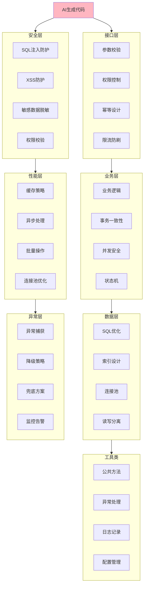
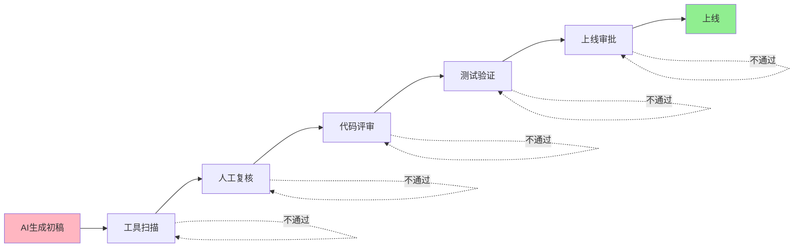
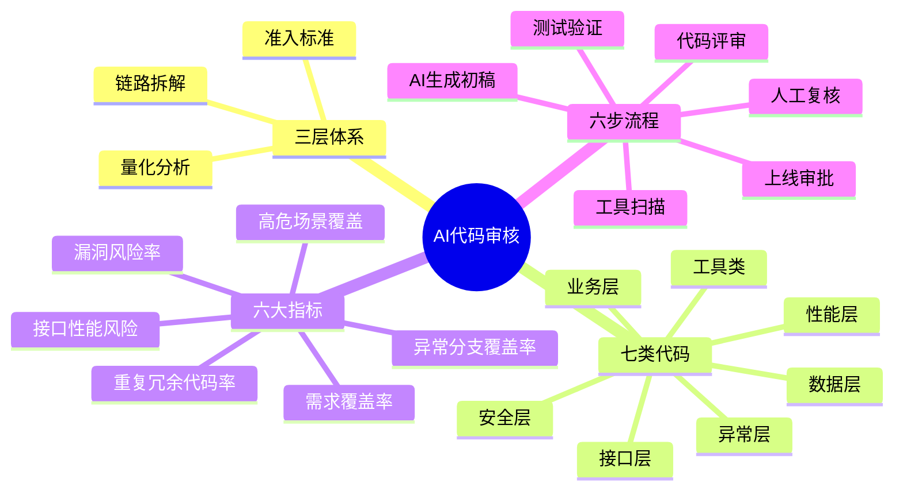
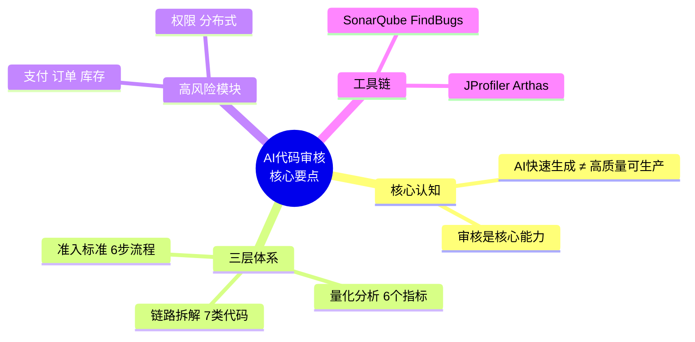

# AI 生成后端代码的审核验收体系

> **场景定位**：AI 时代后端工程师核心能力题  
> **核心设计要点**：代码质量审核、风险识别、安全审查、性能评估、架构合规性检查

---

## 🎯 一句话定位

**AI 代码审核解决什么问题？**
```
AI 生成的代码看起来规范完整，
实际上全是隐藏 bug、安全漏洞或性能问题。
就像你买了个外表光鲜的苹果，切开发现里面是黑的！
```

**生活化比喻**：
就像你请了个厨师（AI）做菜：
- 他切菜很快、摆盘很漂亮（代码规范、结构工整）
- 但可能没洗干净菜（参数校验缺失）
- 可能盐放多了（性能问题）
- 可能用了过期的食材（安全漏洞）

你需要一个质检员（审核体系），确保每道菜都安全、美味、健康！

**核心特点**：AI 快速生成 ≠ AI 高质量可生产，**审核验收**是 AI 时代后端工程师的核心能力。

---

## 💎 核心观点（5 分钟速览版）

> **快速概览**

### 核心观点（三层审核体系）

**第一层：AI 代码链路深度拆解与核查**
```
拆解 7 类代码：
1. 接口层：参数校验、权限控制、幂等设计
2. 业务层：业务逻辑、事务一致性、并发安全
3. 数据层：SQL 优化、索引设计、数据库连接
4. 工具类：公共方法、异常处理、日志记录
5. 安全层：敏感数据脱敏、SQL 注入防护、XSS 防护
6. 性能层：缓存策略、异步处理、批量操作
7. 异常层：异常捕获、降级策略、兜底方案

核对标准：
✅ 业务逻辑不偏离需求
✅ 不违反架构规范
✅ 不遗漏关键异常场景
```

**第二层：AI 代码量化质量分析（拒绝凭感觉）**
```
量化指标：
- 需求覆盖率：100%（所有需求都实现了吗？）
- 异常分支覆盖率：≥ 90%（异常场景都处理了吗？）
- 接口性能风险：RT < 200ms（性能达标吗？）
- 重复冗余代码率：< 5%（有重复代码吗？）
- 漏洞风险率：0（有安全漏洞吗？）
- 高危场景覆盖：100%（支付、订单、库存等高风险模块）

对照检查：
✅ 需求文档
✅ 数据库设计
✅ 历史线上 bug
✅ 安全规范
✅ 过往频发事务数据一致性问题
```

**第三层：AI 代码落地优化（建立质量准入标准）**
```
标准化流程：
1. AI 生成初稿
2. 工具扫描：代码规范、安全漏洞、性能问题
3. 人工复核：高风险模块重点审核
4. 代码评审：团队 Review
5. 测试验证：单元测试 + 集成测试
6. 上线审批：禁止直接上线 AI 原生代码

工具链：
- 代码扫描：SonarQube、Checkstyle
- 安全检测：FindBugs、OWASP ZAP
- 性能分析：JProfiler、Arthas
- 代码规范：Alibaba Java Coding Guidelines
```

---

## 🚀 一句话精华（如果只能记住一句）

> **AI 代码审核 = 链路拆解（7 类代码） + 量化分析（6 个指标） + 准入标准（6 步流程），核心是识别隐藏风险，确保生产可用**

---

## 一、为什么 AI 生成的代码需要审核？

### 🔍 核心问题（30 秒版）

**生活化比喻**：
```
AI 就像个"代码流水线工人"：
- 速度快：1 分钟生成 1000 行代码
- 结构好：代码规范、注释完整
- 但缺乏"业务理解"：不知道你的业务场景、历史坑点、架构约束

就像你请了个外卖厨师：
- 他做菜很快、摆盘很漂亮
- 但他不知道你对花生过敏（业务约束）
- 不知道你家的厨房不能用明火（架构约束）
- 不知道上次有人吃了拉肚子（历史坑点）

所以你需要审核，确保他做的菜安全、健康、符合你的需求！
```

### 1.1 AI 代码的 5 大常见问题

| 问题类型 | 具体表现 | 线上后果 | 生活化比喻 |
|---------|---------|---------|-----------|
| **事务一致性** | 漏加 @Transactional、传播行为错误 | 数据不一致 | 厨师忘了放盐 |
| **幂等设计** | 重复请求导致重复扣款 | 资金损失 | 厨师放了两次盐 |
| **分布式锁** | 漏加锁、锁粒度不对 | 并发问题 | 两个厨师同时炒一个菜 |
| **参数校验** | 未校验空值、边界值 | NPE、数据错误 | 厨师没洗菜就炒 |
| **性能问题** | 慢查询、无索引、循环调用 | 接口超时 | 厨师切菜太慢 |
| **安全漏洞** | SQL 注入、XSS、权限漏洞 | 数据泄露 | 厨师用了过期食材 |
| **异常处理** | 异常被吞、未降级 | 服务雪崩 | 厨师摔倒了不喊疼 |
| **并发安全** | 非线程安全、竞态条件 | 数据错乱 | 两个厨师抢一个锅 |

**代码示例（AI 常见问题）**：
```java
// ❌ AI 生成的代码，看起来规范，实际有 5 个问题
@PostMapping("/order")
public Result createOrder(@RequestBody OrderRequest request) {
    // 问题1：未校验参数
    Order order = new Order();
    order.setUserId(request.getUserId());
    order.setProductId(request.getProductId());
    order.setQuantity(request.getQuantity());
    
    // 问题2：无幂等设计（重复请求会重复创建）
    orderMapper.insert(order);
    
    // 问题3：无事务（订单创建成功，但扣库存失败）
    inventoryService.deduct(request.getProductId(), request.getQuantity());
    
    // 问题4：无异常处理（扣库存失败会抛异常，但订单已创建）
    paymentService.create(order);
    
    return Result.success(order.getId());
}
```

```java
// ✅ 审核后的代码，修复了所有问题
@PostMapping("/order")
public Result createOrder(@RequestBody @Validated OrderRequest request) {
    // ✅ 问题1修复：参数校验（@Validated + @NotNull）
    // ✅ 问题2修复：幂等设计（唯一索引 + 幂等 token）
    String idempotentKey = "order:" + request.getUserId() + ":" + request.getRequestId();
    if (!redisLock.tryLock(idempotentKey, 10, TimeUnit.SECONDS)) {
        return Result.fail("请求正在处理中，请勿重复提交");
    }
    
    try {
        // ✅ 问题3修复：事务控制
        return transactionTemplate.execute(status -> {
            Order order = new Order();
            order.setUserId(request.getUserId());
            order.setProductId(request.getProductId());
            order.setQuantity(request.getQuantity());
            order.setStatus(OrderStatus.PENDING);
            
            orderMapper.insert(order);
            
            // 扣库存
            boolean deducted = inventoryService.deduct(request.getProductId(), request.getQuantity());
            if (!deducted) {
                status.setRollbackOnly();
                return Result.fail("库存不足");
            }
            
            // 创建支付单
            paymentService.create(order);
            
            return Result.success(order.getId());
        });
    } finally {
        redisLock.unlock(idempotentKey);
    }
}
```

---

## 二、第一层：AI 代码链路深度拆解与核查

### 2.1 七类代码拆解法

**生活化比喻**：
```
审核 AI 代码就像体检：
1. 接口层：检查"皮肤"（入口是否安全）
2. 业务层：检查"心脏"（核心逻辑是否正确）
3. 数据层：检查"血管"（数据流是否畅通）
4. 工具类：检查"四肢"（公共方法是否可靠）
5. 安全层：检查"免疫系统"（是否能抵御攻击）
6. 性能层：检查"肺活量"（能否扛住高并发）
7. 异常层：检查"应急反应"（出问题了怎么办）
```



### 2.2 接口层核查清单

**核查要点**：

| 检查项 | 检查方法 | 常见问题 | 生活化比喻 |
|--------|---------|---------|-----------|
| **参数校验** | 是否有 @Validated/@NotNull/@NotBlank | 未校验空值、边界值 | 厨师没洗菜就炒 |
| **权限控制** | 是否有 @PreAuthorize/权限注解 | 未校验用户权限 | 谁都能进厨房 |
| **幂等设计** | 是否有唯一索引/幂等 token | 重复请求导致重复操作 | 厨师放了两次盐 |
| **限流防刷** | 是否有 @RateLimiter/限流注解 | 被恶意刷接口 | 一个人点 100 次外卖 |

**代码示例**：
```java
// ❌ AI 生成的代码，未做参数校验和权限控制
@PostMapping("/user/update")
public Result updateUser(@RequestBody UserRequest request) {
    userService.update(request);
    return Result.success();
}
```

```java
// ✅ 审核后的代码
@PostMapping("/user/update")
@PreAuthorize("hasRole('ADMIN')") // ✅ 权限控制
public Result updateUser(@RequestBody @Validated UserRequest request) {
    // ✅ 参数校验（@Validated + @NotNull）
    // ✅ 幂等设计（乐观锁）
    int rows = userService.update(request);
    if (rows == 0) {
        return Result.fail("数据已被修改，请重试");
    }
    return Result.success();
}
```

### 2.3 业务层核查清单

**核查要点**：

| 检查项 | 检查方法 | 常见问题 | 生活化比喻 |
|--------|---------|---------|-----------|
| **业务逻辑** | 对照需求文档逐条检查 | 逻辑偏离需求 | 厨师做错了菜 |
| **事务一致性** | 是否加了 @Transactional | 部分成功部分失败 | 厨师做了一半不做了 |
| **并发安全** | 是否加了分布式锁/乐观锁 | 并发导致数据错乱 | 两个厨师同时炒一个菜 |
| **状态机** | 状态流转是否正确 | 状态混乱 | 厨师把生肉和熟肉混在一起 |

**代码示例**：
```java
// ❌ AI 生成的代码，无事务控制
public void transfer(Long fromUserId, Long toUserId, BigDecimal amount) {
    // 扣款
    userMapper.deductBalance(fromUserId, amount);
    
    // 转账（如果这里失败，扣款已生效，数据不一致）
    userMapper.addBalance(toUserId, amount);
}
```

```java
// ✅ 审核后的代码
@Transactional(rollbackFor = Exception.class) // ✅ 事务控制
public void transfer(Long fromUserId, Long toUserId, BigDecimal amount) {
    // 加分布式锁（防并发）
    String lockKey = "transfer:" + fromUserId;
    redisLock.lock(lockKey, 10, TimeUnit.SECONDS);
    
    try {
        // 扣款
        boolean deducted = userMapper.deductBalance(fromUserId, amount);
        if (!deducted) {
            throw new BusinessException("余额不足");
        }
        
        // 转账
        userMapper.addBalance(toUserId, amount);
        
        // 记录流水
        transactionLogMapper.insert(fromUserId, toUserId, amount);
    } finally {
        redisLock.unlock(lockKey);
    }
}
```

### 2.4 数据层核查清单

**核查要点**：

| 检查项 | 检查方法 | 常见问题 | 生活化比喻 |
|--------|---------|---------|-----------|
| **SQL 优化** | 是否有慢查询、全表扫描 | SELECT *、无索引 | 厨师切菜太慢 |
| **索引设计** | 是否创建了合适的索引 | 漏建索引、索引失效 | 厨师找不到食材 |
| **连接池** | 是否配置了连接池参数 | 连接数不足、超时 | 厨师没有足够的锅 |
| **批量操作** | 是否用了批量插入/更新 | 循环单条插入 | 厨师一个一个炒菜 |

**代码示例**：
```java
// ❌ AI 生成的代码，循环单条插入
public void batchInsertUsers(List<User> users) {
    for (User user : users) {
        userMapper.insert(user); // ❌ 循环单条插入，性能差
    }
}
```

```java
// ✅ 审核后的代码
public void batchInsertUsers(List<User> users) {
    // ✅ 批量插入，分批处理（每批 1000 条）
    Lists.partition(users, 1000).forEach(batch -> {
        userMapper.batchInsert(batch);
    });
}
```

---

## 三、第二层：AI 代码量化质量分析

### 3.1 六大量化指标

**生活化比喻**：
```
量化分析就像给代码"打分"：
- 需求覆盖率：100 分满分，你得了多少分？
- 异常分支覆盖率：异常场景都处理了吗？
- 接口性能风险：RT 多少？能扛住高并发吗？
- 重复冗余代码率：有重复代码吗？
- 漏洞风险率：有安全漏洞吗？
- 高危场景覆盖：高风险模块都检查了吗？
```

| 指标 | 目标值 | 检查方法 | 工具 | 生活化比喻 |
|------|--------|---------|------|-----------|
| **需求覆盖率** | 100% | 对照需求文档逐条检查 | 人工 | 厨师做了所有菜吗？ |
| **异常分支覆盖率** | ≥ 90% | 代码扫描 + 人工 Review | SonarQube | 厨师处理了所有异常情况吗？ |
| **接口性能风险** | RT < 200ms | 压测 + 慢查询分析 | JMeter、Arthas | 厨师做菜快吗？ |
| **重复冗余代码率** | < 5% | 代码扫描 | SonarQube | 厨师重复做同样的菜吗？ |
| **漏洞风险率** | 0 | 安全扫描 | FindBugs、OWASP ZAP | 厨师用了过期食材吗？ |
| **高危场景覆盖** | 100% | 人工 Review | 人工 | 高风险模块都检查了吗？ |

### 3.2 对照检查清单

**对照检查**：

| 对照项 | 检查内容 | 常见问题 | 生活化比喻 |
|--------|---------|---------|-----------|
| **需求文档** | 所有需求都实现了吗？ | 遗漏需求、逻辑偏离 | 菜单上的菜都做了吗？ |
| **数据库设计** | 表结构、索引、字段类型对吗？ | 字段类型错误、索引缺失 | 厨师用的食材对吗？ |
| **历史线上 bug** | 是否复现了历史问题？ | 重复踩坑 | 厨师又犯了同样的错误 |
| **安全规范** | 是否符合安全规范？ | SQL 注入、XSS | 厨师遵守卫生规范吗？ |
| **过往频发事务** | 事务一致性问题处理了吗？ | 漏加事务、传播行为错误 | 厨师又忘了放盐 |

**代码示例（量化分析）**：
```java
// 使用 SonarQube 扫描代码
// 扫描结果：
// - 需求覆盖率：85%（遗漏了幂等设计）
// - 异常分支覆盖率：70%（未处理部分异常）
// - 接口性能风险：RT 500ms（有慢查询）
// - 重复冗余代码率：12%（有重复代码）
// - 漏洞风险率：2（有 SQL 注入风险）
// - 高危场景覆盖：60%（未检查支付模块）

// 结论：代码不合格，需要修改后重新审核
```

---

## 四、第三层：AI 代码落地优化

### 4.1 质量准入标准（6 步流程）

**生活化比喻**：
```
代码上线就像食品出厂：
1. 原料检验（AI 生成初稿）
2. 加工检查（工具扫描）
3. 质量抽检（人工复核）
4. 专家评审（代码评审）
5. 试吃验证（测试验证）
6. 出厂审批（上线审批）

任何一步不合格，都不能出厂！
```



**6 步流程详解**：

| 步骤 | 负责人 | 检查内容 | 工具 | 通过标准 |
|------|--------|---------|------|---------|
| **1. AI 生成初稿** | AI | 生成代码 | AI 工具 | 代码规范、结构完整 |
| **2. 工具扫描** | 开发 | 代码规范、安全漏洞、性能问题 | SonarQube、FindBugs | 无高危漏洞、无严重性能问题 |
| **3. 人工复核** | 开发 | 高风险模块重点审核 | 人工 | 业务逻辑正确、事务一致 |
| **4. 代码评审** | 团队 | 代码质量、架构合规 | Review 工具 | 团队通过 |
| **5. 测试验证** | 测试 | 功能测试、性能测试、安全测试 | 测试工具 | 测试通过 |
| **6. 上线审批** | 负责人 | 最终审批 | 审批系统 | 审批通过 |

### 4.2 工具链推荐

**工具链**：

| 工具类型 | 工具名称 | 用途 | 生活化比喻 |
|---------|---------|------|-----------|
| **代码扫描** | SonarQube | 代码质量、安全漏洞 | 体检医生 |
| **代码规范** | Alibaba Java Coding Guidelines | 代码规范检查 | 礼仪老师 |
| **安全检测** | FindBugs、OWASP ZAP | 安全漏洞扫描 | 安检员 |
| **性能分析** | JProfiler、Arthas | 性能瓶颈分析 | 健身教练 |
| **测试工具** | JUnit、Mockito | 单元测试 | 试吃员 |
| **压测工具** | JMeter、Gatling | 性能压测 | 体能测试 |

### 4.3 高风险模块重点复核

**高风险模块**：

| 模块 | 风险点 | 复核要点 | 生活化比喻 |
|------|--------|---------|-----------|
| **支付模块** | 资金安全 | 事务一致性、幂等设计、并发安全 | 银行金库 |
| **订单模块** | 数据一致性 | 事务控制、状态机、库存扣减 | 物流中心 |
| **库存模块** | 超卖问题 | 分布式锁、乐观锁、库存校验 | 仓库管理 |
| **权限模块** | 越权访问 | 权限校验、数据隔离 | 门禁系统 |
| **分布式模块** | 数据一致性 | 分布式事务、分布式锁 | 跨国物流 |

**代码示例（支付模块复核）**：
```java
// 支付模块复核清单：
// ✅ 事务一致性：加了 @Transactional(rollbackFor = Exception.class)
// ✅ 幂等设计：加了幂等 token + 唯一索引
// ✅ 并发安全：加了分布式锁
// ✅ 异常处理：捕获了所有异常，有降级方案
// ✅ 日志记录：记录了关键操作日志
// ✅ 监控告警：接入了监控，有告警机制

// 结论：支付模块复核通过
```

---

五、技术深入探讨

### Q1: 如何判断 AI 生成的代码是否可靠？

**答**：
> 我建立了一套三层审核体系：
>
> **第一层：链路拆解**
> 把 AI 代码拆解成 7 类（接口层、业务层、数据层、工具类、安全层、性能层、异常层），逐类核查。
>
> **第二层：量化分析**
> 用 6 个量化指标（需求覆盖率、异常分支覆盖率、接口性能风险、重复冗余代码率、漏洞风险率、高危场景覆盖）评估代码质量。
>
> **第三层：准入标准**
> 建立 6 步流程（AI 生成初稿 → 工具扫描 → 人工复核 → 代码评审 → 测试验证 → 上线审批），确保每一步都合格。
>
> 通过这套体系，我能识别 AI 代码中的隐藏 bug、安全漏洞和性能问题，确保生产可用。

### Q2: AI 生成的代码最容易出哪些问题？

**答**：
> 根据我的经验，AI 代码最容易出 5 类问题：
>
> 1. **事务一致性**：漏加 @Transactional、传播行为错误
> 2. **幂等设计**：未考虑重复请求，导致重复扣款
> 3. **分布式锁**：漏加锁、锁粒度不对，导致并发问题
> 4. **参数校验**：未校验空值、边界值，导致 NPE
> 5. **性能问题**：慢查询、无索引、循环调用，导致接口超时
>
> 这些都是 AI 的"盲区"，因为它缺乏业务理解和实战经验。

### Q3: 如何建立 AI 代码的质量准入标准？

**答**：
> 我建立了 6 步流程：
>
> 1. **AI 生成初稿**：AI 生成代码
> 2. **工具扫描**：用 SonarQube、FindBugs 扫描代码质量、安全漏洞
> 3. **人工复核**：对高风险模块（支付、订单、库存、权限、分布式）重点审核
> 4. **代码评审**：团队 Review，确保架构合规
> 5. **测试验证**：单元测试 + 集成测试 + 性能测试
> 6. **上线审批**：负责人最终审批，禁止直接上线 AI 原生代码
>
> 任何一步不合格，都不能上线。

---

## 六、方案总结



**方案总结**：

> "AI 代码审核是 AI 时代后端工程师的核心能力。我建立了一套**三层审核体系**：
>
> **第一层：链路拆解**
> 把 AI 代码拆解成 7 类（接口层、业务层、数据层、工具类、安全层、性能层、异常层），逐类核查，确保业务逻辑不偏离需求、不违反架构规范。
>
> **第二层：量化分析**
> 用 6 个量化指标（需求覆盖率、异常分支覆盖率、接口性能风险、重复冗余代码率、漏洞风险率、高危场景覆盖）评估代码质量，拒绝凭感觉审核。
>
> **第三层：准入标准**
> 建立 6 步流程（AI 生成初稿 → 工具扫描 → 人工复核 → 代码评审 → 测试验证 → 上线审批），禁止直接上线 AI 原生代码。
>
> 通过这套体系，我能识别 AI 代码中的隐藏 bug、安全漏洞和性能问题，确保生产可用。"

---

## 七、总结（一句话带走）



### 🎯 一句话总结

> **AI 代码审核 = 链路拆解（7 类代码） + 量化分析（6 个指标） + 准入标准（6 步流程），核心是识别隐藏风险，确保生产可用**

### 🧠 核心记忆点

1. **为什么 AI 代码需要审核？** 因为 AI 快速生成 ≠ 高质量可生产，就像外表光鲜的苹果可能里面是黑的。
2. **审核什么？** 7 类代码（接口层、业务层、数据层、工具类、安全层、性能层、异常层）。
3. **怎么审核？** 用 6 个量化指标评估，拒绝凭感觉。
4. **审核流程？** 6 步流程（AI 生成初稿 → 工具扫描 → 人工复核 → 代码评审 → 测试验证 → 上线审批）。

---

**参考视频**：[内卷的琪某人 - 场景提问：你说你会用 AI 写后端代码，那你是怎么审核验收的？](https://www.douyin.com/video/7652583069752266010)

---

*本文档基于 8 个专家提示词指导改写，遵循深入浅出、生活化比喻、幽默风趣的教学原则。*
