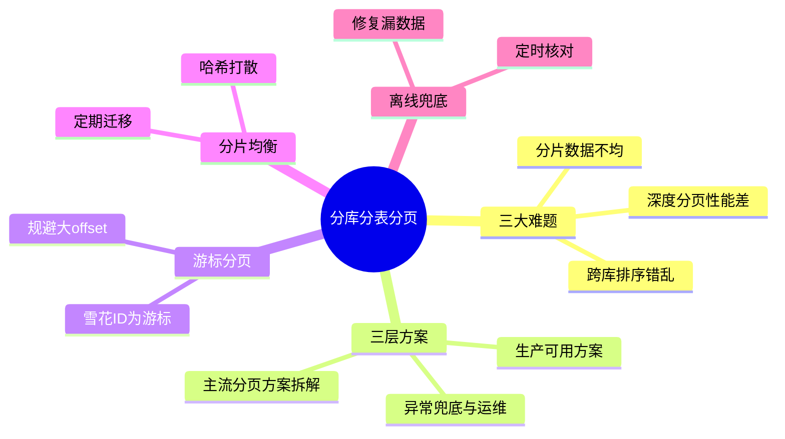
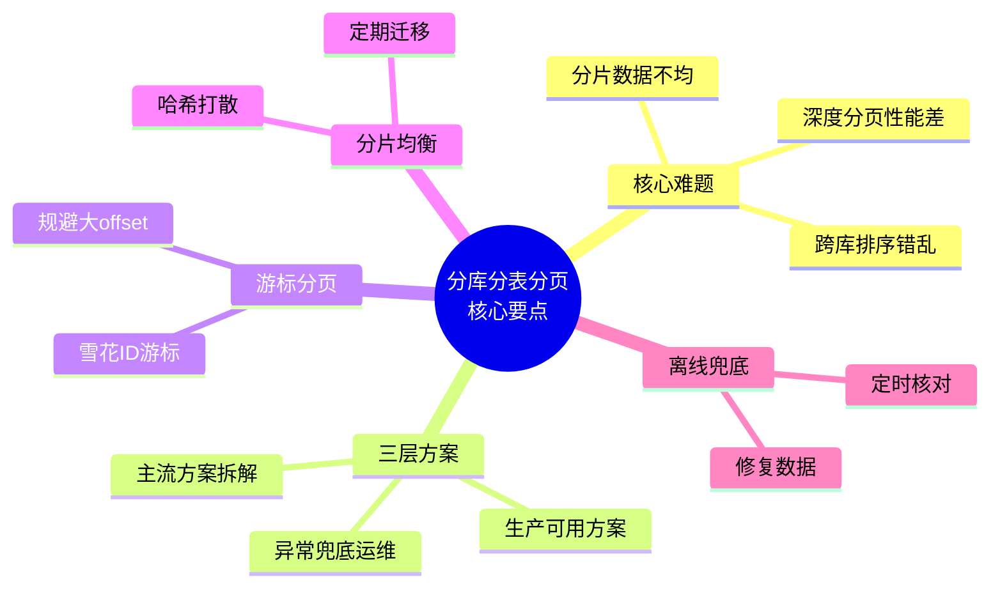

# 分库分表海量数据分页查询方案

> **场景定位**：海量数据架构设计题  
> **核心设计要点**：分库分表、深度分页、游标分页、分片数据均衡、跨库排序、离线校验

---

## 🎯 一句话定位

**分库分表分页解决什么问题？**
```
数据量太大（亿级），单表查询太慢，
所以分库分表。但分页查询时：
- 深度分页性能极差（offset 10000 要扫描大量数据）
- 分片数据不均（第一页正常，第二页丢数据）
- 跨库排序错乱（雪花 ID 无法保证全局有序）

就像你把一本书撕成 10 份，想按页码查找，但每份的页码不连续！
```

**生活化比喻**：
就像你把一本 1000 页的书撕成 10 份（分片），每份 100 页：
- **深度分页**：你想看第 900 页，但每份都要从第 1 页翻到第 90 页（offset 扫描）
- **分片数据不均**：有的份 150 页，有的份 50 页（数据倾斜）
- **跨库排序错乱**：每份的页码不连续，无法全局排序

**核心特点**：分库分表后，分页查询需要兼顾**性能**与**数据完整性**，同时保证**全局有序**。

---

## 💎 核心观点（5 分钟速览版）

> **快速概览**

### 核心观点（三层核心逻辑）

**第一层：主流分页方案拆解**
```
三种方案对比：
1. LIMIT 偏移分页：实现简单，但深度性能极差
   - 适用：数据量小、页数浅
   - 缺陷：offset 10000 要扫描 10000 条数据

2. 缓存分页：只能支撑短期查询
   - 适用：数据变化不频繁
   - 缺陷：新增/删除数据会导致分页错乱

3. 游标分页：以雪花 ID 为游标，规避大 offset
   - 适用：海量数据、深度分页
   - 缺陷：依赖有序分片主键
```

**第二层：生产可用分库分表分页方案**
```
三大核心策略：
1. 游标分页：以雪花 ID 为游标，每次查询 > 上一页最大 ID
   - 避免大 offset 扫描
   - 分片只查询最小数据集

2. 分片数据均衡：
   - 分片键合理哈希打散
   - 定期迁移冷热数据
   - 避免单分片数据堆积

3. 跨库排序优化：
   - 每张分片查询最小数据集
   - 内存中归并排序
   - 减少全量数据聚合开销
```

**第三层：异常兜底与运维防护**
```
四大防线：
1. 分页上限管控：限制最大页码，禁止超大 offset
2. 前端引导：使用游标分页（"加载更多"而非"翻页"）
3. 总数精准统计：定时任务预计算分片总条数，缓存实时分页
4. 全链路监控：监控分页接口 RT、深度分页请求量、分片数据倾斜

兜底方案：
- 离线数据核对：每日定时校验分片分页数据，修复漏数据、重复展示
```

---

## 🚀 一句话精华（如果只能记住一句）

> **分库分表分页 = 游标分页（规避大 offset） + 分片均衡（防数据倾斜） + 离线校验（兜底数据一致性）**

---

## 一、为什么分库分表后分页查询这么难？

### 🔍 核心问题（30 秒版）

**生活化比喻**：
```
单表分页就像查一本完整的书：
- 想看第 100 页，直接翻到第 100 页

分库分表分页就像查 10 本撕碎的书：
- 想看第 100 页，但不知道在哪一本
- 每本都要从第 1 页翻到第 10 页（offset 扫描）
- 有的书 150 页，有的书 50 页（数据倾斜）
- 每本书的页码不连续（跨库排序错乱）

所以分库分表分页的核心难点是：
1. 深度分页性能极差
2. 分片数据不均导致漏数据
3. 跨库排序无法保证全局有序
```

### 1.1 三大核心难题

| 难题 | 具体表现 | 线上后果 | 生活化比喻 |
|------|---------|---------|-----------|
| **深度分页性能差** | offset 10000 要扫描大量数据 | 接口 RT 飙升、超时 | 翻书翻到手酸 |
| **分片数据不均** | 有的分片 150 万条，有的 50 万条 | 第一页正常，第二页丢数据 | 有的书厚，有的书薄 |
| **跨库排序错乱** | 雪花 ID 无法保证全局有序 | 排序结果混乱 | 每本书的页码不连续 |

**代码示例（深度分页性能问题）**：
```java
// ❌ 深度分页，性能极差
SELECT * FROM orders WHERE user_id = 123 ORDER BY created_at DESC LIMIT 10000, 10;

// 问题：要扫描前 10000 条数据，然后丢弃，只取第 10001-10010 条
// 如果分库分表，每张分片都要扫描 10000 条，然后聚合，性能更差！
```

```java
// ✅ 游标分页，规避大 offset
SELECT * FROM orders 
WHERE user_id = 123 
  AND id > 1234567890  // 上一页最大 ID（游标）
ORDER BY created_at DESC 
LIMIT 10;

// 优势：只扫描 > 游标的 10 条数据，性能稳定
```

---

## 二、第一层：主流分页方案拆解

### 2.1 LIMIT 偏移分页

**原理**：
```java
SELECT * FROM orders 
ORDER BY created_at DESC 
LIMIT offset, size;
```

**优点**：
- ✅ 实现简单，语法通用
- ✅ 适合数据量小、页数浅的场景

**缺点**：
- ❌ 深度分页性能极差（offset 10000 要扫描 10000 条数据）
- ❌ 分库分表后，每张分片都要扫描 offset + size 条数据，然后聚合
- ❌ 数据量大时，接口 RT 飙升

**适用场景**：
- 数据量 < 100 万
- 页数 < 100 页

**生活化比喻**：
> 就像翻书，想看第 100 页，要从第 1 页翻到第 100 页。页数越大，翻得越慢。

---

### 2.2 缓存分页

**原理**：
```java
// 第一次查询，缓存结果
List<Order> orders = orderMapper.selectPage(offset, size);
cache.set("page:" + offset, orders, 5, TimeUnit.MINUTES);

// 后续查询，从缓存读取
List<Order> cachedOrders = cache.get("page:" + offset);
```

**优点**：
- ✅ 性能好（缓存命中时）
- ✅ 适合数据变化不频繁的场景

**缺点**：
- ❌ 新增/删除数据会导致分页错乱
- ❌ 只能支撑短期查询（缓存 TTL 内）
- ❌ 数据一致性差

**适用场景**：
- 数据变化不频繁（如配置数据）
- 对一致性要求不高的场景

**生活化比喻**：
> 就像你把书的目录抄下来，下次直接看目录。但如果书的内容变了（新增/删除章节），目录就过时了。

---

### 2.3 游标分页（推荐）

**原理**：
```java
// 第一页查询
SELECT * FROM orders 
ORDER BY id DESC 
LIMIT 10;

// 第二页查询（携带上一页最大 ID 作为游标）
SELECT * FROM orders 
WHERE id > 1234567890  // 上一页最大 ID
ORDER BY id DESC 
LIMIT 10;
```

**优点**：
- ✅ 性能稳定（规避大 offset 扫描）
- ✅ 适合海量数据、深度分页
- ✅ 分片查询效率高（每张分片只查询 > 游标的数据）

**缺点**：
- ❌ 依赖有序分片主键（如雪花 ID）
- ❌ 无法跳页（只能"加载更多"）
- ❌ 业务主键非自增时，需要额外设计

**适用场景**：
- 数据量大（亿级）
- 深度分页（offset > 10000）
- 分库分表场景

**生活化比喻**：
> 就像你看书时，记住上一页最后一页的页码，下次直接从这一页开始看。不用从第 1 页翻起。

**代码示例（游标分页）**：
```java
// 游标分页实现
public List<Order> queryOrders(Long lastId, Integer size) {
    // 第一页：lastId = null
    // 后续页：lastId = 上一页最大 ID
    
    List<Order> orders;
    if (lastId == null) {
        // 第一页
        orders = orderMapper.selectList(
            new QueryWrapper<Order>()
                .orderByDesc("id")
                .last("LIMIT " + size)
        );
    } else {
        // 后续页（游标分页）
        orders = orderMapper.selectList(
            new QueryWrapper<Order>()
                .gt("id", lastId)  // > 上一页最大 ID
                .orderByDesc("id")
                .last("LIMIT " + size)
        );
    }
    
    return orders;
}
```

---

## 三、第二层：生产可用分库分表分页方案

### 3.1 游标分页 + 分片数据均衡

**核心策略**：


**游标分页实现（分库分表）**：
```java
// 分库分表游标分页
public List<Order> queryOrdersSharding(Long lastId, Integer size) {
    // 1. 确定分片（根据分片键）
    List<DataSource> shards = shardingRouter.getShards();
    
    // 2. 每张分片查询 > lastId 的最小数据集
    List<Order> allOrders = new ArrayList<>();
    for (DataSource shard : shards) {
        List<Order> shardOrders = shard.query(
            "SELECT * FROM orders WHERE id > ? ORDER BY id DESC LIMIT ?",
            lastId, size
        );
        allOrders.addAll(shardOrders);
    }
    
    // 3. 内存中归并排序
    allOrders.sort((a, b) -> b.getId().compareTo(a.getId()));
    
    // 4. 取前 size 条
    return allOrders.subList(0, Math.min(size, allOrders.size()));
}
```

**分片数据均衡策略**：

| 策略 | 实现方法 | 优点 | 缺点 | 生活化比喻 |
|------|---------|------|------|-----------|
| **分片键哈希打散** | 用 user_id % 16 分片 | 数据均匀分布 | 查询需要广播所有分片 | 把书平均撕成 10 份 |
| **定期迁移冷热数据** | 定时任务迁移历史数据 | 避免单分片堆积 | 迁移成本高 | 把厚的书撕几页给薄的书 |
| **分片键范围分片** | 按时间范围分片（如按月） | 查询效率高 | 数据可能不均匀 | 按章节分书 |

**代码示例（分片数据迁移）**：
```java
// 定时任务：迁移冷热数据
@Scheduled(cron = "0 0 2 * * ?") // 每天凌晨 2 点
public void migrateHotColdData() {
    // 1. 查询热点分片（数据量 > 阈值）
    List<Shard> hotShards = shardMonitor.getHotShards(1000000);
    
    // 2. 查询冷分片（数据量 < 阈值）
    List<Shard> coldShards = shardMonitor.getColdShards(500000);
    
    // 3. 迁移数据
    for (Shard hotShard : hotShards) {
        for (Shard coldShard : coldShards) {
            // 迁移 10 万条数据
            orderMapper.migrate(hotShard, coldShard, 100000);
        }
    }
}
```

### 3.2 跨库排序优化

**问题**：
```
分库分表后，每张分片的数据是独立的。
如果按 created_at 排序，每张分片的 created_at 是局部有序的，
但全局无序。

就像 10 本书，每本书的页码是连续的，
但 10 本书之间的页码不连续。
```

**解决方案**：
```java
// 跨库排序优化
public List<Order> queryOrdersWithSort(String sortField, Integer size) {
    // 1. 每张分片查询最小数据集（只查询 size 条）
    List<DataSource> shards = shardingRouter.getShards();
    List<Order> allOrders = new ArrayList<>();
    
    for (DataSource shard : shards) {
        List<Order> shardOrders = shard.query(
            "SELECT * FROM orders ORDER BY ? DESC LIMIT ?",
            sortField, size
        );
        allOrders.addAll(shardOrders);
    }
    
    // 2. 内存中归并排序
    allOrders.sort((a, b) -> {
        if ("created_at".equals(sortField)) {
            return b.getCreatedAt().compareTo(a.getCreatedAt());
        }
        return 0;
    });
    
    // 3. 取前 size 条
    return allOrders.subList(0, Math.min(size, allOrders.size()));
}
```

**优化效果**：
- ✅ 每张分片只查询 size 条数据（不是全量）
- ✅ 内存中归并排序（性能高）
- ✅ 减少全量数据聚合开销

---

## 四、第三层：异常兜底与运维防护

### 4.1 分页上限管控

**生活化比喻**：
```
限制最大页码就像限制电梯的最大载重：
- 防止用户翻到第 10000 页（深度分页）
- 防止接口超时、数据库压力过大

如果用户真的需要看第 10000 页，
引导他使用搜索功能，而不是翻页。
```

**代码示例**：
```java
// 限制最大页码
public List<Order> queryOrders(Integer pageNum, Integer pageSize) {
    // 限制最大页码 100
    if (pageNum > 100) {
        throw new BusinessException("页码不能超过 100，请使用搜索功能");
    }
    
    // 限制每页大小 50
    if (pageSize > 50) {
        throw new BusinessException("每页最多显示 50 条");
    }
    
    int offset = (pageNum - 1) * pageSize;
    return orderMapper.selectPage(offset, pageSize);
}
```

### 4.2 前端引导游标分页

**生活化比喻**：
```
前端引导就像导航：
- 传统翻页：1 2 3 4 5 ... 100（用户喜欢翻到很后面）
- 游标分页：加载更多 / 无限滚动（用户只能往后看）

引导用户使用"加载更多"，而不是"翻页"，
就能避免深度分页问题。
```

**实现方式**：
```javascript
// 前端：使用"加载更多"而不是"翻页"
let lastId = null;

function loadMore() {
    fetch(`/api/orders?lastId=${lastId}&size=10`)
        .then(response => response.json())
        .then(orders => {
            renderOrders(orders);
            if (orders.length > 0) {
                lastId = orders[orders.length - 1].id;
            }
        });
}
```

### 4.3 总数精准统计

**问题**：
```
分库分表后，统计总数需要聚合所有分片的 count，
性能差。

就像你要数 10 本书的总页数，
每本都要数一遍，然后加起来。
```

**解决方案**：

**方案 1：定时任务预计算**
```java
// 定时任务：每小时更新总数
@Scheduled(cron = "0 0 * * * ?")
public void updateTotalCount() {
    long totalCount = 0;
    
    // 聚合所有分片的 count
    List<DataSource> shards = shardingRouter.getShards();
    for (DataSource shard : shards) {
        long count = shard.query("SELECT COUNT(*) FROM orders");
        totalCount += count;
    }
    
    // 缓存总数
    cache.set("orders:total_count", totalCount, 1, TimeUnit.HOURS);
}
```

**方案 2：估算值（放弃精准 count）**
```java
// 用估算值代替精准 count
public long estimateTotalCount() {
    // 方案1：用最大 ID 估算
    long maxId = orderMapper.selectMaxId();
    return maxId * 0.8; // 假设有 20% 的数据被删除
    
    // 方案2：用抽样统计
    // 随机抽取 10 个分片，计算平均值，然后乘以总分片数
}
```

### 4.4 全链路监控告警

**监控指标**：

| 指标 | 告警阈值 | 告警原因 | 生活化比喻 |
|------|---------|---------|-----------|
| **分页接口 RT** | > 500ms | 深度分页、慢查询 | 翻书翻得太慢 |
| **深度分页请求量** | > 100 次/分钟 | 用户频繁翻到很后面 | 有人恶意翻书 |
| **分片数据倾斜** | 最大分片 / 最小分片 > 3 | 数据不均匀 | 有的书太厚，有的书太薄 |
| **分页错误率** | > 1% | 分页逻辑错误 | 书撕坏了 |

**代码示例（监控告警）**：
```java
// 监控分页接口 RT
@Around("@annotation(PageQuery)")
public Object monitorPageQuery(ProceedingJoinPoint pjp) throws Throwable {
    long startTime = System.currentTimeMillis();
    
    try {
        Object result = pjp.proceed();
        long rt = System.currentTimeMillis() - startTime;
        
        // 监控 RT
        if (rt > 500) {
            alertService.send("分页接口 RT 过高: " + rt + "ms");
        }
        
        return result;
    } catch (Throwable e) {
        alertService.send("分页接口异常: " + e.getMessage());
        throw e;
    }
}
```

### 4.5 离线数据兜底核对

**生活化比喻**：
```
离线核对就像图书管理员每天闭馆后检查：
- 有没有书页丢失（漏数据）
- 有没有书页重复（重复展示）
- 有没有书页顺序错乱（排序错误）

发现问题，及时修复。
```

**代码示例（离线核对）**：
```java
// 每日定时核对
@Scheduled(cron = "0 0 3 * * ?") // 每天凌晨 3 点
public void verifyPageData() {
    // 1. 随机抽取 1000 个用户
    List<Long> userIds = userMapper.selectRandom(1000);
    
    // 2. 对每个用户，核对分页数据
    for (Long userId : userIds) {
        // 查询用户的所有订单（全量）
        List<Order> allOrders = orderMapper.selectByUserId(userId);
        
        // 分页查询（逐页查询）
        List<Order> pageOrders = new ArrayList<>();
        Long lastId = null;
        while (true) {
            List<Order> page = queryOrders(userId, lastId, 100);
            if (page.isEmpty()) break;
            pageOrders.addAll(page);
            lastId = page.get(page.size() - 1).getId();
        }
        
        // 核对：全量数据 vs 分页数据
        if (allOrders.size() != pageOrders.size()) {
            alertService.send("用户 " + userId + " 分页数据不一致");
        }
    }
}
```

---

五、技术深入探讨

### Q1: 深度分页性能差，怎么优化？

**答**：
> 深度分页性能差的核心原因是 **大 offset 扫描**。优化方案有三种：
>
> 1. **游标分页**：以雪花 ID 为游标，每次查询 > 上一页最大 ID，规避大 offset。适用于海量数据、深度分页场景。
> 2. **限制最大页码**：禁止用户翻到第 10000 页，引导使用搜索功能。
> 3. **延迟关联**：先查询 ID，再关联查询完整数据。
>
> 推荐方案：**游标分页 + 前端引导（"加载更多"而不是"翻页"）**。

### Q2: 分片数据不均，导致分页漏数据，怎么解决？

**答**：
> 分片数据不均的原因是**分片键不合理**或**数据分布不均匀**。解决方案：
>
> 1. **分片键哈希打散**：用 user_id % 16 分片，保证数据均匀分布。
> 2. **定期迁移冷热数据**：定时任务迁移热点分片的数据到冷分片。
> 3. **离线数据核对**：每日定时校验分片分页数据，修复漏数据、重复展示。
>
> 核心思想：**分片均衡 + 离线兜底**。

### Q3: 雪花 ID 无法保证全局有序，跨库排序怎么解决？

**答**：
> 雪花 ID 是趋势递增的，但不是全局有序的（因为包含机器 ID）。跨库排序的解决方案：
>
> 1. **每张分片查询最小数据集**：每张分片只查询 size 条数据（不是全量）。
> 2. **内存中归并排序**：把所有分片的数据在内存中归并排序。
> 3. **取前 size 条**：排序后取前 size 条返回。
>
> 优势：每张分片只查询 size 条数据，内存中归并排序性能高，减少全量数据聚合开销。

---

## 六、方案总结



**方案总结**：

> "分库分表分页的核心难题是：**深度分页性能差、分片数据不均、跨库排序错乱**。
>
> 我的解决方案分三层：
>
> **第一层：主流分页方案拆解**
> LIMIT 偏移分页实现简单，但深度性能差；缓存分页性能好，但一致性差；**游标分页**以雪花 ID 为游标，规避大 offset，适合海量数据。
>
> **第二层：生产可用方案**
> 1. 游标分页：以雪花 ID 为游标，每次查询 > 上一页最大 ID
> 2. 分片数据均衡：分片键哈希打散 + 定期迁移冷热数据
> 3. 跨库排序优化：每张分片查询最小数据集 + 内存中归并排序
>
> **第三层：异常兜底与运维防护**
> 1. 分页上限管控：限制最大页码，禁止超大 offset
> 2. 前端引导：使用游标分页（"加载更多"而非"翻页"）
> 3. 总数精准统计：定时任务预计算分片总条数
> 4. 全链路监控：监控分页接口 RT、深度分页请求量、分片数据倾斜
> 5. 离线数据核对：每日定时校验分片分页数据，修复漏数据、重复展示
>
> 通过这套方案，能解决海量数据分页漏查、超时问题。"

---

## 七、总结（一句话带走）



### 🎯 一句话总结

> **分库分表分页 = 游标分页（规避大 offset） + 分片均衡（防数据倾斜） + 离线校验（兜底数据一致性）**

### 🧠 核心记忆点

1. **为什么深度分页性能差？** 因为大 offset 扫描，就像翻书翻到手酸。
2. **为什么分片数据不均会漏数据？** 因为有的分片 150 万条，有的 50 万条，分页时数据对不上。
3. **怎么解决？** 游标分页（以雪花 ID 为游标） + 分片均衡（哈希打散 + 定期迁移） + 离线校验（定时核对）。

---

**参考视频**：[内卷的琪某人 - 场景提问：大量数据下出现数据漏查、重复分页该怎么解决？](https://www.douyin.com/video/7652319547168460070)

---

*本文档基于 8 个专家提示词指导改写，遵循深入浅出、生活化比喻、幽默风趣的教学原则。*
