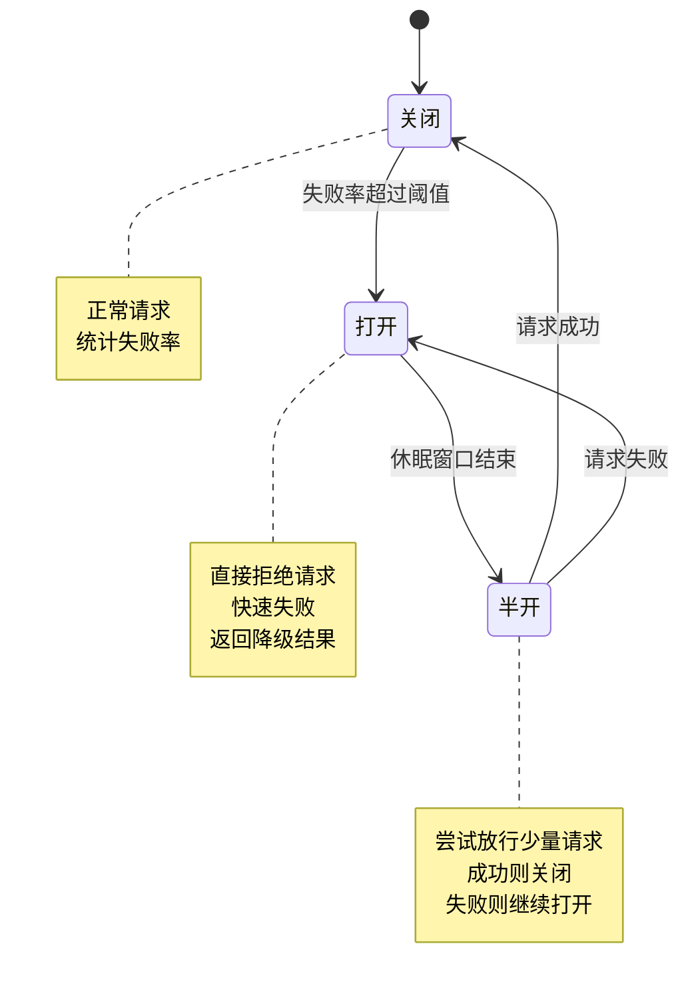
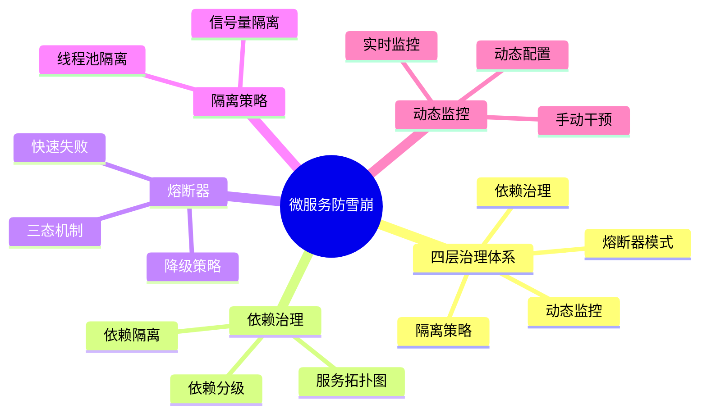
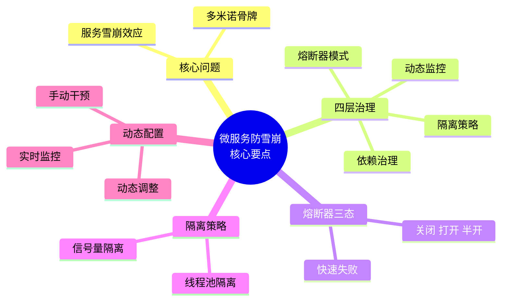

# 微服务雪崩效应与服务治理体系

> **场景定位**：微服务架构设计题  
> **核心设计要点**：服务雪崩、熔断器模式、资源隔离、依赖治理、动态监控

---

## 🎯 一句话定位

**微服务雪崩解决什么问题？**
```
微服务架构 A → B → C → D，
某天 D 服务响应变慢，
结果 A、B、C 全部陷入堵塞，
最终整个集群崩溃。

就像一个人生了感冒，
结果传染给了全家，最后全倒了！
```

**生活化比喻**：
就像一条生产线：
- A 工位依赖 B 工位
- B 工位依赖 C 工位
- C 工位依赖 D 工位

某天 D 工位慢了（机器故障），
结果 C 工位堆积（等待 D），
B 工位堆积（等待 C），
A 工位堆积（等待 B），
最后整条生产线瘫痪！

**核心特点**：微服务不是"一堆服务的简单组合"，而是一个需要**精心治理的生态系统**。没有治理，一个感冒就能传染成瘟疫。

---

## 💎 核心观点（5 分钟速览版）

> **快速概览**

### 核心观点（四层服务治理体系）

**第一层：依赖治理（服务拓扑）**
```
核心思想：
1. 用链路追踪工具（SkyWalking、Zipkin）画出服务调用拓扑图
2. 找出核心链路和薄弱环节
3. 依赖分级：核心服务（订单、支付）vs 非核心服务（积分、推荐）
4. 非核心挂了不能影响核心流程 → 依赖隔离

生活化比喻：
就像医院的分级诊疗：
- 感冒发烧去社区医院（非核心）
- 重病大病去三甲医院（核心）
- 社区医院关门了，不影响三甲医院
```

**第二层：熔断器模式（三态机制）**
```
熔断器三个状态：
1. 关闭状态：正常请求，统计失败率
   - 配置阈值（10 秒内失败率超过 50%）
   - 达到阈值就打开熔断器

2. 打开状态：直接拒绝请求，快速失败
   - 返回降级结果（兜底数据）
   - 给服务喘息的时间恢复

3. 半开状态：尝试放行少量请求
   - 过一段时间（休眠窗口）
   - 如果成功，关闭熔断器
   - 如果失败，继续保持打开

生活化比喻：
就像保险丝：
- 正常用电：保险丝闭合（关闭状态）
- 电流过大：保险丝熔断（打开状态）
- 修好后：尝试通电（半开状态）
```

**第三层：隔离策略（线程池 vs 信号量）**
```
两种隔离模式：
1. 线程池隔离：每个依赖服务分配独立线程池
   - A 服务慢只占自己的线程池，不影响其他服务
   - 适合慢调用、IO 密集型
   - 缺点：线程切换有开销

2. 信号量隔离：用信号量限制并发数
   - 不切换线程，性能更高
   - 适合高并发、快的调用（如本地缓存查询）
   - 缺点：无法隔离慢调用

推荐组件：
- Resilience4j（轻量、功能强）
- Sentinel（阿里开源、功能丰富）
- Hystrix（已停止维护，不推荐）

生活化比喻：
就像餐厅的分区：
- 线程池隔离：VIP 区、普通区、外卖区各自独立
- 信号量隔离：限制总人数，但不分区
```

**第四层：实时监控与动态配置（可观测性）**
```
三大监控维度：
1. 业务指标：QPS、RT、错误率
2. 熔断器状态：关闭、打开、半开
3. 资源使用：线程池使用率、信号量使用率

动态配置：
- 通过配置中心（Nacos、Apollo）实时修改熔断阈值
- 不用重启服务
- 发现异常可以手动打开熔断器，提前切流量

生活化比喻：
就像汽车的仪表盘：
- 实时监控：速度、油量、水温
- 动态调整：根据路况调整速度
- 异常告警：水温过高自动报警
```

---

## 🚀 一句话精华（如果只能记住一句）

> **微服务防雪崩 = 依赖治理（分级隔离） + 熔断器（三态机制） + 资源隔离（线程池/信号量） + 动态监控（可观测性）**

---

## 一、为什么一个服务挂了，整个系统都崩了？

### 🔍 核心问题（30 秒版）

**生活化比喻**：
```
微服务雪崩就像"多米诺骨牌"：
- A 调用 B，B 调用 C，C 调用 D
- D 慢了 → B 等待 → A 等待
- 最终 A、B、C 全部堵塞，整个系统崩溃

根本原因：
1. 同步调用：A 等 B，B 等 C，C 等 D（串行等待）
2. 无隔离：D 慢了，占用了 C 的资源，C 又占用了 B 的资源
3. 无熔断：D 已经挂了，但 C 还在傻等，不知道放弃
```

### 1.1 服务雪崩的过程

```mermaid
sequenceDiagram
    participant A as 服务A
    participant B as 服务B
    participant C as 服务C
    participant D as 服务D
    
    Note over D: D 服务响应变慢
    A->>B: 请求
    B->>C: 转发
    C->>D: 转发
    Note over D: 响应超时
    D-->>C: 超时
    Note over C: C 等待 D，线程阻塞
    C-->>B: 超时
    Note over B: B 等待 C，线程阻塞
    B-->>A: 超时
    Note over A: A 等待 B，线程阻塞
    Note over A,B,C: 所有线程都被占用，无法处理新请求
    Note over A,B,C,D: 整个系统崩溃！
```

**代码示例（雪崩场景）**：
```java
// 服务 A
@Service
public class ServiceA {
    @Autowired
    private ServiceB serviceB;
    
    public String process() {
        // 调用 B，B 调用 C，C 调用 D
        return serviceB.process();
    }
}

// 服务 B
@Service
public class ServiceB {
    @Autowired
    private ServiceC serviceC;
    
    public String process() {
        return serviceC.process();
    }
}

// 服务 C
@Service
public class ServiceC {
    @Autowired
    private ServiceD serviceD;
    
    public String process() {
        // D 慢了，C 就在这里等待，线程阻塞
        return serviceD.process();
    }
}

// 服务 D（响应变慢）
@Service
public class ServiceD {
    public String process() {
        // 模拟响应变慢
        Thread.sleep(10000); // 10 秒
        return "OK";
    }
}
```

**结果**：
- D 慢了 → C 等待 → B 等待 → A 等待
- 所有线程都被占用，无法处理新请求
- 整个系统崩溃！

---

## 二、第一层：依赖治理（服务拓扑）

### 2.1 服务调用拓扑图

**生活化比喻**：
```
画服务调用拓扑图就像画"家族族谱"：
- 谁调用谁？
- 谁是核心服务？
- 谁是非核心服务？
- 哪些环节最脆弱？

知道了族谱，才能分清"嫡系"和"旁支"，
核心服务挂了要优先恢复，
非核心服务挂了可以先不管。
```

**工具推荐**：
- **SkyWalking**： Apache 开源，功能强大
- **Zipkin**： Twitter 开源，轻量级
- **Jaeger**： Uber 开源，云原生

**代码示例（SkyWalking 集成）**：
```java
// pom.xml 添加依赖
<dependency>
    <groupId>org.apache.skywalking</groupId>
    <artifactId>apm-toolkit-trace</artifactId>
    <version>8.12.0</version>
</dependency>

// 启动类添加注解
@SpringBootApplication
@EnableSkyWalking
public class Application {
    public static void main(String[] args) {
        SpringApplication.run(Application.class, args);
    }
}

// SkyWalking 会自动收集调用链路，生成拓扑图
```

### 2.2 依赖分级与隔离

**依赖分级**：

| 级别 | 服务类型 | 示例 | 挂了怎么办 | 生活化比喻 |
|------|---------|------|-----------|-----------|
| **P0** | 核心服务 | 订单、支付 | 立即恢复，不能挂 | 心脏、大脑 |
| **P1** | 重要服务 | 库存、用户 | 快速恢复，可降级 | 手脚 |
| **P2** | 非核心服务 | 积分、推荐 | 可以挂，不影响核心 | 衣服、配饰 |

**依赖隔离策略**：
```java
// ❌ 错误做法：核心服务依赖非核心服务
@Service
public class OrderService {
    @Autowired
    private PointService pointService; // 非核心服务
    
    public void createOrder(Order order) {
        // 创建订单
        orderMapper.insert(order);
        
        // 赠送积分（如果积分服务挂了，订单创建失败）
        pointService.givePoints(order.getUserId(), 100); // ❌ 同步调用
    }
}
```

```java
// ✅ 正确做法：核心服务与非核心服务隔离
@Service
public class OrderService {
    @Autowired
    private PointService pointService;
    
    @Autowired
    private MessageQueue messageQueue;
    
    public void createOrder(Order order) {
        // 创建订单
        orderMapper.insert(order);
        
        // 赠送积分（异步调用，积分服务挂了不影响订单创建）
        try {
            messageQueue.send("point.give", order.getUserId(), 100); // ✅ 异步调用
        } catch (Exception e) {
            log.error("赠送积分失败", e);
            // 记录日志，后续重试，不影响订单创建
        }
    }
}
```

---

## 三、第二层：熔断器模式（三态机制）

### 3.1 熔断器三态

**生活化比喻**：
```
熔断器就像"保险丝"：
- 正常用电：保险丝闭合（关闭状态）
- 电流过大：保险丝熔断（打开状态）
- 修好后：尝试通电（半开状态）

熔断器的作用：
- 快速失败：不让请求傻等
- 给服务喘息的时间恢复
- 防止雪崩效应
```



**状态说明**：

| 状态 | 含义 | 行为 | 生活化比喻 |
|------|------|------|-----------|
| **关闭** | 正常状态 | 正常请求，统计失败率 | 保险丝正常通电 |
| **打开** | 熔断状态 | 直接拒绝请求，快速失败 | 保险丝熔断了 |
| **半开** | 恢复状态 | 尝试放行少量请求 | 修好后尝试通电 |

### 3.2 熔断器配置

**代码示例（Resilience4j）**：
```java
// 配置熔断器
CircuitBreakerConfig config = CircuitBreakerConfig.custom()
    .failureRateThreshold(50) // 失败率阈值 50%
    .waitDurationInOpenState(Duration.ofSeconds(10)) // 打开状态持续时间
    .slidingWindowSize(10) // 滑动窗口大小
    .minimumNumberOfCalls(5) // 最小调用次数
    .build();

CircuitBreakerRegistry registry = CircuitBreakerRegistry.of(config);
CircuitBreaker circuitBreaker = registry.circuitBreaker("serviceD");

// 使用熔断器
@Service
public class ServiceC {
    @Autowired
    private ServiceD serviceD;
    
    public String process() {
        try {
            return circuitBreaker.executeSupplier(() -> serviceD.process());
        } catch (CircuitBreakerOpenException e) {
            // 熔断器打开，返回降级结果
            return "降级结果";
        }
    }
}
```

**配置说明**：

| 参数 | 含义 | 推荐值 | 生活化比喻 |
|------|------|--------|-----------|
| **failureRateThreshold** | 失败率阈值 | 50% | 一半人感冒了就隔离 |
| **waitDurationInOpenState** | 打开状态持续时间 | 10 秒 | 隔离 10 秒后尝试恢复 |
| **slidingWindowSize** | 滑动窗口大小 | 10 | 统计最近 10 次请求 |
| **minimumNumberOfCalls** | 最小调用次数 | 5 | 至少 5 次请求才统计 |

### 3.3 熔断器降级策略

**生活化比喻**：
```
熔断器降级就像"备用方案"：
- 主餐厅关门了，去备用餐厅
- 高速公路堵车了，走国道
- 电梯坏了，走楼梯

降级策略：
1. 返回默认值
2. 返回缓存数据
3. 返回兜底数据
4. 抛出自定义异常
```

**代码示例（降级策略）**：
```java
@Service
public class ProductService {
    @Autowired
    private ProductRemoteService productRemoteService;
    
    @Autowired
    private RedisTemplate<String, String> redisTemplate;
    
    // 熔断器 + 降级
    @CircuitBreaker(fallbackMethod = "getProductFallback")
    public Product getProduct(Long productId) {
        // 调用远程服务
        return productRemoteService.getProduct(productId);
    }
    
    // 降级方法
    public Product getProductFallback(Long productId, Throwable t) {
        // 策略1：返回缓存数据
        String cachedProduct = redisTemplate.opsForValue().get("product:" + productId);
        if (cachedProduct != null) {
            return JSON.parseObject(cachedProduct, Product.class);
        }
        
        // 策略2：返回默认值
        Product defaultProduct = new Product();
        defaultProduct.setId(productId);
        defaultProduct.setName("商品已下架");
        defaultProduct.setPrice(BigDecimal.ZERO);
        return defaultProduct;
        
        // 策略3：抛出自定义异常
        // throw new BusinessException("商品服务不可用，请稍后重试");
    }
}
```

---

## 四、第三层：隔离策略（线程池 vs 信号量）

### 4.1 线程池隔离

**生活化比喻**：
```
线程池隔离就像"餐厅分区"：
- VIP 区：10 个服务员
- 普通区：20 个服务员
- 外卖区：5 个服务员

VIP 区慢了，不影响普通区
普通区满了，不影响外卖区

每个区域独立，互不影响。
```

**代码示例（Resilience4j 线程池隔离）**：
```java
// 配置线程池隔离
ThreadPoolConfig threadPoolConfig = ThreadPoolConfig.custom()
    .coreThreadPoolSize(10) // 核心线程数
    .maximumThreadPoolSize(20) // 最大线程数
    .queueCapacity(100) // 队列容量
    .build();

BulkheadConfig bulkheadConfig = BulkheadConfig.custom()
    .maxConcurrentCalls(10) // 最大并发数
    .maxWaitDuration(Duration.ofMillis(100)) // 最大等待时间
    .build();

// 使用线程池隔离
@Service
public class ServiceC {
    @Autowired
    private ServiceD serviceD;
    
    @Bulkhead(name = "serviceD", fallbackMethod = "fallback")
    public String process() {
        return serviceD.process();
    }
    
    // 降级方法
    public String fallback(Throwable t) {
        return "服务繁忙，请稍后重试";
    }
}
```

**优点**：
- ✅ 完全隔离：A 服务慢了，只占用自己的线程池，不影响其他服务
- ✅ 适合慢调用：IO 密集型场景

**缺点**：
- ❌ 线程切换开销大
- ❌ 线程数有限，无法支撑超高并发

---

### 4.2 信号量隔离

**生活化比喻**：
```
信号量隔离就像"餐厅限流"：
- 餐厅最多容纳 100 人
- 超过了就要排队

不分区，但限制总人数。
性能好，但无法隔离慢调用。
```

**代码示例（Resilience4j 信号量隔离）**：
```java
// 配置信号量隔离
SemaphoreBulkheadConfig config = SemaphoreBulkheadConfig.custom()
    .maxConcurrentCalls(100) // 最大并发数
    .maxWaitDuration(Duration.ofMillis(100)) // 最大等待时间
    .build();

// 使用信号量隔离
@Service
public class ServiceC {
    @Autowired
    private ServiceD serviceD;
    
    @Bulkhead(name = "serviceD", type = Bulkhead.Type.SEMAPHORE, fallbackMethod = "fallback")
    public String process() {
        return serviceD.process();
    }
    
    // 降级方法
    public String fallback(Throwable t) {
        return "服务繁忙，请稍后重试";
    }
}
```

**优点**：
- ✅ 性能好：不切换线程
- ✅ 适合高并发：快的调用（如本地缓存查询）

**缺点**：
- ❌ 无法隔离慢调用：如果 D 慢了，C 的 100 个并发都会被占用

---

### 4.3 两种隔离模式对比

| 对比项 | 线程池隔离 | 信号量隔离 | 生活化比喻 |
|--------|-----------|-----------|-----------|
| **隔离方式** | 独立线程池 | 限制并发数 | 餐厅分区 vs 餐厅限流 |
| **性能** | 较差（线程切换） | 较好（无切换） | 分区服务 vs 自助服务 |
| **适用场景** | 慢调用、IO 密集型 | 高并发、快的调用 | VIP 服务 vs 快餐服务 |
| **隔离效果** | 完全隔离 | 部分隔离 | 完全独立 vs 共享资源 |
| **推荐组件** | Resilience4j、Sentinel | Resilience4j、Sentinel | - |

**推荐方案**：
- **核心服务**：线程池隔离（完全隔离，互不影响）
- **非核心服务**：信号量隔离（性能好，资源利用率高）

---

## 五、第四层：实时监控与动态配置

### 5.1 实时监控

**监控指标**：

| 指标类型 | 监控指标 | 告警阈值 | 生活化比喻 |
|---------|---------|---------|-----------|
| **业务指标** | QPS | > 10000 | 餐厅客流量 |
| | RT（响应时间） | > 500ms | 上菜速度 |
| | 错误率 | > 5% | 菜品不合格率 |
| **熔断器状态** | 状态 | 打开 | 保险丝状态 |
| | 失败率 | > 50% | 感冒比例 |
| **资源使用** | 线程池使用率 | > 80% | 服务员工作强度 |
| | 信号量使用率 | > 80% | 餐厅座位使用率 |

**工具推荐**：
- **Prometheus + Grafana**：监控指标收集与可视化
- **SkyWalking**：链路追踪 + 监控
- **Sentinel Dashboard**：熔断器监控

**代码示例（Prometheus 监控）**：
```java
// pom.xml 添加依赖
<dependency>
    <groupId>io.micrometer</groupId>
    <artifactId>micrometer-registry-prometheus</artifactId>
</dependency>

// application.yml 配置
management:
  endpoints:
    web:
      exposure:
        include: prometheus,metrics,health

// Prometheus 会自动收集以下指标：
// - qps: 请求量
// - rt: 响应时间
// - error_rate: 错误率
// - circuit_breaker_state: 熔断器状态
```

### 5.2 动态配置

**生活化比喻**：
```
动态配置就像"遥控器"：
- 不用重启服务，就能调整熔断阈值
- 发现异常，可以手动打开熔断器
- 提前切流量，防止雪崩

就像空调遥控器：
- 觉得冷了，调高温度
- 觉得热了，调低温度
- 不用重启空调
```

**代码示例（Nacos 动态配置）**：
```java
// application.yml 配置
spring:
  cloud:
    nacos:
      config:
        server-addr: localhost:8848
        file-extension: yaml

// Nacos 配置中心配置熔断参数
resilience4j:
  circuitbreaker:
    instances:
      serviceD:
        failureRateThreshold: 50  # 可以动态调整
        waitDurationInOpenState: 10000  # 可以动态调整

// 代码中动态获取配置
@Value("${resilience4j.circuitbreaker.instances.serviceD.failureRateThreshold}")
private int failureRateThreshold;

// 当 Nacos 配置变化时，会自动更新
```

**动态配置场景**：
```
场景1：大促前
- 调低熔断阈值（更敏感）
- 增加线程池大小（扛高并发）

场景2：发现某个服务异常
- 手动打开熔断器（提前切流量）
- 返回降级结果

场景3：服务恢复
- 手动关闭熔断器（恢复正常）
```

---

六、技术深入探讨

### Q1: 熔断器的三个状态是什么？

**答**：
> 熔断器有三个状态：**关闭、打开、半开**。
>
> 1. **关闭状态**：正常请求，统计失败率。如果失败率超过阈值（如 50%），就打开熔断器。
> 2. **打开状态**：直接拒绝请求，快速失败，返回降级结果。给服务喘息的时间恢复。
> 3. **半开状态**：过一段时间（休眠窗口），尝试放行少量请求。如果成功，关闭熔断器；如果失败，继续保持打开。
>
> 这个机制的核心是：**快速失败 + 给服务恢复时间**。

### Q2: 线程池隔离和信号量隔离怎么选？

**答**：
> 两种隔离模式各有优缺点：
>
> **线程池隔离**：
> - 优点：完全隔离，A 服务慢了不影响其他服务
> - 缺点：线程切换开销大
> - 适用：慢调用、IO 密集型
>
> **信号量隔离**：
> - 优点：性能好，不切换线程
> - 缺点：无法隔离慢调用
> - 适用：高并发、快的调用（如本地缓存查询）
>
> 推荐方案：**核心服务用线程池隔离，非核心服务用信号量隔离**。

### Q3: Hystrix 已经停止维护了，有什么替代方案？

**答**：
> Hystrix 确实在 2018 年停止维护了。推荐的替代方案：
>
> 1. **Resilience4j**：轻量级、功能强大，Spring Boot 2 官方推荐
> 2. **Sentinel**：阿里开源，功能丰富，支持流量控制、熔断降级、系统负载保护
> 3. **Fault Tolerance**：MicroProfile 标准，云原生友好
>
> 我推荐 **Resilience4j**（轻量）或 **Sentinel**（功能丰富），根据项目需求选择。

### Q4: 如何设计一个完整的服务治理体系？

**答**：
> 我设计的服务治理体系分四层：
>
> **第一层：依赖治理**
> 1. 用 SkyWalking 画出服务调用拓扑图
> 2. 依赖分级：核心服务（P0）vs 非核心服务（P2）
> 3. 非核心挂了不能影响核心流程（异步调用、降级）
>
> **第二层：熔断器模式**
> 1. 三态机制：关闭、打开、半开
> 2. 配置阈值：失败率 50%、休眠窗口 10 秒
> 3. 降级策略：返回缓存数据、默认值、兜底数据
>
> **第三层：隔离策略**
> 1. 核心服务：线程池隔离（完全隔离）
> 2. 非核心服务：信号量隔离（性能好）
>
> **第四层：实时监控与动态配置**
> 1. 监控：QPS、RT、错误率、熔断器状态
> 2. 动态配置：通过 Nacos 实时调整熔断阈值
> 3. 手动干预：发现异常可以手动打开熔断器
>
> 通过这四层，能让一个服务挂了不影响整个系统。

---

## 七、方案总结



**方案总结**：

> "微服务防雪崩需要从**四层**设计服务治理体系：
>
> **第一层：依赖治理**
> 用 SkyWalking 画出服务调用拓扑图，找出核心链路和薄弱环节。依赖分级：核心服务（P0）vs 非核心服务（P2）。非核心挂了不能影响核心流程（异步调用、降级）。
>
> **第二层：熔断器模式**
> 三态机制：关闭（正常请求）、打开（快速失败）、半开（尝试恢复）。配置阈值：失败率 50%、休眠窗口 10 秒。降级策略：返回缓存数据、默认值、兜底数据。
>
> **第三层：隔离策略**
> 线程池隔离：每个依赖服务分配独立线程池，适合慢调用。信号量隔离：用信号量限制并发数，性能好，适合高并发。核心服务用线程池隔离，非核心服务用信号量隔离。
>
> **第四层：实时监控与动态配置**
> 监控：QPS、RT、错误率、熔断器状态。动态配置：通过 Nacos 实时调整熔断阈值。手动干预：发现异常可以手动打开熔断器，提前切流量。
>
> 通过这四层，能让一个服务挂了不影响整个系统。"

---

## 八、总结（一句话带走）



### 🎯 一句话总结

> **微服务防雪崩 = 依赖治理（分级隔离） + 熔断器（三态机制） + 资源隔离（线程池/信号量） + 动态监控（可观测性）**

### 🧠 核心记忆点

1. **为什么会雪崩？** 因为同步调用 + 无隔离 + 无熔断，就像一个人生病传染给全家。
2. **怎么防？** 四层治理：依赖治理、熔断器、隔离策略、动态监控。
3. **熔断器三态？** 关闭（正常）、打开（快速失败）、半开（尝试恢复），就像保险丝。
4. **隔离怎么选？** 核心服务用线程池隔离（完全隔离），非核心服务用信号量隔离（性能好）。

---

**参考视频**：[内卷的琪某人 - 线上真实事故：一个微服务挂了，整个系统都崩了？](https://www.douyin.com/video/7651837775234288906)

---

*本文档基于 8 个专家提示词指导改写，遵循深入浅出、生活化比喻、幽默风趣的教学原则。*
