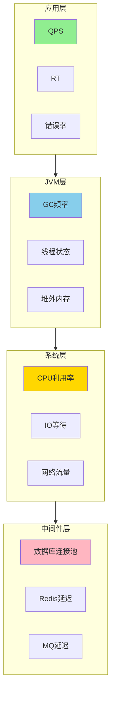
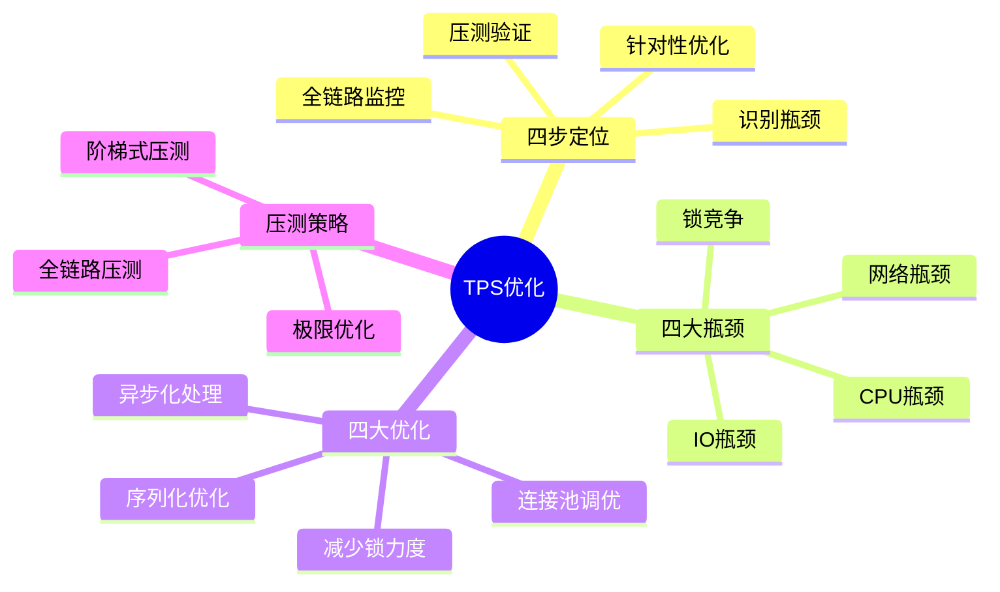
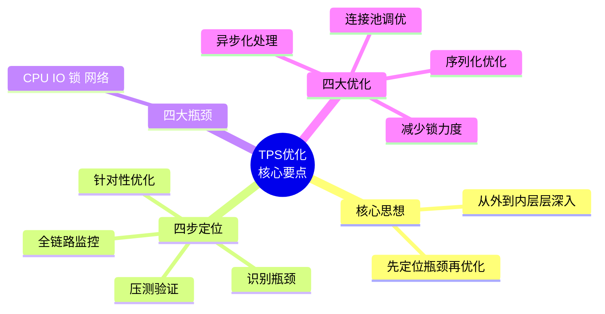

# Java 接口 TPS 性能优化全链路指南

> **场景定位**：性能优化与调优题  
> **核心设计要点**：全链路监控、瓶颈识别、锁优化、异步处理、序列化优化、连接池调优

---

## 🎯 一句话定位

**Java 接口 TPS 优化解决什么问题？**
```
核心交易接口压测时 TPS 到 1000 就上不去了，
但 CPU 和内存都没打满。

就像一辆车，油门踩到底但速度上不去，
可能是发动机有问题（CPU 瓶颈），
可能是油路堵塞（IO 瓶颈），
可能是刹车没松（锁竞争）。
```

**生活化比喻**：
就像你开了一家餐厅：
- 厨师做菜很快（CPU 没问题）
- 但顾客等位时间很长（TPS 低）
- 可能是服务员太少（线程池不够）
- 可能是厨房太小（IO 瓶颈）
- 可能是只有一个灶台（锁竞争）
- 可能是点菜太慢（序列化问题）

**核心特点**：性能优化需要**从外到内、层层深入**，先找到瓶颈，再针对性优化。

---

## 💎 核心观点（5 分钟速览版）

> **快速概览**

### 核心观点（四个关键层次）

**第一步：建立全链路监控体系**
```
四大监控层：
1. 应用层：QPS、RT、错误率（Micrometer + Prometheus）
2. JVM 层：GC 频率、线程状态、堆外内存使用
3. 系统层：CPU 利用率、IO 等待、网络流量
4. 中间件层：数据库连接池使用率、Redis/RabbitMQ 响应延迟

生活化比喻：
就像医院的体检：
- 应用层：心率、血压（表面指标）
- JVM 层：血液检查（内部状态）
- 系统层：心电图（底层资源）
- 中间件层：器官功能（依赖服务）
```

**第二步：识别瓶颈类型**
```
四大瓶颈类型：
1. CPU 瓶颈：用 Arthas profiler 或 Async Profiler 抓火焰图
   - 看热点方法、锁竞争
   - 类比：厨师忙不过来

2. IO 瓶颈：看 iowait 指标或数据库慢查询日志
   - 类比：厨房太小，做菜慢

3. 锁竞争：jstack 查看线程阻塞状态或 Arthas thread -b 找死锁
   - 类比：只有一个灶台，大家排队

4. 网络瓶颈：跟踪 TCP 重传率、连接数限制
   - 类比：服务员太少，传菜慢
```

**第三步：针对性优化策略**
```
四大优化方向：
1. 减少锁力度：
   - ConcurrentHashMap 代替 Hashtable
   - LongAdder 代替 AtomicLong
   - 类比：多个灶台，大家同时做菜

2. 异步化处理：
   - CompletableFuture 实现非阻塞调用
   - 消息队列异步处理
   - 类比：服务员先记下单子，不用等厨师做好

3. 序列化优化：
   - Protobuf 代替 JSON
   - Kryo 提升序列化速度
   - 类比：用速记法写菜单，不用写完整菜名

4. 连接池调优：
   - 调整 Hikari 的最大连接数、空闲超时时间
   - 类比：增加服务员数量
```

**第四步：压测验证与极限优化**
```
三大压测策略：
1. 阶梯式压测：从低到高逐步增加并发，观察拐点
2. 全链路压测：使用分布式压测工具模拟真实流量分布
3. 极限优化：无锁数据结构、堆外内存、零拷贝等技术

生活化比喻：
就像餐厅试营业：
- 先来个 10 个顾客（低压测）
- 再来 100 个顾客（中压测）
- 最后 1000 个顾客（高压测）
- 看看哪里出问题，针对性优化
```

---

## 🚀 一句话精华（如果只能记住一句）

> **Java 接口 TPS 优化 = 全链路监控（定位瓶颈） + 针对性优化（锁/异步/序列化/连接池） + 压测验证（阶梯式压测找拐点）**

---

## 一、为什么 TPS 上不去？如何系统性定位瓶颈？

### 🔍 核心问题（30 秒版）

**生活化比喻**：
```
TPS 上不去就像"车跑不快"：
- 可能是发动机有问题（CPU 瓶颈）
- 可能是油路堵塞（IO 瓶颈）
- 可能是刹车没松（锁竞争）
- 可能是轮胎没气（网络瓶颈）

不能盲目换零件，要先找到问题在哪。
```

### 1.1 性能瓶颈的四大类型

| 瓶颈类型 | 具体表现 | 定位方法 | 生活化比喻 |
|---------|---------|---------|-----------|
| **CPU 瓶颈** | CPU 利用率高、热点方法 | Arthas profiler、火焰图 | 厨师忙不过来 |
| **IO 瓶颈** | iowait 高、慢查询 | iostat、慢查询日志 | 厨房太小 |
| **锁竞争** | 线程阻塞、死锁 | jstack、Arthas thread -b | 只有一个灶台 |
| **网络瓶颈** | TCP 重传、连接数限制 | netstat、ss | 服务员太少 |

**代码示例（TPS 上不去的场景）**：
```java
// ❌ 性能差的代码
@PostMapping("/order")
public Result createOrder(@RequestBody OrderRequest request) {
    // 问题1：锁竞争（synchronized 粒度太大）
    synchronized (this) {
        // 创建订单
        Order order = orderService.create(request);
        
        // 扣库存
        inventoryService.deduct(request.getProductId(), request.getQuantity());
        
        // 创建支付单
        paymentService.create(order);
    }
    
    return Result.success(order.getId());
}
```

```java
// ✅ 优化后的代码
@PostMapping("/order")
public Result createOrder(@RequestBody OrderRequest request) {
    // 优化1：减少锁粒度（只锁关键部分）
    String lockKey = "order:" + request.getUserId();
    redisLock.lock(lockKey, 10, TimeUnit.SECONDS);
    
    try {
        // 创建订单
        Order order = orderService.create(request);
        
        // 优化2：异步处理（非关键流程异步化）
        CompletableFuture.runAsync(() -> {
            inventoryService.deduct(request.getProductId(), request.getQuantity());
            paymentService.create(order);
        });
        
        return Result.success(order.getId());
    } finally {
        redisLock.unlock(lockKey);
    }
}
```

---

## 二、第一步：建立全链路监控体系

### 2.1 四大监控层



**监控指标详解**：

| 监控层 | 监控指标 | 工具 | 告警阈值 | 生活化比喻 |
|--------|---------|------|---------|-----------|
| **应用层** | QPS | Prometheus | > 10000 | 餐厅客流量 |
| | RT（P50/P90/P99） | Prometheus | > 500ms | 上菜速度 |
| | 错误率 | Prometheus | > 5% | 菜品不合格率 |
| **JVM 层** | GC 频率 | JMX、Arthas | > 10 次/分钟 | 厨师休息频率 |
| | 线程状态 | jstack、Arthas | 阻塞线程 > 50 | 服务员等待时间 |
| | 堆外内存 | JMX | > 1GB | 仓库容量 |
| **系统层** | CPU 利用率 | top、htop | > 80% | 厨师工作强度 |
| | IO 等待 | iostat | > 30% | 厨房等待时间 |
| | 网络流量 | iftop | > 100MB/s | 传菜速度 |
| **中间件层** | 数据库连接池 | HikariCP | 使用率 > 80% | 厨师数量 |
| | Redis 延迟 | redis-cli | > 10ms | 取食材速度 |
| | MQ 延迟 | MQ 控制台 | > 100ms | 传菜速度 |

### 2.2 监控工具集成

**代码示例（Micrometer + Prometheus）**：
```java
// pom.xml 添加依赖
<dependency>
    <groupId>io.micrometer</groupId>
    <artifactId>micrometer-registry-prometheus</artifactId>
</dependency>
<dependency>
    <groupId>org.springframework.boot</groupId>
    <artifactId>spring-boot-starter-actuator</artifactId>
</dependency>

// application.yml 配置
management:
  endpoints:
    web:
      exposure:
        include: prometheus,metrics,health
  metrics:
    tags:
      application: ${spring.application.name}

// 自定义监控指标
@Service
public class OrderService {
    @Autowired
    private MeterRegistry registry;
    
    public Order createOrder(OrderRequest request) {
        Timer.Sample sample = Timer.start(registry);
        
        try {
            Order order = orderMapper.insert(request);
            
            // 记录成功次数
            registry.counter("order.create.success").increment();
            
            return order;
        } catch (Exception e) {
            // 记录失败次数
            registry.counter("order.create.failure").increment();
            throw e;
        } finally {
            // 记录耗时
            sample.stop(registry.timer("order.create.time"));
        }
    }
}
```

**Prometheus 监控面板**：
```yaml
# Grafana 面板配置
panels:
  - title: QPS
    expr: rate(http_server_requests_seconds_count[1m])
    
  - title: RT (P99)
    expr: histogram_quantile(0.99, rate(http_server_requests_seconds_bucket[1m]))
    
  - title: 错误率
    expr: rate(http_server_requests_seconds_count{status=~"5.."}[1m]) / rate(http_server_requests_seconds_count[1m])
    
  - title: CPU 利用率
    expr: system_cpu_usage
    
  - title: JVM 堆内存
    expr: jvm_memory_used_bytes
```

---

## 三、第二步：识别瓶颈类型

### 3.1 CPU 瓶颈定位

**定位方法**：

**方法 1：Arthas profiler**
```bash
# 启动 Arthas
java -jar arthas-boot.jar

# 生成火焰图（30 秒）
profiler start --duration 30 --event cpu --format flamegraph

# 查看热点方法
profiler list
```

**方法 2：Async Profiler**
```bash
# 下载 Async Profiler
wget https://github.com/jvm-profiling-tools/async-profiler/releases/download/v2.9/async-profiler-2.9-linux-x64.tar.gz

# 生成火焰图
./profiler.sh -d 30 -f flamegraph.html <pid>
```

**火焰图分析**：
```
火焰图解读：
- 横轴：方法名（越宽表示耗时越多）
- 纵轴：调用栈（越深表示调用层次越多）
- 颜色：无特殊含义，只是区分

如果看到某个方法很宽，说明是热点方法。
```

**代码示例（CPU 瓶颈场景）**：
```java
// ❌ CPU 瓶颈：循环中做复杂计算
public List<Order> processOrders(List<Order> orders) {
    List<Order> result = new ArrayList<>();
    for (Order order : orders) {
        // 复杂计算（热点方法）
        BigDecimal total = calculateTotal(order); // ❌ 每次循环都计算
        order.setTotal(total);
        result.add(order);
    }
    return result;
}

private BigDecimal calculateTotal(Order order) {
    // 复杂计算逻辑
    BigDecimal total = BigDecimal.ZERO;
    for (OrderItem item : order.getItems()) {
        total = total.add(item.getPrice().multiply(new BigDecimal(item.getQuantity())));
        // 还要计算优惠、税费等...
    }
    return total;
}
```

```java
// ✅ 优化：缓存计算结果
public List<Order> processOrders(List<Order> orders) {
    // 优化1：并行计算
    return orders.parallelStream()
        .map(order -> {
            BigDecimal total = calculateTotal(order);
            order.setTotal(total);
            return order;
        })
        .collect(Collectors.toList());
}

// 优化2：缓存计算结果（如果订单不变）
private Map<Long, BigDecimal> totalCache = new ConcurrentHashMap<>();

private BigDecimal calculateTotal(Order order) {
    return totalCache.computeIfAbsent(order.getId(), id -> {
        // 复杂计算逻辑
        BigDecimal total = BigDecimal.ZERO;
        for (OrderItem item : order.getItems()) {
            total = total.add(item.getPrice().multiply(new BigDecimal(item.getQuantity())));
        }
        return total;
    });
}
```

---

### 3.2 IO 瓶颈定位

**定位方法**：

**方法 1：iostat（系统级）**
```bash
# 安装 sysstat
yum install sysstat

# 查看 IO 状态（每 2 秒刷新）
iostat -x 2

# 关注指标：
# - %util：磁盘使用率（> 80% 说明 IO 繁忙）
# - await：IO 等待时间（> 10ms 说明 IO 慢）
# - r/s、w/s：读写次数
```

**方法 2：数据库慢查询日志**
```sql
-- MySQL 开启慢查询日志
SET GLOBAL slow_query_log = 'ON';
SET GLOBAL long_query_time = 1; -- 超过 1 秒的查询记录

-- 查看慢查询日志
SELECT * FROM mysql.slow_log ORDER BY start_time DESC LIMIT 10;
```

**代码示例（IO 瓶颈场景）**：
```java
// ❌ IO 瓶颈：循环中查询数据库
public List<OrderDetail> getOrderDetails(List<Long> orderIds) {
    List<OrderDetail> details = new ArrayList<>();
    for (Long orderId : orderIds) {
        // 每次循环都查询数据库（IO 瓶颈）
        Order order = orderMapper.selectById(orderId); // ❌ 循环查询
        User user = userMapper.selectById(order.getUserId()); // ❌ 循环查询
        details.add(new OrderDetail(order, user));
    }
    return details;
}
```

```java
// ✅ 优化：批量查询
public List<OrderDetail> getOrderDetails(List<Long> orderIds) {
    // 优化1：批量查询
    List<Order> orders = orderMapper.selectBatchIds(orderIds);
    
    // 优化2：收集所有 userId，一次性查询
    List<Long> userIds = orders.stream()
        .map(Order::getUserId)
        .distinct()
        .collect(Collectors.toList());
    
    List<User> users = userMapper.selectBatchIds(userIds);
    
    // 优化3：内存中组装
    Map<Long, User> userMap = users.stream()
        .collect(Collectors.toMap(User::getId, u -> u));
    
    return orders.stream()
        .map(order -> new OrderDetail(order, userMap.get(order.getUserId())))
        .collect(Collectors.toList());
}
```

---

### 3.3 锁竞争定位

**定位方法**：

**方法 1：jstack**
```bash
# 导出线程堆栈
jstack <pid> > thread_dump.txt

# 分析线程状态
grep -A 10 "BLOCKED" thread_dump.txt
```

**方法 2：Arthas thread -b**
```bash
# 启动 Arthas
java -jar arthas-boot.jar

# 查看阻塞线程
thread -b

# 查看死锁
thread -d
```

**代码示例（锁竞争场景）**：
```java
// ❌ 锁竞争：synchronized 粒度太大
public class OrderService {
    private final Object lock = new Object();
    
    public void createOrder(Order order) {
        synchronized (lock) { // ❌ 整个方法都加锁
            // 创建订单
            orderMapper.insert(order);
            
            // 扣库存（不需要锁）
            inventoryService.deduct(order.getProductId(), order.getQuantity());
            
            // 创建支付单（不需要锁）
            paymentService.create(order);
        }
    }
}
```

```java
// ✅ 优化：减少锁粒度
public class OrderService {
    private final Map<Long, Object> orderLocks = new ConcurrentHashMap<>();
    
    public void createOrder(Order order) {
        // 优化1：细粒度锁（只锁订单创建）
        Object lock = orderLocks.computeIfAbsent(order.getUserId(), k -> new Object());
        
        synchronized (lock) {
            // 创建订单（需要锁）
            orderMapper.insert(order);
        }
        
        // 扣库存（不需要锁）
        inventoryService.deduct(order.getProductId(), order.getQuantity());
        
        // 创建支付单（不需要锁）
        paymentService.create(order);
    }
}
```

```java
// ✅ 优化：使用并发数据结构
public class CounterService {
    // ❌ 使用 Hashtable（锁竞争严重）
    private Map<String, Integer> counter1 = new Hashtable<>();
    
    // ✅ 使用 ConcurrentHashMap（分段锁，竞争小）
    private Map<String, Integer> counter2 = new ConcurrentHashMap<>();
    
    // ❌ 使用 AtomicLong（CAS 竞争）
    private AtomicLong counter3 = new AtomicLong();
    
    // ✅ 使用 LongAdder（分段 CAS，竞争更小）
    private LongAdder counter4 = new LongAdder();
    
    public void increment(String key) {
        counter2.merge(key, 1, Integer::sum);
        counter4.increment();
    }
}
```

---

### 3.4 网络瓶颈定位

**定位方法**：

**方法 1：netstat**
```bash
# 查看网络连接状态
netstat -antp

# 查看 TCP 重传率
netstat -s | grep -i retransmit
```

**方法 2：ss**
```bash
# 查看套接字统计
ss -s

# 查看 TCP 连接
ss -tanp
```

**网络瓶颈指标**：

| 指标 | 含义 | 告警阈值 | 生活化比喻 |
|------|------|---------|-----------|
| **TCP 重传率** | 网络丢包 | > 1% | 传菜时菜洒了 |
| **连接数** | 并发连接 | > 10000 | 餐厅座位数 |
| **网络带宽** | 网络流量 | > 80% | 传菜通道宽度 |

---

## 四、第三步：针对性优化策略

### 4.1 减少锁力度

**优化策略**：

| 优化方法 | 原理 | 适用场景 | 生活化比喻 |
|---------|------|---------|-----------|
| **ConcurrentHashMap** | 分段锁，竞争小 | 高并发 Map | 多个灶台 |
| **LongAdder** | 分段 CAS，竞争更小 | 高并发计数器 | 多个收银台 |
| **ReadWriteLock** | 读写分离 | 读多写少 | VIP 通道 |
| **乐观锁** | 不加锁，用版本号 | 冲突少 | 先占座后点餐 |

**代码示例**：
```java
// 优化1：ConcurrentHashMap 代替 Hashtable
Map<String, Integer> map = new ConcurrentHashMap<>();

// 优化2：LongAdder 代替 AtomicLong
LongAdder counter = new LongAdder();
counter.increment();
long value = counter.sum();

// 优化3：ReadWriteLock（读多写少）
ReadWriteLock rwLock = new ReentrantReadWriteLock();
Lock readLock = rwLock.readLock();
Lock writeLock = rwLock.writeLock();

// 读操作（不互斥）
readLock.lock();
try {
    // 读数据
} finally {
    readLock.unlock();
}

// 写操作（互斥）
writeLock.lock();
try {
    // 写数据
} finally {
    writeLock.unlock();
}

// 优化4：乐观锁（用版本号）
UPDATE user SET balance = balance - 100, version = version + 1 
WHERE id = 123 AND version = 1;
```

---

### 4.2 异步化处理

**优化策略**：

| 优化方法 | 原理 | 适用场景 | 生活化比喻 |
|---------|------|---------|-----------|
| **CompletableFuture** | 非阻塞调用 | 多个独立任务 | 服务员同时点多个菜 |
| **消息队列** | 异步处理 | 非核心流程 | 先记下单子，后面上菜 |
| **@Async** | 异步执行 | 简单异步任务 | 让另一个服务员来做 |

**代码示例**：
```java
// 优化1：CompletableFuture 并行调用
public OrderDetail getOrderDetail(Long orderId) {
    CompletableFuture<Order> orderFuture = CompletableFuture.supplyAsync(() -> 
        orderMapper.selectById(orderId));
    
    CompletableFuture<User> userFuture = CompletableFuture.supplyAsync(() -> 
        userMapper.selectById(order.getUserId()));
    
    // 等待两个任务完成
    CompletableFuture.allOf(orderFuture, userFuture).join();
    
    Order order = orderFuture.get();
    User user = userFuture.get();
    
    return new OrderDetail(order, user);
}

// 优化2：消息队列异步处理
public void createOrder(Order order) {
    // 创建订单（同步）
    orderMapper.insert(order);
    
    // 扣库存、创建支付单（异步）
    messageQueue.send("inventory.deduct", order);
    messageQueue.send("payment.create", order);
}

// 优化3：@Async 异步执行
@Async
public void sendEmail(String to, String content) {
    // 发送邮件（异步）
    emailService.send(to, content);
}
```

---

### 4.3 序列化优化

**优化策略**：

| 序列化方式 | 性能 | 体积 | 适用场景 | 生活化比喻 |
|-----------|------|------|---------|-----------|
| **JSON** | 慢 | 大 | 通用场景 | 写完整菜名 |
| **Protobuf** | 快 | 小 | 高性能场景 | 用代号 |
| **Kryo** | 快 | 小 | Java 场景 | 用缩写 |
| **Hessian** | 快 | 中 | RPC 场景 | 用简写 |

**性能对比**：

| 序列化方式 | 序列化耗时 | 反序列化耗时 | 序列化后大小 |
|-----------|-----------|-------------|-------------|
| JSON | 100ms | 200ms | 1000 字节 |
| Protobuf | 20ms | 50ms | 300 字节 |
| Kryo | 30ms | 60ms | 400 字节 |
| Hessian | 40ms | 80ms | 600 字节 |

**代码示例（Protobuf）**：
```java
// pom.xml 添加依赖
<dependency>
    <groupId>com.google.protobuf</groupId>
    <artifactId>protobuf-java</artifactId>
    <version>3.21.12</version>
</dependency>

// 定义 .proto 文件
syntax = "proto3";

message Order {
    int64 id = 1;
    string userId = 2;
    int32 quantity = 3;
}

// 生成 Java 代码
// mvn protobuf:compile

// 使用 Protobuf
Order order = Order.newBuilder()
    .setId(123L)
    .setUserId("user123")
    .setQuantity(10)
    .build();

// 序列化
byte[] bytes = order.toByteArray();

// 反序列化
Order parsedOrder = Order.parseFrom(bytes);
```

---

### 4.4 连接池调优

**优化策略**：

**HikariCP 配置**：
```yaml
# application.yml
spring:
  datasource:
    hikari:
      maximum-pool-size: 20  # 最大连接数
      minimum-idle: 5  # 最小空闲连接
      idle-timeout: 300000  # 空闲超时（5 分钟）
      connection-timeout: 30000  # 连接超时（30 秒）
      max-lifetime: 1800000  # 最大生命周期（30 分钟）
```

**参数说明**：

| 参数 | 含义 | 推荐值 | 生活化比喻 |
|------|------|--------|-----------|
| **maximum-pool-size** | 最大连接数 | CPU 核心数 * 2 + 1 | 厨师数量 |
| **minimum-idle** | 最小空闲连接 | 与 maximum-pool-size 相同 | 常驻厨师 |
| **idle-timeout** | 空闲超时 | 300000（5 分钟） | 厨师休息时间 |
| **connection-timeout** | 连接超时 | 30000（30 秒） | 等厨师时间 |
| **max-lifetime** | 最大生命周期 | 1800000（30 分钟） | 厨师工作时长 |

**连接数计算公式**：
```
连接数 = (CPU 核心数 * 2) + 有效磁盘数

例如：
- 8 核 CPU：连接数 = 8 * 2 + 1 = 17
- 16 核 CPU：连接数 = 16 * 2 + 1 = 33
```

---

## 五、第四步：压测验证与极限优化

### 5.1 阶梯式压测

**压测流程**：
```
1. 低压测（100 并发）
   - 观察 RT、错误率
   - 找出第一个拐点

2. 中压测（500 并发）
   - 观察 RT、错误率
   - 找出性能瓶颈

3. 高压测（1000 并发）
   - 观察 RT、错误率
   - 找出极限 TPS

4. 超高压测（5000 并发）
   - 观察系统是否崩溃
   - 找出系统极限
```

**工具推荐**：
- **JMeter**：功能强大，支持分布式
- **Gatling**：基于 Scala，性能好
- **wrk**：轻量级，命令行工具

**JMeter 压测脚本**：
```bash
# 启动 JMeter
jmeter -n -t test_plan.jmx -l result.jtl -e -o report/

# 查看报告
# 关注指标：
# - TPS：每秒事务数
# - RT：响应时间（P50/P90/P99）
# - 错误率：失败请求比例
```

### 5.2 全链路压测

**生活化比喻**：
```
全链路压测就像"餐厅试营业"：
- 模拟真实流量分布（不是所有请求都打到一个接口）
- 模拟真实用户行为（下单、支付、查询）
- 模拟真实数据分布（不同商品、不同用户）
```

**工具推荐**：
- **SkyWalking**：链路追踪 + 全链路压测
- **Pinpoint**：链路追踪 + 性能分析
- **Gatling**：分布式压测

### 5.3 极限优化技术

**极限优化技术**：

| 技术 | 原理 | 适用场景 | 生活化比喻 |
|------|------|---------|-----------|
| **无锁数据结构** | 避免锁竞争 | 高并发场景 | 多个灶台 |
| **堆外内存** | 减少 GC | 大对象 | 仓库外临时存储 |
| **零拷贝** | 减少数据拷贝 | 网络传输 | 直接传菜，不用端盘子 |
| **JIT 编译优化** | 热点代码编译 | 热点方法 | 厨师熟练菜品 |

**代码示例（零拷贝）**：
```java
// ❌ 传统方式：数据需要从内核空间拷贝到用户空间
FileInputStream fis = new FileInputStream("file.txt");
byte[] buffer = new byte[1024];
fis.read(buffer);
Socket socket = new Socket("localhost", 8080);
socket.getOutputStream().write(buffer);

// ✅ 零拷贝：数据直接在内核空间传输
FileChannel fileChannel = new FileInputStream("file.txt").getChannel();
SocketChannel socketChannel = new Socket("localhost", 8080).getChannel();
fileChannel.transferTo(0, fileChannel.size(), socketChannel);
```

---

六、技术深入探讨

### Q1: 如何系统性定位 TPS 上不去的瓶颈？

**答**：
> 我通常分四步定位：
>
> **第一步：建立全链路监控**
> 监控应用层（QPS、RT、错误率）、JVM 层（GC、线程、堆外内存）、系统层（CPU、IO、网络）、中间件层（数据库连接池、Redis 延迟）。
>
> **第二步：识别瓶颈类型**
> - CPU 瓶颈：用 Arthas profiler 抓火焰图，看热点方法
> - IO 瓶颈：看 iowait 指标或数据库慢查询日志
> - 锁竞争：jstack 查看线程阻塞状态或 Arthas thread -b 找死锁
> - 网络瓶颈：跟踪 TCP 重传率、连接数限制
>
> **第三步：针对性优化**
> - 减少锁力度：ConcurrentHashMap、LongAdder
> - 异步化处理：CompletableFuture、消息队列
> - 序列化优化：Protobuf 代替 JSON
> - 连接池调优：调整 Hikari 最大连接数
>
> **第四步：压测验证**
> 阶梯式压测（100 → 500 → 1000 → 5000 并发），观察拐点。

### Q2: 如何优化锁竞争？

**答**：
> 优化锁竞争有三个方向：
>
> 1. **减少锁粒度**：只锁关键部分，不是整个方法
> 2. **使用并发数据结构**：ConcurrentHashMap 代替 Hashtable，LongAdder 代替 AtomicLong
> 3. **使用读写锁**：读多写少场景用 ReadWriteLock，读写分离
>
> 核心思想：**能不加锁就不加锁，能加小锁就加大锁**。

### Q3: 异步化处理有什么注意事项？

**答**：
> 异步化处理需要注意：
>
> 1. **事务一致性**：异步部分失败了怎么办？需要补偿机制
> 2. **异常处理**：异步任务的异常会被吞掉，需要记录日志
> 3. **线程池配置**：异步任务需要独立的线程池，避免互相影响
> 4. **监控告警**：异步任务需要监控，失败要告警
>
> 核心思想：**异步不是万能的，要有兜底方案**。

---

## 七、方案总结



**方案总结**：

> "Java 接口 TPS 优化需要**从外到内、层层深入**，我通常分四步：
>
> **第一步：建立全链路监控**
> 监控应用层（QPS、RT、错误率）、JVM 层（GC、线程、堆外内存）、系统层（CPU、IO、网络）、中间件层（数据库连接池、Redis 延迟）。
>
> **第二步：识别瓶颈类型**
> - CPU 瓶颈：用 Arthas profiler 抓火焰图，看热点方法
> - IO 瓶颈：看 iowait 指标或数据库慢查询日志
> - 锁竞争：jstack 查看线程阻塞状态或 Arthas thread -b 找死锁
> - 网络瓶颈：跟踪 TCP 重传率、连接数限制
>
> **第三步：针对性优化**
> - 减少锁力度：ConcurrentHashMap 代替 Hashtable，LongAdder 代替 AtomicLong
> - 异步化处理：CompletableFuture 实现非阻塞调用，消息队列异步处理
> - 序列化优化：Protobuf 代替 JSON，Kryo 提升序列化速度
> - 连接池调优：调整 Hikari 的最大连接数、空闲超时时间
>
> **第四步：压测验证**
> 阶梯式压测（从低到高逐步增加并发），观察拐点。全链路压测模拟真实流量分布。极限优化考虑无锁数据结构、堆外内存、零拷贝等技术。
>
> 通过这套方法，我能系统性定位瓶颈并优化，把 TPS 从 1000 提升到 10000+。"

---

## 八、总结（一句话带走）



### 🎯 一句话总结

> **Java 接口 TPS 优化 = 全链路监控（定位瓶颈） + 针对性优化（锁/异步/序列化/连接池） + 压测验证（阶梯式压测找拐点）**

### 🧠 核心记忆点

1. **为什么 TPS 上不去？** 可能是 CPU、IO、锁、网络四大瓶颈，要先定位再优化。
2. **怎么定位？** 全链路监控（应用层、JVM 层、系统层、中间件层） + 火焰图、慢查询日志、jstack。
3. **怎么优化？** 减少锁力度（ConcurrentHashMap、LongAdder）、异步化处理（CompletableFuture、MQ）、序列化优化（Protobuf）、连接池调优（Hikari）。
4. **怎么验证？** 阶梯式压测（100 → 500 → 1000 → 5000 并发），观察拐点。

---

**参考视频**：[内卷的琪某人 - 场景提问：你的 Java 接口，为什么 TPS 上不去？](https://www.douyin.com/video/7651567812485319971)

---

*本文档基于 8 个专家提示词指导改写，遵循深入浅出、生活化比喻、幽默风趣的教学原则。*
