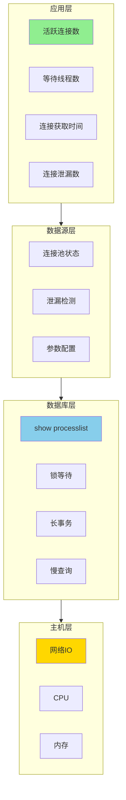
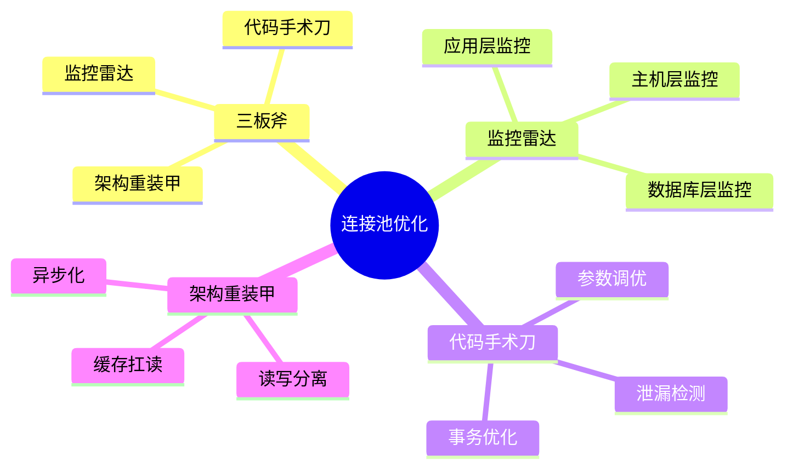
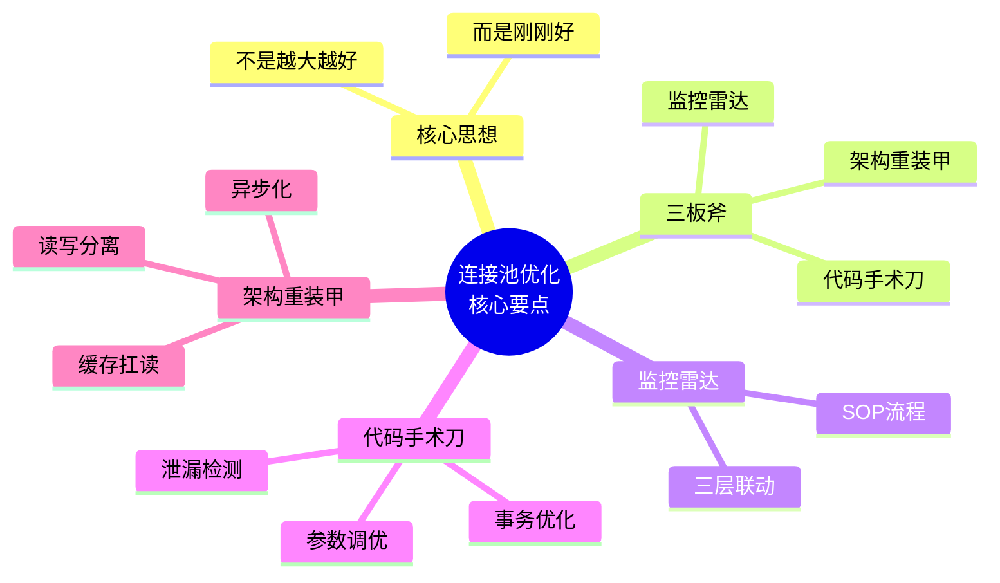

# 数据库连接池雪崩与全链路优化

> **场景定位**：数据库性能优化与事故处理题  
> **核心设计要点**：连接池原理、参数调优、监控告警、事务优化、架构升级

---

## 🎯 一句话定位

**数据库连接池雪崩解决什么问题？**
```
大促期间订单系统接口突然大面积超时，
监控发现数据库连接池被打满，
活跃连接数 100%，新的请求全部排队等待，
最后直接雪崩。

就像餐厅只有 50 个座位，
突然来了 500 个顾客，
外面排队的人越来越多，
最后整个餐厅瘫痪！
```

**生活化比喻**：
就像餐厅的座位管理：
- **连接池**：餐厅的座位（有限资源）
- **活跃连接**：正在用餐的顾客
- **等待连接**：排队等位的顾客
- **连接超时**：等太久顾客走了
- **连接泄露**：顾客吃完不走，占着座位

**核心特点**：连接池不是越大越好，**过大数据库崩盘，过小请求排队**，关键是**刚刚好**。

---

## 💎 核心观点（5 分钟速览版）

> **快速概览**

### 核心观点（三板斧保卫战）

**第一板斧：监控雷达（让连接池状态无处遁形）**
```
三层监控联动：
1. 应用层：连接池监控（活跃连接数、等待线程数、获取时间）
2. 数据源层：中间件监控（连接池状态、泄漏检测）
3. 数据库层：show processlist（锁等待、长事务）
4. 主机层：网络 IO、数据库 CPU、内存

SOP 流程：
报警 → 查看连接池指标 → 抓取数据库现场 → 分析事务日志 → 定位根因

生活化比喻：
就像医院的体检：
- 应用层：心率、血压（表面指标）
- 数据库层：血液检查（内部状态）
- 主机层：心电图（底层资源）
```

**第二板斧：代码手术刀（根治连接滥用与事务黑洞）**
```
四大优化方向：
1. 事务边界优化：@Transactional 不要随意加在类上，只给真正需要事务的方法加
2. 查询强制只读：查询操作加 @Transactional(readOnly = true)，减少连接占用时间
3. 连接池参数动态调优：
   - maximumPoolSize：最大连接数
   - minimumIdle：最小空闲连接
   - maxLifetime：最大生命周期
4. 泄漏检测：开启 leakDetection，自动打印泄漏堆栈

生活化比喻：
就像餐厅管理：
- 事务优化：顾客吃完赶紧走，别占着座位
- 只读查询：快餐区，吃完就走
- 参数调优：调整座位数量和等位时间
- 泄漏检测：监控谁吃完不走
```

**第三板斧：架构重装甲（给数据库减负）**
```
四大架构升级：
1. 读写分离：主库扛写，从库扛读，分散连接压力
2. 分库分表：拆库后每个库的连接池独立，从源头降低连接竞争
3. 缓存扛读：Redis 集群扛住 80% 读流量，数据库连接快速释放
4. 异步化改造：请求进 MQ，削峰填谷，数据库不再被瞬时洪峰冲垮

生活化比喻：
就像餐厅扩张：
- 读写分离：VIP 区（写）和普通区（读）分开
- 分库分表：开分店，分散客流
- 缓存扛读：自助取餐区，不用等服务员
- 异步化：外卖订单，不在店里吃
```

---

## 🚀 一句话精华（如果只能记住一句）

> **数据库连接池优化 = 监控雷达（三层联动） + 代码手术刀（事务优化 + 参数调优） + 架构重装甲（读写分离 + 缓存 + 异步）**

---

## 一、为什么连接池会雪崩？根因分析

### 🔍 核心问题（30 秒版）

**生活化比喻**：
```
连接池雪崩就像"餐厅座位危机"：
- 高峰期来了 500 个顾客（高并发请求）
- 但只有 50 个座位（连接池 max=50）
- 外面排队的人越来越多（等待线程堆积）
- 有的顾客吃完不走（连接泄露）
- 有的顾客等太久走了（连接超时）
- 最后整个餐厅瘫痪（系统雪崩）

根因分析：
1. 慢 SQL：顾客点菜太慢，占着座位（连接占用时间长）
2. 长事务：顾客吃完不结账，占着座位（事务未提交）
3. 连接泄露：顾客吃完从后门溜了，座位还被占着（连接未释放）
4. 死锁：两个顾客互相等对方的菜，都吃不了（死锁）
```

### 1.1 连接池雪崩的四大根因

| 根因 | 具体表现 | 线上后果 | 生活化比喻 |
|------|---------|---------|-----------|
| **慢 SQL** | 查询慢、索引失效 | 连接占用时间长 | 顾客点菜慢 |
| **长事务** | 事务未及时提交 | 连接被长时间占用 | 顾客吃完不结账 |
| **连接泄露** | 连接未正确释放 | 可用连接越来越少 | 顾客从后门溜了 |
| **死锁** | 两个事务互相等待 | 连接被永久占用 | 两个顾客互相等菜 |

**代码示例（连接泄露场景）**：
```java
// ❌ 连接泄露：异常时连接未释放
public void processOrder(Order order) {
    Connection conn = null;
    try {
        conn = dataSource.getConnection();
        // 业务逻辑
        orderMapper.insert(conn, order);
    } catch (Exception e) {
        // ❌ 异常时连接未释放
        log.error("处理订单失败", e);
    } finally {
        // ✅ 应该在 finally 中释放
        if (conn != null) {
            conn.close();
        }
    }
}
```

```java
// ✅ 正确做法：使用 try-with-resources
public void processOrder(Order order) {
    try (Connection conn = dataSource.getConnection()) {
        // 业务逻辑
        orderMapper.insert(conn, order);
    } catch (Exception e) {
        log.error("处理订单失败", e);
        throw e;
    }
    // 连接自动释放
}
```

---

## 二、第一板斧：监控雷达（三层联动）

### 2.1 应用层监控

**监控指标**：

| 指标 | 含义 | 告警阈值 | 生活化比喻 |
|------|------|---------|-----------|
| **活跃连接数** | 正在使用的连接 | > maxPoolSize * 80% | 餐厅座位使用率 |
| **等待线程数** | 等待获取连接的线程 | > 10 | 排队等位的人数 |
| **连接获取时间** | 获取连接耗时 | > 100ms | 等位时间 |
| **连接泄漏数** | 未释放的连接 | > 0 | 吃完不走的顾客 |

**代码示例（HikariCP 监控）**：
```java
// HikariCP 配置
HikariConfig config = new HikariConfig();
config.setJdbcUrl("jdbc:mysql://localhost:3306/test");
config.setMaximumPoolSize(50);
config.setMinimumIdle(10);
config.setConnectionTimeout(30000);
config.setIdleTimeout(600000);
config.setMaxLifetime(1800000);
config.setLeakDetectionThreshold(60000); // 泄漏检测阈值 60 秒

// Prometheus 监控
@Bean
public MeterBinder hikariMetrics(HikariDataSource dataSource) {
    return new HikariPoolMetrics(dataSource, "hikaricp", "orders");
}
```

**Grafana 监控面板**：
```yaml
panels:
  - title: 活跃连接数
    expr: hikaricp_active_connections
    
  - title: 等待线程数
    expr: hikaricp_pending_threads
    
  - title: 连接获取时间
    expr: hikaricp_connection_obtain_time
    
  - title: 连接泄漏数
    expr: hikaricp_connection_leak_count
```

### 2.2 数据库层监控

**show processlist**：
```sql
-- 查看当前所有连接
SHOW PROCESSLIST;

-- 查看锁等待
SELECT * FROM information_schema.innodb_lock_waits;

-- 查看长事务
SELECT * FROM information_schema.innodb_trx 
WHERE trx_started < NOW() - INTERVAL 60 SECOND;

-- 查看慢查询
SELECT * FROM mysql.slow_log 
ORDER BY start_time DESC 
LIMIT 10;
```

**监控指标**：

| 指标 | 含义 | 告警阈值 | 生活化比喻 |
|------|------|---------|-----------|
| **锁等待** | 等待锁的事务 | > 10 | 顾客等菜 |
| **长事务** | 运行时间 > 60s | > 5 | 顾客吃太久 |
| **慢查询** | 执行时间 > 1s | > 10/分钟 | 厨师做菜慢 |
| **CPU 利用率** | 数据库 CPU | > 80% | 厨师工作强度 |

### 2.3 三层监控联动



**SOP 流程**：
```
1. 报警：连接池活跃连接数 > 80%
2. 查看连接池指标：活跃连接数、等待线程数、获取时间
3. 抓取数据库现场：show processlist、锁等待、长事务
4. 分析事务日志：找出慢事务、泄漏连接
5. 定位根因：慢 SQL？长事务？连接泄露？死锁？
```

---

## 三、第二板斧：代码手术刀（事务优化 + 参数调优）

### 3.1 事务边界优化

**生活化比喻**：
```
事务优化就像"餐厅翻台率"：
- 顾客吃完赶紧走，提高翻台率（事务及时提交）
- 别让顾客占着座位不消费（长事务）
- 快餐区吃完就走（只读查询）
```

**代码示例（事务优化）**：
```java
// ❌ 错误：@Transactional 加在类上，所有方法都有事务
@Service
@Transactional
public class OrderService {
    
    // 查询方法不需要事务
    public Order getOrder(Long orderId) {
        return orderMapper.selectById(orderId);
    }
    
    // 只有写方法需要事务
    public void createOrder(Order order) {
        orderMapper.insert(order);
    }
}
```

```java
// ✅ 正确：只在需要事务的方法上加
@Service
public class OrderService {
    
    // ✅ 查询方法加只读事务
    @Transactional(readOnly = true)
    public Order getOrder(Long orderId) {
        return orderMapper.selectById(orderId);
    }
    
    // ✅ 写方法加普通事务
    @Transactional
    public void createOrder(Order order) {
        orderMapper.insert(order);
        inventoryService.deduct(order.getProductId(), order.getQuantity());
    }
}
```

**事务优化原则**：
1. **事务粒度要小**：只包含必要的数据库操作
2. **查询加只读**：@Transactional(readOnly = true) 减少连接占用时间
3. **避免大事务**：把长事务拆成多个短事务
4. **不要在事务中做 RPC**：RPC 调用可能很慢，导致事务长时间占用连接

---

### 3.2 连接池参数调优

**HikariCP 关键参数**：

| 参数 | 含义 | 推荐值 | 计算公式 | 生活化比喻 |
|------|------|--------|---------|-----------|
| **maximumPoolSize** | 最大连接数 | CPU 核心数 * 2 + 1 | 根据并发模型计算 | 餐厅座位数 |
| **minimumIdle** | 最小空闲连接 | 与 maximumPoolSize 相同 | - | 常驻服务员 |
| **connectionTimeout** | 连接超时 | 30000（30 秒） | - | 等位时间 |
| **idleTimeout** | 空闲超时 | 600000（10 分钟） | - | 服务员休息时间 |
| **maxLifetime** | 最大生命周期 | 1800000（30 分钟） | - | 服务员工作时长 |
| **leakDetectionThreshold** | 泄漏检测阈值 | 60000（60 秒） | - | 监控谁吃完不走 |

**连接数计算公式**：
```
连接数 = (CPU 核心数 * 2) + 有效磁盘数

例如：
- 8 核 CPU：连接数 = 8 * 2 + 1 = 17
- 16 核 CPU：连接数 = 16 * 2 + 1 = 33

HikariCP 官方推荐：
连接数 = 核心线程数 + (等待时间 / 处理时间)

例如：
- 核心线程 10
- 等待时间 10ms
- 处理时间 5ms
- 连接数 = 10 + (10 / 5) = 12
```

**代码示例（HikariCP 配置）**：
```yaml
# application.yml
spring:
  datasource:
    hikari:
      maximum-pool-size: 20  # 最大连接数
      minimum-idle: 10  # 最小空闲连接
      connection-timeout: 30000  # 连接超时 30 秒
      idle-timeout: 600000  # 空闲超时 10 分钟
      max-lifetime: 1800000  # 最大生命周期 30 分钟
      leak-detection-threshold: 60000  # 泄漏检测 60 秒
```

---

### 3.3 泄漏检测

**代码示例（泄漏检测）**：
```java
// HikariCP 泄漏检测
HikariConfig config = new HikariConfig();
config.setLeakDetectionThreshold(60000); // 60 秒未释放，打印泄漏堆栈

// 当连接泄漏时，会打印如下日志：
// WARN  HikariPool-1 - Connection leak detection triggered for connection HikariProxyConnection@1234567, stack trace follows
// java.lang.Exception: Apparent connection leak detected
//     at com.example.OrderService.processOrder(OrderService.java:45)
//     at com.example.OrderController.createOrder(OrderController.java:23)
```

---

## 四、第三板斧：架构重装甲（给数据库减负）

### 4.1 读写分离

**生活化比喻**：
```
读写分离就像"餐厅分区"：
- VIP 区（主库）：只接待点菜的顾客（写操作）
- 普通区（从库）：接待取餐的顾客（读操作）

VIP 区人少，普通区人多，互不影响。
```

**代码示例（读写分离）**：
```java
// 配置多数据源
@Configuration
public class DataSourceConfig {
    
    @Bean
    @Primary
    @ConfigurationProperties("spring.datasource.master")
    public DataSource masterDataSource() {
        return DataSourceBuilder.create().build();
    }
    
    @Bean
    @ConfigurationProperties("spring.datasource.slave")
    public DataSource slaveDataSource() {
        return DataSourceBuilder.create().build();
    }
    
    @Bean
    public DataSourceRouting dataSourceRouting() {
        DataSourceRouting routing = new DataSourceRouting();
        routing.setDefaultTargetDataSource(masterDataSource());
        
        Map<Object, Object> targetDataSources = new HashMap<>();
        targetDataSources.put("master", masterDataSource());
        targetDataSources.put("slave", slaveDataSource());
        routing.setTargetDataSources(targetDataSources);
        
        return routing;
    }
}

// 使用注解切换数据源
@Service
public class OrderService {
    
    // 写操作走主库
    @DS("master")
    public void createOrder(Order order) {
        orderMapper.insert(order);
    }
    
    // 读操作走从库
    @DS("slave")
    public Order getOrder(Long orderId) {
        return orderMapper.selectById(orderId);
    }
}
```

### 4.2 缓存扛读

**生活化比喻**：
```
缓存扛读就像"自助取餐区"：
- 80% 的顾客去自助取餐区（Redis 缓存）
- 只有 20% 的顾客需要服务员点餐（数据库）

服务员压力小，顾客也不用等。
```

**代码示例（缓存扛读）**：
```java
@Service
public class OrderService {
    
    @Autowired
    private RedisTemplate<String, String> redisTemplate;
    
    @Autowired
    private OrderMapper orderMapper;
    
    public Order getOrder(Long orderId) {
        // 先查缓存
        String cachedOrder = redisTemplate.opsForValue().get("order:" + orderId);
        if (cachedOrder != null) {
            return JSON.parseObject(cachedOrder, Order.class);
        }
        
        // 缓存未命中，查数据库
        Order order = orderMapper.selectById(orderId);
        
        // 写入缓存
        redisTemplate.opsForValue().set("order:" + orderId, JSON.toJSONString(order), 1, TimeUnit.HOURS);
        
        return order;
    }
}
```

### 4.3 异步化改造

**生活化比喻**：
```
异步化就像"外卖订单"：
- 顾客下单后不在店里等（同步）
- 而是回家等外卖（异步）

店里不用排队，顾客也不用等。
```

**代码示例（异步化）**：
```java
@Service
public class OrderService {
    
    @Autowired
    private MessageQueue messageQueue;
    
    public void createOrder(OrderRequest request) {
        // 请求进 MQ，异步处理
        messageQueue.send("order.create", request);
        
        // 立即返回，不等待
        return Result.success("订单创建中");
    }
}

// 消费者异步处理
@Component
@RocketMQMessageListener(topic = "order.create", consumerGroup = "order-consumer")
public class OrderConsumer implements RocketMQListener<OrderRequest> {
    
    @Override
    public void onMessage(OrderRequest request) {
        // 异步处理订单
        orderService.processOrder(request);
    }
}
```

---

五、技术深入探讨

### Q1: 连接池爆满如何排查？

**答**：
> 我通常按以下步骤排查：
>
> **第一步：查看连接池指标**
> 活跃连接数、等待线程数、连接获取时间、泄漏检测数。
>
> **第二步：抓取数据库现场**
> show processlist 查看当前连接、锁等待、长事务。
>
> **第三步：分析事务日志**
> 找出慢事务、泄漏连接、死锁。
>
> **第四步：定位根因**
> - 慢 SQL：索引失效、全表扫描
> - 长事务：事务未及时提交
> - 连接泄露：连接未正确释放
> - 死锁：两个事务互相等待
>
> **第五步：针对性优化**
> - 慢 SQL：加索引、优化查询
> - 长事务：拆分事务、及时提交
> - 连接泄露：使用 try-with-resources
> - 死锁：调整事务顺序

### Q2: 连接池参数怎么配置？

**答**：
> 连接池参数需要根据业务并发模型计算：
>
> **maximumPoolSize**：
> - 公式：(CPU 核心数 * 2) + 有效磁盘数
> - 例如：8 核 CPU，连接数 = 8 * 2 + 1 = 17
>
> **minimumIdle**：
> - 推荐与 maximumPoolSize 相同，避免频繁创建销毁
>
> **connectionTimeout**：
> - 推荐 30 秒，避免无限等待
>
> **idleTimeout**：
> - 推荐 10 分钟，及时释放空闲连接
>
> **maxLifetime**：
> - 推荐 30 分钟，防止连接泄露
>
> **leakDetectionThreshold**：
> - 推荐 60 秒，自动打印泄漏堆栈
>
> 核心思想：**连接池不是越大越好，而是刚刚好**。

### Q3: 如何防止连接泄露？

**答**：
> 防止连接泄露有三个方向：
>
> 1. **使用 try-with-resources**：自动释放连接
> 2. **在 finally 中释放**：确保异常时也能释放
> 3. **开启泄漏检测**：HikariCP 的 leakDetectionThreshold，自动打印泄漏堆栈
>
> 核心思想：**连接必须释放，无论是否异常**。

---

## 六、方案总结



**方案总结**：

> "数据库连接池优化我通常用**三板斧**：
>
> **第一板斧：监控雷达**
> 三层监控联动：应用层（活跃连接数、等待线程数、获取时间）、数据源层（连接池状态、泄漏检测）、数据库层（show processlist、锁等待、长事务）、主机层（网络 IO、CPU、内存）。SOP 流程：报警 → 查看连接池指标 → 抓取数据库现场 → 分析事务日志 → 定位根因。
>
> **第二板斧：代码手术刀**
> 1. 事务边界优化：@Transactional 不要随意加在类上，只给真正需要事务的方法加。查询操作加 readOnly = true，减少连接占用时间。
> 2. 连接池参数动态调优：maximumPoolSize = (CPU 核心数 * 2) + 有效磁盘数，minimumIdle 与 maximumPoolSize 相同，connectionTimeout 30 秒，maxLifetime 30 分钟。
> 3. 泄漏检测：开启 leakDetectionThreshold 60 秒，自动打印泄漏堆栈。
>
> **第三板斧：架构重装甲**
> 1. 读写分离：主库扛写，从库扛读，分散连接压力。
> 2. 缓存扛读：Redis 集群扛住 80% 读流量，数据库连接快速释放。
> 3. 异步化改造：请求进 MQ，削峰填谷，数据库不再被瞬时洪峰冲垮。
>
> 通过这套方法，我能把连接池从雪崩边缘拉回来，保证系统稳定。"

---

## 七、总结（一句话带走）



### 🎯 一句话总结

> **数据库连接池优化 = 监控雷达（三层联动） + 代码手术刀（事务优化 + 参数调优） + 架构重装甲（读写分离 + 缓存 + 异步）**

### 🧠 核心记忆点

1. **为什么连接池会雪崩？** 慢 SQL、长事务、连接泄露、死锁，导致连接被长时间占用。
2. **怎么排查？** 三层监控联动：应用层、数据源层、数据库层、主机层。SOP 流程：报警 → 查看指标 → 抓取现场 → 分析日志 → 定位根因。
3. **怎么优化？** 事务边界优化（只给需要的方法加事务）、参数调优（maximumPoolSize = CPU * 2 + 1）、泄漏检测（60 秒自动打印堆栈）。
4. **架构怎么升级？** 读写分离、缓存扛读、异步化，给数据库减负。

---

**参考视频**：[内卷的琪某人 - 数据库连接池爆满！系统瞬间雪崩](https://www.douyin.com/video/7651197203771914740)

---

*本文档基于 8 个专家提示词指导改写，遵循深入浅出、生活化比喻、幽默风趣的教学原则。*
