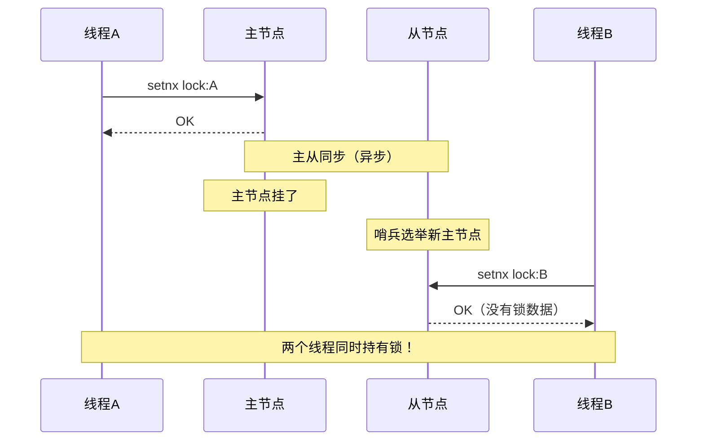

# Redis 分布式锁与库存超卖问题

> **场景定位**：分布式系统核心题  
> **核心设计要点**：分布式锁原理、Redis 主从切换、看门狗机制、Redlock 算法、双保险方案

---

## 🎯 一句话定位

**Redis 分布式锁解决什么问题？**
```
用 Redis 做分布式锁，保证库存扣减的原子性。
结果双十一当天库存超卖了，
查日志发现两个线程同时拿到了锁！

就像你和朋友同时看到最后一件商品，
你们都以为自己是唯一看到的人，
结果都下单了，但只有一件货！
```

**生活化比喻**：
就像洗手间的门锁：
- **加锁**：进去后锁门（setnx）
- **释放锁**：出来后开门（del）
- **过期时间**：防止有人晕在里面（expire）
- **唯一标识**：确保开的是自己的锁（uuid）

**核心特点**：分布式锁不是百分之百可靠，需要**四层设计**保证安全性，同时兼顾性能。

---

## 💎 核心观点（5 分钟速览版）

> **快速概览**

### 核心观点（四层设计）

**第一层：基础实现（入门版）**
```
三个必要条件：
1. set key value nx px 3000：一条命令同时设置锁和过期时间
2. 唯一标识 value：用 UUID 或线程 ID，防止误删别人的锁
3. 释放锁时先判断：是不是自己家的锁

生活化比喻：
- 进洗手间后锁门（setnx）
- 在门上贴个名字（uuid）
- 出来后看看是不是自己的锁（判断 uuid）
- 设置 3 分钟自动开门（px 3000）
```

**第二层：集群环境问题（进阶版）**
```
Redis 主从复制是异步的！
问题场景：
1. 线程 A 在主节点加锁成功
2. 主节点还没同步到从节点就挂了
3. 哨兵选举新主节点（从节点）
4. 从节点没有锁数据
5. 线程 B 也能加锁成功
6. 两个线程同时拿到锁，数据乱了！

解决方案：Redlock 算法
- 在多个 Redis 节点上同时加锁
- 超过半数成功才算加锁成功
- 缺点：性能较差，需要独立 Redis 实例

生活化比喻：
就像多个洗手间，你要把所有洗手间都锁上才算安全。
但这样太慢了（性能差）。
```

**第三层：看门狗机制（生产版）**
```
业务执行时间超过锁过期时间怎么办？
看门狗机制：
1. Redisson 框架启动后台线程（看门狗）
2. 每隔 10 秒检查一次
3. 如果锁还在，自动续期到 30 秒
4. 业务执行完再释放锁

生活化比喻：
就像洗手间里的定时器：
- 你进去后设置 3 分钟自动开门
- 但如果你还没出来，定时器会自动续期
- 防止你还没出来门就开了
```

**第四层：降级方案（双保险）**
```
分布式锁不是百分之百可靠！
降级方案：
在最终扣减库存的数据库操作上加乐观锁：
UPDATE inventory SET stock = stock - 1 
WHERE product_id = 123 AND stock > 0

即使分布式锁失效，数据库也能挡住超卖！

生活化比喻：
就像双重保险：
- 第一道锁：分布式锁（Redis）
- 第二道锁：数据库乐观锁（MySQL）
- 两道锁都通过，才能扣减库存
```

---

## 🚀 一句话精华（如果只能记住一句）

> **Redis 分布式锁 = 基础实现（setnx + uuid + expire） + 集群方案（Redlock） + 看门狗（自动续期） + 双保险（乐观锁兜底）**

---

## 一、为什么 Redis 分布式锁会失效？

### 🔍 核心问题（30 秒版）

**生活化比喻**：
```
Redis 分布式锁失效的三大原因：
1. 没设置过期时间 → 死锁（有人晕在洗手间）
2. 业务执行时间超过过期时间 → 锁提前释放（门自动开了）
3. Redis 主从切换 → 锁丢失（主节点挂了，从节点没有锁数据）

就像洗手间门锁：
- 没设置过期时间：有人晕在里面，别人进不来
- 过期时间太短：你还没出来，门就开了
- 门锁坏了：别人也能打开
```

### 1.1 三大失效场景

| 失效场景 | 具体表现 | 线上后果 | 生活化比喻 |
|---------|---------|---------|-----------|
| **未设置过期时间** | 业务异常，锁未释放 | 死锁，其他线程永远拿不到锁 | 有人晕在洗手间 |
| **业务超时** | 业务执行时间 > 过期时间 | 锁提前释放，多个线程同时持有锁 | 你还没出来，门就开了 |
| **主从切换** | 主节点挂了，从节点没有锁数据 | 多个线程同时加锁成功 | 门锁坏了，别人也能打开 |

---

## 二、第一层：基础实现（入门版）

### 2.1 正确加锁方式

**代码示例**：
```java
// ✅ 正确：一条命令同时设置锁和过期时间
public boolean tryLock(String key, String value, long expireTime) {
    // set key value nx px 3000
    String result = redis.set(key, value, "NX", "PX", expireTime);
    return "OK".equals(result);
}

// ❌ 错误：分两条命令（加锁和设置过期时间）
public boolean tryLockWrong(String key, String value, long expireTime) {
    Long result = redis.setnx(key, value); // 加锁
    if (result == 1) {
        redis.expire(key, expireTime); // 设置过期时间
        // ❌ 如果这条命令执行前程序崩了，锁永远不会过期！
        return true;
    }
    return false;
}
```

### 2.2 正确释放锁方式

**代码示例**：
```java
// ✅ 正确：先判断是不是自己的锁，再释放
public void unlock(String key, String value) {
    // 使用 Lua 脚本保证原子性
    String luaScript = 
        "if redis.call('get', KEYS[1]) == ARGV[1] then " +
        "    return redis.call('del', KEYS[1]) " +
        "else " +
        "    return 0 " +
        "end";
    
    redis.eval(luaScript, Arrays.asList(key), Arrays.asList(value));
}

// ❌ 错误：直接删除（可能删除别人的锁）
public void unlockWrong(String key) {
    redis.del(key); // ❌ 可能删除别人的锁！
}
```

**完整示例**：
```java
public class RedisLock {
    
    private String key;
    private String value; // UUID + 线程 ID
    private long expireTime;
    
    public RedisLock(String key, long expireTime) {
        this.key = key;
        this.value = UUID.randomUUID().toString();
        this.expireTime = expireTime;
    }
    
    // 加锁
    public boolean tryLock() {
        String result = redis.set(key, value, "NX", "PX", expireTime);
        return "OK".equals(result);
    }
    
    // 释放锁
    public void unlock() {
        String luaScript = 
            "if redis.call('get', KEYS[1]) == ARGV[1] then " +
            "    return redis.call('del', KEYS[1]) " +
            "else " +
            "    return 0 " +
            "end";
        
        redis.eval(luaScript, Arrays.asList(key), Arrays.asList(value));
    }
}

// 使用示例
public void deductStock(Long productId) {
    RedisLock lock = new RedisLock("lock:product:" + productId, 30000);
    
    try {
        if (lock.tryLock()) {
            // 业务逻辑
            inventoryMapper.deduct(productId);
        } else {
            throw new BusinessException("系统繁忙，请稍后重试");
        }
    } finally {
        lock.unlock();
    }
}
```

---

## 三、第二层：集群环境问题（Redlock 算法）

### 3.1 主从切换导致锁丢失

**问题场景**：
```
1. 线程 A 在主节点加锁成功
2. 主节点还没同步到从节点就挂了
3. 哨兵选举新主节点（从节点）
4. 从节点没有锁数据
5. 线程 B 也能加锁成功
6. 两个线程同时拿到锁，数据乱了！
```



### 3.2 Redlock 算法

**原理**：
```
1. 在 N 个独立的 Redis 节点上同时加锁
2. 超过半数（N/2 + 1）成功才算加锁成功
3. 锁的过期时间要减去通信时间

例如：5 个节点，至少 3 个成功才算加锁成功
```

**代码示例（Redisson Redlock）**：
```java
// 配置多个 Redis 节点
Config config1 = new Config();
config1.useSingleServer().setAddress("redis://192.168.1.1:6379");

Config config2 = new Config();
config2.useSingleServer().setAddress("redis://192.168.1.2:6379");

Config config3 = new Config();
config3.useSingleServer().setAddress("redis://192.168.1.3:6379");

RedissonClient redisson1 = Redisson.create(config1);
RedissonClient redisson2 = Redisson.create(config2);
RedissonClient redisson3 = Redisson.create(config3);

// 创建 Redlock
RLock lock1 = redisson1.getLock("lock:product:123");
RLock lock2 = redisson2.getLock("lock:product:123");
RLock lock3 = redisson3.getLock("lock:product:123");

RedissonRedlock redLock = new RedissonRedlock(lock1, lock2, lock3);

try {
    // 加锁（至少 3 个节点成功）
    boolean isLock = redLock.tryLock(500, 30000, TimeUnit.MILLISECONDS);
    
    if (isLock) {
        // 业务逻辑
        inventoryMapper.deduct(productId);
    }
} finally {
    redLock.unlock();
}
```

**Redlock 缺点**：
- ❌ 性能差：需要在多个节点上加锁
- ❌ 需要独立 Redis 实例：成本高
- ❌ 实现复杂：需要处理时钟跳跃等问题

---

## 四、第三层：看门狗机制（自动续期）

### 4.1 问题场景

**生活化比喻**：
```
业务执行时间超过锁过期时间怎么办？

就像你设置了 3 分钟自动开门，
但你办事需要 5 分钟，
结果 3 分钟门就开了，
别人进来了！
```

### 4.2 看门狗机制

**原理**：
```
1. Redisson 框架启动后台线程（看门狗）
2. 每隔 10 秒检查一次（默认过期时间的 1/3）
3. 如果锁还在，自动续期到 30 秒
4. 业务执行完再释放锁

好处：
- 不会提前释放（门不会提前开）
- 不会死锁（业务完成后释放）
```

**代码示例（Redisson 看门狗）**：
```java
// Redisson 自动启用看门狗机制
Config config = new Config();
config.useSingleServer().setAddress("redis://192.168.1.1:6379");

RedissonClient redisson = Redisson.create(config);

RLock lock = redisson.getLock("lock:product:123");

try {
    // 加锁（不设置过期时间，Redisson 自动启用看门狗）
    lock.lock(); // ✅ 自动续期
    
    // 业务逻辑（即使执行时间超过 30 秒，锁也不会提前释放）
    Thread.sleep(60000); // 模拟业务执行 60 秒
    
} finally {
    lock.unlock();
}

// 看门狗机制：
// 1. 默认过期时间 30 秒
// 2. 每 10 秒检查一次（30 / 3 = 10）
// 3. 如果锁还在，自动续期到 30 秒
// 4. 业务完成后释放锁
```

---

## 五、第四层：降级方案（双保险）

### 5.1 乐观锁兜底

**生活化比喻**：
```
双保险就像：
- 第一道锁：分布式锁（Redis）
- 第二道锁：数据库乐观锁（MySQL）
- 两道锁都通过，才能扣减库存

即使分布式锁失效，数据库也能挡住超卖！
```

**代码示例（双保险）**：
```java
public void deductStock(Long productId, Integer quantity) {
    // 第一道锁：分布式锁
    RLock lock = redisson.getLock("lock:product:" + productId);
    
    try {
        if (lock.tryLock(500, 30000, TimeUnit.MILLISECONDS)) {
            // 第二道锁：数据库乐观锁
            int rows = inventoryMapper.deductWithOptimisticLock(productId, quantity);
            
            if (rows == 0) {
                throw new BusinessException("库存不足");
            }
        } else {
            throw new BusinessException("系统繁忙，请稍后重试");
        }
    } finally {
        if (lock.isHeldByCurrentThread()) {
            lock.unlock();
        }
    }
}

// SQL：乐观锁
UPDATE inventory 
SET stock = stock - #{quantity}, version = version + 1 
WHERE product_id = #{productId} 
  AND stock >= #{quantity} 
  AND version = #{version};
```

---

六、技术深入探讨

### Q1: Redis 分布式锁为什么会失效？

**答**：
> Redis 分布式锁失效有三大原因：
>
> 1. **未设置过期时间**：业务异常导致锁未释放，造成死锁
> 2. **业务执行时间超过过期时间**：锁提前释放，多个线程同时持有锁
> 3. **Redis 主从切换**：主节点挂了，从节点没有锁数据，导致多个线程同时加锁成功
>
> 解决方案：
> - 基础实现：setnx + uuid + expire
> - 集群环境：Redlock 算法（多个节点加锁）
> - 自动续期：看门狗机制
> - 降级方案：数据库乐观锁兜底

### Q2: Redlock 算法有什么优缺点？

**答**：
> **优点**：
> - 解决了主从切换导致的锁丢失问题
> - 在多个节点上加锁，超过半数成功才算成功
>
> **缺点**：
> - 性能差：需要在多个节点上加锁
> - 需要独立 Redis 实例：成本高
> - 实现复杂：需要处理时钟跳跃等问题
>
> 推荐方案：**Redisson 的 Redlock 实现 + 看门狗机制 + 数据库乐观锁兜底**

### Q3: 看门狗机制是怎么实现的？

**答**：
> 看门狗机制的原理：
>
> 1. Redisson 启动后台线程（看门狗）
> 2. 每隔 10 秒检查一次（默认过期时间的 1/3）
> 3. 如果锁还在，自动续期到 30 秒
> 4. 业务完成后释放锁
>
> 好处：
> - 不会提前释放（门不会提前开）
> - 不会死锁（业务完成后释放）

---

## 七、方案总结

**方案总结**：

> "Redis 分布式锁需要**四层设计**保证安全性：
>
> **第一层：基础实现**
> 用 set key value nx px 3000 一条命令同时设置锁和过期时间。唯一标识 value 用 UUID，释放锁时先判断是不是自己的锁，防止误删别人的锁。
>
> **第二层：集群环境**
> Redis 主从复制是异步的，主节点挂了可能导致锁丢失。解决方案是 Redlock 算法，在多个 Redis 节点上同时加锁，超过半数成功才算加锁成功。但 Redlock 性能较差，需要独立 Redis 实例。
>
> **第三层：看门狗机制**
> 业务执行时间超过锁过期时间怎么办？用看门狗，Redisson 框架会启动后台线程，每 10 秒检查一次，如果锁还在就自动续期到 30 秒，业务执行完再释放锁。
>
> **第四层：降级方案**
> 分布式锁不是百分之百可靠，要有兜底方案。在最终扣减库存的数据库操作上加乐观锁，即使分布式锁失效，数据库也能挡住超卖，这叫双保险。
>
> 通过这四层，能在复杂的分布式环境下保证锁的安全性，同时兼顾性能。"

---

## 八、总结（一句话带走）

### 🎯 一句话总结

> **Redis 分布式锁 = 基础实现（setnx + uuid + expire） + 集群方案（Redlock） + 看门狗（自动续期） + 双保险（乐观锁兜底）**

### 🧠 核心记忆点

1. **为什么分布式锁会失效？** 未设置过期时间、业务超时、Redis 主从切换。
2. **怎么解决？** 四层设计：基础实现、Redlock、看门狗、双保险。
3. **Redlock 有什么优缺点？** 优点是解决锁丢失，缺点是性能差、成本高。
4. **看门狗机制？** 每 10 秒检查一次，自动续期到 30 秒。

---

**参考视频**：[内卷的琪某人 - 分布式锁采用 Redis 实现，双十一库存超卖该如何排查修复？](https://www.douyin.com/video/7650726867364055266)

---

*本文档基于 8 个专家提示词指导改写，遵循深入浅出、生活化比喻、幽默风趣的教学原则。*
