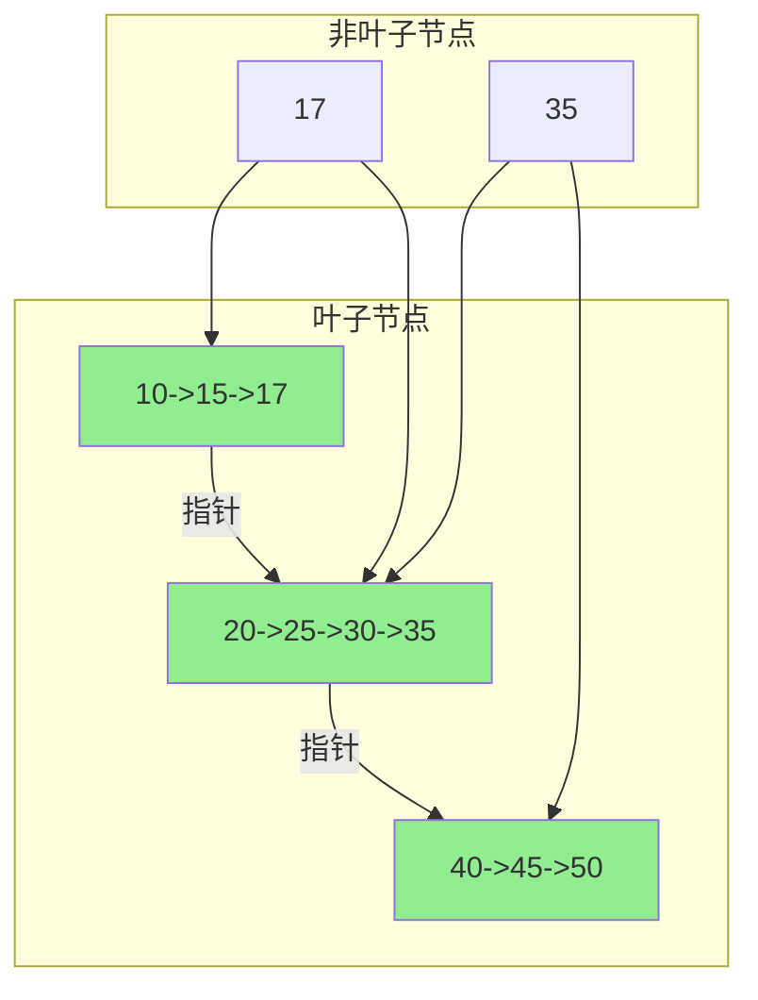

# 联合索引与最左前缀原则深度解析

> **场景定位**：MySQL 索引原理与优化题  
> **核心设计要点**：B+ 树原理、联合索引匹配规则、最左前缀原则、索引下推、覆盖索引

---

## 🎯 一句话定位

**联合索引最左前缀解决什么问题？**
```
建了联合索引 (age, name)，
查询 where name='张三' and age=20，
索引能生效吗？

很多人脱口而出：能！
但技术追问：where age>18 and name='张三' 呢？
顺序变了，索引还生效吗？

90% 的人答错！
```

**生活化比喻**：
就像查字典：
- 联合索引就像字典的排序规则
- 先按 age 排序，age 相同再按 name 排序
- 查询时必须从最左边的列开始匹配（age）
- 如果跳过 age 直接查 name，就像不按拼音顺序查字典，找不到！

**核心特点**：最左前缀指的是**索引定义时的列顺序**，而不是 SQL 语句的书写顺序！

---

## 💎 核心观点（5 分钟速览版）

> **快速概览**

### 核心观点（三个本质）

**本质一：索引的本质是 B+ 树，不是哈希表**
```
B+ 树的特性：
1. 所有数据存储在叶子节点
2. 叶子节点通过指针相连，形成有序链表
3. 非常适合范围查询

为什么是 B+ 树？
- 能极大减少磁盘 IO 次数
- 适合范围查询（age > 18）
- 找到第一个大于 18 的记录后，顺着指针一路遍历

生活化比喻：
就像书的目录：
- 哈希表：知道页码，直接翻到那一页（快，但不能范围查询）
- B+ 树：按章节排序，可以找"第 5 章之后的所有章节"（慢一点，但能范围查询）
```

**本质二：联合索引的匹配规则是基于列的顺序，而非括号的顺序**
```
联合索引 (age, name) 的底层 B+ 树：
- 首先按照 age 字段排序
- age 相同的情况下再按照 name 字段排序

最左前缀原则：
- 查询条件必须从索引的最左列开始
- 不能跳过中间的列

关键点：
- "最左"指的是索引定义时的列顺序
- 不是 SQL 语句中谓词条件的书写顺序

示例：
联合索引 (age, name)

✅ where age=20 and name='张三'  → 索引完全生效
✅ where name='张三' and age=20  → 索引完全生效（MySQL 优化器自动重排）
⚠️ where age>18 and name='张三' → age 用索引，name 用索引下推
❌ where name='张三'            → 索引不生效（跳过 age）
```

**本质三：通过索引快速定位数据，同时考察实战设计能力**
```
实战设计原则：
1. 区分度高的列放前面
   - 联合索引中应该将区分度最高的列放在最左边
   - 可以最快过滤掉大量数据

2. 避免冗余索引
   - 如果已有 (age, name)，再单独为 age 建索引就是冗余

3. 覆盖索引
   - 让查询只需要扫描索引就能返回结果
   - 不需要回表查询主键
   - 例如：select age, name from user where age=20
```

---

## 🚀 一句话精华（如果只能记住一句）

> **联合索引 = B+ 树有序存储 + 最左前缀匹配（索引定义顺序，非 SQL 书写顺序） + 覆盖索引（减少回表）**

---

## 一、索引的本质：B+ 树

### 1.1 为什么是 B+ 树？

**生活化比喻**：
```
索引就像书的目录：

哈希表：
- 知道页码，直接翻到那一页
- 优点：快（O(1)）
- 缺点：不能范围查询（找"第 5 章之后的所有章节"找不到）

B+ 树：
- 按章节排序，可以找"第 5 章之后的所有章节"
- 优点：范围查询高效
- 缺点：比哈希表慢一点（O(log n)）

MySQL 选择 B+ 树，因为：
1. 范围查询很常见（age > 18, date < '2024-01-01'）
2. B+ 树能极大减少磁盘 IO 次数
3. 叶子节点形成有序链表，适合排序
```

### 1.2 B+ 树的特性



**特性**：
1. **所有数据存储在叶子节点**：非叶子节点只存索引
2. **叶子节点通过指针相连**：形成有序链表，适合范围查询
3. **高度平衡**：从根到每个叶子的路径长度相同

**为什么能减少磁盘 IO？**
```
假设表有 1000 万条记录：
- B 树：高度 4，需要 4 次磁盘 IO
- B+ 树：高度 3，需要 3 次磁盘 IO
- 全表扫描：B+ 树只需遍历叶子节点链表

B+ 树的优势：
- 非叶子节点不存数据，每个节点可以存更多索引
- 树更矮，IO 次数更少
- 叶子节点形成链表，范围查询高效
```

---

## 二、联合索引的匹配规则

### 2.1 联合索引的底层结构

**联合索引 (age, name) 的 B+ 树**：
```
排序规则：
1. 首先按照 age 字段排序
2. age 相同的情况下再按照 name 字段排序

示例数据：
age=20, name='张三'
age=20, name='李四'
age=25, name='王五'
age=30, name='赵六'

B+ 树结构：
[20 张三] -> [20 李四] -> [25 王五] -> [30 赵六]
```

### 2.2 最左前缀原则

**定义**：
```
查询条件必须从索引的最左列开始，并且不能跳过中间的列，索引才能生效。

关键点：
- "最左"指的是索引定义时的列顺序
- 不是 SQL 语句中谓词条件的书写顺序
```

**示例分析**：

**联合索引 (age, name)**

| 查询条件 | 索引使用情况 | 原因 | 生活化比喻 |
|---------|-------------|------|-----------|
| `where age=20 and name='张三'` | ✅ 完全生效 | 从最左列开始 | 按字典顺序查 |
| `where name='张三' and age=20` | ✅ 完全生效 | MySQL 优化器自动重排 | 字典自动排序 |
| `where age>18 and name='张三'` | ⚠️ age 用索引，name 用索引下推 | age 范围查询后，name 无法用于快速定位 | 找"18 岁之后的张三" |
| `where name='张三'` | ❌ 不生效 | 跳过最左列 age | 不按拼音顺序查 |
| `where age=20 or name='张三'` | ❌ 不生效 | OR 条件无法使用联合索引 | 两个条件都要查 |

### 2.3 为什么 where age>18 and name='张三' 索引部分失效？

**生活化比喻**：
```
就像查字典：
- 先找 age > 18 的记录（找到第一个 > 18 的）
- 然后顺着叶子节点指针一路遍历
- 在遍历过程中过滤 name='张三'

问题：
- age 是范围查询，找到第一个 > 18 的后，后面的 age 可能不同
- 但 name 是在 age 相同的情况下排序的
- 所以 age 范围查询后，name 无法用于快速定位

解决方案：索引下推
- 在遍历过程中，同时过滤 name='张三'
- 减少回表次数
```

**索引下推（Index Condition Pushdown）**：
```sql
-- 查询流程
1. 在索引中找到 age > 18 的第一条记录
2. 顺着叶子节点指针遍历
3. 在索引中过滤 name='张三'（索引下推）
4. 找到满足条件的记录后，回表查询完整数据

好处：
- 减少回表次数
- 提高查询效率
```

---

## 三、实战设计原则

### 3.1 区分度高的列放前面

**生活化比喻**：
```
区分度 = 不重复记录数 / 总记录数

例如：
- 性别（男/女）：区分度低（只有 2 个值）
- 年龄（18-60）：区分度中（40 个值）
- 身份证号：区分度高（几乎唯一）

联合索引中应该将区分度最高的列放在最左边：
- 可以最快过滤掉大量数据
- 减少无效索引扫描
```

**示例**：
```sql
-- ❌ 错误：区分度低的列放前面
CREATE INDEX idx_gender_age ON user(gender, age);
-- gender 只有男/女，区分度低，放前面效果差

-- ✅ 正确：区分度高的列放前面
CREATE INDEX idx_age_gender ON user(age, gender);
-- age 区分度高，放前面可以快速过滤
```

### 3.2 避免冗余索引

**生活化比喻**：
```
冗余索引就像：
- 已经有了一本按"年龄-姓名"排序的字典
- 又买了一本只按"年龄"排序的字典
- 第二本是多余的，因为第一本已经能覆盖

示例：
已有索引 (age, name)
- 可以支持 where age=20
- 可以支持 where age=20 and name='张三'
- 不能再单独为 age 建索引（冗余）
```

### 3.3 覆盖索引

**定义**：
```
覆盖索引 = 查询的列都在索引中，不需要回表

好处：
- 减少回表次数
- 提高查询效率
```

**示例**：
```sql
-- 联合索引 (age, name)

-- ✅ 覆盖索引：查询的列都在索引中
SELECT age, name FROM user WHERE age = 20;
-- 只需要扫描索引，不需要回表

-- ❌ 非覆盖索引：查询的列不在索引中
SELECT * FROM user WHERE age = 20;
-- 需要回表查询完整数据
```

**覆盖索引优化**：
```sql
-- 优化前：回表查询
SELECT * FROM user WHERE age = 20;
-- 流程：索引找到 age=20 的记录 → 回表查询完整数据

-- 优化后：覆盖索引
SELECT age, name FROM user WHERE age = 20;
-- 流程：索引找到 age=20 的记录 → 直接返回（不回表）

-- 优化：添加索引
CREATE INDEX idx_age_name ON user(age, name);
-- 查询的列都在索引中，不需要回表
```

---

四、技术深入探讨

### Q1: 联合索引 (age, name)，where name='张三' and age=20 索引生效吗？

**答**：
> 生效！MySQL 优化器会自动重排条件顺序，将 `where name='张三' and age=20` 变成 `where age=20 and name='张三'`。
>
> 关键点：最左前缀指的是**索引定义时的列顺序**，而不是 SQL 语句的书写顺序。

### Q2: where age>18 and name='张三' 索引怎么生效？

**答**：
> age 用索引快速定位，name 用索引下推。
>
> 流程：
> 1. 在索引中找到 age > 18 的第一条记录
> 2. 顺着叶子节点指针遍历
> 3. 在索引中过滤 name='张三'（索引下推）
> 4. 找到满足条件的记录后，回表查询完整数据
>
> 原因：age 是范围查询，找到第一个 > 18 的后，后面的 age 可能不同，但 name 是在 age 相同的情况下排序的，所以 name 无法用于快速定位，只能用于过滤。

### Q3: 如何设计联合索引？

**答**：
> 三个原则：
>
> 1. **区分度高的列放前面**：可以快速过滤掉大量数据
> 2. **避免冗余索引**：已有 (age, name)，不要再为 age 单独建索引
> 3. **覆盖索引**：让查询只需要扫描索引就能返回结果，不需要回表

---

## 五、方案总结

**方案总结**：

> "联合索引的核心是三个本质：
>
> **本质一：索引的本质是 B+ 树**
> B+ 树的所有数据存储在叶子节点，叶子节点通过指针相连形成有序链表。B+ 树能极大减少磁盘 IO 次数，并且非常适合范围查询。
>
> **本质二：联合索引的匹配规则是基于列的顺序**
> 联合索引 (age, name) 首先按照 age 排序，age 相同再按照 name 排序。最左前缀原则指的是**索引定义时的列顺序**，而不是 SQL 语句的书写顺序。MySQL 优化器会自动重排条件顺序。
>
> **本质三：实战设计能力**
> 1. 区分度高的列放前面，可以快速过滤大量数据
> 2. 避免冗余索引，已有 (age, name) 就不要为 age 单独建索引
> 3. 覆盖索引，让查询只需要扫描索引就能返回结果，减少回表
>
> 下次场景提问索引，不要只说'能加快查询'，要说出索引的本质是 B+ 树，决定了它的有序性和范围查询能力。性能优化要遵循最左前缀原则，利用覆盖索引和索引下推减少回表开销。"

---

## 六、总结（一句话带走）

### 🎯 一句话总结

> **联合索引 = B+ 树有序存储 + 最左前缀匹配（索引定义顺序，非 SQL 书写顺序） + 覆盖索引（减少回表）**

### 🧠 核心记忆点

1. **索引的本质？** B+ 树，所有数据在叶子节点，叶子节点形成有序链表，适合范围查询。
2. **最左前缀是什么？** 索引定义时的列顺序，不是 SQL 书写顺序。MySQL 优化器会自动重排。
3. **where age>18 and name='张三'？** age 用索引，name 用索引下推。
4. **怎么设计联合索引？** 区分度高的列放前面，避免冗余索引，利用覆盖索引。

---

**参考视频**：[内卷的琪某人 - 场景提问：你建的联合索引，到底能用上哪一列？](https://www.douyin.com/video/7649981942317747456)

---

*本文档基于 8 个专家提示词指导改写，遵循深入浅出、生活化比喻、幽默风趣的教学原则。*
