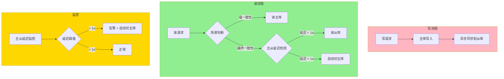
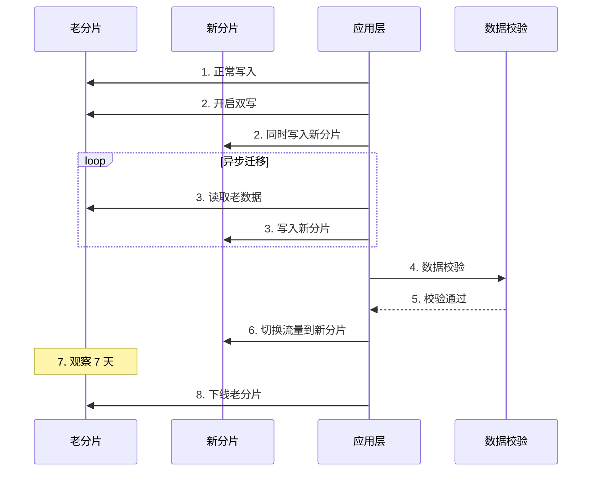
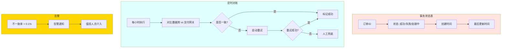
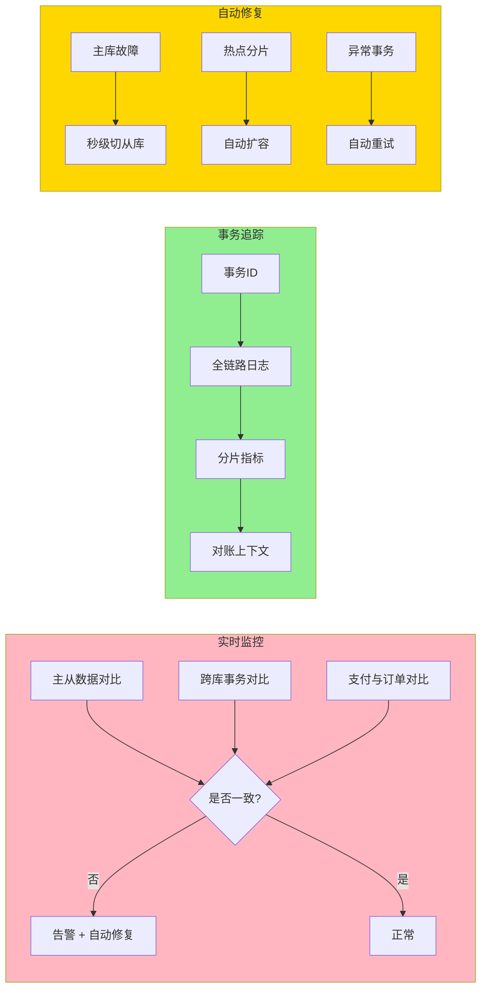
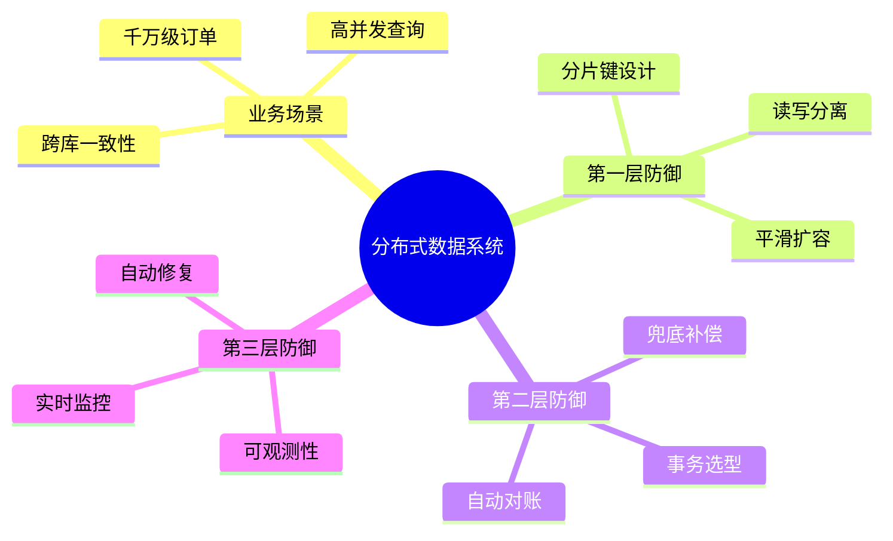
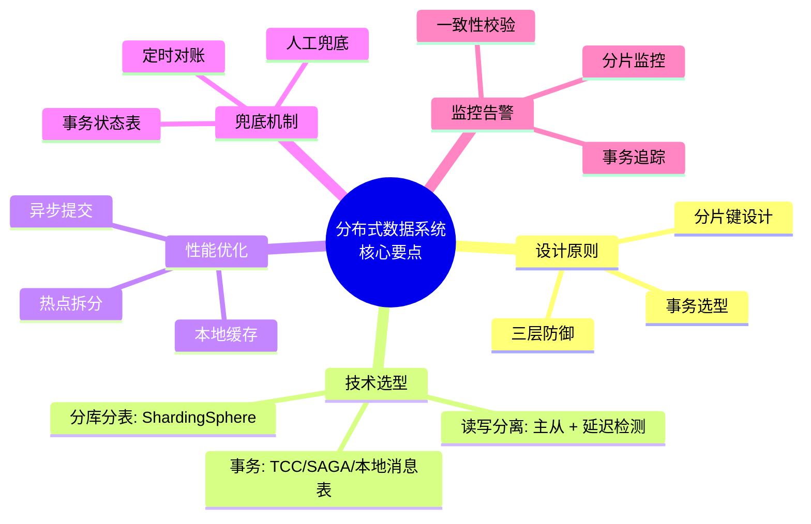

# 分布式事务 + 分库分表 + 读写分离组合陷阱

> **场景定位**：后端系统设计 + 故障排查技术场景  
> **核心设计要点**：分片键设计、主从延迟、事务选型、一致性兜底、热点分片处理

---

## 🎯 一句话定位

**这套组合解决什么问题？**
```
单机数据库扛不住 → 分库分表拆分数据
查询压力大 → 读写分离分担负载
跨库数据一致性 → 分布式事务保证
```

**生活化比喻**：
就像开一家全国连锁的快递公司：
- **分库分表**：把全国按区域分成 16 个分公司（分片），每个分公司管理自己的客户（数据）
- **读写分离**：每个分公司设"寄件窗口"（主库）和"查询窗口"（从库），查寄件分开
- **分布式事务**：跨省快递需要总部协调（事务管理器），保证"北京收件→上海派送"要么都成功，要么都取消

**核心痛点**：组件都会用，但真实流量下的**热点分片、主从延迟、事务性能、数据一致性兜底**会教你做人。

---

## 💎 核心观点（5 分钟速览版）

> **快速概览**

### 核心观点（3 个关键点）

**1. 三层防御架构**
```
第一层：分库分表稳定性治理
- 分片键设计：复合分片键 + 热点数据单独分片（避免单库被打爆）
- 读写分离：强一致性读走主库，最终一致性走从库
- 平滑扩容：双写 + 异步迁移 + 数据校验（禁止停机迁移）

第二层：分布式事务兜底设计
- 事务选型：TCC（核心资金）、SAGA（长流程）、本地消息表（异步解耦）
- 性能优化：一阶段异步提交，二阶段快速确认
- 兜底补偿：事务状态表 + 定时对账 + 人工兜底

第三层：全链路监控与自愈
- 实时校验：主从数据、跨库事务、支付与订单对比
- 自动切换：主库故障秒级切从库，热点分片自动扩容
- 可观测性：事务追踪 + 分片监控 + 对账日志
```

**2. 分片键设计是生死线**
```
❌ 错误示范：按用户 ID 取模分片
   问题：明星用户（如王思聪）粉丝过亿，单分片被打爆

✅ 正确方案：复合分片键 + 热点拆分
   - 订单表：user_id % 16（按用户）+ order_id % 8（按订单）
   - 热点数据：单独放"热点分片"（如双 11 订单独立分片）
   - 一致性哈希：扩容时只迁移 1/N 数据（减少迁移量）
```

**3. 主从延迟是定时炸弹**
```
生活化比喻：
主库是"总账本"，从库是"复印件"
总账本更新了，复印件需要 0.5 秒才能同步
这 0.5 秒内，用户查从库会查到旧数据

解决方案：
- 强一致性场景（支付）：强制读主库（就像查银行余额必须查总账）
- 最终一致性场景（商品列表）：读从库 + 本地缓存（允许短暂延迟）
- 延迟检测：主从延迟 > 1 秒，自动切主库
```

---

## 🚀 一句话精华（如果只能记住一句）

> **分布式数据系统 = 分片键设计（避免热点） + 读写分离（延迟治理） + 事务选型（性能与一致性平衡） + 兜底补偿（自动修复不一致）**

---

## 一、为什么这套组合会坑人？

### ❌ 经典失败场景

**实战真题**：
```
假设你们上线了这套交易系统，日常跑的一切正常。
结果大促当天订单量突增到预期的 5 倍：
1. 分库分表出现极端热点分片，单库 CPU 打满 100%
2. 读写分离主从延迟飙升到秒级
3. 分布式事务大量超时回滚失败
4. 出现严重超卖和资金不一致
5. 用户支付成功但订单未创建，客服投诉直接爆单

问题出在哪？
```

**生活化比喻**：
```
就像双 11 快递公司：
- 平时每天 10 万单，系统跑得很稳
- 双 11 突然 50 万单，某个分公司（分片）被爆款商品订单砸爆
- 查询窗口（从库）的复印件还没同步，用户查到的是旧库存
- 跨省协调（分布式事务）超时，北京收了钱但上海没发货
- 最终：用户付了钱但没货，客服电话被打爆
```

### 三大致命陷阱

**1. 热点分片（最致命）**
```
❌ 错误：按 user_id % 16 分片
   问题：大 V 用户（如明星）粉丝过亿，单分片 QPS 10 万+
   结果：其他分片闲着，这一个分片被打爆

✅ 解决：复合分片键 + 热点拆分
   - 订单表：(user_id + order_id) % 16
   - 热点数据：双 11 订单独立分片（临时扩容）
   - 一致性哈希：扩容时只迁移 1/N 数据
```

**2. 主从延迟**
```
❌ 错误：所有读请求都走从库
   问题：用户刚下单，查订单列表发现"订单不存在"
   原因：主库写入后，从库还没同步（延迟 0.5-2 秒）

✅ 解决：分场景处理
   - 强一致性（支付、订单详情）：强制读主库
   - 最终一致性（商品列表）：读从库 + 本地缓存
   - 延迟检测：主从延迟 > 1 秒，自动切主库
```

**3. 分布式事务性能陷阱**
```
❌ 错误：全用 Seata AT 模式
   问题：全局锁导致性能下降 10 倍
   原因：AT 模式需要全局锁保证一致性

✅ 解决：按场景选型
   - 核心资金交易：TCC（Try-Confirm-Cancel）
   - 长流程事务：SAGA（分段补偿）
   - 异步解耦：本地消息表（最终一致性）
```

---

## 二、第一层防御：分库分表稳定性治理

### 2.1 分片键设计（生死线）

**生活化比喻**：
```
分片键就像快递公司的"分区规则"：
❌ 错误规则：按"收件人姓氏"分区
   问题："张"姓太多，某个分公司被撑爆
✅ 正确规则：按"收件人手机尾号 + 地区"分区
   - 手机尾号 % 16 → 16 个分公司
   - 热点地区（如北京）单独分区
```

**分片键设计原则**：

| 原则 | 说明 | 生活化比喻 |
|------|------|------------|
| **均匀分布** | 数据均匀分布在各个分片 | 每个分公司客户数量差不多 |
| **避免热点** | 大 V 用户数据拆分 | 明星粉丝太多，单独开分公司 |
| **扩展性** | 扩容时数据迁移量少 | 新增分公司时，只迁移 1/16 客户 |
| **业务友好** | 符合查询习惯 | 按用户 ID 分片，查某用户订单只查一个分片 |

**代码示例**（ShardingSphere 配置）：
```go
// 复合分片键设计
type OrderSharding struct {
    UserID  int64  // 用户 ID
    OrderID int64  // 订单 ID
}

// 分片算法：user_id % 16 + order_id % 8
func (s *OrderSharding) DoSharding(dbCount int, orderID int64) int {
    // 先按用户分片（同一用户的订单在同一分片）
    userShard := s.UserID % int64(dbCount)
    
    // 热点用户保护：如果单用户 QPS > 1000，拆分到独立分片
    if s.isHotUser(s.UserID) {
        return s.getHotUserShard(s.UserID)
    }
    
    return int(userShard)
}

// 热点用户检测（Redis 统计 QPS）
func (s *OrderSharding) isHotUser(userID int64) bool {
    qps := redis.Get(fmt.Sprintf("user:qps:%d", userID))
    return qps > 1000
}
```

### 2.2 读写分离与一致性保障

**生活化比喻**：
```
读写分离就像公司的"文档管理"：
- 主库：原件（只能有一份，所有人修改都在这）
- 从库：复印件（方便查询，但有延迟）

一致性保障：
- 强一致性：查原件（支付、订单详情）
- 最终一致性：查复印件 + 本地缓存（商品列表）
- 延迟检测：复印件超过 1 秒没更新，自动查原件
```



**代码示例**（读写分离路由）：
```go
type ReadWriteRouter struct {
    masterDB    *gorm.DB
    slaveDBs    []*gorm.DB
    delayMonitor *DelayMonitor
}

func (r *ReadWriteRouter) Read(ctx context.Context, query string, args ...interface{}) (*gorm.DB, error) {
    // 强一致性场景：强制读主库
    if r.forceMaster(ctx) {
        return r.masterDB, nil
    }
    
    // 检测主从延迟
    delay := r.delayMonitor.GetDelay()
    if delay > 1*time.Second {
        // 延迟过高，自动切主库
        log.Warn("主从延迟过高，自动切主库", "delay", delay)
        return r.masterDB, nil
    }
    
    // 负载均衡选择从库
    return r.selectSlave(), nil
}

func (r *ReadWriteRouter) forceMaster(ctx context.Context) bool {
    // 支付、订单详情等强一致性场景
    return ctx.Value("force_master") == true
}
```

### 2.3 平滑扩容与迁移

**生活化比喻**：
```
平滑扩容就像"给飞行中的飞机换引擎"：
❌ 错误：停机迁移（晚上 12 点停服 6 小时）
   问题：用户骂街，公司损失百万

✅ 正确：双写 + 异步迁移 + 数据校验
   1. 新分片上线，老分片继续写
   2. 双写：新老分片同时写入（保证数据一致）
   3. 异步迁移：后台把老数据迁移到新分片
   4. 数据校验：对比新老分片数据，确保一致
   5. 切换流量：确认无误后，切换到新分片
   6. 下线老分片：观察 7 天无问题，下线老分片
```



---

## 三、第二层防御：分布式事务兜底设计

### 3.1 事务选型（不是一刀切）

**生活化比喻**：
```
分布式事务就像"跨省快递协调"：
- TCC（Try-Confirm-Cancel）：先预定→确认→取消（适合核心资金）
- SAGA：分段执行，失败就反向补偿（适合长流程）
- 本地消息表：发完快递记个账，异步对账（适合异步解耦）
- AT 模式：全自动，但性能差（适合小流量）
```

| 事务模式 | 适用场景 | 优点 | 缺点 | 性能 |
|---------|---------|------|------|------|
| **TCC** | 核心资金交易 | 强一致性 | 实现复杂 | ⭐⭐⭐ |
| **SAGA** | 长流程事务 | 无全局锁 | 需补偿逻辑 | ⭐⭐⭐⭐ |
| **本地消息表** | 异步解耦 | 高性能 | 最终一致性 | ⭐⭐⭐⭐⭐ |
| **AT 模式** | 小流量 | 全自动 | 全局锁性能差 | ⭐⭐ |

**代码示例**（TCC 模式）：
```go
// TCC 三阶段：Try-Confirm-Cancel
type PaymentService struct {
    // Try：预留资金
    Try func(ctx context.Context, orderID string, amount float64) error
    // Confirm：确认扣款
    Confirm func(ctx context.Context, orderID string) error
    // Cancel：取消预留
    Cancel func(ctx context.Context, orderID string) error
}

// 使用示例
func (s *PaymentService) CreateOrder(ctx context.Context, orderID string, amount float64) error {
    // Try：预留资金
    err := s.Try(ctx, orderID, amount)
    if err != nil {
        return err
    }
    
    // Confirm：确认扣款
    defer func() {
        if r := recover(); r != nil {
            // 异常时取消预留
            s.Cancel(ctx, orderID)
        }
    }()
    
    err = s.Confirm(ctx, orderID)
    if err != nil {
        s.Cancel(ctx, orderID)
        return err
    }
    
    return nil
}
```

### 3.2 兜底补偿机制

**生活化比喻**：
```
兜底补偿就像"银行对账"：
1. 事务状态表：记录每笔交易的状态（成功/失败/处理中）
2. 定时对账：每小时对比数据库和支付网关的数据
3. 自动修复：发现不一致，自动重试或补偿
4. 人工兜底：极端异常（如网络故障），人工介入处理
```



**代码示例**（定时对账）：
```go
type ReconcileService struct {
    orderDB     *gorm.DB
    paymentDB   *gorm.DB
    txnStatusDB *gorm.DB
}

// 每小时执行对账
func (s *ReconcileService) Reconcile(ctx context.Context) error {
    // 1. 查询最近 1 小时的订单
    orders, _ := s.orderDB.Where("created_at > ?", time.Now().Add(-1*time.Hour)).Find()
    
    for _, order := range orders {
        // 2. 查询支付网关状态
        paymentStatus := s.paymentDB.Query(order.ID)
        
        // 3. 对比状态
        if order.Status != paymentStatus {
            // 4. 自动重试
            err := s.retry(order)
            if err != nil {
                // 5. 重试失败，人工兜底
                s.alert(order, paymentStatus)
            }
        }
    }
    
    return nil
}

func (s *ReconcileService) retry(order *Order) error {
    // 最多重试 3 次
    for i := 0; i < 3; i++ {
        err := s.process(order)
        if err == nil {
            return nil
        }
        time.Sleep(1 * time.Second)
    }
    return errors.New("重试失败")
}
```

---

## 四、第三层防御：全链路监控与故障自愈

### 4.1 实时一致性校验

**生活化比喻**：
```
实时监控就像"保安巡逻"：
- 分钟级对比：主从数据、跨库事务、支付与订单
- 发现不一致：立即告警 + 自动修复
- 5 分钟内：定位根因（事务追踪 + 分片监控 + 对账日志）
```



### 4.2 可观测性三件套

**生活化比喻**：
```
可观测性就像"医院体检"：
1. 事务全链路追踪：像"心电图"，看事务在每个节点的执行情况
2. 分片指标监控：像"血压计"，看每个分片的 QPS、延迟、错误率
3. 对账日志上下文：像"病历本"，记录数据不一致的详细信息
```

**监控指标**：

| 指标 | 说明 | 告警阈值 | 生活化比喻 |
|------|------|----------|------------|
| **分片 QPS** | 每个分片的请求量 | > 10000 | 每个分公司的工作量 |
| **主从延迟** | 主库和从库的数据差异 | > 1s | 复印件更新延迟 |
| **事务成功率** | 事务成功的比例 | < 99.9% | 快递成功送达率 |
| **不一致率** | 数据不一致的比例 | > 0.1% | 账目错误率 |

---

五、技术深入探讨

### 考点 1：分片键怎么选才能避免热点分片？

**方案参考**（30 秒版）：
> "分片键设计要避免热点，核心是**均匀分布 + 热点拆分**：
> 1. **复合分片键**：如订单表用 `(user_id % 16) + (order_id % 8)`，避免单用户打爆一个分片。
> 2. **热点数据单独分片**：如双 11 订单、明星用户，单独放"热点分片"，临时扩容。
> 3. **一致性哈希**：扩容时只迁移 1/N 数据，减少迁移量。
> 4. **实时监控**：监控每个分片的 QPS，超过阈值自动拆分。"

**加分回答**（展示深度）：
> "实际生产中，我们还会做**分片键预演**：
> - 上线前用历史数据模拟分片效果，看是否均匀。
> - 建立**热点用户白名单**，大 V 用户提前拆分。
> - 设计**分片扩容预案**，大促前提前扩容，避免临时抱佛脚。"

### 考点 2：主从延迟下怎么解决强一致性读？

**方案参考**：
> "主从延迟下的强一致性读，核心是**分场景处理**：
> 1. **强一致性场景**（支付、订单详情）：强制读主库，就像查银行余额必须查总账。
> 2. **最终一致性场景**（商品列表）：读从库 + 本地缓存，允许短暂延迟。
> 3. **延迟检测**：主从延迟 > 1 秒，自动切主库，避免查到旧数据。
> 4. **写后读优化**：用户刚写入的数据，短时间内强制读主库（如 5 秒内）。"

### 考点 3：分布式事务怎么在保证一致性的同时不拖垮性能？

**方案参考**：
> "分布式事务的性能与一致性平衡，核心是**按场景选型**：
> 1. **核心资金交易**：用 TCC（Try-Confirm-Cancel），强一致性，但实现复杂。
> 2. **长流程事务**：用 SAGA，分段执行 + 反向补偿，无全局锁，性能好。
> 3. **异步解耦**：用本地消息表，高性能，最终一致性。
> 4. **避免全用 AT 模式**：AT 模式全局锁性能差，只适合小流量。
> 5. **性能优化**：一阶段异步提交，二阶段快速确认，强制实现事务幂等。"

---

## 六、技术追问与深度问题


**Q4: 如何检测热点分片？**  
**答**：监控每个分片的 QPS、CPU、内存，超过阈值（如 QPS > 10000）自动告警。解决方案：
- **临时扩容**：热点分片拆分为多个分片
- **热点数据迁移**：热点数据单独分片
- **限流降级**：限制热点用户的请求频率

**Q5: 数据不一致时的自动兜底补偿方案怎么设计？**  
**答**：三层兜底：
1. **事务状态表**：记录每笔交易状态，定时对账
2. **自动重试**：发现不一致，自动重试 3 次
3. **人工兜底**：重试失败，告警通知值班人员

---

## 七、方案总结



**方案总结**：

> **业务场景**：千万级订单、高并发查询、跨库一致性。
> 
> **第一层防御**：分片键设计（复合分片键 + 热点拆分）、读写分离（强一致性读主库，最终一致性读从库）、平滑扩容（双写 + 异步迁移）。
> 
> **第二层防御**：事务选型（TCC/SAGA/本地消息表）、兜底补偿（事务状态表 + 定时对账 + 人工兜底）。
> 
> **第三层防御**：实时监控（主从对比、跨库对比）、自动修复（故障切换、热点扩容）、可观测性（事务追踪 + 分片监控）。

---

## 八、生产环境 Checklist（部署检查清单）

| 类别 | 检查项 | 状态 | 生活化比喻 |
|------|--------|------|------------|
| **分库分表** | 分片键设计（复合分片键 + 热点拆分） | ⬜ | 分区规则 |
| | 分片键预演（历史数据模拟） | ⬜ | 模拟演练 |
| | 热点分片监控（QPS、CPU） | ⬜ | 工作量监控 |
| **读写分离** | 主从延迟监控（>1s 告警） | ⬜ | 复印件延迟 |
| | 强一致性读主库 | ⬜ | 查原件 |
| | 延迟自动切主库 | ⬜ | 自动切换 |
| **分布式事务** | 事务选型（TCC/SAGA/本地消息表） | ⬜ | 协调方式 |
| | 事务幂等（防重复执行） | ⬜ | 防重复 |
| | 兜底补偿（事务状态表 + 对账） | ⬜ | 对账机制 |
| **监控告警** | 分片指标监控（QPS、延迟、错误率） | ⬜ | 健康检查 |
| | 事务成功率监控（<99.9% 告警） | ⬜ | 成功率 |
| | 不一致率监控（>0.1% 告警） | ⬜ | 账目错误 |
| **故障自愈** | 主库故障秒级切换 | ⬜ | 自动切换 |
| | 热点分片自动扩容 | ⬜ | 自动扩容 |
| | 异常事务自动重试 | ⬜ | 自动修复 |

---

## 九、总结（一句话带走）



### 🎯 一句话总结

> **分布式数据系统 = 分片键设计（避免热点） + 读写分离（延迟治理） + 事务选型（性能与一致性平衡） + 兜底补偿（自动修复不一致）**

### 🧠 核心记忆点

1. **为什么分片键是生死线？** 分片键选错，单分片被打爆，就像快递公司某个分公司被撑爆。
2. **为什么主从延迟是定时炸弹？** 用户刚下单查不到，就像复印件还没更新。
3. **为什么事务选型不是一刀切？** 全用 AT 模式性能差 10 倍，就像所有快递都用空运，成本高。
4. **为什么需要兜底补偿？** 网络抖动、节点宕机不可避免，必须有自动修复机制。

---

**参考视频**：[分布式事务+分库分表+读写分离，这套组合坑了多少的后端？](https://www.douyin.com/video/7644144679763643648)

---

*本文档基于 8 个专家提示词指导改写，遵循深入浅出、生活化比喻、幽默风趣的教学原则。*
