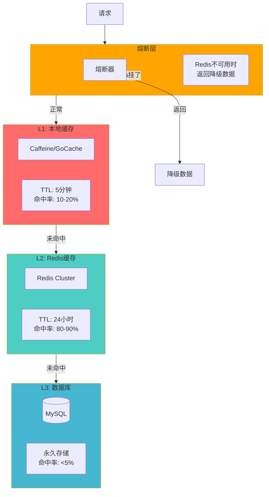
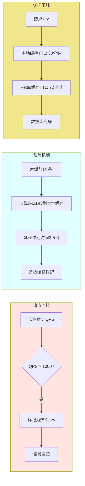
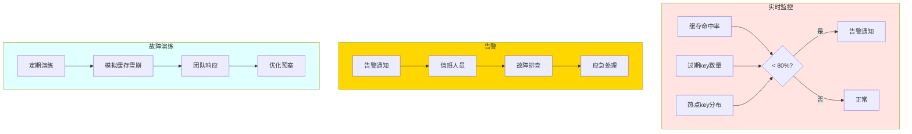
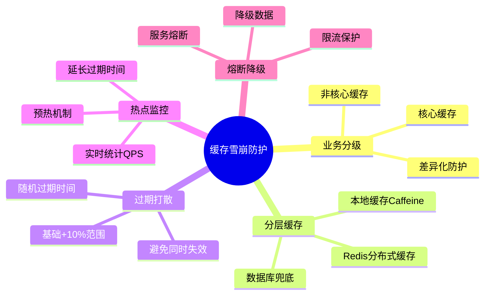
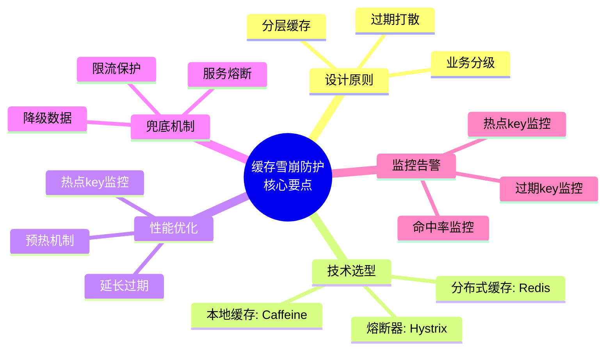

# Redis 缓存雪崩应急处理与预防体系

> **场景定位**：Redis 高可用 + 故障排查技术场景  
> **核心设计要点**：缓存雪崩预防、Redis 集群宕机兜底、热点 key 监控、应急恢复方案

---

## 🎯 一句话定位

**缓存雪崩解决什么问题？**
```
❌ 灾难场景：
   - 大面积缓存同时过期
   - Redis 集群突然宕机
   - 热点 key 集中失效
   - 所有请求直接打到数据库
   - 数据库瞬间被打挂

✅ 解决方案：
   - 三层防护体系（业务分级 + 分层缓存 + 异常处理）
   - 从预防到应急的全流程设计
```

**生活化比喻**：
就像银行系统：
- **缓存**：银行前台（快速办理业务）
- **数据库**：银行金库（安全但慢）
- **缓存雪崩**：前台所有人同时请假，所有客户涌向金库，金库被挤爆
- **解决方案**：留部分前台员工（本地缓存）+ 限制金库进入人数（限流）+ 提前培训备用人员（预热）

**核心特点**：看似简单（加随机过期时间），但真正考验的是**集群宕机、热点失效、应急恢复**的兜底能力。

---

## 💎 核心观点（5 分钟速览版）

> **快速概览**

### 核心观点（3 个关键点）

**1. 三层防护体系**
```
第一层：业务分级
- 核心缓存（商品详情、订单查询、支付状态）：多重防护，高可用
- 非核心缓存（后台统计、日志查询）：允许降级，不影响主业务

第二层：分层缓存 + 过期打散
- 基础层：所有 key 加随机过期时间（基础时间 + 10% 范围内打散）
- 中间层：本地缓存 + Redis 二级缓存（Redis 挂了还有本地缓存兜底）
- 热点层：实时监控热点 key，大促前预热并延长过期时间

第三层：异常处理细节
- Redis 宕机：服务熔断 + 返回降级数据
- 雪崩应急：限流保护数据库 + 分批恢复缓存
- 监控预警：缓存命中率、过期 key 数量、热点 key 分布
```

**2. 热点 key 是定时炸弹**
```
生活化比喻：
热点 key 就像"明星商品"（如 iPhone 新品）：
- 平时：QPS 100，缓存命中率高
- 大促：QPS 10 万+，缓存一旦失效，数据库瞬间被打爆

解决方案：
- 实时监控：发现热点 key，提前预警
- 预热机制：大促前提前加载到本地缓存
- 延长过期：热点 key 过期时间设置为普通 key 的 3-5 倍
- 多级缓存：本地缓存（Caffeine）+ Redis + 数据库
```

**3. Redis 集群宕机是终极考验**
```
❌ 错误做法：所有请求直接打到数据库
   结果：数据库被打挂，整个系统崩溃

✅ 正确做法：
   1. 服务熔断：Redis 不可用时，自动触发熔断
   2. 降级数据：返回预设的默认值（如"系统繁忙，请稍后重试"）
   3. 限流保护：限制数据库访问流量，保护数据库
   4. 分批恢复：逐步恢复缓存，避免一次性加载所有数据
```

---

## 🚀 一句话精华（如果只能记住一句）

> **缓存雪崩防护 = 业务分级（核心 vs 非核心） + 分层缓存（本地 + Redis） + 过期打散（随机时间） + 熔断降级（Redis 宕机兜底） + 限流保护（数据库保护）**

---

## 一、为什么缓存雪崩会致命？

### ❌ 经典失败场景

**实战真题**：
```
线上突然出现大面积缓存同时过期，数据库瞬间被打挂，你怎么处理？

追问：
1. 如果加了随机过期时间，还是出现了小范围雪崩怎么办？
2. 如果 Redis 整个集群都挂了，怎么兜底？
3. 如果是热点 key 集中失效（如大促期间爆款商品），瞬间几十万请求怎么办？
4. 如果缓存雪崩已经发生，数据库已经被打挂了，怎么快速恢复？
```

**生活化比喻**：
```
缓存雪崩就像"银行前台集体请假"：
- 平时：前台 10 个员工（缓存），金库 1 个窗口（数据库）
- 雪崩：前台 9 个员工同时请假，只剩 1 个
- 结果：所有客户涌向金库，金库被挤爆
- 更糟：如果金库也挂了（数据库宕机），整个银行瘫痪
```

### 三大致命场景

**1. 大面积缓存同时过期**
```
❌ 错误：所有缓存设置相同的过期时间（如都设置为 1 小时）
   问题：1 小时后，所有缓存同时失效，所有请求打到数据库
   结果：数据库 QPS 瞬间飙升 100 倍，被打挂

✅ 解决：过期时间加随机值
   - 基础过期时间：1 小时
   - 随机范围：±10%（54-66 分钟）
   - 效果：过期时间分散在 12 分钟内，避免同时失效
```

**2. Redis 集群宕机**
```
❌ 错误：Redis 挂了，所有请求直接打到数据库
   问题：数据库 QPS 瞬间飙升 1000 倍，被打挂
   结果：整个系统崩溃，用户无法访问

✅ 解决：服务熔断 + 降级数据
   - 熔断：Redis 不可用时，自动触发熔断
   - 降级：返回预设的默认值（如"系统繁忙，请稍后重试"）
   - 限流：限制数据库访问流量，保护数据库
```

**3. 热点 key 集中失效**
```
❌ 错误：热点 key（如爆款商品）和普通 key 设置相同的过期时间
   问题：大促期间，所有热点 key 同时失效，瞬间几十万请求打到数据库
   结果：数据库被打挂，用户无法下单

✅ 解决：热点 key 特殊处理
   - 实时监控：发现热点 key，提前预警
   - 预热机制：大促前提前加载到本地缓存
   - 延长过期：热点 key 过期时间设置为普通 key 的 3-5 倍
   - 多级缓存：本地缓存（Caffeine）+ Redis + 数据库
```

---

## 二、第一层防御：业务分级

### 2.1 区分核心缓存与非核心缓存

**生活化比喻**：
```
业务分级就像"银行 VIP 服务"：
- VIP 客户（核心业务）：优先服务，多重保障
  - 商品详情、订单查询、支付状态
  - 必须保证高可用，缓存失效时优先恢复

- 普通客户（非核心业务）：允许降级，不影响主业务
  - 后台统计、日志查询、历史数据
  - 缓存失效时返回默认值或降级处理
```

**业务分级策略**：

| 业务类型 | 缓存重要性 | 防护策略 | 降级方案 | 生活化比喻 |
|---------|-----------|---------|---------|------------|
| **商品详情** | ⭐⭐⭐⭐⭐ | 多级缓存 + 预热 | 返回缓存快照 | VIP 客户 |
| **订单查询** | ⭐⭐⭐⭐⭐ | 多级缓存 + 熔断 | 返回默认值 | VIP 客户 |
| **支付状态** | ⭐⭐⭐⭐⭐ | 强一致性 + 本地缓存 | 强制查数据库 | VIP 客户 |
| **后台统计** | ⭐⭐⭐ | 普通缓存 | 返回默认值 | 普通客户 |
| **日志查询** | ⭐⭐ | 普通缓存 | 延迟加载 | 普通客户 |
| **历史数据** | ⭐⭐ | 普通缓存 | 返回默认值 | 普通客户 |

**代码示例**（业务分级缓存）：
```go
type CacheLevel int

const (
    CacheLevelCritical CacheLevel = iota // 核心业务
    CacheLevelNormal                      // 普通业务
    CacheLevelLow                         // 低优先级业务
)

type CacheService struct {
    localCache  *cache.Cache      // 本地缓存（Caffeine）
    redisCache  *redis.Client     // Redis 缓存
    mysqlDB     *gorm.DB          // 数据库
    fuse        *Fuse             // 熔断器
}

func (s *CacheService) Get(ctx context.Context, key string, level CacheLevel) (string, error) {
    // L1: 本地缓存（最快）
    if val, ok := s.localCache.Get(key); ok {
        return val, nil
    }
    
    // L2: Redis 缓存
    val, err := s.redisCache.Get(key).Result()
    if err == nil {
        s.localCache.Set(key, val, s.getTTL(level)) // 回写本地
        return val, nil
    }
    
    // Redis 不可用，触发熔断
    if s.fuse.IsOpen() {
        // 降级处理
        return s.getFallback(key, level)
    }
    
    // L3: 数据库（最慢）
    val, err = s.mysqlDB.Query(key)
    if err == nil {
        s.redisCache.Set(key, val, s.getTTL(level))
        s.localCache.Set(key, val, s.getTTL(level))
        return val, nil
    }
    
    return s.getFallback(key, level)
}

func (s *CacheService) getTTL(level CacheLevel) time.Duration {
    switch level {
    case CacheLevelCritical:
        return 24 * time.Hour // 核心业务：长过期时间
    case CacheLevelNormal:
        return 1 * time.Hour  // 普通业务：中等过期时间
    case CacheLevelLow:
        return 10 * time.Minute // 低优先级：短过期时间
    default:
        return 1 * time.Hour
    }
}

func (s *CacheService) getFallback(key string, level CacheLevel) (string, error) {
    if level == CacheLevelCritical {
        // 核心业务：返回缓存快照
        return s.getSnapshot(key)
    }
    // 非核心业务：返回默认值
    return "系统繁忙，请稍后重试", nil
}
```

---

## 三、第二层防御：分层缓存 + 过期打散

### 3.1 过期时间打散（基础层）

**生活化比喻**：
```
过期打散就像"银行员工轮班"：
❌ 错误：所有员工同一时间下班（缓存同时失效）
✅ 正确：员工分批下班（缓存分散失效）

实现方式：
- 基础过期时间：1 小时
- 随机范围：±10%（54-66 分钟）
- 效果：过期时间分散在 12 分钟内，避免同时失效
```

**代码示例**（过期时间打散）：
```go
func (s *CacheService) SetWithRandomTTL(key string, value string, baseTTL time.Duration) {
    // 随机范围：±10%
    randomRange := float64(baseTTL) * 0.1
    randomOffset := time.Duration(rand.Float64()*randomRange*2 - randomRange)
    ttl := baseTTL + randomOffset
    
    s.redisCache.Set(key, value, ttl)
}

// 使用示例
s.SetWithRandomTTL("product:123", productData, 1*time.Hour)
// 实际过期时间：54-66 分钟之间随机
```

### 3.2 二级缓存架构（中间层）

**生活化比喻**：
```
二级缓存就像"银行前台 + 备用前台"：
- 本地缓存（Caffeine）：银行前台（最快，但容量小）
- Redis 缓存：备用前台（快，容量中等）
- 数据库：金库（慢，但容量大，永久保存）

优势：
- Redis 挂了，还有本地缓存兜底
- 减少 Redis 访问压力
- 抗热点能力更强
```



**代码示例**（二级缓存 + 熔断）：
```go
type MultiLevelCache struct {
    localCache  *cache.Cache      // 本地缓存
    redisCache  *redis.Client     // Redis 缓存
    mysqlDB     *gorm.DB          // 数据库
    fuse        *Fuse             // 熔断器
    monitor     *Monitor          // 监控
}

func (c *MultiLevelCache) Get(ctx context.Context, key string) (string, error) {
    // L1: 本地缓存（最快）
    if val, ok := c.localCache.Get(key); ok {
        c.monitor.IncrHit("local")
        return val, nil
    }
    
    // 检查熔断状态
    if c.fuse.IsOpen() {
        // Redis 不可用，返回降级数据
        return c.getFallback(key)
    }
    
    // L2: Redis 缓存
    val, err := c.redisCache.Get(key).Result()
    if err == nil {
        c.localCache.Set(key, val, 5*time.Minute) // 回写本地
        c.monitor.IncrHit("redis")
        return val, nil
    }
    
    // Redis 异常，触发熔断
    if c.isRedisError(err) {
        c.fuse.Trigger()
        return c.getFallback(key)
    }
    
    // L3: 数据库
    val, err = c.mysqlDB.Query(key)
    if err == nil {
        c.redisCache.Set(key, val, 24*time.Hour)
        c.localCache.Set(key, val, 5*time.Minute)
        c.monitor.IncrHit("mysql")
        return val, nil
    }
    
    return c.getFallback(key)
}
```

### 3.3 热点 key 监控与预热（热点层）

**生活化比喻**：
```
热点 key 就像"明星商品"：
- 平时：QPS 100，缓存命中率高
- 大促：QPS 10 万+，缓存一旦失效，数据库瞬间被打爆

解决方案：
- 实时监控：发现热点 key，提前预警
- 预热机制：大促前提前加载到本地缓存
- 延长过期：热点 key 过期时间设置为普通 key 的 3-5 倍
```



**代码示例**（热点 key 监控）：
```go
type HotKeyMonitor struct {
    redis     *redis.Client
    threshold int64 // QPS 阈值
    hotKeys   map[string]bool
    mu        sync.RWMutex
}

// 实时监控热点 key
func (m *HotKeyMonitor) Check(key string) {
    // 统计 QPS
    qps := m.redis.Incr(fmt.Sprintf("qps:%s", key)).Val()
    
    if qps > m.threshold {
        // 标记为热点 key
        m.mu.Lock()
        m.hotKeys[key] = true
        m.mu.Unlock()
        
        // 告警通知
        m.alert(key, qps)
    }
}

// 预热热点 key
func (m *HotKeyMonitor) Preheat(keys []string, localCache *cache.Cache) {
    for _, key := range keys {
        // 从 Redis 加载到本地缓存
        val, _ := m.redis.Get(key).Result()
        // 延长过期时间（3-5 倍）
        localCache.Set(key, val, 30*time.Minute)
    }
}
```

---

## 四、第三层防御：异常处理细节

### 4.1 Redis 集群宕机兜底

**生活化比喻**：
```
Redis 宕机就像"银行系统故障"：
❌ 错误：所有客户涌向金库（数据库被打挂）
✅ 正确：
   1. 限制进入金库的人数（限流）
   2. 告诉客户"系统繁忙，请稍后重试"（降级）
   3. 分批恢复系统（避免一次性加载所有数据）
```

**代码示例**（熔断 + 降级）：
```go
type Fuse struct {
    isOpen    bool
    threshold int // 失败次数阈值
    failCount int
    timeout   time.Duration // 熔断超时时间
    mu        sync.RWMutex
}

func (f *Fuse) IsOpen() bool {
    f.mu.RLock()
    defer f.mu.RUnlock()
    return f.isOpen
}

func (f *Fuse) Trigger() {
    f.mu.Lock()
    defer f.mu.Unlock()
    
    f.failCount++
    if f.failCount >= f.threshold {
        f.isOpen = true
        // 超时后自动恢复
        time.AfterFunc(f.timeout, func() {
            f.Reset()
        })
    }
}

func (f *Fuse) Reset() {
    f.mu.Lock()
    defer f.mu.Unlock()
    
    f.isOpen = false
    f.failCount = 0
}

// 使用示例
func (s *CacheService) Get(key string) (string, error) {
    if s.fuse.IsOpen() {
        // 熔断触发，返回降级数据
        return "系统繁忙，请稍后重试", nil
    }
    
    val, err := s.redisCache.Get(key).Result()
    if err != nil {
        s.fuse.Trigger()
        return "系统繁忙，请稍后重试", nil
    }
    
    return val, nil
}
```

### 4.2 缓存雪崩应急处理

**生活化比喻**：
```
应急处理就像"银行系统恢复"：
1. 限流保护：限制金库进入人数（保护数据库）
2. 分批恢复：分批叫客户进入金库（避免一次性加载所有数据）
3. 优先级恢复：先恢复核心业务（商品详情、订单查询）
```

**代码示例**（限流 + 分批恢复）：
```go
type EmergencyHandler struct {
    limiter   *rate.Limiter // 限流器
    cache     *MultiLevelCache
    monitor   *Monitor
}

// 应急处理
func (h *EmergencyHandler) Handle() {
    // 1. 限流保护数据库
    h.limiter.SetLimit(1000) // 限制 QPS 为 1000
    
    // 2. 分批恢复缓存
    keys := h.getExpiredKeys()
    batchSize := 100 // 每批恢复 100 个 key
    
    for i := 0; i < len(keys); i += batchSize {
        batch := keys[i:min(i+batchSize, len(keys))]
        h.cache.BatchReload(batch)
        time.Sleep(1 * time.Second) // 间隔 1 秒，避免压力骤增
    }
    
    // 3. 恢复限流
    h.limiter.SetLimit(10000) // 恢复正常 QPS
}
```

### 4.3 缓存监控体系

**生活化比喻**：
```
监控体系就像"银行保安巡逻"：
- 实时监控：缓存命中率、过期 key 数量、热点 key 分布
- 提前预警：发现异常，及时告警
- 故障演练：定期演练，确保团队能快速响应
```

**监控指标**：

| 指标 | 说明 | 告警阈值 | 生活化比喻 |
|------|------|----------|------------|
| **缓存命中率** | 缓存命中的比例 | < 80% | 前台服务效率 |
| **过期 key 数量** | 单位时间内过期的 key 数量 | > 10000/分钟 | 员工离职数量 |
| **热点 key 数量** | QPS > 1000 的 key 数量 | > 100 | VIP 客户数量 |
| **Redis QPS** | Redis 的请求量 | > 100000 | 银行业务量 |
| **数据库 QPS** | 数据库的请求量 | > 10000 | 金库业务量 |



---

五、技术深入探讨

### 考点 1：如何预防缓存雪崩？

**方案参考**（30 秒版）：
> "缓存雪崩预防需要三层防护：
> 1. **业务分级**：核心缓存（商品详情、订单查询）多重防护，非核心缓存允许降级。
> 2. **过期打散**：所有 key 加随机过期时间（基础时间 + 10%），避免同时失效。
> 3. **分层缓存**：本地缓存 + Redis 二级缓存，Redis 挂了还有本地缓存兜底。
> 4. **热点监控**：实时监控热点 key，大促前预热并延长过期时间。
> 5. **熔断降级**：Redis 不可用时自动触发熔断，返回降级数据，保护数据库。"

**加分回答**（展示深度）：
> "实际生产中，我们还会做**故障演练**：
> - 定期模拟缓存雪崩场景，验证团队响应能力。
> - 建立**缓存监控大盘**，实时监控命中率、过期 key、热点 key。
> - 制定**应急预案**，明确每个角色的职责和处理流程。
> - 建立**缓存快照机制**，缓存失效时快速恢复。"

### 考点 2：Redis 集群宕机怎么兜底？

**方案参考**：
> "Redis 集群宕机是终极考验，兜底方案：
> 1. **服务熔断**：Redis 不可用时，自动触发熔断，不再访问 Redis。
> 2. **降级数据**：返回预设的默认值或缓存快照，保证业务可用。
> 3. **限流保护**：限制数据库访问流量，保护数据库不被打挂。
> 4. **分批恢复**：Redis 恢复后，分批加载缓存，避免一次性加载所有数据导致数据库压力骤增。"

### 考点 3：热点 key 集中失效怎么处理？

**方案参考**：
> "热点 key 是定时炸弹，处理方案：
> 1. **实时监控**：统计每个 key 的 QPS，超过阈值（如 1000）标记为热点 key。
> 2. **预热机制**：大促前提前加载热点 key 到本地缓存，延长过期时间（3-5 倍）。
> 3. **多级缓存**：热点 key 同时放在本地缓存（Caffeine）+ Redis + 数据库，多级保护。
> 4. **限流降级**：热点 key 缓存失效时，限流保护数据库，返回降级数据。"

---

## 六、技术追问与深度问题

```mermaid
graph TB
    subgraph Q1["Q1: 如何检测缓存雪崩风险?"]
        A1[监控过期key数量] --> A2[单位时间过期>10000]
        A2 --> A3[告警通知]
        A3 --> A4[提前预警]
    end
    
    subgraph Q2["Q2: Redis集群宕机怎么恢复?"]
        B1[Redis重启] --> B2[分批加载缓存]
        B2 --> B3[优先加载核心业务]
        B3 --> B4[逐步恢复QPS]
    end
    
    subgraph Q3["Q3: 热点key如何识别?"]
        C1[实时统计QPS] --> C2[QPS>1000]
        C2 --> C3[标记为热点]
        C3 --> C4[预热+延长过期]
    end
    
    subgraph Q4["Q4: 缓存快照怎么做?"]
        D1[定时备份热点key] --> D2[存储到本地磁盘]
        D2 --> D3[缓存失效时快速恢复]
    end
    
    style Q1 fill:#FFE4E1
    style Q2 fill:#E0FFFF
    style Q3 fill:#F0E68C
    style Q4 fill:#DDA0DD
```



**Q4: 缓存快照怎么做？**  
**答**：定时备份热点 key 到本地磁盘：
```go
// 定时备份热点 key
func (s *CacheService) Backup() {
    hotKeys := s.monitor.GetHotKeys()
    
    for _, key := range hotKeys {
        val, _ := s.redisCache.Get(key).Result()
        // 存储到本地磁盘
        os.WriteFile(fmt.Sprintf("/tmp/cache/%s", key), []byte(val), 0644)
    }
}

// 缓存失效时快速恢复
func (s *CacheService) Restore() {
    files, _ := os.ReadDir("/tmp/cache/")
    
    for _, file := range files {
        data, _ := os.ReadFile(fmt.Sprintf("/tmp/cache/%s", file.Name()))
        s.localCache.Set(file.Name(), string(data), 30*time.Minute)
    }
}
```

---

## 七、方案总结



**方案总结**：

> **业务分级**：核心缓存（商品详情、订单查询）多重防护，非核心缓存允许降级。
> 
> **分层缓存**：本地缓存（Caffeine）+ Redis 二级缓存，Redis 挂了还有本地缓存兜底。
> 
> **过期打散**：所有 key 加随机过期时间（基础时间 + 10%），避免同时失效。
> 
> **热点监控**：实时监控热点 key，大促前预热并延长过期时间。
> 
> **熔断降级**：Redis 不可用时自动触发熔断，返回降级数据，限流保护数据库。

---

## 八、生产环境 Checklist（部署检查清单）

| 类别 | 检查项 | 状态 | 生活化比喻 |
|------|--------|------|------------|
| **业务分级** | 核心缓存识别（商品、订单、支付） | ⬜ | VIP 客户 |
| | 非核心缓存降级方案 | ⬜ | 普通客户 |
| **过期打散** | 随机过期时间（±10%） | ⬜ | 员工轮班 |
| | 避免相同过期时间 | ⬜ | 避免集体请假 |
| **分层缓存** | 本地缓存（Caffeine） | ⬜ | 银行前台 |
| | Redis 分布式缓存 | ⬜ | 备用前台 |
| | 数据库兜底 | ⬜ | 金库 |
| **热点监控** | 实时统计 QPS | ⬜ | 客流量统计 |
| | 热点 key 识别（QPS > 1000） | ⬜ | VIP 客户识别 |
| | 预热机制（大促前） | ⬜ | 提前准备 |
| **熔断降级** | 服务熔断器 | ⬜ | 自动开关 |
| | 降级数据（默认值/快照） | ⬜ | 备用方案 |
| | 限流保护（数据库） | ⬜ | 限流阀 |
| **监控告警** | 缓存命中率监控（< 80% 告警） | ⬜ | 效率监控 |
| | 过期 key 数量监控 | ⬜ | 离职监控 |
| | 热点 key 分布监控 | ⬜ | VIP 监控 |
| **故障演练** | 定期故障演练 | ⬜ | 消防演习 |
| | 应急预案（文档化） | ⬜ | 应急手册 |
| | 团队培训 | ⬜ | 培训演练 |

---

## 九、总结（一句话带走）



### 🎯 一句话总结

> **缓存雪崩防护 = 业务分级（核心 vs 非核心） + 分层缓存（本地 + Redis） + 过期打散（随机时间） + 熔断降级（Redis 宕机兜底） + 限流保护（数据库保护）**

### 🧠 核心记忆点

1. **为什么加随机过期时间？** 避免所有缓存同时失效，就像员工分批下班，避免银行前台集体请假。
2. **为什么需要二级缓存？** Redis 挂了还有本地缓存兜底，就像银行前台请假了，还有备用前台。
3. **为什么热点 key 要特殊处理？** 热点 key 一旦失效，瞬间几十万请求打到数据库，就像明星商品卖光，所有客户涌向金库。
4. **为什么需要熔断降级？** Redis 挂了不能直接打到数据库，要先熔断，返回降级数据，保护数据库。

---

**参考视频**：[Redis 缓存雪崩导致数据库瞬间宕机？](https://www.douyin.com/video/7643685632224562467)

---

*本文档基于 8 个专家提示词指导改写，遵循深入浅出、生活化比喻、幽默风趣的教学原则。*
