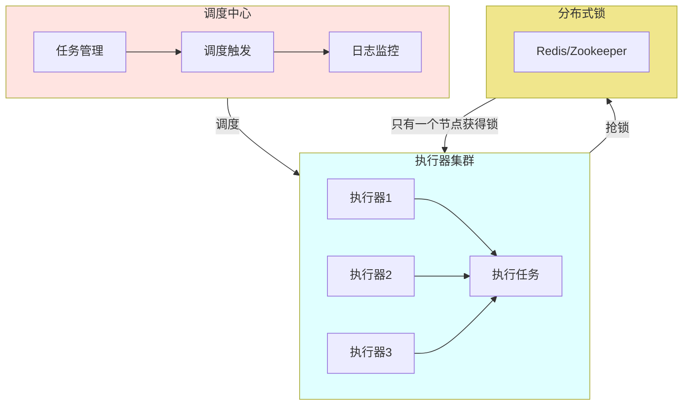
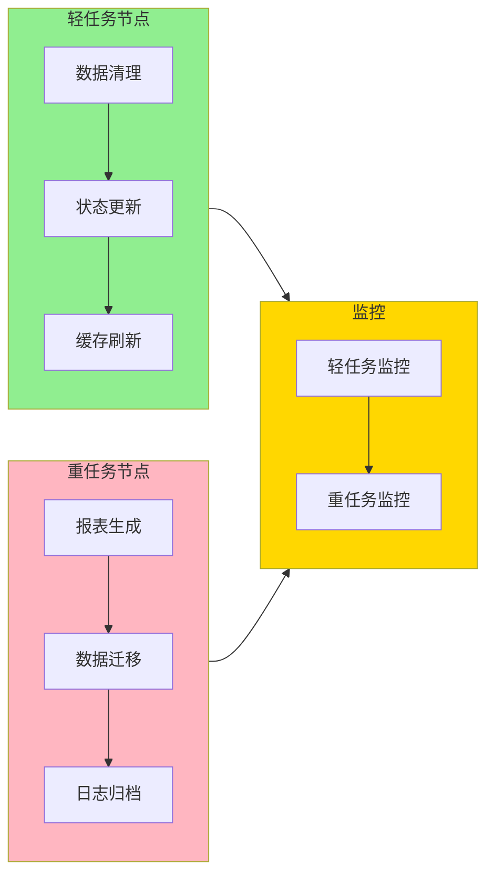
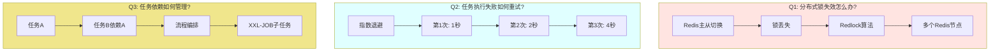

# 分布式定时任务调度防重复执行

> **场景定位**：分布式系统 + 任务调度技术场景  
> **核心设计要点**：集群防重复、分布式锁、任务分级、调度框架选型

---

## 🎯 一句话定位

**定时任务解决什么问题？**
```
❌ 单机场景：配置 cron 表达式，到点自动执行，一切正常
✅ 集群场景：多台服务器同时触发任务，重复统计、重复生成账单、重复推送消息
```

**生活化比喻**：
就像银行的"每日结算"：
- **单机**：一个会计做结算，没问题
- **集群**：10 个会计同时做结算，重复计算 10 次，账目全乱
- **解决方案**：只有一个人能做结算（分布式锁），其他人看着他做

**核心痛点**：单机没问题，集群部署直接引发任务并发重复执行。

---

## 💎 核心观点（5 分钟速览版）

> **快速概览**

### 核心观点（3 个关键点）

**1. 三层防御架构**
```
第一层：业务分级
- 高频任务（实时数据同步、订单超时关闭）：把控执行间隔，防止任务堆积
- 低频任务（数据清理、日志归档）：做好集群防重复，避免重复运行

第二层：集群锁控与兜底机制
- Redis 分布式锁：任务执行前抢锁，抢到锁才执行，其余节点跳过
- 任务唯一标识：执行完成标记状态，避免短时间内重复触发
- 最大执行时长：防止任务卡死，阻塞下次调度

第三层：架构层优化
- 分布式调度框架：统一管理，精准分配执行节点
- 轻重任务分离：耗时任务单独隔离部署
- 任务延后机制：系统压力过大时，非核心任务暂缓执行
```

**2. 分布式锁是核心**
```
生活化比喻：
分布式锁就像"会议室门卡"：
- 只有一个人能拿到门卡（抢到锁）
- 拿到门卡的人进入会议室（执行任务）
- 其他人看到门卡没了，直接跳过（不执行）

实现方式：
- Redis 分布式锁：SETNX + 过期时间
- 数据库锁：SELECT ... FOR UPDATE
- Zookeeper：临时顺序节点
```

**3. 调度框架选型**
```
| 框架 | 适用场景 | 优点 | 缺点 |
|------|---------|------|------|
| **XXL-JOB** | 中大型项目 | 功能完善、可视化 | 依赖数据库 |
| **Elastic-Job** | 大规模分布式 | 去中心化、弹性扩缩容 | 依赖 Zookeeper |
| **Quartz** | 单机/小集群 | 简单轻量 | 集群模式复杂 |
| **Spring @Scheduled** | 单机 | 简单 | 不支持集群 |
```

---

## 🚀 一句话精华（如果只能记住一句）

> **分布式定时任务 = 业务分级（高频 vs 低频） + 分布式锁（防重复执行） + 调度框架（统一管理） + 兜底机制（超时保护 + 失败重试）**

---

## 一、为什么集群部署会出问题？

### ❌ 经典失败场景

**实战真题**：
```
假设项目部署多台服务器，集群统一配置了每日数据统计定时任务。
一到执行时间，所有服务器同时触发任务：
- 重复统计数据
- 重复生成账单
- 重复推送消息
- 造成大量无效数据

单台服务器运行一切正常，集群部署后直接出现批量重复操作问题，出在哪？
```

**生活化比喻**：
```
就像银行的"每日结算"：
❌ 错误：10 个会计同时做结算
   结果：同一笔账被计算 10 次，账目全乱

✅ 正确：只有 1 个会计做结算
   方案：会议室只有 1 张门卡，拿到门卡的人才能做结算
```

### 三大致命陷阱

**1. 重复执行（最致命）**
```
❌ 错误：所有节点同时执行任务
   问题：数据统计 10 次，账单生成 10 份，消息推送 10 条
   结果：数据错乱，用户投诉

✅ 解决：分布式锁保证只有一个节点执行
   - Redis 分布式锁：SETNX key value EX 60
   - 抢到锁的节点执行，其他节点跳过
```

**2. 任务卡死**
```
❌ 错误：任务执行时间过长，没有超时保护
   问题：任务卡死，阻塞下次调度
   结果：任务堆积，系统崩溃

✅ 解决：限定最大执行时长
   - 设置超时时间：任务执行超过 30 分钟自动终止
   - 超时告警：通知值班人员排查问题
```

**3. 任务堆积**
```
❌ 错误：高频任务执行间隔过短
   问题：上一个任务还没执行完，下一个任务又开始了
   结果：任务堆积，线程耗尽

✅ 解决：把控执行间隔
   - 高频任务：最小间隔 5 秒
   - 任务未完成时，不触发下一次调度
```

---

## 二、第一层防御：业务分级

### 2.1 区分高频任务与低频任务

**生活化比喻**：
```
任务分级就像"银行柜台分类"：
- 高频任务（VIP 柜台）：实时数据同步、订单超时关闭
  - 执行间隔短，需要快速响应
  - 把控执行间隔，防止任务堆积

- 低频任务（普通柜台）：数据清理、日志归档
  - 执行间隔长，可以错峰执行
  - 做好集群防重复，避免重复运行
```

**任务分级策略**：

| 任务类型 | 执行频率 | 防护策略 | 生活化比喻 |
|---------|---------|---------|------------|
| **实时数据同步** | 每 5 秒 | 分布式锁 + 超时保护 | VIP 柜台 |
| **订单超时关闭** | 每分钟 | 分布式锁 + 幂等性 | VIP 柜台 |
| **数据清理** | 每天凌晨 | 分布式锁 + 分批处理 | 普通柜台 |
| **日志归档** | 每周 | 分布式锁 + 单独部署 | 普通柜台 |

---

## 三、第二层防御：集群锁控与兜底机制

### 3.1 Redis 分布式锁（核心方案）

**生活化比喻**：
```
分布式锁就像"会议室门卡"：
1. 任务执行前，先去抢门卡（Redis SETNX）
2. 抢到门卡的人进入会议室（执行任务）
3. 其他人看到门卡没了，直接跳过（不执行）
4. 执行完成后，归还门卡（删除锁）
```

**代码示例**（Redis 分布式锁）：
```go
type TaskScheduler struct {
    redis  *redis.Client
    logger *log.Logger
}

// 执行定时任务（带分布式锁）
func (s *TaskScheduler) ExecuteTask(ctx context.Context, taskName string, taskFunc func()) error {
    lockKey := fmt.Sprintf("task:lock:%s", taskName)
    lockValue := fmt.Sprintf("%d", time.Now().UnixNano())
    
    // 1. 尝试获取分布式锁（过期时间 60 秒）
    ok, err := s.redis.SetNX(lockKey, lockValue, 60*time.Second).Result()
    if err != nil {
        return fmt.Errorf("获取锁失败: %w", err)
    }
    
    if !ok {
        // 其他节点已获取锁，跳过执行
        s.logger.Info("任务已被其他节点执行，跳过", "task", taskName)
        return nil
    }
    
    // 2. 获取锁成功，执行任务
    defer func() {
        // 释放锁（确保只释放自己的锁）
        s.releaseLock(lockKey, lockValue)
    }()
    
    // 3. 执行任务逻辑
    taskFunc()
    
    return nil
}

func (s *TaskScheduler) releaseLock(lockKey, lockValue string) {
    // Lua 脚本保证原子性
    script := `
        if redis.call("get", KEYS[1]) == ARGV[1] then
            return redis.call("del", KEYS[1])
        else
            return 0
        end
    `
    
    s.redis.Eval(script, []string{lockKey}, lockValue)
}

// 使用示例
scheduler := &TaskScheduler{
    redis:  redisClient,
    logger: logger,
}

// 每日数据统计任务
scheduler.ExecuteTask(ctx, "daily_stats", func() {
    // 执行数据统计逻辑
    stats := calculateDailyStats()
    saveStats(stats)
})
```

### 3.2 任务幂等性保护

**生活化比喻**：
```
幂等性就像"银行转账"：
- 转账 100 元，无论执行多少次，结果都是转了 100 元
- 不会因为重复执行，变成转了 200 元、300 元

实现方式：
- 任务唯一标识：执行完成标记状态
- 数据库唯一索引：防止重复插入
- 状态检查：执行前检查是否已完成
```

**代码示例**（任务幂等性）：
```go
type TaskRecord struct {
    ID        string
    TaskName  string
    Status    string // pending, running, completed
    ExecTime  time.Time
    CompleteTime time.Time
}

func (s *TaskScheduler) ExecuteWithIdempotent(ctx context.Context, taskName string, execTime time.Time) error {
    // 1. 生成任务唯一标识
    taskID := fmt.Sprintf("%s:%s", taskName, execTime.Format("20060102150405"))
    
    // 2. 检查任务是否已执行
    record, err := s.getTaskRecord(taskID)
    if err == nil && record.Status == "completed" {
        // 任务已完成，跳过
        s.logger.Info("任务已完成，跳过", "taskID", taskID)
        return nil
    }
    
    // 3. 创建任务记录（状态：pending）
    s.createTaskRecord(taskID, taskName, "pending")
    
    // 4. 更新状态为 running
    s.updateTaskStatus(taskID, "running")
    
    // 5. 执行任务
    err = s.executeTask(taskName)
    if err != nil {
        s.updateTaskStatus(taskID, "failed")
        return err
    }
    
    // 6. 更新状态为 completed
    s.updateTaskStatus(taskID, "completed")
    
    return nil
}
```

### 3.3 超时保护机制

**生活化比喻**：
```
超时保护就像"餐厅限时用餐"：
- 每个任务有最大执行时长（如 30 分钟）
- 超时自动终止，释放资源
- 超时告警，通知值班人员
```

**代码示例**（超时保护）：
```go
func (s *TaskScheduler) ExecuteWithTimeout(ctx context.Context, taskName string, timeout time.Duration) error {
    // 创建带超时的 context
    ctx, cancel := context.WithTimeout(ctx, timeout)
    defer cancel()
    
    // 使用 channel 接收任务完成信号
    done := make(chan error, 1)
    
    go func() {
        done <- s.executeTask(taskName)
    }()
    
    select {
    case err := <-done:
        // 任务完成
        return err
    case <-ctx.Done():
        // 超时终止
        s.logger.Error("任务执行超时，强制终止", "task", taskName, "timeout", timeout)
        s.alert(fmt.Sprintf("任务 %s 执行超时", taskName))
        return fmt.Errorf("任务执行超时: %w", ctx.Err())
    }
}

// 使用示例
scheduler.ExecuteWithTimeout(ctx, "daily_report", 30*time.Minute)
```

---

## 四、第三层防御：架构层优化

### 4.1 分布式调度框架选型

**生活化比喻**：
```
调度框架就像"银行总行调度中心"：
- 统一管理所有任务（可视化界面）
- 精准分配执行节点（负载均衡）
- 失败自动重试（容错机制）
- 任务依赖管理（流程编排）
```

**框架对比**：

| 框架 | 适用场景 | 优点 | 缺点 | 推荐度 |
|------|---------|------|------|--------|
| **XXL-JOB** | 中大型项目 | 功能完善、可视化、易上手 | 依赖数据库 | ⭐⭐⭐⭐⭐ |
| **Elastic-Job** | 大规模分布式 | 去中心化、弹性扩缩容 | 依赖 Zookeeper | ⭐⭐⭐⭐ |
| **Quartz** | 单机/小集群 | 简单轻量 | 集群模式复杂 | ⭐⭐⭐ |
| **Spring @Scheduled** | 单机 | 简单 | 不支持集群 | ⭐⭐ |

**XXL-JOB 架构**：



### 4.2 轻重任务分离

**生活化比喻**：
```
轻重任务分离就像"银行柜台分类"：
- 轻任务（快速柜台）：数据清理、状态更新
  - 执行时间短（< 1 分钟）
  - 和普通任务混部

- 重任务（VIP 柜台）：报表生成、数据迁移
  - 执行时间长（> 10 分钟）
  - 单独隔离部署，避免影响轻任务
```

**部署策略**：



### 4.3 任务延后机制

**生活化比喻**：
```
任务延后就像"餐厅高峰期暂缓服务"：
- 系统压力过大时（如大促期间）
- 非核心任务暂缓执行（如日志归档、数据清理）
- 优先保障核心业务（如订单处理、支付）
```

**代码示例**（任务延后）：
```go
type TaskPriority int

const (
    PriorityCritical TaskPriority = iota // 核心任务（必须执行）
    PriorityHigh                         // 高优先级（尽量执行）
    PriorityNormal                       // 普通优先级（可延后）
    PriorityLow                          // 低优先级（可跳过）
)

func (s *TaskScheduler) ShouldExecute(priority TaskPriority) bool {
    // 检查系统负载
    load := s.getSystemLoad()
    
    switch priority {
    case PriorityCritical:
        return true // 核心任务必须执行
    case PriorityHigh:
        return load < 90 // 负载 < 90% 才执行
    case PriorityNormal:
        return load < 70 // 负载 < 70% 才执行
    case PriorityLow:
        return load < 50 // 负载 < 50% 才执行
    }
    
    return true
}

// 使用示例
if scheduler.ShouldExecute(PriorityNormal) {
    scheduler.ExecuteTask(ctx, "log_archive", archiveFunc)
} else {
    logger.Info("系统负载过高，任务延后执行", "task", "log_archive")
}
```

---

五、技术深入探讨

### 考点 1：如何保证集群环境下任务只执行一次？

**方案参考**（30 秒版）：
> "集群环境下保证任务只执行一次，核心是**分布式锁**：
> 1. **Redis 分布式锁**：任务执行前抢锁（SETNX），抢到锁的节点执行，其他节点跳过。
> 2. **锁过期时间**：设置合理的过期时间（如 60 秒），防止任务卡死导致锁无法释放。
> 3. **幂等性保护**：任务执行完成标记状态，避免短时间内重复触发。
> 4. **调度框架**：引入 XXL-JOB 等分布式调度框架，统一管理，精准分配执行节点。"

**加分回答**（展示深度）：
> "实际生产中，我们还会做**锁续期**：
> - 任务执行时间长，锁快过期时自动续期（Redisson WatchDog 机制）
> - 避免任务还没执行完，锁就过期了，导致其他节点重复执行
> - 同时设置**最大执行时长**，防止任务卡死，锁永远不释放"

### 考点 2：定时任务卡死怎么办？

**方案参考**：
> "定时任务卡死是常见问题，解决方案：
> 1. **超时保护**：设置最大执行时长（如 30 分钟），超时自动终止。
> 2. **超时告警**：超时后通知值班人员排查问题。
> 3. **锁续期**：任务执行中自动续期锁，避免锁过期导致重复执行。
> 4. **强制终止**：超时后强制终止任务，释放资源。"

### 考点 3：如何设计高可用定时任务系统？

**方案参考**：
> "高可用定时任务系统需要三层防御：
> 1. **业务分级**：核心任务（支付、订单）必须执行，非核心任务（日志归档）可延后。
> 2. **分布式锁**：Redis 分布式锁保证任务只执行一次，锁续期防止锁过期。
> 3. **调度框架**：XXL-JOB 统一管理，失败自动重试，节点故障自动切换。
> 4. **监控告警**：监控任务执行状态，超时、失败及时告警。"

---

## 六、技术追问与深度问题



**Q4: 分布式锁失效怎么办？**  
**答**：Redis 主从切换可能导致锁丢失，解决方案：
- **Redlock 算法**：多个 Redis 节点，只有超过半数节点加锁成功才算成功
- **Zookeeper**：临时顺序节点，强一致性
- **数据库锁**：性能差，但强一致性

---

## 七、生产环境 Checklist（部署检查清单）

| 类别 | 检查项 | 状态 | 生活化比喻 |
|------|--------|------|------------|
| **分布式锁** | Redis 分布式锁（SETNX） | ⬜ | 会议室门卡 |
| | 锁过期时间（60 秒） | ⬜ | 限时使用 |
| | 锁续期机制（WatchDog） | ⬜ | 自动续期 |
| **幂等性** | 任务唯一标识 | ⬜ | 任务身份证 |
| | 执行状态标记 | ⬜ | 完成标记 |
| | 数据库唯一索引 | ⬜ | 防重复插入 |
| **超时保护** | 最大执行时长 | ⬜ | 限时用餐 |
| | 超时自动终止 | ⬜ | 强制终止 |
| | 超时告警 | ⬜ | 超时通知 |
| **调度框架** | XXL-JOB / Elastic-Job | ⬜ | 调度中心 |
| | 失败自动重试 | ⬜ | 失败重试 |
| | 节点故障切换 | ⬜ | 自动切换 |
| **监控告警** | 任务执行状态监控 | ⬜ | 状态监控 |
| | 超时/失败告警 | ⬜ | 异常告警 |
| | 任务堆积监控 | ⬜ | 堆积监控 |

---

## 八、总结（一句话带走）

### 🎯 一句话总结

> **分布式定时任务 = 业务分级（高频 vs 低频） + 分布式锁（防重复执行） + 调度框架（统一管理） + 兜底机制（超时保护 + 失败重试）**

### 🧠 核心记忆点

1. **为什么需要分布式锁？** 集群环境下多台服务器同时执行任务，导致重复统计、重复生成账单。
2. **为什么需要超时保护？** 任务卡死会阻塞下次调度，导致任务堆积，系统崩溃。
3. **为什么需要调度框架？** 单机 @Scheduled 不支持集群，需要 XXL-JOB 等框架统一管理。
4. **为什么需要业务分级？** 核心任务必须执行，非核心任务可延后，避免系统压力过大。

---

**参考视频**：[场景提问：项目定时任务怎么开发？](https://www.douyin.com/video/7642644715556392235)

---

*本文档基于 8 个专家提示词指导改写，遵循深入浅出、生活化比喻、幽默风趣的教学原则。*
