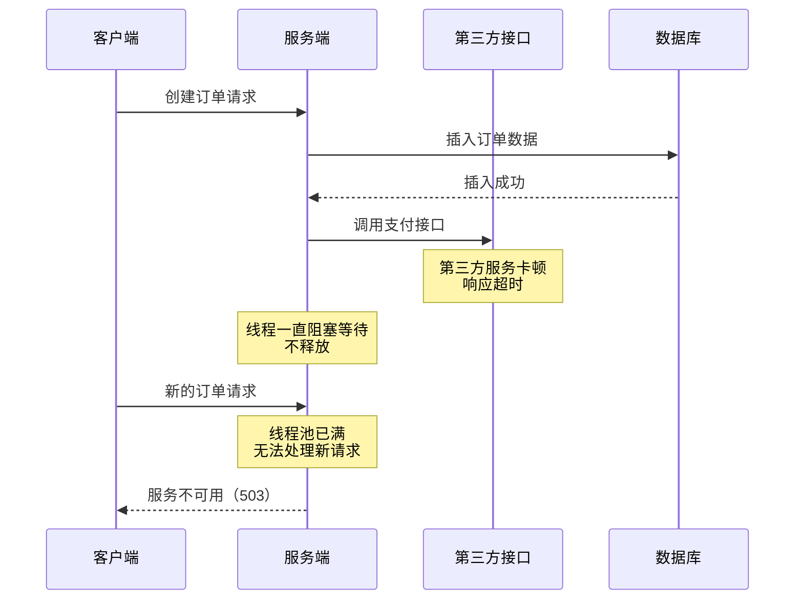
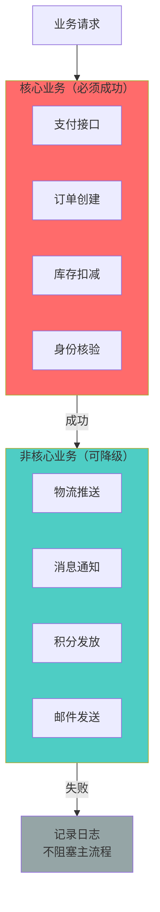
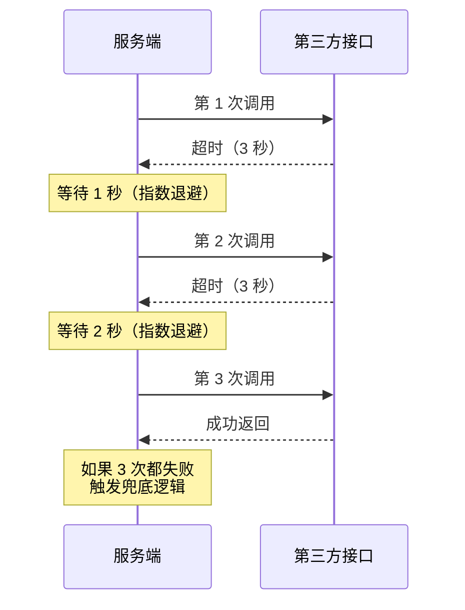
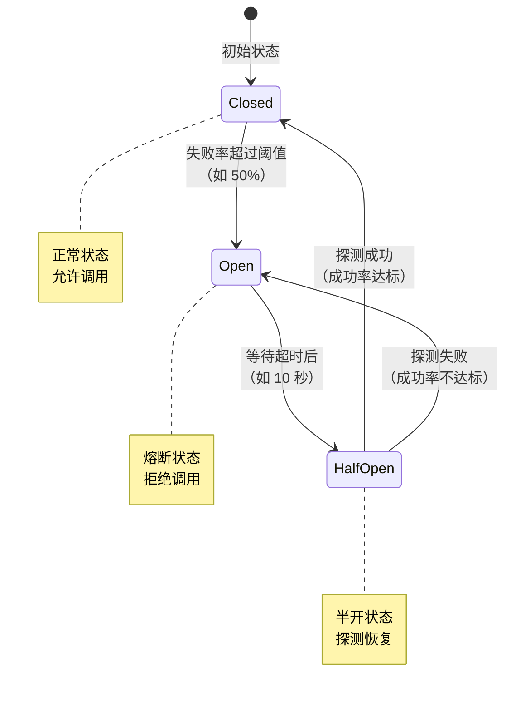
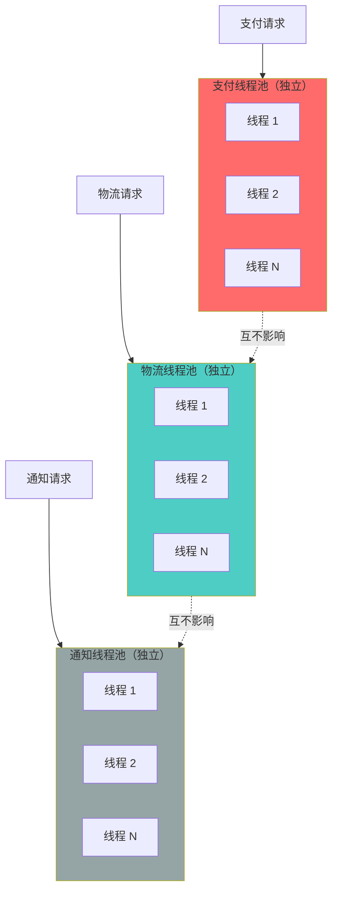
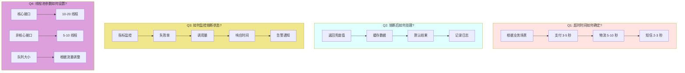
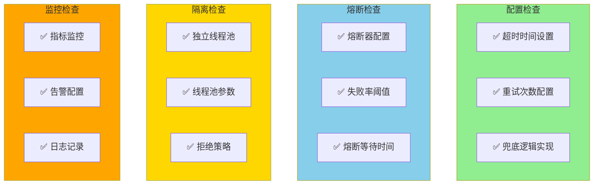
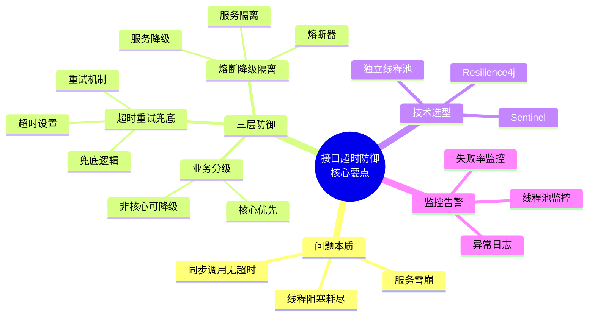

# 接口超时与熔断降级

> **场景定位**：后端架构设计场景  
> **核心设计要点**：远程调用超时、线程池耗尽、熔断降级、服务隔离、容错设计

---

## 🎯 一句话定位

**接口超时问题是什么？**
```
你打电话问朋友"今晚吃饭吗？"，朋友一直在忙没接电话。
你就一直举着手机等，结果其他朋友的电话也打不进来了。
整个手机"瘫痪"了，就因为一个人没接电话。
```

**生活化比喻**：就像餐厅服务员等一个厨师做菜，等了 2 小时，其他顾客的菜也上不了，整个餐厅瘫痪了。

**核心特点**：外部服务不稳定，会拖垮内部服务，就像"猪队友"拖累整个团队。

---

## 💎 核心观点（5 分钟速览版）

> **快速概览**

### 核心观点（3 层防御）

**1. 业务分级：区分核心 vs 非核心调用**
```
✅ 核心调用（支付、订单）：必须成功，做好重试和兜底
❌ 非核心调用（物流推送、消息通知）：失败就失败，别阻塞主流程

生活化比喻：
就像医院急诊室，先救重病患者（核心业务），轻伤患者（非核心）可以等一等。
```

**2. 超时、重试与兜底策略**
```
超时设置：调用第三方接口必须设置超时时间（如 3 秒）
重试机制：短暂失败自动重试（最多 3 次）
兜底逻辑：多次失败直接返回默认值，不阻塞主流程

生活化比喻：
就像打电话，响铃 10 秒没人接就挂断（超时），
隔 1 分钟再打（重试），打了 3 次还不接就发短信（兜底）。
```

**3. 架构层优化：熔断、降级、隔离**
```
熔断器：第三方接口频繁异常，直接熔断，不再调用（就像保险丝）
服务隔离：不同第三方调用使用独立线程池，互不影响（就像隔离病房）
服务降级：高峰期暂停非必要调用，保障核心业务（就像限电时期优先保障医院）

生活化比喻：
熔断 = 保险丝（电流过大就断开）
隔离 = 隔离病房（病人分开住，防止交叉感染）
降级 = 限电措施（优先保障重要部门用电）
```

---

## 🚀 一句话精华（如果只能记住一句）

> **远程调用三层防御 = 业务分级（核心优先） + 超时重试兜底（不阻塞） + 熔断降级隔离（服务保护）**

---

## 一、问题本质：同步调用的"幽灵陷阱"

### ❌ 普通后端的错误做法

**代码示例（错误示范）**：
```java
// ❌ 错误示范：同步调用，无超时机制
public void createOrder(Order order) {
    // 1. 创建订单
    orderMapper.insert(order);
    
    // 2. 调用第三方支付接口（无超时设置）
    PayResult result = paymentService.pay(order.getId()); // 可能卡死在这里
    
    // 3. 更新订单状态
    orderMapper.updateStatus(order.getId(), result.getStatus());
}

// 问题：如果 paymentService.pay() 一直不返回，线程就一直阻塞
// 高峰期大量线程阻塞 → 线程池耗尽 → 整个服务瘫痪
```

**问题分析**：
```
生活化比喻：
就像餐厅服务员点完菜后，一直站在厨房等厨师做菜，
其他顾客的点单没人接，整个餐厅瘫痪了。

技术问题：
1. 第三方接口响应慢 → 线程阻塞
2. 大量请求堆积 → 线程池耗尽
3. 内部正常业务也无法处理 → 服务雪崩
```



### ✅ 高级后端的正确做法

**核心思维转变**：
```
❌ 普通后端：调用接口 → 等待返回 → 继续执行
✅ 高级后端：调用接口 → 设置超时 → 失败重试 → 兜底处理 → 熔断保护

就像：
普通员工：打电话等人接，一直等
优秀员工：打电话 10 秒不接就挂断，隔 1 分钟再打，3 次不接就发短信
```

---

## 二、第一层防御：业务分级

### 2.1 核心调用 vs 非核心调用

**生活化比喻**：
```
就像医院急诊室，患者按病情严重程度分级：
🔴 危急患者（核心业务）：立即抢救，必须成功
   - 支付、订单创建、库存扣减、身份核验
   
🟡 普通患者（非核心业务）：可以等待，失败可容忍
   - 物流推送、消息通知、积分发放、邮件发送

原则：优先保障核心业务，非核心业务可以降级或放弃
```

**代码示例（业务分级）**：
```java
@Service
public class OrderService {
    
    @Autowired
    private PaymentService paymentService;      // 核心调用
    @Autowired
    private LogisticsService logisticsService;  // 非核心调用
    @Autowired
    private NotificationService notificationService; // 非核心调用
    
    public void createOrder(Order order) {
        // 1. 创建订单（核心业务，必须成功）
        orderMapper.insert(order);
        
        // 2. 调用支付接口（核心业务，必须成功，做好重试）
        PayResult payResult = paymentService.payWithRetry(order.getId());
        if (!payResult.isSuccess()) {
            throw new BusinessException("支付失败");
        }
        
        // 3. 调用物流推送（非核心业务，失败不阻塞）
        try {
            logisticsService.pushOrder(order.getId());
        } catch (Exception e) {
            // 记录日志，但不抛出异常，不影响主流程
            log.error("物流推送失败，订单ID: {}", order.getId(), e);
        }
        
        // 4. 发送通知（非核心业务，失败不阻塞）
        try {
            notificationService.send(order.getUserId(), "订单创建成功");
        } catch (Exception e) {
            log.error("通知发送失败", e);
        }
    }
}
```



---

## 三、第二层防御：超时、重试与兜底

### 3.1 超时设置（必须！）

**生活化比喻**：
```
就像打电话，不能一直等对方接：
✅ 正确做法：响铃 10 秒没人接就挂断
❌ 错误做法：一直等，等到手机没电

超时设置原则：
- 第三方支付：3-5 秒
- 物流接口：5-10 秒
- 短信接口：2-3 秒
```

**代码示例（超时设置）**：
```java
// ✅ 正确做法：设置超时时间
@Configuration
public class RestClientConfig {
    
    @Bean
    public RestTemplate restTemplate() {
        // 创建 HTTP 请求工厂
        SimpleClientHttpRequestFactory factory = new SimpleClientHttpRequestFactory();
        
        // 设置连接超时（建立连接的最长等待时间）
        factory.setConnectTimeout(3000); // 3 秒
        
        // 设置读取超时（等待响应数据的最长时间）
        factory.setReadTimeout(5000); // 5 秒
        
        return new RestTemplate(factory);
    }
}

@Service
public class PaymentService {
    
    @Autowired
    private RestTemplate restTemplate;
    
    public PayResult pay(Long orderId) {
        try {
            // 调用第三方支付接口
            String url = "https://api.payment.com/pay?orderId=" + orderId;
            ResponseEntity<PayResult> response = restTemplate.getForEntity(
                url, 
                PayResult.class
            );
            return response.getBody();
        } catch (ResourceAccessException e) {
            // 超时异常
            log.error("支付接口超时，订单ID: {}", orderId);
            throw new BusinessException("支付服务响应超时");
        } catch (Exception e) {
            log.error("支付接口调用失败", e);
            throw new BusinessException("支付服务异常");
        }
    }
}
```

### 3.2 重试机制（短暂失败自动重试）

**生活化比喻**：
```
就像打电话，第一次没人接，可能是对方在忙：
✅ 正确做法：隔 1 分钟再打，最多打 3 次
❌ 错误做法：一直打，骚扰对方

重试原则：
- 重试次数：最多 3 次
- 重试间隔：指数退避（1 秒、2 秒、4 秒）
- 重试条件：网络超时、服务暂时不可用（不是业务失败）
```

**代码示例（重试机制）**：
```java
@Service
public class PaymentService {
    
    @Autowired
    private RestTemplate restTemplate;
    
    /**
     * 带重试的支付调用
     */
    public PayResult payWithRetry(Long orderId) {
        int maxRetries = 3; // 最大重试次数
        int retryCount = 0;
        Exception lastException = null;
        
        while (retryCount < maxRetries) {
            try {
                // 调用支付接口
                PayResult result = pay(orderId);
                if (result != null && result.isSuccess()) {
                    return result; // 成功，直接返回
                }
            } catch (ResourceAccessException e) {
                // 超时异常，可以重试
                lastException = e;
                retryCount++;
                log.warn("支付接口超时，第 {} 次重试", retryCount);
                
                // 指数退避：等待 1s, 2s, 4s
                try {
                    Thread.sleep((long) Math.pow(2, retryCount - 1) * 1000);
                } catch (InterruptedException ie) {
                    Thread.currentThread().interrupt();
                }
            } catch (BusinessException e) {
                // 业务失败（如余额不足），不重试
                log.error("支付业务失败，订单ID: {}", orderId, e);
                throw e;
            }
        }
        
        // 重试次数用尽，抛出异常
        throw new BusinessException("支付接口调用失败，已重试 " + maxRetries + " 次", lastException);
    }
}
```



### 3.3 兜底策略（快速失败）

**生活化比喻**：
```
就像打电话，打了 3 次都没人接：
✅ 正确做法：发短信告知，去做其他事
❌ 错误做法：继续等，浪费时间在一个人身上

兜底原则：
- 快速失败：多次失败直接返回默认值
- 不阻塞主流程：保证核心业务能继续
```

**代码示例（兜底策略）**：
```java
@Service
public class OrderService {
    
    @Autowired
    private LogisticsService logisticsService;
    
    public void createOrder(Order order) {
        // 1. 创建订单（核心业务）
        orderMapper.insert(order);
        
        // 2. 调用物流推送（非核心业务，带兜底）
        LogisticsResult result;
        try {
            result = logisticsService.pushWithRetry(order.getId());
        } catch (Exception e) {
            // 兜底：返回默认值，记录日志
            log.error("物流推送失败，进入兜底逻辑", e);
            result = LogisticsResult.defaultResult(); // 默认结果
        }
        
        // 3. 继续主流程，不受物流推送影响
        orderMapper.updateLogisticsStatus(order.getId(), result.getStatus());
    }
}

@Service
public class LogisticsService {
    
    /**
     * 带兜底的物流推送
     */
    public LogisticsResult pushWithRetry(Long orderId) {
        try {
            return push(orderId); // 调用带重试的方法
        } catch (Exception e) {
            // 兜底：返回默认结果
            log.error("物流推送失败，返回默认结果", e);
            return LogisticsResult.defaultResult();
        }
    }
    
    public LogisticsResult push(Long orderId) {
        // 实际调用逻辑
        // ...
    }
}
```

---

## 四、第三层防御：熔断、降级、隔离

### 4.1 熔断器（服务保险丝）

**生活化比喻**：
```
就像家里的保险丝：
- 电流正常 → 正常供电
- 电流过大 → 保险丝熔断，切断电路，保护电器
- 等电流恢复正常 → 手动或自动恢复

熔断器原理：
- 第三方接口正常 → 正常调用
- 第三方接口频繁失败 → 熔断，不再调用（保护自身服务）
- 等第三方恢复 → 半开探测，逐步恢复

生活场景：
就像你常去的那家餐厅，连续去了 3 次都关门（失败率过高），
你就暂时不去这家了（熔断），过几天再去看看（半开探测）。
```

**代码示例（使用 Resilience4j 熔断器）**：
```java
@Service
public class PaymentService {
    
    @Autowired
    private RestTemplate restTemplate;
    
    // 创建熔断器配置
    private CircuitBreaker circuitBreaker = CircuitBreaker.ofDefaults("paymentService");
    
    public PayResult pay(Long orderId) {
        // 使用熔断器包装调用
        Supplier<PayResult> decoratedSupplier = CircuitBreaker.decorateSupplier(
            circuitBreaker,
            () -> payRemote(orderId)
        );
        
        try {
            return Try.ofSupplier(decoratedSupplier)
                .recover(throwable -> {
                    // 熔断后的兜底逻辑
                    log.error("支付接口熔断，返回默认结果", throwable);
                    return PayResult.defaultResult();
                })
                .get();
        } catch (Exception e) {
            throw new BusinessException("支付服务异常", e);
        }
    }
    
    private PayResult payRemote(Long orderId) {
        // 实际调用第三方接口
        String url = "https://api.payment.com/pay?orderId=" + orderId;
        ResponseEntity<PayResult> response = restTemplate.getForEntity(
            url,
            PayResult.class
        );
        return response.getBody();
    }
}

// 熔断器配置（resilience4j.yml）
/*
resilience4j:
  circuitbreaker:
    instances:
      paymentService:
        registerHealthIndicator: true
        slidingWindowSize: 10           # 滑动窗口大小（最近 10 次调用）
        failureRateThreshold: 50        # 失败率阈值 50%
        waitDurationInOpenState: 10000  # 熔断后等待时间（10 秒）
        permittedNumberOfCallsInHalfOpenState: 3  # 半开状态允许调用数
        automaticTransitionFromOpenToHalfOpenEnabled: true
*/
```



**熔断器状态说明**：
| 状态 | 行为 | 生活化比喻 |
|------|------|------------|
| **Closed（关闭）** | 正常调用，统计失败率 | 餐厅正常营业 |
| **Open（开启）** | 拒绝调用，直接返回兜底 | 餐厅关门，不接待客人 |
| **HalfOpen（半开）** | 允许少量调用探测 | 餐厅试营业，看看情况 |

### 4.2 服务隔离（独立线程池）

**生活化比喻**：
```
就像医院的隔离病房：
- 普通病人和传染病人分开住
- 防止交叉感染

服务隔离原理：
- 不同第三方调用使用独立线程池
- 一个第三方挂了，不影响其他第三方
- 避免"一颗老鼠屎坏了一锅粥"

生活场景：
就像餐厅的不同窗口：
- 炒菜窗口、蒸菜窗口、凉菜窗口分开
- 炒菜窗口排队再长，也不影响凉菜窗口
```

**代码示例（线程池隔离）**：
```java
@Configuration
public class ThreadPoolConfig {
    
    // 支付接口专用线程池
    @Bean("paymentExecutor")
    public ExecutorService paymentExecutor() {
        return new ThreadPoolExecutor(
            10,                     // 核心线程数
            20,                     // 最大线程数
            60L, TimeUnit.SECONDS,  // 空闲线程存活时间
            new LinkedBlockingQueue<>(100), // 任务队列
            new ThreadFactoryBuilder().setNameFormat("payment-pool-%d").build(),
            new ThreadPoolExecutor.CallerRunsPolicy() // 拒绝策略
        );
    }
    
    // 物流接口专用线程池
    @Bean("logisticsExecutor")
    public ExecutorService logisticsExecutor() {
        return new ThreadPoolExecutor(
            5,
            10,
            60L, TimeUnit.SECONDS,
            new LinkedBlockingQueue<>(50),
            new ThreadFactoryBuilder().setNameFormat("logistics-pool-%d").build(),
            new ThreadPoolExecutor.CallerRunsPolicy()
        );
    }
    
    // 通知接口专用线程池
    @Bean("notificationExecutor")
    public ExecutorService notificationExecutor() {
        return new ThreadPoolExecutor(
            5,
            10,
            60L, TimeUnit.SECONDS,
            new LinkedBlockingQueue<>(50),
            new ThreadFactoryBuilder().setNameFormat("notification-pool-%d").build(),
            new ThreadPoolExecutor.CallerRunsPolicy()
        );
    }
}

@Service
public class PaymentService {
    
    @Autowired
    @Qualifier("paymentExecutor")
    private ExecutorService paymentExecutor;
    
    public CompletableFuture<PayResult> payAsync(Long orderId) {
        return CompletableFuture.supplyAsync(
            () -> pay(orderId),
            paymentExecutor
        );
    }
}
```



### 4.3 服务降级（高峰期保核心）

**生活化比喻**：
```
就像限电时期的措施：
- 优先保障医院、学校用电（核心业务）
- 限制工厂、商场用电（非核心业务）
- 必要时家庭也限电（全面降级）

服务降级原理：
- 流量高峰期，暂停非必要功能
- 优先保障核心业务运转
- 等高峰期过后再恢复

生活场景：
就像双十一期间：
- 核心功能：下单、支付（必须保证）
- 非核心功能：评价、推荐、积分（可以暂停）
```

**代码示例（服务降级）**：
```java
@Service
public class OrderService {
    
    @Autowired
    private RecommendationService recommendationService;
    
    @Autowired
    private RedisTemplate<String, Boolean> redisTemplate;
    
    public OrderDetail getOrderDetail(Long orderId) {
        // 1. 查询订单（核心业务，必须执行）
        Order order = orderMapper.selectById(orderId);
        
        // 2. 查询推荐商品（非核心业务，可降级）
        List<Product> recommendations = null;
        if (!isDegradeEnabled()) {
            // 未开启降级，正常调用
            try {
                recommendations = recommendationService.getRecommendations(order.getUserId());
            } catch (Exception e) {
                log.error("推荐服务调用失败", e);
            }
        } else {
            // 已开启降级，返回默认值或缓存数据
            log.info("推荐服务已降级，返回缓存数据");
            recommendations = getCachedRecommendations(order.getUserId());
        }
        
        // 3. 组装返回结果
        OrderDetail detail = new OrderDetail();
        detail.setOrder(order);
        detail.setRecommendations(recommendations);
        return detail;
    }
    
    /**
     * 判断是否开启降级
     */
    private boolean isDegradeEnabled() {
        // 从 Redis 读取降级开关
        Boolean degrade = redisTemplate.opsForValue().get("degrade:recommendation");
        return degrade != null && degrade;
    }
    
    /**
     * 获取缓存的推荐数据
     */
    private List<Product> getCachedRecommendations(Long userId) {
        // 从缓存或本地获取默认数据
        return Collections.emptyList();
    }
}
```

---

五、技术深入探讨

### 考点 1：为什么要设置超时时间？

**方案参考**（30 秒版）：
> "设置超时时间是为了防止线程长时间阻塞。第三方接口响应慢时，如果不设置超时，线程会一直等待，导致线程池耗尽，整个服务瘫痪。就像打电话，响铃 10 秒没人接就挂断，不能一直等。"

**加分回答**（展示深度）：
> "超时时间要根据业务场景合理设置：支付接口 3-5 秒，物流接口 5-10 秒。同时配合重试机制，短暂失败自动重试，多次失败直接返回兜底值。还要结合熔断器，当失败率超过阈值时直接熔断，不再调用。"

### 考点 2：熔断器的工作原理是什么？

**方案参考**：
> "熔断器有三个状态：Closed（关闭）、Open（开启）、HalfOpen（半开）。正常时处于 Closed 状态，统计失败率；当失败率超过阈值（如 50%），进入 Open 状态，拒绝调用；等待超时后进入 HalfOpen 状态，允许少量调用探测；如果探测成功，回到 Closed 状态，否则回到 Open 状态。就像保险丝，电流过大就熔断，保护电器。"

**加分回答**：
> "实际使用中，我会用 Resilience4j 或 Sentinel 实现熔断器。配置滑动窗口大小（如最近 10 次调用）、失败率阈值（如 50%）、熔断等待时间（如 10 秒）、半开状态允许调用数（如 3 次）。同时要配置兜底逻辑，熔断后返回默认值或缓存数据。"

### 考点 3：如何隔离不同的第三方调用？

**方案参考**：
> "使用独立线程池隔离不同的第三方调用。每个第三方接口分配独立的线程池，这样某个接口挂了，不会影响其他接口。就像医院的隔离病房，病人分开住，防止交叉感染。"

**加分回答**：
> "线程池参数要根据业务特点设置：核心接口（如支付）线程数大一些（10-20），非核心接口（如通知）线程数小一些（5-10）。同时使用 CompletableFuture 异步调用，避免阻塞主流程。还要监控线程池状态，当队列满或线程数达到上限时触发告警。"

---

## 六、技术追问与深度问题



**方案详解**：

**Q1: 超时时间如何确定？**  
**答**：根据业务场景和第三方接口的 SLA 确定。支付接口一般 3-5 秒，物流接口 5-10 秒，短信接口 2-3 秒。可以通过压测和历史数据分析确定合理值。同时要配合重试机制，超时后自动重试。

**Q2: 熔断后如何处理？**  
**答**：熔断后要返回兜底值，可以是缓存数据、默认结果或空值。同时记录日志，触发告警。对于核心业务，要提供降级方案，如支付失败后提示用户稍后重试。

**Q3: 如何监控熔断状态？**  
**答**：监控三个指标：失败率、调用量、响应时间。使用 Prometheus + Grafana 可视化，配置告警规则（如失败率 > 50% 触发告警）。同时监控线程池状态（活跃线程数、队列长度、拒绝任务数）。

**Q4: 线程池参数如何设置？**  
**答**：核心接口（如支付）线程数 10-20，非核心接口（如通知）线程数 5-10。队列大小根据流量调整（如 100-500）。使用有界队列避免 OOM，配置合理的拒绝策略（如 CallerRunsPolicy）。

---

## 七、生产环境 Checklist



**部署检查清单**：

| 类别 | 检查项 | 状态 | 生活化比喻 |
|------|--------|------|------------|
| **配置** | 超时时间设置（3-5 秒） | ⬜ | 打电话等待时间 |
| | 重试次数配置（最多 3 次） | ⬜ | 重拨次数 |
| | 兜底逻辑实现 | ⬜ | 发短信备选方案 |
| **熔断** | 熔断器配置（Resilience4j/Sentinel） | ⬜ | 保险丝 |
| | 失败率阈值（50%） | ⬜ | 触发熔断的条件 |
| | 熔断等待时间（10 秒） | ⬜ | 恢复探测时间 |
| **隔离** | 独立线程池（每个第三方接口） | ⬜ | 隔离病房 |
| | 线程池参数（核心 10-20，非核心 5-10） | ⬜ | 窗口数量 |
| | 拒绝策略（CallerRunsPolicy） | ⬜ | 队列满后的处理 |
| **监控** | 指标监控（失败率、调用量、响应时间） | ⬜ | 保安巡逻 |
| | 告警配置（失败率 > 50%） | ⬜ | 警报器 |
| | 日志记录（异常、熔断、降级） | ⬜ | 记事本 |

---

## 八、总结（一句话带走）



### 🎯 一句话总结

> **远程调用三层防御 = 业务分级（核心优先） + 超时重试兜底（不阻塞） + 熔断降级隔离（服务保护）**

### 🧠 核心记忆点

1. **为什么要设置超时？** 防止线程阻塞，就像打电话不能一直等。
2. **熔断器的作用？** 第三方接口频繁失败时直接熔断，保护自身服务，就像保险丝。
3. **为什么要隔离？** 不同第三方调用使用独立线程池，一个挂了不影响其他，就像隔离病房。
4. **服务降级的意义？** 高峰期暂停非核心业务，保障核心业务，就像限电时期优先保障医院。

---

**参考视频**：[内卷的琪某人 - 接口超时引发业务流程卡死，问题出在哪？](https://www.douyin.com/video/7642612628975668521)

---

*本文档基于 8 个专家提示词指导改写，遵循深入浅出、生活化比喻、幽默风趣的教学原则。*
