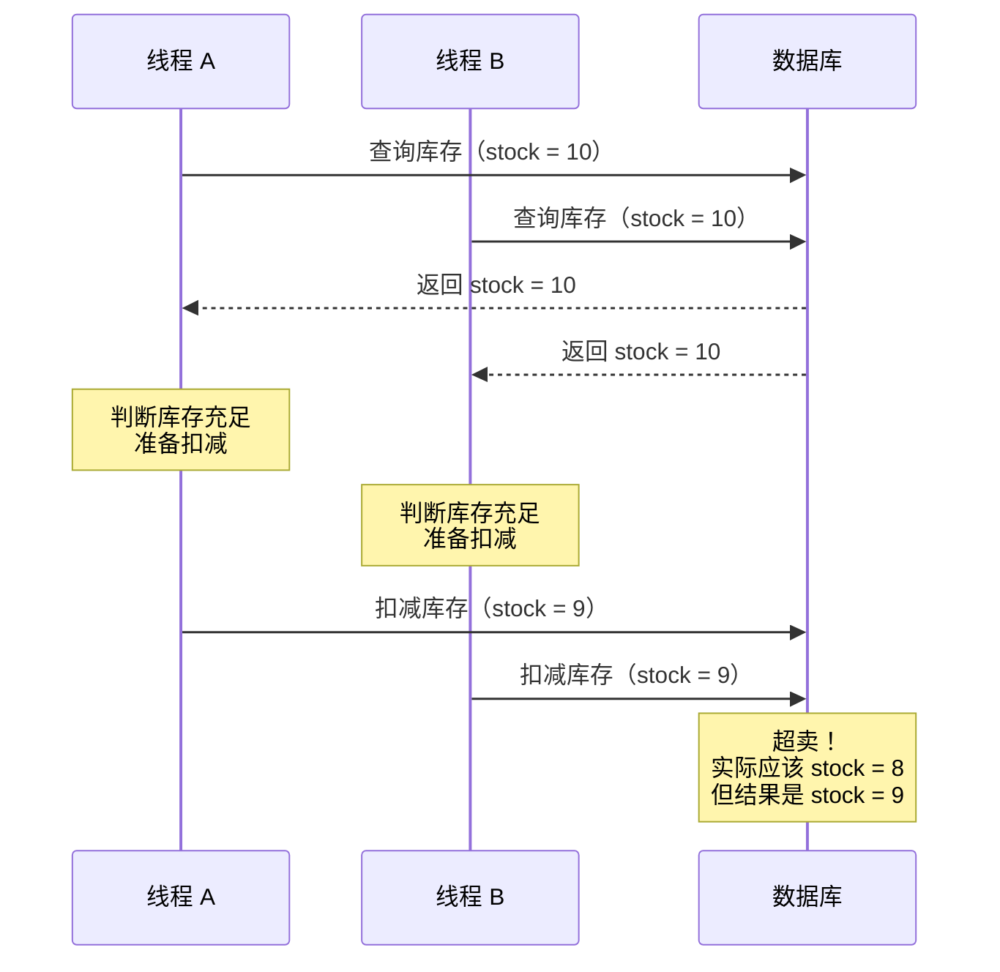
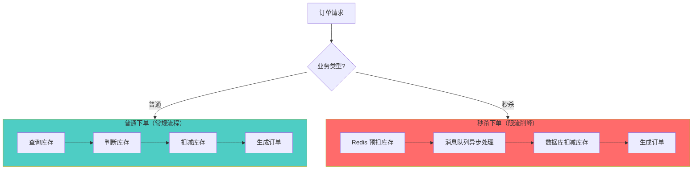
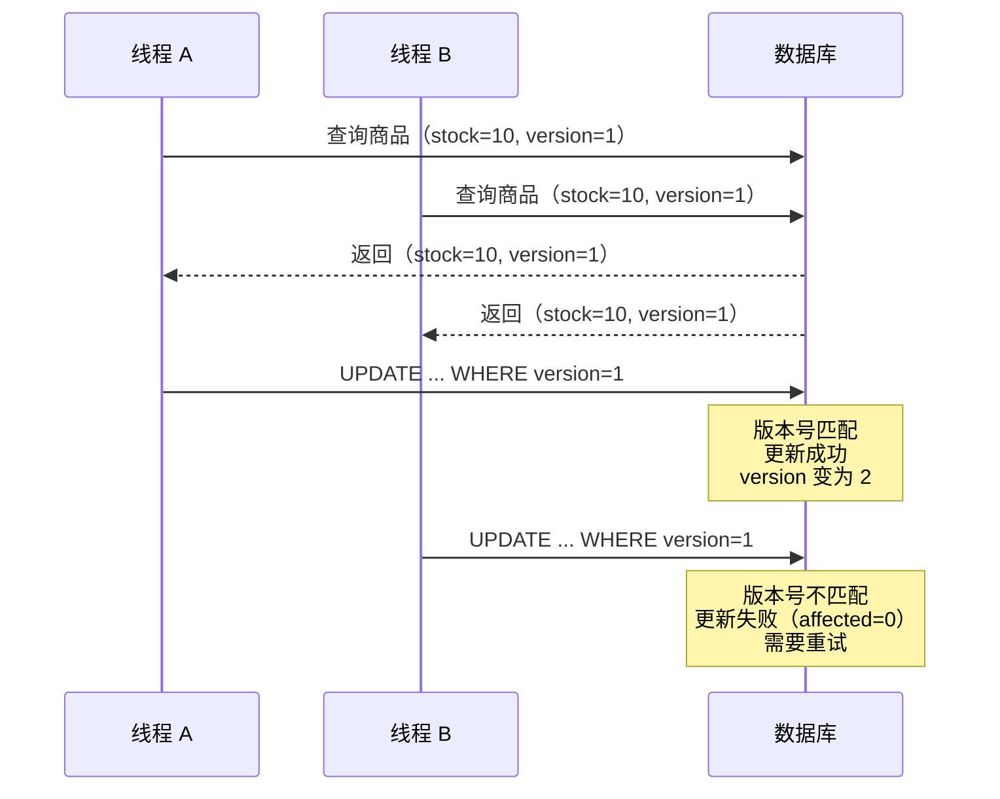
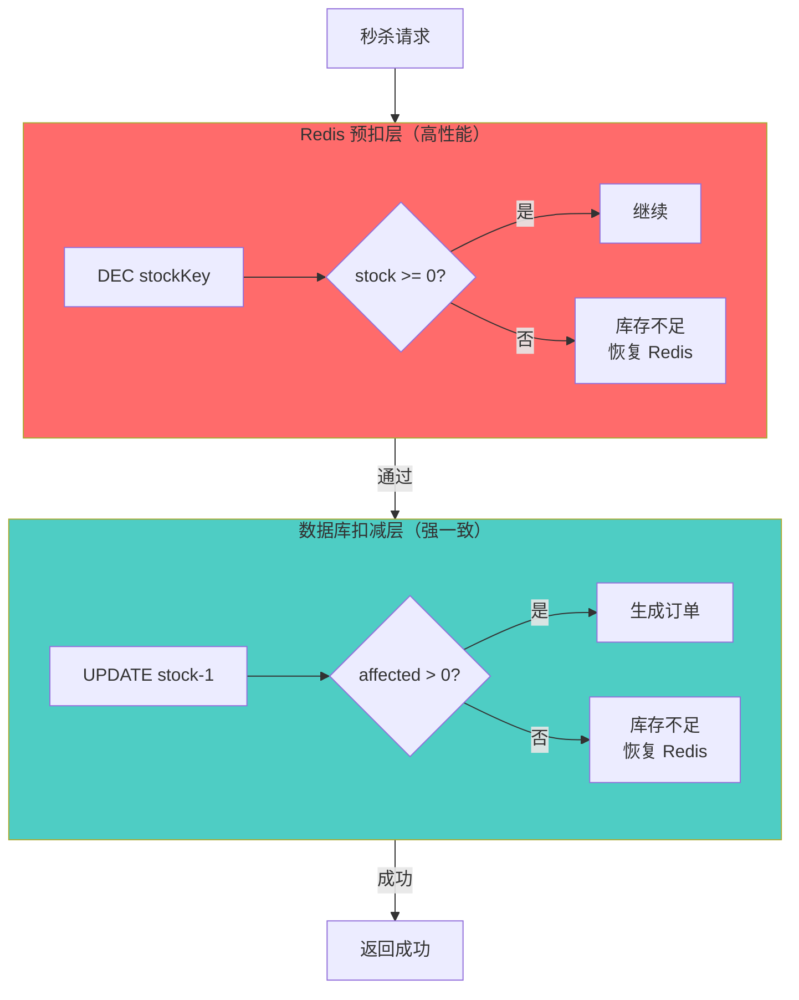
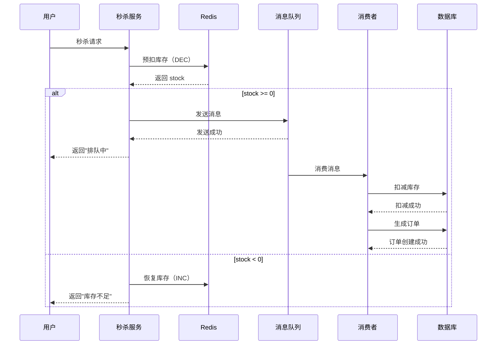
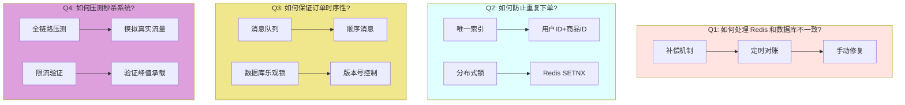
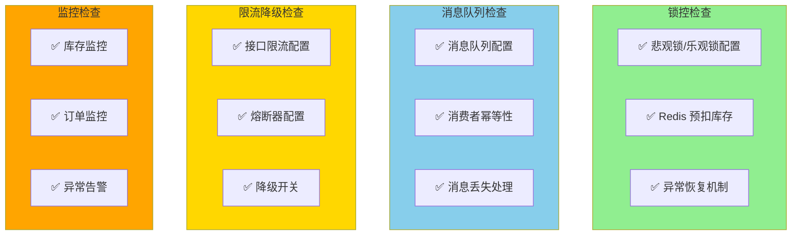
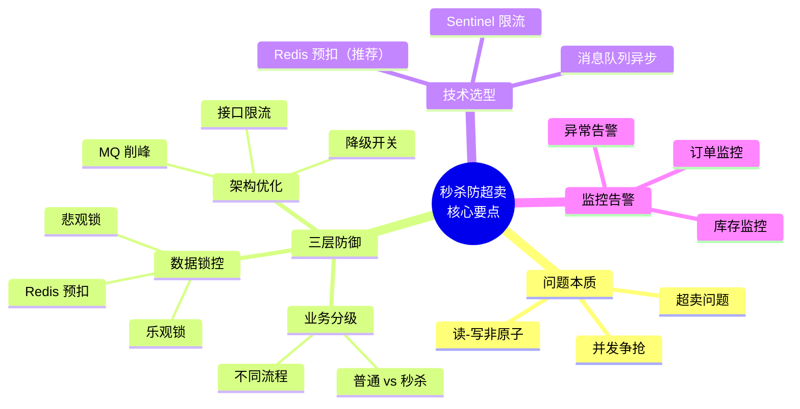

# 秒杀系统防超卖架构

> **场景定位**：高并发架构设计技术场景  
> **核心设计要点**：超卖问题、悲观锁、乐观锁、Redis 预扣库存、消息队列削峰、限流降级

---

## 🎯 一句话定位

**秒杀超卖问题是什么？**
```
100 个人同时抢 10 件商品，结果卖出去 100 件。
商家亏大了，用户收到了货，但仓库里根本没那么多货。
```

**生活化比喻**：就像电影院卖票，100 个人同时买同一场的同一排座位，系统没锁住，卖出去 100 张票，但只有 10 个座位。

**核心特点**：高并发下的数据一致性问题，单用户正常，高并发就失控。

---

## 💎 核心观点（5 分钟速览版）

> **快速概览**

### 核心观点（3 层防御）

**1. 业务分级：区分普通下单 vs 秒杀下单**
```
✅ 普通下单：走常规事务流程，数据库直接扣减库存
✅ 秒杀下单：走限流削峰方案，拦截无效流量

生活化比喻：
普通下单 = 平时买菜，慢慢挑，不着急
秒杀下单 = 双十一抢购，瞬间涌入大量订单
```

**2. 数据锁控与兜底校验**
```
悲观锁：SELECT ... FOR UPDATE（锁住库存记录）
乐观锁：版本号机制（UPDATE ... WHERE version = ?）
Redis 预扣库存：提前在 Redis 扣减，拦截大部分请求

生活化比喻：
悲观锁 = 独占卫生间，进去就锁门，别人等着
乐观锁 = 共享文档，修改时检查版本号，没冲突就提交
Redis 预扣 = 预报名，先在名单上登记，真正的抢购时再确认
```

**3. 架构层优化：削峰、限流、降级**
```
消息队列：异步处理订单，削峰填谷
接口限流：超出承载流量直接拒绝
降级开关：关闭非必要业务，只保留核心流程

生活化比喻：
消息队列 = 餐厅排队叫号，分批进入
限流 = 限制进场人数，防止踩踏
降级 = 高峰期暂停表演，只保留核心服务
```

---

## 🚀 一句话精华（如果只能记住一句）

> **秒杀防超卖 = 业务分级（普通 vs 秒杀） + 数据锁控（悲观锁/乐观锁/Redis 预扣） + 架构优化（MQ 削峰 + 限流降级）**

---

## 一、问题本质：并发争抢导致的超卖

### ❌ 错误做法（无锁控制）

**代码示例（错误示范）**：
```java
@Service
public class OrderService {
    
    @Autowired
    private ProductMapper productMapper;
    
    @Autowired
    private OrderMapper orderMapper;
    
    public void createOrder(Long userId, Long productId) {
        // 1. 查询库存
        Product product = productMapper.selectById(productId);
        
        // 2. 判断库存是否充足
        if (product.getStock() <= 0) {
            throw new BusinessException("库存不足");
        }
        
        // 3. 扣减库存
        product.setStock(product.getStock() - 1);
        productMapper.updateById(product);
        
        // 4. 生成订单
        Order order = new Order();
        order.setUserId(userId);
        order.setProductId(productId);
        orderMapper.insert(order);
    }
}

// 问题：高并发下，多个线程同时读取库存（如 10），
// 都判断库存充足，然后都扣减，导致超卖
```

**问题分析**：
```
生活化比喻：
10 个人同时看到仓库里有 10 件商品，
都说"我要买"，然后都拿走了商品，
结果仓库空了，但卖出去 100 件。

技术问题：
读-写操作不是原子性的
线程 A 读取库存 = 10
线程 B 读取库存 = 10（同时读取）
线程 A 扣减库存 = 9
线程 B 扣减库存 = 9（覆盖了 A 的结果）
结果：卖出 2 件，库存还剩 9 件，超卖了！
```



---

## 二、第一层防御：业务分级

### 2.1 普通下单 vs 秒杀下单

**生活化比喻**：
```
普通下单 = 平时去超市买菜
- 人流量平稳
- 可以慢慢挑
- 走正常流程

秒杀下单 = 双十一抢购
- 瞬间涌入大量请求
- 需要限流削峰
- 走特殊通道

原则：不同场景，不同处理
```

**代码示例（业务分级）**：
```java
@Service
public class OrderService {
    
    @Autowired
    private NormalOrderService normalOrderService;  // 普通下单
    
    @Autowired
    private SeckillOrderService seckillOrderService; // 秒杀下单
    
    /**
     * 创建订单（根据业务类型分流）
     */
    public void createOrder(OrderRequest request) {
        if (request.isSeckill()) {
            // 秒杀场景：走限流削峰方案
            seckillOrderService.createSeckillOrder(request);
        } else {
            // 普通场景：走常规事务流程
            normalOrderService.createNormalOrder(request);
        }
    }
}
```



---

## 三、第二层防御：数据锁控与兜底校验

### 3.1 悲观锁（SELECT ... FOR UPDATE）

**生活化比喻**：
```
悲观锁 = 独占卫生间
- 进去就锁门
- 别人在外面等
- 保证同一时间只有一个人使用

优点：绝对安全，不会超卖
缺点：性能差，阻塞等待
适用场景：并发量不大，对一致性要求极高
```

**代码示例（悲观锁）**：
```java
@Service
public class SeckillService {
    
    @Autowired
    private ProductMapper productMapper;
    
    @Autowired
    private OrderMapper orderMapper;
    
    @Transactional
    public void seckillWithPessimisticLock(Long userId, Long productId) {
        // 1. 悲观锁查询（加行锁）
        Product product = productMapper.selectForUpdate(productId);
        
        // 2. 判断库存
        if (product.getStock() <= 0) {
            throw new BusinessException("库存不足");
        }
        
        // 3. 扣减库存
        product.setStock(product.getStock() - 1);
        productMapper.updateById(product);
        
        // 4. 生成订单
        Order order = new Order();
        order.setUserId(userId);
        order.setProductId(productId);
        orderMapper.insert(order);
    }
}

// Mapper 接口
@Mapper
public interface ProductMapper {
    /**
     * 悲观锁查询（SELECT ... FOR UPDATE）
     */
    @Select("SELECT * FROM product WHERE id = #{productId} FOR UPDATE")
    Product selectForUpdate(Long productId);
}
```

**注意事项**：
```
✅ 必须在事务中使用（@Transactional）
✅ 锁住具体记录（WHERE id = ?）
❌ 避免锁全表（WHERE stock > 0 会锁全表）
❌ 避免长时间持有锁（事务不要太长）
```

### 3.2 乐观锁（版本号机制）

**生活化比喻**：
```
乐观锁 = 共享文档协作
- 大家都能看
- 修改时检查版本号
- 版本号没变，说明没冲突，可以提交
- 版本号变了，说明有人改过了，重试

优点：性能好，不阻塞
缺点：冲突多时需要多次重试
适用场景：并发量大，冲突较少
```

**代码示例（乐观锁）**：
```java
@Service
public class SeckillService {
    
    @Autowired
    private ProductMapper productMapper;
    
    @Autowired
    private OrderMapper orderMapper;
    
    @Transactional
    public void seckillWithOptimisticLock(Long userId, Long productId) {
        int maxRetries = 3; // 最大重试次数
        int retryCount = 0;
        
        while (retryCount < maxRetries) {
            // 1. 查询商品（包括版本号）
            Product product = productMapper.selectById(productId);
            
            // 2. 判断库存
            if (product.getStock() <= 0) {
                throw new BusinessException("库存不足");
            }
            
            // 3. 扣减库存（带版本号检查）
            int affected = productMapper.decreaseStockWithVersion(
                productId,
                product.getVersion()
            );
            
            if (affected > 0) {
                // 扣减成功，生成订单
                Order order = new Order();
                order.setUserId(userId);
                order.setProductId(productId);
                orderMapper.insert(order);
                return; // 成功，退出
            }
            
            // 扣减失败（版本号冲突），重试
            retryCount++;
            log.warn("乐观锁冲突，第 {} 次重试", retryCount);
        }
        
        throw new BusinessException("系统繁忙，请稍后重试");
    }
}

// Mapper 接口
@Mapper
public interface ProductMapper {
    /**
     * 乐观锁扣减库存（带版本号检查）
     */
    @Update("UPDATE product SET stock = stock - 1, version = version + 1 " +
            "WHERE id = #{productId} AND version = #{version} AND stock > 0")
    int decreaseStockWithVersion(
        @Param("productId") Long productId,
        @Param("version") Integer version
    );
}
```



### 3.3 Redis 预扣库存（推荐方案）

**生活化比喻**：
```
Redis 预扣 = 预报名制度
- 先在名单上登记（Redis 预扣）
- 真正的抢购时再确认（数据库扣减）
- 大部分无效请求在 Redis 层就被拦截

优点：性能极高，抗住大并发
缺点：需要保证 Redis 和数据库一致性
适用场景：高并发秒杀（推荐）
```

**代码示例（Redis 预扣库存）**：
```java
@Service
public class SeckillService {
    
    @Autowired
    private StringRedisTemplate redisTemplate;
    
    @Autowired
    private ProductMapper productMapper;
    
    @Autowired
    private OrderMapper orderMapper;
    
    /**
     * 秒杀接口（Redis 预扣 + 数据库扣减）
     */
    @Transactional
    public void seckill(Long userId, Long productId) {
        String stockKey = "seckill:stock:" + productId;
        
        // 1. Redis 预扣库存（原子操作）
        Long stock = redisTemplate.opsForValue().decrement(stockKey);
        
        if (stock < 0) {
            // 库存不足，恢复 Redis 库存
            redisTemplate.opsForValue().increment(stockKey);
            throw new BusinessException("库存不足");
        }
        
        try {
            // 2. 数据库扣减库存（悲观锁或乐观锁）
            int affected = productMapper.decreaseStock(productId);
            
            if (affected == 0) {
                // 数据库库存不足，恢复 Redis 库存
                redisTemplate.opsForValue().increment(stockKey);
                throw new BusinessException("库存不足");
            }
            
            // 3. 生成订单
            Order order = new Order();
            order.setUserId(userId);
            order.setProductId(productId);
            orderMapper.insert(order);
            
        } catch (Exception e) {
            // 异常时恢复 Redis 库存
            redisTemplate.opsForValue().increment(stockKey);
            throw e;
        }
    }
    
    /**
     * 初始化秒杀库存（活动开始前调用）
     */
    public void initSeckillStock(Long productId, Integer stock) {
        String stockKey = "seckill:stock:" + productId;
        redisTemplate.opsForValue().set(stockKey, stock.toString());
    }
}

// Mapper 接口
@Mapper
public interface ProductMapper {
    /**
     * 数据库扣减库存
     */
    @Update("UPDATE product SET stock = stock - 1 WHERE id = #{productId} AND stock > 0")
    int decreaseStock(@Param("productId") Long productId);
}
```



**优势**：
- ✅ **性能极高**：Redis 单线程原子操作，抗 10 万+ QPS
- ✅ **拦截无效请求**：大部分请求在 Redis 层就被拒绝
- ✅ **保护数据库**：只有少量请求真正打到数据库

---

## 四、第三层防御：架构层优化

### 4.1 消息队列异步处理（削峰填谷）

**生活化比喻**：
```
消息队列 = 餐厅排队叫号
- 顾客来了先取号（请求进入队列）
- 厨师按顺序做菜（消费者按速度处理）
- 不会一下子涌入厨房（保护后端）

削峰填谷原理：
- 瞬时高峰流量进入队列
- 消费者按固定速度处理
- 避免数据库被打垮
```

**代码示例（消息队列削峰）**：
```java
@Service
public class SeckillService {
    
    @Autowired
    private StringRedisTemplate redisTemplate;
    
    @Autowired
    private RocketMQTemplate rocketMQTemplate;
    
    /**
     * 秒杀接口（Redis 预扣 + 消息队列异步处理）
     */
    public SeckillResponse seckillAsync(Long userId, Long productId) {
        String stockKey = "seckill:stock:" + productId;
        
        // 1. Redis 预扣库存
        Long stock = redisTemplate.opsForValue().decrement(stockKey);
        
        if (stock < 0) {
            redisTemplate.opsForValue().increment(stockKey);
            return SeckillResponse.failed("库存不足");
        }
        
        // 2. 发送消息到 MQ（异步处理）
        SeckillMessage message = new SeckillMessage();
        message.setUserId(userId);
        message.setProductId(productId);
        message.setTimestamp(System.currentTimeMillis());
        
        rocketMQTemplate.convertAndSend("seckill-topic", message);
        
        // 3. 返回"排队中"
        return SeckillResponse.queuing("正在排队，请稍后查询结果");
    }
}

// 消息消费者
@Component
@RocketMQMessageListener(
    topic = "seckill-topic",
    consumerGroup = "seckill-consumer-group"
)
public class SeckillConsumer implements RocketMQListener<SeckillMessage> {
    
    @Autowired
    private ProductMapper productMapper;
    
    @Autowired
    private OrderMapper orderMapper;
    
    @Autowired
    private StringRedisTemplate redisTemplate;
    
    @Override
    @Transactional
    public void onMessage(SeckillMessage message) {
        try {
            // 1. 数据库扣减库存
            int affected = productMapper.decreaseStock(message.getProductId());
            
            if (affected == 0) {
                // 库存不足，恢复 Redis 库存
                redisTemplate.opsForValue().increment(
                    "seckill:stock:" + message.getProductId()
                );
                return;
            }
            
            // 2. 生成订单
            Order order = new Order();
            order.setUserId(message.getUserId());
            order.setProductId(message.getProductId());
            orderMapper.insert(order);
            
            // 3. 更新订单状态为"成功"
            updateOrderStatus(order.getId(), "SUCCESS");
            
        } catch (Exception e) {
            log.error("秒杀处理失败", e);
            // 异常时恢复 Redis 库存
            redisTemplate.opsForValue().increment(
                "seckill:stock:" + message.getProductId()
            );
        }
    }
}
```



### 4.2 接口限流与熔断

**生活化比喻**：
```
限流 = 餐厅限制进场人数
- 场内已有 100 人，外面的人等着
- 防止踩踏事故

熔断 = 保险丝
- 电流过大就断开
- 保护后端服务

降级 = 限电措施
- 高峰期关闭非必要功能
- 只保留核心业务
```

**代码示例（接口限流）**：
```java
@RestController
public class SeckillController {
    
    @Autowired
    private SeckillService seckillService;
    
    // 使用 Sentinel 限流
    @GetMapping("/seckill/{productId}")
    @SentinelResource(
        value = "seckill",
        blockHandler = "seckillBlockHandler"
    )
    public Result seckill(
        @UserId Long userId,
        @PathVariable Long productId
    ) {
        SeckillResponse response = seckillService.seckillAsync(userId, productId);
        return Result.success(response);
    }
    
    /**
     * 限流后的降级处理
     */
    public Result seckillBlockHandler(
        Long userId,
        Long productId,
        BlockException ex
    ) {
        return Result.error("系统繁忙，请稍后重试");
    }
}

// Sentinel 配置（Application.java）
@SpringBootApplication
public class Application {
    
    @PostConstruct
    public void initFlowRules() {
        List<FlowRule> rules = new ArrayList<>();
        
        // 秒杀接口限流：最多 1000 QPS
        FlowRule rule = new FlowRule();
        rule.setResource("seckill");
        rule.setGrade(RuleConstant.FLOW_GRADE_QPS);
        rule.setCount(1000); // 每秒最多 1000 个请求
        rules.add(rule);
        
        FlowRuleManager.loadRules(rules);
    }
}
```

### 4.3 降级开关

**代码示例（降级开关）**：
```java
@Service
public class SeckillService {
    
    @Autowired
    private RecommendationService recommendationService;
    
    @Autowired
    private RedisTemplate<String, Boolean> redisTemplate;
    
    public SeckillResult seckill(Long userId, Long productId) {
        // 1. 核心流程：扣减库存、生成订单
        // ...
        
        // 2. 非核心流程：推荐商品（可降级）
        List<Product> recommendations = null;
        if (!isDegradeEnabled()) {
            try {
                recommendations = recommendationService.getRecommendations(userId);
            } catch (Exception e) {
                log.error("推荐服务异常", e);
            }
        } else {
            log.info("推荐服务已降级");
        }
        
        return SeckillResult.success(recommendations);
    }
    
    private boolean isDegradeEnabled() {
        Boolean degrade = redisTemplate.opsForValue().get("degrade:recommendation");
        return degrade != null && degrade;
    }
}
```

---

五、技术深入探讨

### 考点 1：为什么会出现超卖？

**方案参考**（30 秒版）：
> "超卖是因为读-写操作不是原子性的。多个线程同时读取库存（如 10），都判断库存充足，然后都扣减，导致实际卖出的数量超过库存。就像 10 个人同时看到仓库有 10 件商品，都说要买，结果卖出去 100 件。"

**加分回答**：
> "解决方案有三种：悲观锁（SELECT ... FOR UPDATE）、乐观锁（版本号机制）、Redis 预扣库存。悲观锁性能差但安全，乐观锁性能好但冲突多时需要重试，Redis 预扣性能最高适合高并发场景。"

### 考点 2：悲观锁和乐观锁的区别？

**方案参考**：
> "悲观锁是独占锁，同一时间只有一个线程能修改数据，像独占卫生间；乐观锁是版本号机制，修改时检查版本号，没冲突就提交，像共享文档协作。悲观锁适合并发量大、冲突多的场景，乐观锁适合并发量大、冲突少的场景。"

**加分回答**：
> "实际生产中，秒杀场景推荐用 Redis 预扣库存 + 数据库乐观锁的组合。Redis 预扣拦截大部分请求，数据库乐观锁保证最终一致性。这样既保证了性能，又保证了数据一致性。"

### 考点 3：Redis 预扣库存如何保证一致性？

**方案参考**：
> "Redis 预扣库存后，如果数据库扣减失败，要恢复 Redis 库存。使用 DEC 原子操作预扣，失败时用 INC 恢复。同时要处理异常情况，保证 Redis 和数据库的最终一致性。"

**加分回答**：
> "还可以使用 Lua 脚本保证 Redis 操作的原子性，避免并发问题。同时要监控 Redis 和数据库的库存差异，定期校准。对于重要场景，可以引入分布式事务（如 Seata）保证强一致性。"

---

## 六、技术追问与深度问题



**方案详解**：

**Q1: 如何处理 Redis 和数据库不一致？**  
**答**：使用补偿机制，定时对账（如每小时一次），对比 Redis 和数据库库存，发现不一致时手动修复。同时要做好日志记录，方便排查问题。对于重要场景，可以使用分布式事务保证强一致性。

**Q2: 如何防止重复下单？**  
**答**：使用唯一索引（用户 ID + 商品 ID），数据库层面保证一个用户只能买一次。同时使用分布式锁（Redis SETNX），在业务层面防止并发重复请求。

**Q3: 如何保证订单时序性？**  
**答**：使用消息队列的顺序消息，保证同一用户的订单按顺序处理。数据库层面使用乐观锁（版本号），保证数据一致性。

**Q4: 如何压测秒杀系统？**  
**答**：使用全链路压测工具（如 JMeter），模拟真实流量，验证系统峰值承载能力。重点测试限流是否生效、Redis 预扣是否准确、数据库是否会超卖。

---

## 七、生产环境 Checklist



**部署检查清单**：

| 类别 | 检查项 | 状态 | 生活化比喻 |
|------|--------|------|------------|
| **锁控** | 悲观锁/乐观锁配置 | ⬜ | 卫生间门锁 |
| | Redis 预扣库存 | ⬜ | 预报名制度 |
| | 异常恢复机制（Redis 库存回滚） | ⬜ | 失败退款 |
| **消息队列** | 消息队列配置（RocketMQ/Kafka） | ⬜ | 排队叫号系统 |
| | 消费者幂等性（防止重复处理） | ⬜ | 防止重复叫号 |
| | 消息丢失处理（重试机制） | ⬜ | 叫号失败重叫 |
| **限流降级** | 接口限流配置（Sentinel） | ⬜ | 限制进场人数 |
| | 熔断器配置（Resilience4j） | ⬜ | 保险丝 |
| | 降级开关（Redis 控制） | ⬜ | 限电措施 |
| **监控** | 库存监控（Redis + 数据库） | ⬜ | 库存盘点 |
| | 订单监控（成功率、延迟） | ⬜ | 销售统计 |
| | 异常告警（钉钉/企业微信） | ⬜ | 警报器 |

---

## 八、总结（一句话带走）



### 🎯 一句话总结

> **秒杀防超卖 = 业务分级（普通 vs 秒杀） + 数据锁控（悲观锁/乐观锁/Redis 预扣） + 架构优化（MQ 削峰 + 限流降级）**

### 🧠 核心记忆点

1. **为什么会超卖？** 读-写操作不是原子性的，多个线程同时读取库存，都判断充足，然后都扣减。
2. **悲观锁 vs 乐观锁？** 悲观锁是独占（像独占卫生间），乐观锁是版本号检查（像共享文档）。
3. **为什么用 Redis 预扣？** 性能极高，抗 10 万+ QPS，拦截大部分无效请求，保护数据库。
4. **如何削峰？** 使用消息队列，瞬时流量进入队列，消费者按固定速度处理。

---

**参考视频**：[内卷的琪某人 - 场景提问：商品秒杀业务怎么实现？](https://www.douyin.com/video/7642277650320346431)

---

*本文档基于 8 个专家提示词指导改写，遵循深入浅出、生活化比喻、幽默风趣的教学原则。*
