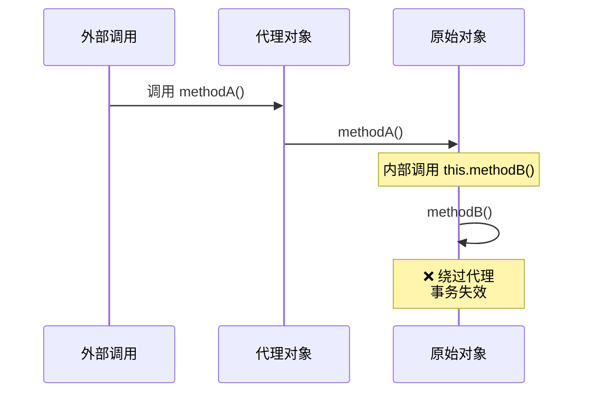
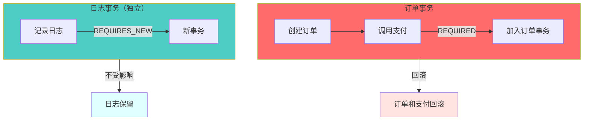
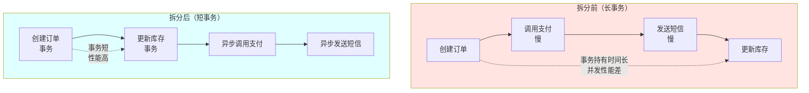
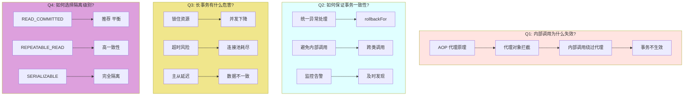
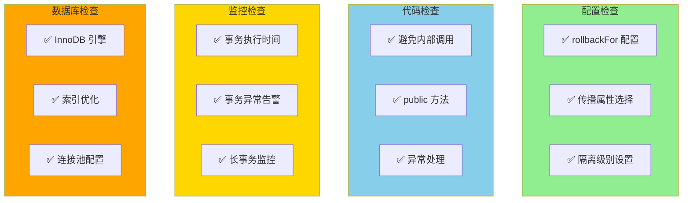
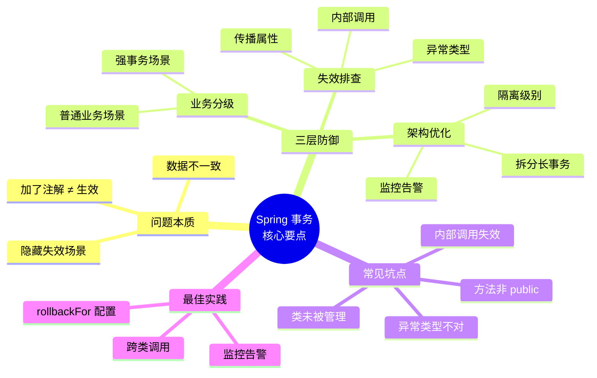

# Spring 事务失效排查

> **场景定位**：Spring 框架核心场景  
> **核心设计要点**：事务失效场景、事务传播机制、AOP 代理原理、事务隔离级别、长事务优化

---

## 🎯 一句话定位

**Spring 事务失效是什么？**
```
你给方法加了 @Transactional 注解，以为会开启事务。
结果出异常后，数据没有回滚，一部分成功一部分失败。
就像你以为买了保险，出事后发现保险不生效。
```

**生活化比喻**：就像你写了"如有问题全额退款"，但实际上有很多隐藏条款（事务失效场景），导致退款不生效。

**核心特点**：加了注解不等于事务生效，有很多隐藏坑点。

---

## 💎 核心观点（5 分钟速览版）

> **快速概览**

### 核心观点（3 层防御）

**1. 业务分级：区分事务使用场景**
```
✅ 强事务场景（必须开启）：
   - 资金流转（转账、支付）
   - 订单创建（订单 + 库存 + 支付）
   - 数据联动修改（用户 + 账号 + 钱包）

❌ 普通业务场景（无需开启）：
   - 查询、统计
   - 日志记录
   - 非核心数据新增

生活化比喻：
强事务 = 重要合同，必须签字盖章生效
普通业务 = 日常记录，不需要那么正式
```

**2. 事务失效问题排查与解决**
```
坑点 1：内部调用（最常见）
   - 问题：同类中方法 A 调用方法 B，B 的事务不生效
   - 原因：AOP 代理失效，绕过了代理对象
   - 解决：将事务方法放到不同类中

坑点 2：异常类型
   - 问题：默认只捕获 RuntimeException
   - 原因：checked 异常不会触发回滚
   - 解决：手动配置 rollbackFor = Exception.class

坑点 3：传播属性
   - 问题：事务嵌套混乱
   - 原因：默认 REQUIRED，会加入当前事务
   - 解决：根据业务选择 REQUIRES_NEW 等

生活化比喻：
内部调用 = 自己给自己打电话（无法接通）
异常类型 = 保险只赔车祸，不赔火灾
传播属性 = 嵌套合同的依赖关系
```

**3. 架构层优化：稳固事务执行环境**
```
隔离级别：根据并发程度选择（READ_COMMITTED 推荐）
拆分长事务：把耗时逻辑拆出去，缩小事务范围
监控告警：监控事务执行状态，超时预警

生活化比喻：
隔离级别 = 隐私保护程度
拆分长事务 = 把大合同拆成小合同，快速签署
监控告警 = 安装监控摄像头，异常立即报警
```

---

## 🚀 一句话精华（如果只能记住一句）

> **Spring 事务三层防御 = 业务分级（强事务 vs 普通业务） + 失效排查（内部调用/异常类型/传播属性） + 架构优化（隔离级别/拆分长事务/监控告警）**

---

## 一、问题本质：加了注解 ≠ 事务生效

### ❌ 常见误区

**代码示例（错误示范）**：
```java
@Service
public class UserService {
    
    @Autowired
    private UserMapper userMapper;
    
    @Autowired
    private AccountMapper accountMapper;
    
    @Autowired
    private WalletMapper walletMapper;
    
    // ❌ 以为加了注解就万事大吉
    @Transactional
    public void createUser(User user) {
        // 1. 创建用户
        userMapper.insert(user);
        
        // 2. 创建账号
        accountMapper.insert(new Account(user.getId()));
        
        // 3. 创建钱包（这里抛出异常）
        walletMapper.insert(new Wallet(user.getId(), 0.00));
        
        // 预期：三个操作都回滚
        // 实际：可能部分成功，部分失败（事务失效）
    }
}

// 问题：如果事务失效，user 和 account 创建成功，wallet 失败
// 导致数据不一致：有用户有账号，但没有钱包
```

**问题分析**：
```
生活化比喻：
就像你写了"如有问题全额退款"的承诺书，
但实际上有很多隐藏条款：
- 内部调用不退（AOP 代理失效）
- 某些异常不退（异常类型不对）
- 嵌套合同混乱（传播属性配置错误）

结果：承诺书看起来有效，实际不生效
```

---

## 二、第一层防御：业务分级

### 2.1 强事务场景 vs 普通业务场景

**生活化比喻**：
```
强事务场景 = 重要合同
- 必须签字盖章（开启事务）
- 违约要赔偿（回滚）
- 资金流转、订单创建、数据联动

普通业务场景 = 日常记录
- 不需要那么正式（无需事务）
- 查询、统计、日志记录
- 开了事务反而降低性能

原则：该开就开，不该开别开
```

**代码示例（业务分级）**：
```java
@Service
public class UserService {
    
    // ✅ 强事务场景：开启事务
    @Transactional
    public void createUserWithWallet(User user) {
        userMapper.insert(user);
        accountMapper.insert(new Account(user.getId()));
        walletMapper.insert(new Wallet(user.getId(), 0.00));
    }
    
    // ❌ 普通业务场景：无需事务
    public User getUserById(Long userId) {
        return userMapper.selectById(userId);
    }
    
    // ❌ 日志记录：无需事务
    public void logUserLogin(Long userId) {
        logMapper.insert(new LoginLog(userId, new Date()));
    }
}
```

```mermaid
graph TB
    subgraph Strong["强事务场景（必须开启）"]
        A1[资金流转]
        A2[订单创建]
        A3[数据联动]
        A4[库存扣减]
    end
    
    subgraph Normal["普通业务场景（无需开启）"]
        B1[查询统计]
        B2[日志记录]
        B3[非核心新增]
        B4[数据导出]
    end
    
    Request[业务请求] --> RequestType{场景类型?}
    RequestType -->|强事务| Strong
    RequestType -->|普通| Normal
    
    Strong -->|开启事务| Transaction[@Transactional]
    Normal -->|不开事务| NoTransaction[直接执行]
    
    style Strong fill:#FF6B6B
    style Normal fill:#4ECDC4
    style Transaction fill:#90EE90
    style NoTransaction fill:#95A5A6
```

---

## 三、第二层防御：事务失效问题排查

### 3.1 坑点 1：内部调用（最常见）

**问题描述**：
```java
@Service
public class UserService {
    
    // ❌ 内部调用，事务失效
    public void methodA() {
        // ...
        this.methodB(); // 同类中调用，事务不生效
    }
    
    @Transactional
    public void methodB() {
        // 事务不会生效
    }
}
```

**原因分析**：
```
生活化比喻：
就像你自己给自己打电话，无法接通。
Spring 事务是通过 AOP 代理实现的，
内部调用绕过了代理对象，直接调用原始方法。

技术原理：
Spring 为每个 @Service 类创建一个代理对象
外部调用 → 代理对象 → 事务拦截 → 原始方法
内部调用 → 原始方法（绕过代理，事务失效）
```



**解决方案**：
```java
// ✅ 方案 1：将事务方法放到不同类
@Service
public class UserService {
    
    @Autowired
    private WalletService walletService; // 注入另一个 Bean
    
    public void createUser(User user) {
        userMapper.insert(user);
        walletService.createWallet(user.getId()); // 跨类调用
    }
}

@Service
public class WalletService {
    
    @Transactional
    public void createWallet(Long userId) {
        walletMapper.insert(new Wallet(userId, 0.00));
    }
}

// ✅ 方案 2：使用 AopContext（不推荐）
@Service
public class UserService {
    
    public void methodA() {
        UserService proxy = (UserService) AopContext.currentProxy();
        proxy.methodB(); // 通过代理调用
    }
    
    @Transactional
    public void methodB() {
        // 事务生效
    }
}
```

### 3.2 坑点 2：异常类型

**问题描述**：
```java
@Service
public class UserService {
    
    // ❌ 默认只捕获 RuntimeException
    @Transactional
    public void createUser() throws Exception {
        userMapper.insert(user);
        
        // 抛出 checked 异常，不会回滚
        throw new Exception("业务异常");
    }
}
```

**原因分析**：
```
Spring 事务默认只对 RuntimeException 回滚
checked 异常（如 Exception、IOException）不会触发回滚

生活化比喻：
就像保险只赔车祸（RuntimeException），
不赔火灾（checked 异常）。
```

**解决方案**：
```java
// ✅ 方案 1：指定 rollbackFor
@Service
public class UserService {
    
    @Transactional(rollbackFor = Exception.class)
    public void createUser() throws Exception {
        userMapper.insert(user);
        throw new Exception("业务异常"); // 会回滚
    }
}

// ✅ 方案 2：手动捕获并抛出 RuntimeException
@Service
public class UserService {
    
    @Transactional
    public void createUser() {
        try {
            userMapper.insert(user);
            throw new Exception("业务异常");
        } catch (Exception e) {
            throw new RuntimeException(e); // 转换为 RuntimeException
        }
    }
}
```

### 3.3 坑点 3：传播属性

**问题描述**：
```java
@Service
public class OrderService {
    
    @Autowired
    private PaymentService paymentService;
    
    @Transactional
    public void createOrder(Order order) {
        orderMapper.insert(order);
        
        // 调用支付方法（默认 REQUIRED，会加入当前事务）
        paymentService.pay(order.getId());
    }
}

@Service
public class PaymentService {
    
    @Transactional // 默认传播属性：REQUIRED
    public void pay(Long orderId) {
        // 如果 createOrder 有事务，这里会加入
        // 如果 createOrder 没有事务，这里会创建新事务
    }
}
```

**传播属性说明**：
| 传播属性 | 含义 | 生活化比喻 | 使用场景 |
|---------|------|------------|----------|
| **REQUIRED**（默认） | 有事务就加入，没有就创建 | 有合同就加入，没有就新签 | 大多数场景 |
| **REQUIRES_NEW** | 总是创建新事务 | 独立合同，互不影响 | 重要操作，不被外层影响 |
| **SUPPORTS** | 有事务就加入，没有就非事务 | 随大流 | 查询操作 |
| **NOT_SUPPORTED** | 总是非事务执行 | 拒绝加入合同 | 日志记录 |
| **MANDATORY** | 必须在事务中调用 | 必须依附合同 | 强制要求事务 |
| **NEVER** | 不能在事务中调用 | 拒绝合同 | 严格非事务 |

**代码示例（正确使用传播属性）**：
```java
@Service
public class OrderService {
    
    @Autowired
    private PaymentService paymentService;
    
    @Autowired
    private LogService logService;
    
    @Transactional
    public void createOrder(Order order) {
        orderMapper.insert(order);
        
        // 支付：加入当前事务（REQUIRED）
        paymentService.pay(order.getId());
        
        // 日志：独立事务（REQUIRES_NEW）
        // 即使订单回滚，日志也要保留
        logService.log("创建订单：" + order.getId());
    }
}

@Service
public class LogService {
    
    @Transactional(propagation = Propagation.REQUIRES_NEW)
    public void log(String message) {
        logMapper.insert(new Log(message));
    }
}
```



### 3.4 其他失效场景

**坑点 4：方法不是 public**：
```java
@Service
public class UserService {
    
    // ❌ 私有方法，事务失效
    @Transactional
    private void createUser() {
        // ...
    }
    
    // ❌ 受保护方法，事务失效
    @Transactional
    protected void updateUser() {
        // ...
    }
    
    // ✅ 必须是 public 方法
    @Transactional
    public void deleteUser() {
        // ...
    }
}
```

**坑点 5：类没有被 Spring 管理**：
```java
// ❌ 没有 @Service 注解，事务失效
public class UserService {
    
    @Transactional
    public void createUser() {
        // ...
    }
}

// ✅ 正确做法
@Service
public class UserService {
    
    @Transactional
    public void createUser() {
        // ...
    }
}
```

**坑点 6：数据库不支持事务**：
```java
// ❌ MySQL 的 MyISAM 引擎不支持事务
CREATE TABLE user (
    id INT PRIMARY KEY,
    name VARCHAR(50)
) ENGINE=MyISAM; // 不支持事务

// ✅ 使用 InnoDB 引擎
CREATE TABLE user (
    id INT PRIMARY KEY,
    name VARCHAR(50)
) ENGINE=InnoDB; // 支持事务
```

---

## 四、第三层防御：架构层优化

### 4.1 合理设置隔离级别

**隔离级别说明**：
| 隔离级别 | 脏读 | 不可重复读 | 幻读 | 性能 | 生活化比喻 |
|---------|------|-----------|------|------|------------|
| **READ_UNCOMMITTED** | ✅ | ✅ | ✅ | 最高 | 完全公开，谁都能看 |
| **READ_COMMITTED** | ❌ | ✅ | ✅ | 高 | 提交后可见（推荐） |
| **REPEATABLE_READ** | ❌ | ❌ | ✅ | 中 | 事务内可见性一致 |
| **SERIALIZABLE** | ❌ | ❌ | ❌ | 最低 | 完全隔离，排队执行 |

**代码示例**：
```java
@Service
public class UserService {
    
    // 推荐：READ_COMMITTED（平衡性能和一致性）
    @Transactional(isolation = Isolation.READ_COMMITTED)
    public void transfer(Long fromUserId, Long toUserId, BigDecimal amount) {
        // 转账操作
        userMapper.deductBalance(fromUserId, amount);
        userMapper.addBalance(toUserId, amount);
    }
}
```

### 4.2 拆分长事务

**问题描述**：
```java
@Service
public class OrderService {
    
    // ❌ 长事务：包含耗时操作
    @Transactional
    public void createOrder(Order order) {
        // 1. 创建订单（快）
        orderMapper.insert(order);
        
        // 2. 调用第三方接口（慢，可能超时）
        PaymentResult result = paymentService.pay(order.getId());
        
        // 3. 发送短信（慢）
        smsService.send(order.getUserId(), "订单创建成功");
        
        // 4. 更新库存（快）
        productMapper.decreaseStock(order.getProductId());
    }
    
    // 问题：事务持有时间过长，锁住数据库资源，并发性能下降
}
```

**解决方案**：
```java
// ✅ 拆分长事务
@Service
public class OrderService {
    
    @Transactional
    public void createOrder(Order order) {
        // 只包含核心业务（快）
        orderMapper.insert(order);
        productMapper.decreaseStock(order.getProductId());
    }
    
    // 耗时操作异步处理
    @Async
    public void processOrderAsync(Long orderId) {
        // 调用支付
        PaymentResult result = paymentService.pay(orderId);
        
        // 发送短信
        smsService.send(order.getUserId(), "订单创建成功");
    }
}

// 使用时
public void createOrder(Order order) {
    // 1. 事务创建订单
    orderService.createOrder(order);
    
    // 2. 异步处理耗时操作
    orderService.processOrderAsync(order.getId());
}
```



### 4.3 事务监控告警

**代码示例**：
```java
@Configuration
@EnableAspectJAutoProxy
public class TransactionMonitorConfig {
    
    @Bean
    public TransactionMonitorAspect transactionMonitorAspect() {
        return new TransactionMonitorAspect();
    }
}

@Aspect
@Component
public class TransactionMonitorAspect {
    
    private static final Logger log = LoggerFactory.getLogger(TransactionMonitorAspect.class);
    
    // 监控所有事务方法
    @Around("@annotation(org.springframework.transaction.annotation.Transactional)")
    public Object monitorTransaction(ProceedingJoinPoint joinPoint) throws Throwable {
        long startTime = System.currentTimeMillis();
        String methodName = joinPoint.getSignature().getName();
        
        try {
            Object result = joinPoint.proceed();
            long duration = System.currentTimeMillis() - startTime;
            
            // 记录执行时间
            if (duration > 1000) { // 超过 1 秒告警
                log.warn("事务执行时间过长：{}，耗时：{}ms", methodName, duration);
            }
            
            return result;
        } catch (Throwable t) {
            // 记录异常
            log.error("事务执行异常：{}", methodName, t);
            throw t;
        }
    }
}
```

---

五、技术深入探讨

### 考点 1：Spring 事务失效的场景有哪些？

**方案参考**（30 秒版）：
> "Spring 事务失效的常见场景有：1）内部调用（同类中方法互相调用），AOP 代理失效；2）异常类型不对，默认只捕获 RuntimeException；3）方法不是 public；4）类没有被 Spring 管理；5）数据库不支持事务（如 MyISAM）。最常见的是内部调用和异常类型问题。"

**加分回答**：
> "实际开发中，我会注意三点：1）避免内部调用，将事务方法放到不同类；2）统一配置 rollbackFor = Exception.class；3）使用 Spring 的事务管理器监控事务执行状态。对于复杂场景，可以使用编程式事务（TransactionTemplate）精确控制。"

### 考点 2：事务传播属性有哪些？

**方案参考**：
> "Spring 有 7 种传播属性：REQUIRED（默认，有就加入，没有就创建）、REQUIRES_NEW（总是创建新事务）、SUPPORTS（有就加入，没有就非事务）、NOT_SUPPORTED（总是非事务）、MANDATORY（必须在事务中）、NEVER（不能在事务中）、NESTED（嵌套事务）。最常用的是 REQUIRED 和 REQUIRES_NEW。"

**加分回答**：
> "实际使用中，大部分场景用 REQUIRED 就够了。但对于日志记录、审计等需要独立提交的操作，我会用 REQUIRES_NEW，保证即使外层事务回滚，日志也能保留。嵌套事务（NESTED）用得较少，因为对数据库有要求（需要支持 savepoint）。"

### 考点 3：如何排查事务失效问题？

**方案参考**：
> "排查事务失效问题，我会按以下步骤：1）检查方法是否 public；2）检查类是否被 Spring 管理；3）检查是否有内部调用；4）检查异常类型是否正确；5）检查数据库引擎是否支持事务。可以通过日志或断点调试，查看事务是否真正开启。"

**加分回答**：
> "我会开启 Spring 的事务日志（logging.level.org.springframework.jdbc.datasource.DataSourceTransactionManager=DEBUG），查看事务的开启、提交、回滚日志。同时使用 AOP 切面监控事务执行状态，记录执行时间和异常信息。对于复杂场景，可以使用编程式事务精确控制。"

---

## 六、技术追问与深度问题



**方案详解**：

**Q1: 内部调用为什么失效？**  
**答**：Spring 事务是通过 AOP 代理实现的。外部调用时，会先经过代理对象，代理对象拦截事务方法，开启事务。但内部调用时，是原始对象自己调用自己，绕过了代理对象，所以事务不生效。解决方案是将事务方法放到不同类，或者使用 AopContext.currentProxy() 获取代理对象。

**Q2: 如何保证事务一致性？**  
**答**：1）统一配置 rollbackFor = Exception.class；2）避免内部调用，使用跨类调用；3）合理选择传播属性；4）开启事务监控，及时发现异常。对于复杂场景，可以使用编程式事务（TransactionTemplate）精确控制。

**Q3: 长事务有什么危害？**  
**答**：长事务会锁住数据库资源，导致并发性能下降；可能超时，导致连接池耗尽；主从架构下会导致主从延迟。解决方案是拆分长事务，将耗时操作异步处理，只保留核心业务在事务中。

**Q4: 如何选择隔离级别？**  
**答**：大多数场景用 READ_COMMITTED 就够了，平衡性能和一致性。对于需要强一致性的场景（如转账），可以用 REPEATABLE_READ。SERIALIZABLE 性能最差，很少使用。MySQL 默认是 REPEATABLE_READ，Oracle 默认是 READ_COMMITTED。

---

## 七、生产环境 Checklist



**部署检查清单**：

| 类别 | 检查项 | 状态 | 生活化比喻 |
|------|--------|------|------------|
| **配置** | rollbackFor = Exception.class | ⬜ | 保险覆盖范围 |
| | 传播属性选择（REQUIRED/REQUIRES_NEW） | ⬜ | 合同依赖关系 |
| | 隔离级别设置（READ_COMMITTED） | ⬜ | 隐私保护程度 |
| **代码** | 避免内部调用（跨类调用） | ⬜ | 避免自己给自己打电话 |
| | 方法必须是 public | ⬜ | 必须是公开方法 |
| | 异常处理正确 | ⬜ | 异常类型匹配 |
| **监控** | 事务执行时间监控（>1 秒告警） | ⬜ | 计时器 |
| | 事务异常告警 | ⬜ | 警报器 |
| | 长事务监控 | ⬜ | 超时提醒 |
| **数据库** | InnoDB 引擎 | ⬜ | 支持事务 |
| | 索引优化 | ⬜ | 查询加速 |
| | 连接池配置 | ⬜ | 资源管理 |

---

## 八、总结（一句话带走）



### 🎯 一句话总结

> **Spring 事务三层防御 = 业务分级（强事务 vs 普通业务） + 失效排查（内部调用/异常类型/传播属性） + 架构优化（隔离级别/拆分长事务/监控告警）**

### 🧠 核心记忆点

1. **为什么事务会失效？** 内部调用绕过 AOP 代理、异常类型不对、方法不是 public、类未被 Spring 管理。
2. **如何避免内部调用失效？** 将事务方法放到不同类，使用跨类调用。
3. **传播属性如何选择？** 大多数用 REQUIRED，日志等独立操作用 REQUIRES_NEW。
4. **长事务的危害？** 锁住资源、并发下降、超时风险，解决方案是拆分事务，异步处理耗时操作。

---

**参考视频**：[内卷的琪某人 - 场景提问：Spring 事务怎么用的？](https://www.douyin.com/video/7641897114515066118)

---

*本文档基于 8 个专家提示词指导改写，遵循深入浅出、生活化比喻、幽默风趣的教学原则。*
