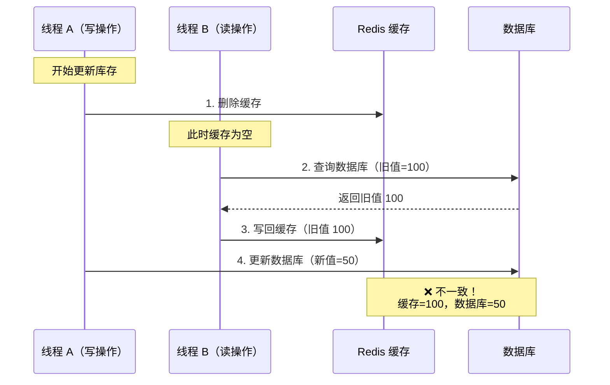
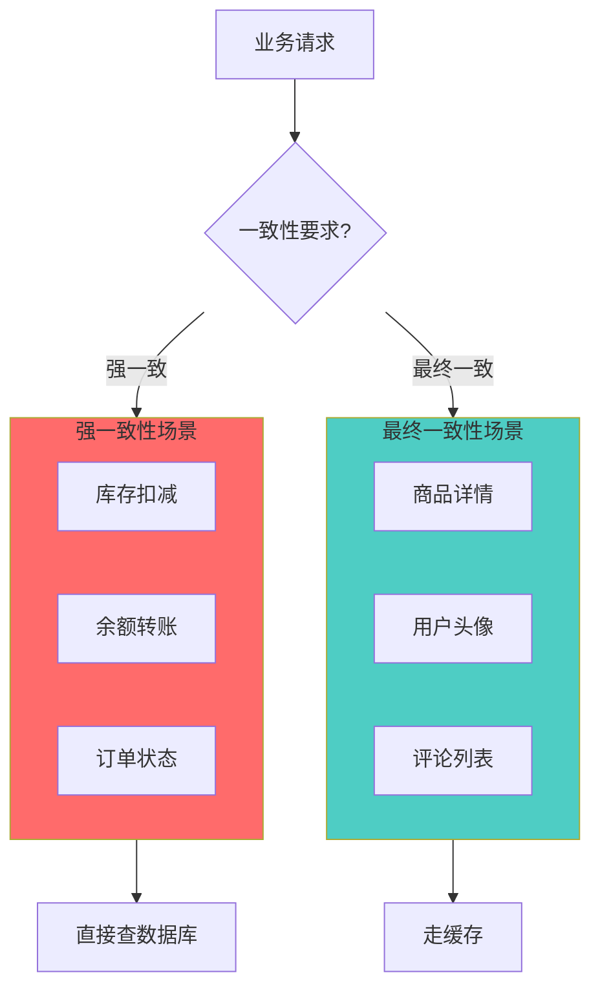
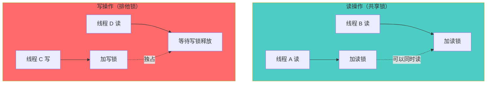
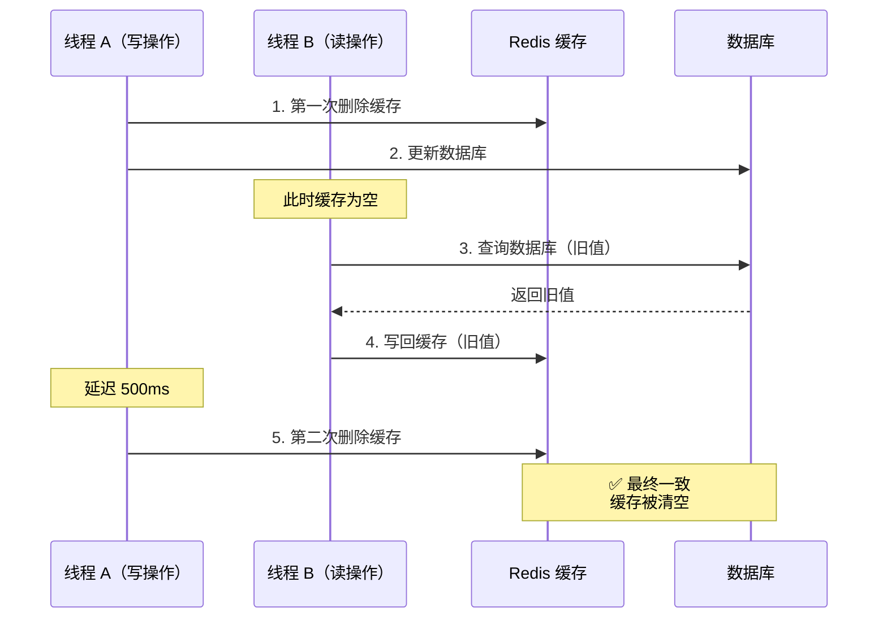
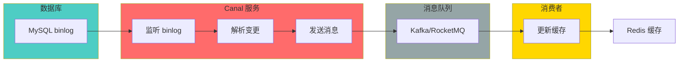
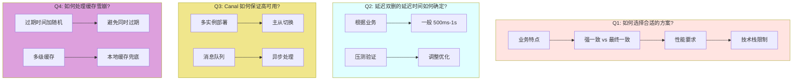
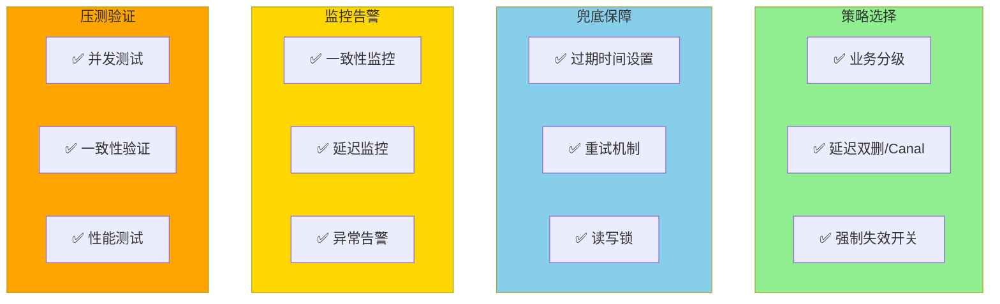
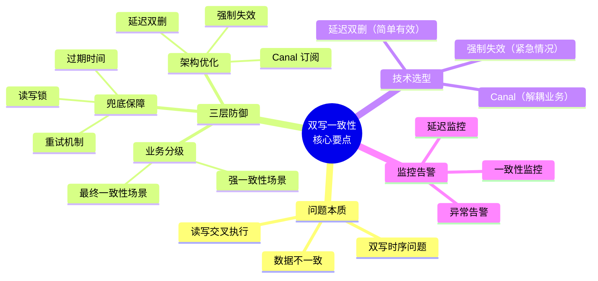

# Redis 与数据库双写一致性

> **场景定位**：分布式缓存架构技术场景  
> **核心设计要点**：缓存双写一致性、延迟双删、Canal 订阅 binlog、分布式锁、最终一致性

---

## 🎯 一句话定位

**Redis 和数据库双写一致性问题是什么？**
```
数据库里库存已经扣减到 0 了，但 Redis 里还剩 12 件。
结果瞬间进来 12 个订单全部支付成功，超卖了 120 多件。
老板凌晨三点打电话让你紧急回滚数据。
```

**生活化比喻**：就像你在两个账本上记账，一个账本更新了，另一个没更新，导致账目对不上。

**核心特点**：双写时序问题导致缓存和数据库数据不一致。

---

## 💎 核心观点（5 分钟速览版）

> **快速概览**

### 核心观点（3 层防御）

**1. 业务分级：区分强一致性和最终一致性**
```
✅ 强一致性场景（必须严格一致）：
   - 库存、余额、订单状态
   - 强制走数据库查询或加分布式锁
   - 下单扣库存瞬间，必须查数据库确认最新值

✅ 最终一致性场景（可以接受短暂延迟）：
   - 商品详情、用户头像、评论列表
   - 延迟几分钟用户完全感知不到
   - 走缓存，提高性能

生活化比喻：
强一致性 = 银行账户余额，必须实时更新
最终一致性 = 微博粉丝数，延迟几分钟无所谓
```

**2. 缓存降级与兜底一致性保障**
```
过期时间兜底：给所有缓存设置合理的过期时间
   - 即使出现不一致，最多过期时间后自动恢复
   - 就像设置自动对账时间

更新重试机制：删除缓存失败时加入死信队列
   - 后台异步重试删除，确保缓存最终被清空
   - 就像失败后自动重试

读写锁优化：读多写少场景用读写锁
   - 写操作加排他锁，读操作加共享锁
   - 避免脏读

生活化比喻：
过期时间 = 自动对账时间
重试机制 = 失败后自动重发
读写锁 = 写的时候不让读，读的时候不让写
```

**3. 架构层优化：从根源减少不一致窗口**
```
延迟双删：写数据库后，延迟几百毫秒再删一次缓存
   - 覆盖掉可能被其他线程读回的旧数据
   - 就像写完作业后再检查一遍

Canal 订阅 binlog：通过数据库 binlog 同步工具异步更新缓存
   - 替代业务代码里的缓存删除逻辑
   - 保证数据变更的最终一致性

强制缓存失效开关：在大促或数据修复期间，临时关闭对应缓存
   - 所有请求直连数据库，宁可牺牲性能也要保证数据正确
   - 就像紧急情况下直接查原始账本

生活化比喻：
延迟双删 = 写完再检查
Canal = 自动同步机器人
强制失效 = 紧急情况下直接查原始账本
```

---

## 🚀 一句话精华（如果只能记住一句）

> **双写一致性三层防御 = 业务分级（强一致 vs 最终一致） + 兜底保障（过期时间/重试/读写锁） + 架构优化（延迟双删/Canal/强制失效）**

---

## 一、问题本质：双写时序导致的幽灵陷阱

### ❌ 问题场景分析

**问题描述**：
```java
// 线程 A 和线程 B 同时操作同一库存数据
// 线程 A：更新库存
// 线程 B：查询库存

// 时序问题：
// 1. 线程 A 先删缓存
// 2. 线程 B 查询数据库（旧值）
// 3. 线程 B 将旧值写回缓存
// 4. 线程 A 更新数据库
// 结果：缓存里是旧值，数据库是新值，不一致！
```

**生活化比喻**：
```
就像两个会计同时记账：
- 会计 A 先擦掉黑板上的数字（删缓存）
- 会计 B 看到黑板是空的，把旧数字写上去（读旧值写缓存）
- 会计 A 然后在账本上更新数字（更新数据库）
- 结果：黑板上是旧数字，账本上是新数字，不一致！
```



**问题根源**：
```
双写时序问题：
1. 先删缓存 vs 先写数据库，都会有并发问题
2. 读写操作交叉执行，导致脏数据被读回缓存
3. 没有严格的事务控制，无法保证原子性
```

---

## 二、第一层防御：业务分级

### 2.1 强一致性场景 vs 最终一致性场景

**生活化比喻**：
```
强一致性 = 银行账户余额
- 必须实时更新
- 转账后余额必须立即变化
- 不能接受延迟

最终一致性 = 微博粉丝数
- 可以接受短暂延迟
- 关注后粉丝数延迟几秒更新没关系
- 用户感知不到

原则：根据业务特点选择一致性级别
```

**代码示例（业务分级）**：
```java
@Service
public class ProductService {
    
    @Autowired
    private StringRedisTemplate redisTemplate;
    
    @Autowired
    private ProductMapper productMapper;
    
    /**
     * 强一致性场景：库存扣减（必须查数据库）
     */
    @Transactional
    public void decreaseStock(Long productId, Integer quantity) {
        // 直接查数据库，不走缓存
        Product product = productMapper.selectById(productId);
        
        if (product.getStock() < quantity) {
            throw new BusinessException("库存不足");
        }
        
        // 扣减库存
        productMapper.decreaseStock(productId, quantity);
        
        // 删除缓存（保证下次查询走数据库）
        redisTemplate.delete("product:stock:" + productId);
    }
    
    /**
     * 最终一致性场景：商品详情查询（走缓存）
     */
    public ProductDetail getProductDetail(Long productId) {
        String cacheKey = "product:detail:" + productId;
        
        // 先查缓存
        String cacheValue = redisTemplate.opsForValue().get(cacheKey);
        if (cacheValue != null) {
            return JSON.parseObject(cacheValue, ProductDetail.class);
        }
        
        // 缓存未命中，查数据库
        ProductDetail detail = productMapper.selectDetailById(productId);
        
        // 写入缓存（设置过期时间 10 分钟）
        redisTemplate.opsForValue().set(
            cacheKey,
            JSON.toJSONString(detail),
            10, TimeUnit.MINUTES
        );
        
        return detail;
    }
}
```



---

## 三、第二层防御：缓存降级与兜底保障

### 3.1 过期时间兜底

**生活化比喻**：
```
过期时间 = 自动对账时间
- 即使出现不一致，最多过期时间后自动恢复
- 就像设置闹钟，定时检查账目

原则：
- 热点数据：5-10 分钟
- 普通数据：30 分钟 - 1 小时
- 不重要的数据：可以更长
```

**代码示例**：
```java
@Service
public class ProductService {
    
    @Autowired
    private StringRedisTemplate redisTemplate;
    
    public Product getProduct(Long productId) {
        String cacheKey = "product:" + productId;
        
        // 先查缓存
        String cacheValue = redisTemplate.opsForValue().get(cacheKey);
        if (cacheValue != null) {
            return JSON.parseObject(cacheValue, Product.class);
        }
        
        // 缓存未命中，查数据库
        Product product = productMapper.selectById(productId);
        
        // 写入缓存，设置过期时间（兜底）
        if (product != null) {
            redisTemplate.opsForValue().set(
                cacheKey,
                JSON.toJSONString(product),
                10, // 过期时间 10 分钟
                TimeUnit.MINUTES
            );
        }
        
        return product;
    }
}
```

### 3.2 更新重试机制

**生活化比喻**：
```
重试机制 = 失败后自动重发
- 删除缓存失败时，加入死信队列
- 后台异步重试删除，确保缓存最终被清空
- 就像快递发送失败，自动重试
```

**代码示例**：
```java
@Service
public class CacheService {
    
    @Autowired
    private StringRedisTemplate redisTemplate;
    
    @Autowired
    private RocketMQTemplate rocketMQTemplate;
    
    /**
     * 删除缓存（带重试）
     */
    public void deleteCache(String cacheKey) {
        try {
            redisTemplate.delete(cacheKey);
        } catch (Exception e) {
            log.error("删除缓存失败：{}", cacheKey, e);
            
            // 删除失败，发送消息到死信队列
            CacheDeleteMessage message = new CacheDeleteMessage();
            message.setCacheKey(cacheKey);
            message.setRetryCount(0);
            message.setTimestamp(System.currentTimeMillis());
            
            rocketMQTemplate.convertAndSend("cache-delete-retry", message);
        }
    }
}

// 死信队列消费者（异步重试）
@Component
@RocketMQMessageListener(
    topic = "cache-delete-retry",
    consumerGroup = "cache-delete-retry-group"
)
public class CacheDeleteRetryConsumer implements RocketMQListener<CacheDeleteMessage> {
    
    @Autowired
    private StringRedisTemplate redisTemplate;
    
    @Override
    public void onMessage(CacheDeleteMessage message) {
        try {
            // 重试删除缓存
            redisTemplate.delete(message.getCacheKey());
            log.info("重试删除缓存成功：{}", message.getCacheKey());
        } catch (Exception e) {
            log.error("重试删除缓存失败：{}", message.getCacheKey(), e);
            
            // 重试次数限制（最多 3 次）
            if (message.getRetryCount() < 3) {
                message.setRetryCount(message.getRetryCount() + 1);
                // 延迟重试（指数退避）
                long delay = (long) Math.pow(2, message.getRetryCount()) * 1000;
                message.setTimestamp(System.currentTimeMillis() + delay);
                
                // 重新发送消息
                rocketMQTemplate.convertAndSend("cache-delete-retry", message);
            } else {
                log.error("重试次数已达上限，手动处理：{}", message.getCacheKey());
                // 发送告警
            }
        }
    }
}
```

### 3.3 读写锁优化

**生活化比喻**：
```
读写锁 = 写的时候不让读，读的时候不让写
- 写操作加排他锁（独占）
- 读操作加共享锁（可以多个读者）
- 避免脏读

就像：
- 老师改作业时，学生不能看（排他锁）
- 学生自习时，可以一起看（共享锁）
```

**代码示例**：
```java
@Service
public class ProductService {
    
    @Autowired
    private StringRedisTemplate redisTemplate;
    
    @Autowired
    private RedissonClient redissonClient;
    
    /**
     * 读操作（加共享锁）
     */
    public Product getProduct(Long productId) {
        RReadWriteLock rwLock = redissonClient.getReadWriteLock("product:lock:" + productId);
        RLock readLock = rwLock.readLock();
        
        try {
            // 加读锁（共享锁）
            readLock.lock();
            
            String cacheKey = "product:" + productId;
            String cacheValue = redisTemplate.opsForValue().get(cacheKey);
            
            if (cacheValue != null) {
                return JSON.parseObject(cacheValue, Product.class);
            }
            
            // 缓存未命中，查数据库
            Product product = productMapper.selectById(productId);
            
            if (product != null) {
                redisTemplate.opsForValue().set(
                    cacheKey,
                    JSON.toJSONString(product),
                    10, TimeUnit.MINUTES
                );
            }
            
            return product;
        } finally {
            readLock.unlock();
        }
    }
    
    /**
     * 写操作（加排他锁）
     */
    @Transactional
    public void updateProduct(Product product) {
        RReadWriteLock rwLock = redissonClient.getReadWriteLock("product:lock:" + product.getId());
        RLock writeLock = rwLock.writeLock();
        
        try {
            // 加写锁（排他锁）
            writeLock.lock();
            
            // 更新数据库
            productMapper.updateById(product);
            
            // 删除缓存
            redisTemplate.delete("product:" + product.getId());
        } finally {
            writeLock.unlock();
        }
    }
}
```



---

## 四、第三层防御：架构层优化

### 4.1 延迟双删（推荐方案）

**生活化比喻**：
```
延迟双删 = 写完作业后再检查一遍
- 第一次删除：写数据库前删除缓存
- 第二次删除：写数据库后，延迟几百毫秒再删除一次
- 覆盖掉可能被其他线程读回的旧数据

就像：
- 先擦掉黑板（第一次删除）
- 写完作业后，再擦一次黑板（第二次删除）
- 防止有人在中间写上去
```

**代码示例**：
```java
@Service
public class ProductService {
    
    @Autowired
    private StringRedisTemplate redisTemplate;
    
    @Autowired
    private ProductMapper productMapper;
    
    @Autowired
    private ThreadPoolTaskExecutor taskExecutor;
    
    /**
     * 延迟双删策略
     */
    @Transactional
    public void updateProduct(Product product) {
        String cacheKey = "product:" + product.getId();
        
        // 1. 第一次删除缓存
        redisTemplate.delete(cacheKey);
        
        // 2. 更新数据库
        productMapper.updateById(product);
        
        // 3. 延迟几百毫秒后第二次删除缓存
        long delayMillis = 500; // 根据业务调整
        
        taskExecutor.execute(() -> {
            try {
                Thread.sleep(delayMillis);
                redisTemplate.delete(cacheKey);
                log.info("延迟双删：第二次删除缓存成功，key={}", cacheKey);
            } catch (InterruptedException e) {
                Thread.currentThread().interrupt();
                log.error("延迟双删失败", e);
            }
        });
    }
}
```



**优势**：
- ✅ 简单有效，覆盖脏数据被读回的场景
- ✅ 不需要引入额外组件
- ✅ 适合大多数业务场景

**注意事项**：
- 延迟时间要根据业务调整（一般 500ms - 1s）
- 第二次删除失败要有重试机制

### 4.2 Canal 订阅 binlog（生产推荐）

**生活化比喻**：
```
Canal = 自动同步机器人
- 监听数据库 binlog（变更日志）
- 数据变更时自动更新缓存
- 替代业务代码里的缓存删除逻辑

就像：
- 账本更新时，自动机器人同步到黑板
- 不需要人工干预
- 保证最终一致性
```

**架构原理**：


**代码示例**：
```java
// Canal 消费者（监听数据库变更）
@Component
public class CanalConsumer {
    
    @Autowired
    private StringRedisTemplate redisTemplate;
    
    /**
     * 监听 product 表变更
     */
    @KafkaListener(topics = "canal-product-topic")
    public void handleProductChange(String message) {
        CanalMessage canalMessage = JSON.parseObject(message, CanalMessage.class);
        
        // 解析变更数据
        Long productId = canalMessage.getData().getId();
        String operation = canalMessage.getType(); // INSERT/UPDATE/DELETE
        
        String cacheKey = "product:" + productId;
        
        // 根据操作类型更新缓存
        if ("DELETE".equals(operation)) {
            // 删除操作：删除缓存
            redisTemplate.delete(cacheKey);
        } else {
            // 插入/更新操作：删除缓存（下次查询时重建）
            redisTemplate.delete(cacheKey);
        }
        
        log.info("Canal 同步：更新缓存，key={}, operation={}", cacheKey, operation);
    }
}
```

**优势**：
- ✅ 解耦业务代码，不需要在业务中处理缓存
- ✅ 保证最终一致性
- ✅ 支持多表、多库同步

**注意事项**：
- 需要部署 Canal 服务
- 需要消息队列配合
- 有一定的延迟（秒级）

### 4.3 强制缓存失效开关

**生活化比喻**：
```
强制失效开关 = 紧急情况下直接查原始账本
- 大促或数据修复期间，临时关闭对应缓存
- 所有请求直连数据库
- 宁可牺牲性能也要保证数据正确

就像：
- 对账期间，暂停使用黑板
- 所有人都直接查账本
- 保证数据准确
```

**代码示例**：
```java
@Service
public class ProductService {
    
    @Autowired
    private StringRedisTemplate redisTemplate;
    
    @Autowired
    private ProductMapper productMapper;
    
    public Product getProduct(Long productId) {
        String cacheKey = "product:" + productId;
        
        // 检查是否开启强制失效开关
        if (isCacheDisabled(productId)) {
            // 强制走数据库
            return productMapper.selectById(productId);
        }
        
        // 正常走缓存
        String cacheValue = redisTemplate.opsForValue().get(cacheKey);
        if (cacheValue != null) {
            return JSON.parseObject(cacheValue, Product.class);
        }
        
        Product product = productMapper.selectById(productId);
        
        if (product != null) {
            redisTemplate.opsForValue().set(
                cacheKey,
                JSON.toJSONString(product),
                10, TimeUnit.MINUTES
            );
        }
        
        return product;
    }
    
    /**
     * 判断是否禁用缓存
     */
    private boolean isCacheDisabled(Long productId) {
        // 从 Redis 读取开关状态
        String switchKey = "cache:disable:product:" + productId;
        String disabled = redisTemplate.opsForValue().get(switchKey);
        return "true".equals(disabled);
    }
    
    /**
     * 开启/关闭缓存
     */
    public void setCacheDisabled(Long productId, boolean disabled) {
        String switchKey = "cache:disable:product:" + productId;
        redisTemplate.opsForValue().set(switchKey, String.valueOf(disabled));
    }
}
```

**使用场景**：
```
大促期间：临时关闭库存缓存，所有请求走数据库
数据修复：临时关闭问题数据缓存，避免读到错误数据
紧急回滚：临时关闭缓存，快速恢复数据一致性
```

---

五、技术深入探讨

### 考点 1：为什么会出现双写不一致？

**方案参考**（30 秒版）：
> "双写不一致是因为读写操作交叉执行。比如线程 A 先删缓存，线程 B 在 A 写数据库前查询，把旧值读回缓存。最后 A 更新数据库，但缓存里是旧值。就像两个会计同时记账，一个擦黑板，一个写黑板，导致账目对不上。"

**加分回答**：
> "解决方案有三种：1）延迟双删，写数据库后再删一次缓存；2）Canal 订阅 binlog，自动同步缓存；3）强制缓存失效开关，紧急情况下直接查数据库。推荐 Canal 方案，解耦业务代码，保证最终一致性。"

### 考点 2：延迟双删的原理是什么？

**方案参考**：
> "延迟双删是在写数据库前后各删除一次缓存。第一次删除在写数据库前，第二次删除在写数据库后延迟几百毫秒。目的是覆盖掉可能被其他线程读回的旧数据。就像先擦黑板，写完作业后再擦一次，防止有人在中间写上去。"

**加分回答**：
> "延迟时间要根据业务调整，一般 500ms - 1s。第二次删除失败要有重试机制。可以结合消息队列异步重试，保证最终删除成功。"

### 考点 3：Canal 订阅 binlog 的原理？

**方案参考**：
> "Canal 是一个数据同步工具，监听 MySQL binlog（变更日志），解析数据变更，发送到消息队列。消费者监听消息队列，根据变更类型更新缓存。这样就把缓存更新逻辑从业务代码中解耦出来，保证最终一致性。"

**加分回答**：
> "Canal 支持主从复制协议，模拟 MySQL slave 接收 binlog。可以部署多个 Canal 实例保证高可用。配合 Kafka 或 RocketMQ，实现异步更新缓存。有一定延迟（秒级），但不影响业务。"

---

## 六、技术追问与深度问题



**方案详解**：

**Q1: 如何选择合适的方案？**  
**答**：根据业务特点选择：1）强一致性场景（如库存），用数据库查询或分布式锁；2）最终一致性场景（如商品详情），用延迟双删或 Canal；3）大促期间，用强制缓存失效开关。性能要求高的用延迟双删，解耦要求高的用 Canal。

**Q2: 延迟双删的延迟时间如何确定？**  
**答**：根据业务的读写并发情况，一般 500ms - 1s。可以通过压测验证，观察是否有脏数据被读回。如果发现还有不一致，适当增加延迟时间。

**Q3: Canal 如何保证高可用？**  
**答**：部署多个 Canal 实例，使用主从切换机制。配合 Kafka 或 RocketMQ 的多分区，实现异步处理。Canal 挂掉后，可以从头消费 binlog，保证数据不丢失。

**Q4: 如何处理缓存雪崩？**  
**答**：1）过期时间加随机值，避免大量缓存同时过期；2）使用多级缓存（本地缓存 + Redis）；3）限流降级，保护数据库。

---

## 七、生产环境 Checklist



**部署检查清单**：

| 类别 | 检查项 | 状态 | 生活化比喻 |
|------|--------|------|------------|
| **策略** | 业务分级（强一致 vs 最终一致） | ⬜ | 重要程度分类 |
| | 延迟双删/Canal 方案 | ⬜ | 同步策略 |
| | 强制缓存失效开关 | ⬜ | 紧急按钮 |
| **兜底** | 过期时间设置（避免永不过期） | ⬜ | 自动对账 |
| | 重试机制（删除失败重试） | ⬜ | 失败重发 |
| | 读写锁（避免脏读） | ⬜ | 读写分离 |
| **监控** | 一致性监控（Redis vs 数据库） | ⬜ | 账目核对 |
| | 延迟监控（双删延迟、Canal 延迟） | ⬜ | 延迟统计 |
| | 异常告警（删除失败、同步失败） | ⬜ | 警报器 |
| **压测** | 并发测试（模拟高并发） | ⬜ | 压力测试 |
| | 一致性验证（检查数据一致性） | ⬜ | 数据核对 |
| | 性能测试（QPS、延迟） | ⬜ | 性能统计 |

---

## 八、总结（一句话带走）



### 🎯 一句话总结

> **双写一致性三层防御 = 业务分级（强一致 vs 最终一致） + 兜底保障（过期时间/重试/读写锁） + 架构优化（延迟双删/Canal/强制失效）**

### 🧠 核心记忆点

1. **为什么会不一致？** 读写操作交叉执行，线程 A 删缓存，线程 B 读旧值写回缓存，线程 A 更新数据库。
2. **如何解决？** 延迟双删（写后再删一次）、Canal 订阅 binlog（自动同步）、强制缓存失效开关（紧急情况）。
3. **如何选型？** 强一致性场景走数据库，最终一致性场景用延迟双删或 Canal。
4. **兜底方案？** 过期时间（自动恢复）、重试机制（失败重发）、读写锁（避免脏读）。

---

**参考视频**：[内卷的琪某人 - 场景提问：Redis 和数据库双写怎么保证一致？](https://www.douyin.com/video/7641527521728548132)

---

*本文档基于 8 个专家提示词指导改写，遵循深入浅出、生活化比喻、幽默风趣的教学原则。*
