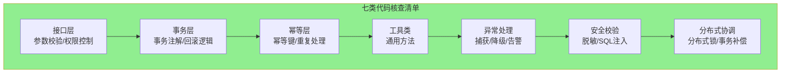
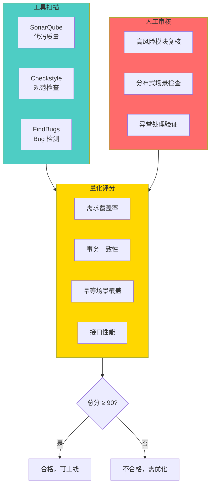
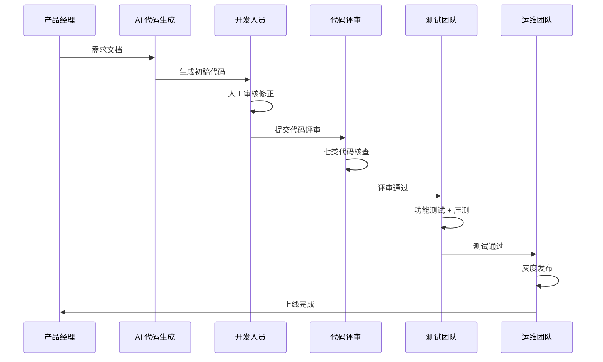
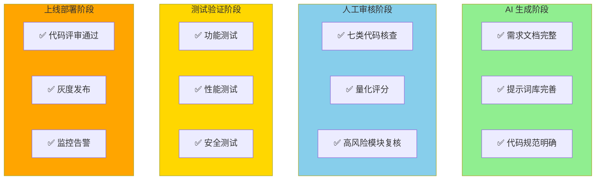
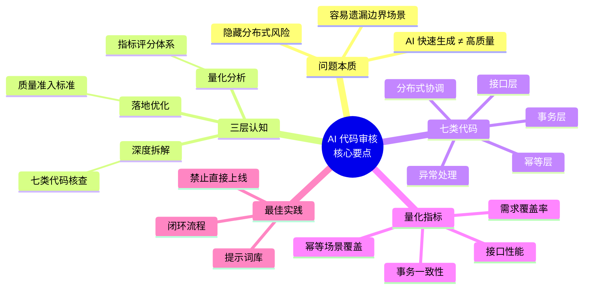

# AI 代码审核与分布式风险

> **场景定位**：代码质量与架构审核技术场景  
> **核心设计要点**：AI 代码质量审核、分布式事务、幂等性、分布式锁、线程池配置、异常处理

---

## 🎯 一句话定位

**AI 生成的分布式代码能直接上线吗？**
```
AI 生成的代码看着规范完整，接口能调通，能返回数据。
但可能藏着事务漏回滚、幂等失效、分布式锁死机的隐患。
直接上线可能导致数据错乱、服务雪崩。
```

**生活化比喻**：就像 AI 帮你写了一份合同，看着条款齐全，但可能藏着法律漏洞，需要律师审核才能签字。

**核心特点**：AI 快速生成 ≠ AI 高质量可生产，需要人工审核。

---

## 💎 核心观点（5 分钟速览版）

> **快速概览**

### 核心观点（3 层认知）

**1. AI 代码链路深度拆解与核查**
```
AI 优势：快速生成常规接口、基础事务模板
AI 劣势：容易遗漏关键场景

需要拆解的七类代码：
1. 接口层：参数校验、权限控制
2. 事务层：事务注解、回滚逻辑
3. 幂等层：幂等键设计、重复调用处理
4. 工具类：通用工具方法
5. 异常处理：异常捕获、降级兜底
6. 安全校验：数据脱敏、SQL 注入防护
7. 分布式协调：分布式锁、事务补偿

生活化比喻：
就像体检，不能只看表面，要检查各个器官
AI 代码 = 看起来健康的人
深度核查 = 全面体检，发现隐藏疾病
```

**2. AI 代码量化质量分析**
```
拒绝凭感觉审核，要用数据说话：

量化指标：
- 需求覆盖率：是否覆盖所有业务场景
- 事务一致性达标率：事务是否正确
- 幂等场景覆盖率：是否处理重复调用
- 接口响应性能：响应时间是否达标
- 重复冗余代码率：是否有重复代码
- 漏洞风险率：是否有安全漏洞
- 分布式高危场景覆盖：是否覆盖分布式场景

生活化比喻：
就像考试成绩，不能凭感觉，要看分数
量化分析 = 给 AI 代码打分
```

**3. AI 代码落地优化**
```
建立质量准入标准：

标准流程：
1. AI 生成初稿
2. 人工审核修正
3. 代码评审（Code Review）
4. 压测验证
5. 上线部署

禁止事项：
❌ 禁止直接上线 AI 原生代码
❌ 禁止只调通接口就上线
❌ 禁止忽略分布式场景风险

生活化比喻：
就像 publishing 流程：
AI 写稿 → 编辑审核 → 校对修改 → 印刷验证 → 发布
```

---

## 🚀 一句话精华（如果只能记住一句）

> **AI 代码审核三层认知 = 深度拆解（七类代码） + 量化分析（指标评分） + 落地优化（准入标准）**

---

## 一、问题本质：AI 快速生成 ≠ 高质量可生产

### ❌ 常见误区

**误区 1：接口能调通就能上线**
```java
// AI 生成的代码
@RestController
public class OrderController {
    
    @PostMapping("/create")
    public Result createOrder(@RequestBody OrderRequest request) {
        // 看起来没问题，接口能调通
        Order order = orderService.create(request);
        return Result.success(order);
    }
}

// 但可能隐藏着：
// ❌ 没有事务注解，部分失败不会回滚
// ❌ 没有幂等处理，重复调用会重复创建
// ❌ 没有参数校验，可能注入恶意数据
// ❌ 没有异常处理，可能抛出未捕获异常
```

**误区 2：加了事务注解就万事大吉**
```java
// AI 生成的代码
@Service
public class OrderService {
    
    @Transactional
    public Order create(OrderRequest request) {
        // 加了事务注解，以为会回滚
        orderMapper.insert(request);
        paymentService.pay(request);
        return orderMapper.selectById(request.getId());
    }
    
    // 但可能隐藏着：
    // ❌ 内部调用事务失效
    // ❌ 异常类型不对，不会回滚
    // ❌ 没有分布式事务，跨服务数据不一致
}
```

**问题分析**：
```
生活化比喻：
AI 代码 = 看起来健康的人
- 表面看起来没问题（接口能调通）
- 但可能藏着隐藏疾病（事务漏回滚、幂等失效）
- 需要全面体检（深度核查）才能发现

技术问题：
- AI 擅长生成常规代码，但容易遗漏边界场景
- 分布式场景复杂，AI 难以全面考虑
- 需要人工审核，识别隐藏风险
```

---

## 二、第一层认知：AI 代码链路深度拆解

### 2.1 七类代码核查清单

**生活化比喻**：
```
就像体检要检查各个器官：
- 心脏（接口层）
- 肝脏（事务层）
- 肺部（幂等层）
- 肾脏（工具类）
- 大脑（异常处理）
- 皮肤（安全校验）
- 神经系统（分布式协调）

每个器官都要检查，不能只看表面
```

#### 1. 接口层核查

**检查项**：
```
✅ 参数校验（@Valid、@NotNull、@Size）
✅ 权限控制（@PreAuthorize、自定义注解）
✅ 请求频率限制（限流注解）
✅ 日志记录（入参、出参、耗时）
✅ 异常统一处理（全局异常处理器）
```

**代码示例**：
```java
@RestController
@RequestMapping("/order")
public class OrderController {
    
    @PostMapping("/create")
    @PreAuthorize("hasRole('USER')") // 权限控制
    @RateLimit(permits = 100, duration = 60) // 限流
    public Result<OrderVO> createOrder(
        @Valid @RequestBody OrderRequest request // 参数校验
    ) {
        log.info("创建订单，请求参数：{}", request);
        
        long startTime = System.currentTimeMillis();
        OrderVO order = orderService.create(request);
        long costTime = System.currentTimeMillis() - startTime;
        
        log.info("创建订单成功，耗时：{}ms", costTime);
        return Result.success(order);
    }
}

// 全局异常处理器
@RestControllerAdvice
public class GlobalExceptionHandler {
    
    @ExceptionHandler(BusinessException.class)
    public Result handleBusinessException(BusinessException e) {
        log.error("业务异常：{}", e.getMessage());
        return Result.error(e.getCode(), e.getMessage());
    }
    
    @ExceptionHandler(Exception.class)
    public Result handleException(Exception e) {
        log.error("系统异常", e);
        return Result.error("系统繁忙，请稍后重试");
    }
}
```

#### 2. 事务层核查

**检查项**：
```
✅ 事务注解（@Transactional）
✅ 回滚配置（rollbackFor = Exception.class）
✅ 传播属性（REQUIRED、REQUIRES_NEW）
✅ 隔离级别（READ_COMMITTED）
✅ 避免内部调用（跨类调用）
✅ 分布式事务（Seata、TCC）
```

**代码示例**：
```java
@Service
public class OrderService {
    
    @Autowired
    private PaymentService paymentService; // 跨类调用
    
    @Transactional(rollbackFor = Exception.class)
    public Order create(OrderRequest request) {
        // 1. 创建订单
        Order order = orderMapper.insert(request);
        
        // 2. 扣减库存（跨类调用，事务生效）
        inventoryService.decrease(request.getProductId(), request.getQuantity());
        
        // 3. 调用支付（跨类调用，事务生效）
        paymentService.pay(order.getId(), request.getAmount());
        
        return order;
    }
}

// 分布式事务（跨服务）
@GlobalTransactional // Seata 分布式事务
public void transfer(Long fromUserId, Long toUserId, BigDecimal amount) {
    // 跨服务转账
    userService.deductBalance(fromUserId, amount);
    userService.addBalance(toUserId, amount);
}
```

#### 3. 幂等层核查

**检查项**：
```
✅ 幂等键设计（业务唯一标识）
✅ 重复调用处理（查数据库、分布式锁）
✅ 状态机控制（订单状态流转）
✅ 唯一索引（数据库层面防重）
```

**代码示例**：
```java
@Service
public class OrderService {
    
    @Autowired
    private StringRedisTemplate redisTemplate;
    
    /**
     * 幂等处理（分布式锁）
     */
    public Order create(OrderRequest request) {
        String idempotentKey = "order:create:" + request.getRequestId();
        
        // 获取分布式锁
        Boolean locked = redisTemplate.opsForValue()
            .setIfAbsent(idempotentKey, "1", 10, TimeUnit.SECONDS);
        
        if (!locked) {
            throw new BusinessException("请求正在处理，请勿重复提交");
        }
        
        try {
            // 检查是否已创建（查数据库）
            Order existOrder = orderMapper.selectByRequestId(request.getRequestId());
            if (existOrder != null) {
                return existOrder; // 已创建，直接返回
            }
            
            // 创建订单
            return doCreate(request);
        } finally {
            // 释放锁
            redisTemplate.delete(idempotentKey);
        }
    }
}
```

#### 4. 异常处理核查

**检查项**：
```
✅ 异常捕获（try-catch-finally）
✅ 降级兜底（返回默认值、缓存数据）
✅ 异常日志（记录完整堆栈）
✅ 异常告警（钉钉、企业微信）
```

**代码示例**：
```java
@Service
public class PaymentService {
    
    @Autowired
    private ThirdPartyPaymentService thirdPartyPaymentService;
    
    public PaymentResult pay(Long orderId, BigDecimal amount) {
        try {
            return thirdPartyPaymentService.pay(orderId, amount);
        } catch (ResourceAccessException e) {
            // 超时异常，降级处理
            log.error("支付接口超时，订单ID：{}", orderId, e);
            return PaymentResult.pending(); // 返回处理中状态
        } catch (Exception e) {
            // 其他异常，记录日志并告警
            log.error("支付失败，订单ID：{}", orderId, e);
            sendAlert(orderId, e); // 发送告警
            throw new BusinessException("支付失败");
        }
    }
    
    private void sendAlert(Long orderId, Exception e) {
        // 发送钉钉告警
        String message = String.format("支付失败告警\n订单ID：%d\n异常：%s", 
            orderId, e.getMessage());
        dingTalkService.send(message);
    }
}
```

#### 5. 分布式协调核查

**检查项**：
```
✅ 分布式锁（Redis SETNX、Redisson）
✅ 锁超时设置（避免死锁）
✅ 锁释放（finally 块）
✅ 事务补偿（失败回滚、重试机制）
```

**代码示例**：
```java
@Service
public class InventoryService {
    
    @Autowired
    private RedissonClient redissonClient;
    
    /**
     * 扣减库存（分布式锁）
     */
    public void decrease(Long productId, Integer quantity) {
        String lockKey = "inventory:lock:" + productId;
        RLock lock = redissonClient.getLock(lockKey);
        
        try {
            // 获取锁（超时时间 10 秒）
            boolean locked = lock.tryLock(10, 30, TimeUnit.SECONDS);
            
            if (!locked) {
                throw new BusinessException("系统繁忙，请稍后重试");
            }
            
            // 扣减库存
            inventoryMapper.decrease(productId, quantity);
            
        } catch (InterruptedException e) {
            Thread.currentThread().interrupt();
            throw new BusinessException("获取锁失败");
        } finally {
            // 释放锁（一定要在 finally）
            if (lock.isHeldByCurrentThread()) {
                lock.unlock();
            }
        }
    }
}
```



---

## 三、第二层认知：AI 代码量化质量分析

### 3.1 量化指标体系

**生活化比喻**：
```
就像考试成绩，不能凭感觉，要看分数：
- 语文：80 分
- 数学：90 分
- 英语：85 分

AI 代码也要量化评分：
- 需求覆盖率：95%
- 事务一致性：100%
- 幂等场景覆盖：80%
```

**量化指标表**：
| 指标 | 权重 | 评分标准 | 目标分数 |
|------|------|----------|----------|
| **需求覆盖率** | 20% | 覆盖所有业务场景 | ≥ 95% |
| **事务一致性达标率** | 20% | 事务正确、回滚完整 | 100% |
| **幂等场景覆盖率** | 15% | 处理重复调用 | ≥ 90% |
| **接口响应性能** | 15% | 响应时间 < 500ms | ≥ 95% |
| **重复冗余代码率** | 10% | 代码复用率高 | ≤ 5% |
| **漏洞风险率** | 10% | 无安全漏洞 | 0% |
| **分布式高危场景覆盖** | 10% | 覆盖分布式场景 | ≥ 85% |

**评分示例**：
```
AI 代码质量评分卡：

需求覆盖率：95% ✅
事务一致性：100% ✅
幂等场景覆盖：80% ⚠️（缺少部分场景）
接口响应性能：98% ✅
重复冗余代码率：3% ✅
漏洞风险率：0% ✅
分布式高危场景覆盖：70% ⚠️（缺少分布式锁）

总分：91 分（合格，但需要优化幂等和分布式场景）
```

### 3.2 量化分析方法

**工具辅助**：
```
代码扫描工具：
- SonarQube：代码质量、漏洞检测
- Checkstyle：代码规范检查
- FindBugs：Bug 检测
- JaCoCo：代码覆盖率

性能测试工具：
- JMeter：接口压测
- Gatling：高并发测试

安全检测工具：
- OWASP ZAP：Web 安全扫描
- SQLMap：SQL 注入检测
```

**人工审核**：
```
重点复核：
- 支付、订单、库存等高风险模块
- 分布式事务、分布式锁场景
- 异常处理、降级兜底逻辑

对照检查：
- 需求文档：是否覆盖所有业务场景
- 数据库设计：是否符合表结构设计
- 历史 bug：是否修复过往问题
- 安全规范：是否符合安全要求
```



---

## 四、第三层认知：AI 代码落地优化

### 4.1 质量准入标准

**标准流程**：


**准入标准**：
| 阶段 | 检查项 | 通过标准 | 责任人 |
|------|--------|----------|--------|
| **AI 生成** | 需求文档完整性 | 100% 覆盖 | 产品经理 |
| **人工审核** | 七类代码核查 | 全部通过 | 开发人员 |
| **代码评审** | 量化评分 | ≥ 90 分 | 技术负责人 |
| **功能测试** | 业务场景覆盖 | 100% | 测试团队 |
| **性能测试** | QPS、延迟 | 达标 | 测试团队 |
| **安全测试** | 漏洞扫描 | 0 漏洞 | 安全团队 |
| **灰度发布** | 小流量验证 | 无异常 | 运维团队 |

### 4.2 禁止事项

**❌ 禁止直接上线 AI 原生代码**：
```
AI 生成的代码必须经过：
1. 人工审核修正
2. 代码评审
3. 压测验证
4. 灰度发布

不能因为"看着没问题"就直接上线
```

**❌ 禁止只调通接口就上线**：
```
接口能调通 ≠ 可以上线
还要检查：
- 事务是否正确
- 幂等是否处理
- 异常是否捕获
- 分布式场景是否考虑
```

**❌ 禁止忽略分布式场景风险**：
```
分布式场景复杂，容易出问题：
- 分布式事务不一致
- 分布式锁死机
- 网络分区
- 数据冲突

必须重点核查分布式场景
```

### 4.3 建立 AI 提示词库

**生活化比喻**：
```
就像给 AI 培训，告诉它公司的规范：
- 业务规则
- 历史坑点
- 架构约束

AI 生成代码时，就会遵循这些规范，减少问题
```

**提示词库内容**：
```markdown
# 后端代码生成规范

## 事务规范
- 所有写操作必须加 @Transactional(rollbackFor = Exception.class)
- 跨类调用，避免内部调用
- 跨服务使用 Seata 分布式事务

## 幂等规范
- 所有创建接口必须处理幂等
- 使用分布式锁（Redis SETNX）
- 使用唯一索引（数据库层面）

## 异常处理规范
- 必须捕获异常，不能抛出未处理异常
- 降级兜底：返回默认值或缓存数据
- 记录完整日志，发送告警

## 分布式锁规范
- 使用 Redisson 分布式锁
- 设置超时时间（避免死锁）
- 在 finally 块释放锁

## 安全规范
- 敏感数据脱敏（手机号、身份证）
- 防止 SQL 注入（使用 MyBatis 参数化查询）
- 防止 XSS（输入过滤、输出编码）
```

---

五、技术深入探讨

### 考点 1：AI 生成的代码为什么不能直接上线？

**方案参考**（30 秒版）：
> "AI 快速生成和 AI 高质量可生产是两个不同的技术维度。AI 擅长生成常规代码，但容易遗漏边界场景，如事务漏回滚、幂等失效、分布式锁未释放等。直接上线可能导致数据错乱、服务雪崩。需要人工审核、代码评审、压测验证后才能上线。"

**加分回答**：
> "我会建立三层认知：1）深度拆解七类代码（接口、事务、幂等、工具类、异常、安全、分布式）；2）量化质量分析（需求覆盖率、事务一致性等指标）；3）建立质量准入标准（AI 生成→人工审核→代码评审→压测→上线）。同时沉淀业务规则、历史坑点做 AI 提示词，提高 AI 生成代码的质量。"

### 考点 2：如何审核 AI 生成的分布式代码？

**方案参考**：
> "审核 AI 生成的分布式代码，我会重点检查：1）分布式事务是否一致（Seata、TCC）；2）分布式锁是否正确（Redisson、超时设置、finally 释放）；3）幂等性是否处理（幂等键、重复调用）；4）异常降级是否兜底（超时、失败处理）；5）事务补偿是否完整（失败回滚、重试机制）。"

**加分回答**：
> "我会用工具辅助审核：SonarQube 检查代码质量，JMeter 压测性能，OWASP ZAP 扫描安全漏洞。同时人工重点复核高风险模块（支付、订单、库存）。对照需求文档、数据库设计、历史 bug，确保覆盖所有场景。最后通过代码评审、压测验证、灰度发布后才能上线。"

### 考点 3：如何提高 AI 生成代码的质量？

**方案参考**：
> "提高 AI 生成代码质量，我会：1）建立 AI 提示词库，包含业务规则、历史坑点、架构约束；2）制定代码规范（事务规范、幂等规范、异常处理规范）；3）人工审核修正，识别隐藏风险；4）代码评审，量化评分；5）沉淀经验，不断优化提示词。"

**加分回答**：
> "我会建立闭环：AI 生成→人工审核→代码评审→压测→上线→反馈。把线上问题、历史 bug 沉淀到提示词库，AI 下次生成时就会避免这些问题。同时建立质量准入标准，禁止直接上线 AI 原生代码，保证代码质量。"

---

## 六、技术追问与深度问题

```mermaid
graph TB
    subgraph Q1["Q1: 如何识别 AI 代码的隐藏风险?"]
        A1[七类代码核查] --> A2[接口/事务/幂等]
        A2 --> A3[异常/安全/分布式]
    end
    
    subgraph Q2["Q2: 如何量化 AI 代码质量?"]
        B1[指标体系] --> B2[需求覆盖率]
        B2 --> B3[事务一致性]
        B3 --> B4[幂等场景覆盖]
    end
    
    subgraph Q3["Q3: 如何建立质量准入标准?"]
        C1[标准流程] --> C2[AI 生成→人工审核]
        C2 --> C3[代码评审→压测]
        C3 --> C4[灰度发布→上线]
    end
    
    subgraph Q4["Q4: 如何提高 AI 生成质量?"]
        D1[提示词库] --> D2[业务规则]
        D2 --> D3[历史坑点]
        D3 --> D4[架构约束]
    end
    
    style Q1 fill:#FFE4E1
    style Q2 fill:#E0FFFF
    style Q3 fill:#F0E68C
    style Q4 fill:#DDA0DD
```



**方案详解**：

**Q1: 如何识别 AI 代码的隐藏风险？**  
**答**：我会拆解七类代码核查：1）接口层（参数校验、权限控制）；2）事务层（事务注解、回滚逻辑）；3）幂等层（幂等键、重复处理）；4）工具类（通用方法）；5）异常处理（捕获、降级、告警）；6）安全校验（脱敏、SQL 注入）；7）分布式协调（分布式锁、事务补偿）。每类代码都有检查清单，逐一核查。

**Q2: 如何量化 AI 代码质量？**  
**答**：建立量化指标体系：需求覆盖率（20%）、事务一致性达标率（20%）、幂等场景覆盖率（15%）、接口响应性能（15%）、重复冗余代码率（10%）、漏洞风险率（10%）、分布式高危场景覆盖（10%）。用工具扫描（SonarQube、JMeter）和人工审核结合，给出量化评分。

**Q3: 如何建立质量准入标准？**  
**答**：建立标准流程：AI 生成初稿→人工审核修正→代码评审（七类代码核查、量化评分）→功能测试 + 压测→安全测试→灰度发布→正式上线。禁止直接上线 AI 原生代码，禁止只调通接口就上线，禁止忽略分布式场景风险。

**Q4: 如何提高 AI 生成质量？**  
**答**：建立 AI 提示词库，包含业务规则、历史坑点、架构约束。AI 生成代码时，会遵循这些规范，减少问题。同时建立闭环：AI 生成→人工审核→代码评审→压测→上线→反馈。把线上问题沉淀到提示词库，不断优化。

---

## 七、生产环境 Checklist



**部署检查清单**：

| 阶段 | 检查项 | 状态 | 生活化比喻 |
|------|--------|------|------------|
| **AI 生成** | 需求文档完整性 | ⬜ | 设计图纸 |
| | 提示词库完善 | ⬜ | 培训教材 |
| | 代码规范明确 | ⬜ | 施工标准 |
| **人工审核** | 七类代码核查 | ⬜ | 全面体检 |
| | 量化评分（≥ 90 分） | ⬜ | 考试成绩 |
| | 高风险模块复核 | ⬜ | 重点检查 |
| **测试验证** | 功能测试（100% 覆盖） | ⬜ | 功能验证 |
| | 性能测试（QPS、延迟） | ⬜ | 压力测试 |
| | 安全测试（0 漏洞） | ⬜ | 安全扫描 |
| **上线部署** | 代码评审通过 | ⬜ | 专家审核 |
| | 灰度发布（小流量验证） | ⬜ | 试点运行 |
| | 监控告警（异常及时发现） | ⬜ | 监控摄像头 |

---

## 八、总结（一句话带走）



### 🎯 一句话总结

> **AI 代码审核三层认知 = 深度拆解（七类代码） + 量化分析（指标评分） + 落地优化（准入标准）**

### 🧠 核心记忆点

1. **为什么 AI 代码不能直接上线？** AI 快速生成 ≠ 高质量，容易遗漏事务漏回滚、幂等失效、分布式锁未释放等隐藏风险。
2. **如何审核？** 拆解七类代码（接口、事务、幂等、工具类、异常、安全、分布式），逐一核查。
3. **如何量化？** 建立指标体系：需求覆盖率、事务一致性、幂等场景覆盖、接口性能等，量化评分。
4. **如何提高质量？** 建立提示词库（业务规则、历史坑点、架构约束），建立闭环流程（AI 生成→人工审核→代码评审→压测→上线→反馈）。

---

**参考视频**：[内卷的琪某人 - 场景提问：AI 生成的分布式接口和事务逻辑你敢直接上线吗？](https://www.douyin.com/video/7640057879961013556)

---

*本文档基于 8 个专家提示词指导改写，遵循深入浅出、生活化比喻、幽默风趣的教学原则。*
