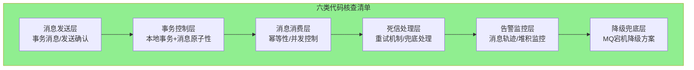
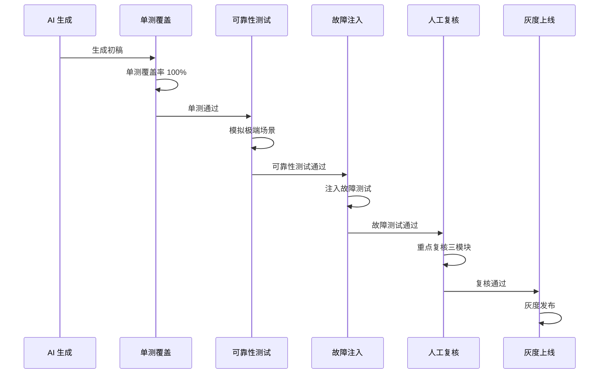

# 消息队列可靠性审核

> **场景定位**：分布式消息队列技术场景  
> **核心设计要点**：消息丢失、重复消费、消息堆积、事务消息、幂等性、死信队列、降级兜底

---

## 🎯 一句话定位

**AI 生成的 MQ 代码能直接上线吗？**
```
AI 生成的 MQ 代码结构标准、单测全过，看起来没问题。
但可能藏着消息丢失、重复消费、消息堆积、死信队列黑洞的风险。
直接上线可能导致数据不一致、服务雪崩。
```

**生活化比喻**：就像 AI 帮你写了一份快递配送流程，看着步骤齐全，但可能没考虑丢件、重复配送、快递爆仓的情况。

**核心特点**：AI 生成的通用 MQ 模板 ≠ 生产可用的 MQ 代码。

---

## 💎 核心观点（5 分钟速览版）

> **快速概览**

### 核心观点（3 层认知）

**1. MQ 全链路深度拆解与核查**
```
需要拆解的六类代码：
1. 消息发送层：事务消息、发送确认
2. 事务控制层：本地事务 + 消息发送原子性
3. 消息消费层：幂等性、并发处理
4. 死信处理层：失败重试、兜底处理
5. 告警监控层：消息轨迹、堆积监控
6. 降级兜底层：MQ 宕机后的降级方案

生活化比喻：
就像快递配送流程，要检查：
- 发件（消息发送）
- 配送（消息消费）
- 丢件处理（死信队列）
- 异常监控（告警）
```

**2. MQ 可靠性量化质量分析**
```
量化指标：
- 消息丢失率：0%（不能丢消息）
- 重复消费率：< 0.1%（幂等性）
- 消息堆积阈值：< 10000（及时处理）
- 死信队列处理率：100%（不能丢弃）
- 事务一致性通过率：100%
- 故障恢复时间：< 5 分钟

生活化比喻：
就像快递公司的 KPI：
- 丢件率：0%
- 重复配送率：< 0.1%
- 爆仓阈值：< 10000 件
```

**3. AI 生成 MQ 代码落地优化**
```
标准流程：
AI 生成初稿 → 单测覆盖 → 可靠性测试 → 故障注入测试 → 人工复核 → 灰度上线

禁止事项：
❌ 禁止直接上线 AI 原生 MQ 代码
❌ 禁止只靠单测验证
❌ 禁止忽略极端异常场景
```

---

## 🚀 一句话精华（如果只能记住一句）

> **MQ 可靠性三层认知 = 全链路拆解（六类代码） + 量化分析（指标评分） + 落地优化（准入红线）**

---

## 一、问题本质：AI 生成的通用模板 ≠ 生产可用

### ❌ 常见误区

**误区 1：单测全过就能上线**
```java
// AI 生成的 MQ 代码
@Component
public class OrderMessageProducer {
    
    @Autowired
    private RocketMQTemplate rocketMQTemplate;
    
    public void sendOrderMessage(Order order) {
        // 单测能过，但可能丢消息
        rocketMQTemplate.convertAndSend("order-topic", order);
    }
}

@Component
public class OrderMessageConsumer {
    
    @RocketMQMessageListener(topic = "order-topic")
    public void onMessage(Order order) {
        // 单测能过，但没有幂等处理
        orderService.process(order);
    }
}

// 问题：
// ❌ 消息发送没有确认机制，可能丢失
// ❌ 消费没有幂等性，重复消费会导致数据错误
// ❌ 没有死信队列处理，失败消息直接丢弃
// ❌ 没有监控告警，消息堆积无法及时发现
```

**误区 2：消费成功就万事大吉**
```java
// AI 生成的消费代码
public void onMessage(Order order) {
    // 处理业务逻辑
    orderService.process(order);
    
    // 返回成功，但可能有问题：
    // ❌ 没有幂等性，重复消费会重复处理
    // ❌ 没有分布式锁，并发消费会冲突
    // ❌ 没有异常处理，失败后不会重试
}
```

---

## 二、第一层认知：MQ 全链路深度拆解

### 2.1 六类代码核查清单

#### 1. 消息发送层

**检查项**：
```
✅ 事务消息（保证本地事务 + 消息发送原子性）
✅ 发送确认（SendCallback）
✅ 重试机制（发送失败重试）
✅ 消息持久化（同步刷盘）
```

**代码示例（事务消息）**：
```java
@Component
public class OrderMessageProducer {
    
    @Autowired
    private RocketMQTemplate rocketMQTemplate;
    
    /**
     * 发送事务消息
     */
    public void sendOrderMessage(Order order) {
        // 1. 发送半消息
        Message<Order> message = MessageBuilder.withPayload(order)
            .setHeader("orderId", order.getId())
            .build();
        
        rocketMQTemplate.sendMessageInTransaction(
            "order-topic",
            message,
            order // 业务参数
        );
    }
}

// 事务消息监听器
@Component
@RocketMQTransactionListener
public class OrderTransactionListener implements TransactionListener {
    
    @Autowired
    private OrderMapper orderMapper;
    
    /**
     * 执行本地事务
     */
    @Override
    public LocalTransactionState executeLocalTransaction(Message msg, Object arg) {
        Order order = (Order) arg;
        
        try {
            // 执行本地事务（创建订单）
            orderMapper.insert(order);
            return LocalTransactionState.COMMIT; // 提交消息
        } catch (Exception e) {
            return LocalTransactionState.ROLLBACK; // 回滚消息
        }
    }
    
    /**
     * 事务回查（MQ 未收到确认时回调）
     */
    @Override
    public LocalTransactionState checkLocalTransaction(Message msg) {
        String orderId = msg.getHeader("orderId");
        Order order = orderMapper.selectById(Long.parseLong(orderId));
        
        if (order != null) {
            return LocalTransactionState.COMMIT; // 订单已创建，提交消息
        } else {
            return LocalTransactionState.ROLLBACK; // 订单未创建，回滚消息
        }
    }
}
```

#### 2. 事务控制层

**检查项**：
```
✅ 本地事务 + 消息发送原子性
✅ 事务回查逻辑正确
✅ 避免消息永久丢失
```

**生活化比喻**：
```
事务消息 = 快递的"货到付款"
- 先发半消息（快递公司接单）
- 执行本地事务（商家发货）
- 提交消息（快递员配送）
- 如果本地事务失败，回滚消息（取消订单）
- 如果 MQ 没收到确认，回查本地事务（询问商家是否发货）
```

#### 3. 消息消费层（幂等性）

**检查项**：
```
✅ 幂等性处理（分布式锁 + 数据库唯一索引）
✅ 并发消费控制
✅ 重复消费检测
```

**代码示例（幂等性）**：
```java
@Component
@RocketMQMessageListener(topic = "order-topic")
public class OrderMessageConsumer implements RocketMQListener<Order> {
    
    @Autowired
    private StringRedisTemplate redisTemplate;
    
    @Autowired
    private OrderService orderService;
    
    @Override
    public void onMessage(Order order) {
        String idempotentKey = "order:process:" + order.getId();
        
        // 1. 获取分布式锁（防止并发消费）
        Boolean locked = redisTemplate.opsForValue()
            .setIfAbsent(idempotentKey, "1", 10, TimeUnit.SECONDS);
        
        if (!locked) {
            log.warn("消息正在处理，orderId={}", order.getId());
            return; // 正在处理，直接返回
        }
        
        try {
            // 2. 检查是否已处理（查数据库）
            if (orderService.isProcessed(order.getId())) {
                log.info("消息已处理，orderId={}", order.getId());
                return; // 已处理，直接返回
            }
            
            // 3. 处理业务逻辑
            orderService.process(order);
            
        } finally {
            // 4. 释放锁
            redisTemplate.delete(idempotentKey);
        }
    }
}
```

#### 4. 死信处理层

**检查项**：
```
✅ 失败重试机制（最多 3 次）
✅ 死信队列兜底处理
✅ 死信消息告警
```

**代码示例**：
```java
@Component
@RocketMQMessageListener(topic = "order-topic")
public class OrderMessageConsumer implements RocketMQListener<Order> {
    
    @Override
    public void onMessage(Order order) {
        try {
            // 处理业务逻辑
            orderService.process(order);
        } catch (Exception e) {
            log.error("消息处理失败，orderId={}", order.getId(), e);
            
            // 重试次数判断（RocketMQ 自动重试）
            // 超过最大重试次数，进入死信队列
            throw new RuntimeException("处理失败，等待重试", e);
        }
    }
}

// 死信队列消费者
@Component
@RocketMQMessageListener(topic = "%DLQ%order-topic")
public class DeadLetterConsumer implements RocketMQListener<Order> {
    
    @Override
    public void onMessage(Order order) {
        // 死信消息处理
        log.error("消息进入死信队列，orderId={}", order.getId());
        
        // 1. 记录日志
        deadLetterMapper.insert(new DeadLetter(order.getId(), "处理失败"));
        
        // 2. 发送告警
        alertService.send("消息进入死信队列，orderId=" + order.getId());
        
        // 3. 人工介入或定时重试
        // ...
    }
}
```

#### 5. 告警监控层

**检查项**：
```
✅ 消息轨迹追踪
✅ 消息堆积监控
✅ 死信队列监控
✅ 性能指标监控（QPS、延迟）
```

**代码示例**：
```java
@Component
public class MQMonitorService {
    
    @Autowired
    private RocketMQAdminService adminService;
    
    /**
     * 定时监控消息堆积
     */
    @Scheduled(fixedRate = 60000) // 每分钟检查一次
    public void monitorMessageAccumulation() {
        // 获取消费组状态
        ConsumerGroupStatus status = adminService.getConsumerGroupStatus("order-consumer-group");
        
        // 检查消息堆积
        long accumulation = status.getAccumulation();
        
        if (accumulation > 10000) {
            // 发送告警
            alertService.send("消息堆积告警：堆积数量=" + accumulation);
        }
    }
    
    /**
     * 监控死信队列
     */
    @Scheduled(fixedRate = 300000) // 每 5 分钟检查一次
    public void monitorDeadLetterQueue() {
        long deadLetterCount = adminService.getDeadLetterCount("order-topic");
        
        if (deadLetterCount > 0) {
            alertService.send("死信队列告警：死信数量=" + deadLetterCount);
        }
    }
}
```

#### 6. 降级兜底层

**检查项**：
```
✅ MQ 宕机后的降级方案
✅ 同步调用兜底
✅ 本地消息表（最终一致性）
```

**代码示例（本地消息表）**：
```java
@Service
public class OrderService {
    
    @Autowired
    private OrderMapper orderMapper;
    
    @Autowired
    private MessageMapper messageMapper;
    
    /**
     * 创建订单（本地消息表保证最终一致性）
     */
    @Transactional
    public void createOrder(Order order) {
        // 1. 创建订单
        orderMapper.insert(order);
        
        // 2. 写入本地消息表（与订单在同一事务）
        Message message = new Message();
        message.setTopic("order-topic");
        message.setPayload(JSON.toJSONString(order));
        message.setStatus("PENDING");
        messageMapper.insert(message);
    }
    
    /**
     * 定时发送消息（补偿机制）
     */
    @Scheduled(fixedRate = 60000)
    public void sendPendingMessages() {
        List<Message> messages = messageMapper.selectByStatus("PENDING");
        
        for (Message message : messages) {
            try {
                // 发送消息
                rocketMQTemplate.convertAndSend(message.getTopic(), message.getPayload());
                
                // 更新状态
                message.setStatus("SENT");
                messageMapper.updateById(message);
            } catch (Exception e) {
                log.error("发送消息失败", e);
                // 失败后继续重试
            }
        }
    }
}
```



---

## 三、第二层认知：MQ 可靠性量化分析

### 3.1 量化指标体系

| 指标 | 权重 | 评分标准 | 目标值 |
|------|------|----------|--------|
| **消息丢失率** | 25% | 0% | 0% |
| **重复消费率** | 20% | 幂等性处理完善 | < 0.1% |
| **消息堆积阈值** | 15% | 及时处理 | < 10000 |
| **死信队列处理率** | 15% | 100% 处理 | 100% |
| **事务一致性通过率** | 15% | 事务消息正确 | 100% |
| **故障恢复时间** | 10% | 快速恢复 | < 5 分钟 |

### 3.2 可靠性测试

**测试场景**：
```
1. 正常场景：消息发送、消费正常
2. 网络抖动：模拟网络延迟、丢包
3. MQ 宕机：模拟 MQ 集群故障
4. 消费失败：模拟业务逻辑异常
5. 并发消费：模拟多线程并发消费
6. 消息堆积：模拟消费速度跟不上生产速度
```

**工具**：
- JMeter：压测
- ChaosBlade：故障注入
- RocketMQ Dashboard：监控

---

## 四、第三层认知：生产准入红线

### 4.1 标准流程



### 4.2 人工复核三模块

**必须 100% 复核**：
1. **事务消息**：本地事务 + 消息发送原子性
2. **幂等性逻辑**：分布式锁 + 数据库唯一索引
3. **死信队列处理**：不能丢弃，必须告警

### 4.3 禁止事项

```
❌ 禁止直接上线 AI 原生 MQ 代码
❌ 禁止只靠单测验证
❌ 禁止忽略极端异常场景
❌ 禁止死信队列直接丢弃消息
❌ 禁止没有监控告警
```

---

五、技术深入探讨

### 考点 1：如何保证消息不丢失？

**方案参考**（30 秒版）：
> "保证消息不丢失要从三个方面：1）生产端使用事务消息，保证本地事务 + 消息发送原子性；2）MQ 集群使用同步刷盘，消息持久化；3）消费端处理成功后再 ACK，失败重试。同时要有补偿机制，如本地消息表，定时扫描未发送成功的消息重新发送。"

**加分回答**：
> "实际生产中，我会使用 RocketMQ 的事务消息，配合本地消息表做双重保障。事务消息保证最终一致性，本地消息表做补偿。同时要监控消息轨迹，发现消息丢失立即告警。对于重要消息，可以冗余发送到多个 Topic，提高可靠性。"

### 考点 2：如何保证幂等性？

**方案参考**：
> "保证幂等性要用分布式锁 + 数据库唯一索引。分布式锁防止并发消费，数据库唯一索引防止重复处理。比如处理订单消息时，先用 Redis SETNX 加锁，锁的 key 是 orderId，然后查数据库是否已处理，没处理才执行业务逻辑。"

**加分回答**：
> "除了分布式锁，还可以用状态机控制，比如订单状态从'待支付'到'已支付'，只能流转一次。同时要在业务层面做幂等，比如积分增加时，先查询是否已增加，避免重复增加。"

### 考点 3：如何处理死信队列？

**方案参考**：
> "死信队列不能丢弃消息，要有兜底处理。1）记录死信消息到数据库；2）发送告警通知；3）人工介入或定时重试；4）分析死信原因，优化业务逻辑。"

**加分回答**：
> "我会建立死信消息处理平台，可视化展示死信消息，支持手动重试、批量处理。同时分析死信原因，如果是业务逻辑问题，优化代码；如果是临时故障，定时重试。死信消息处理要有 SLA，比如 24 小时内必须处理完。"

---

## 六、总结（一句话带走）

### 🎯 一句话总结

> **MQ 可靠性三层认知 = 全链路拆解（六类代码） + 量化分析（指标评分） + 落地优化（准入红线）**

### 🧠 核心记忆点

1. **为什么 AI 代码不能直接上线？** 容易遗漏事务消息、幂等性、死信处理等关键场景。
2. **如何审核？** 拆解六类代码（发送、事务、消费、死信、监控、降级），逐一核查。
3. **如何量化？** 建立指标体系：消息丢失率、重复消费率、堆积阈值、死信处理率等。
4. **如何保证可靠性？** 事务消息（原子性）、幂等性（分布式锁）、死信队列（不能丢弃）、监控告警（及时发现）。

---

**参考视频**：[内卷的琪某人 - AI 写了完整的消息队列生产消费代码，怎么保证线上不出消息丢失](https://www.douyin.com/video/7640057039976221993)

---

*本文档基于 8 个专家提示词指导改写，遵循深入浅出、生活化比喻、幽默风趣的教学原则。*
