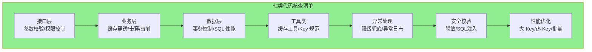
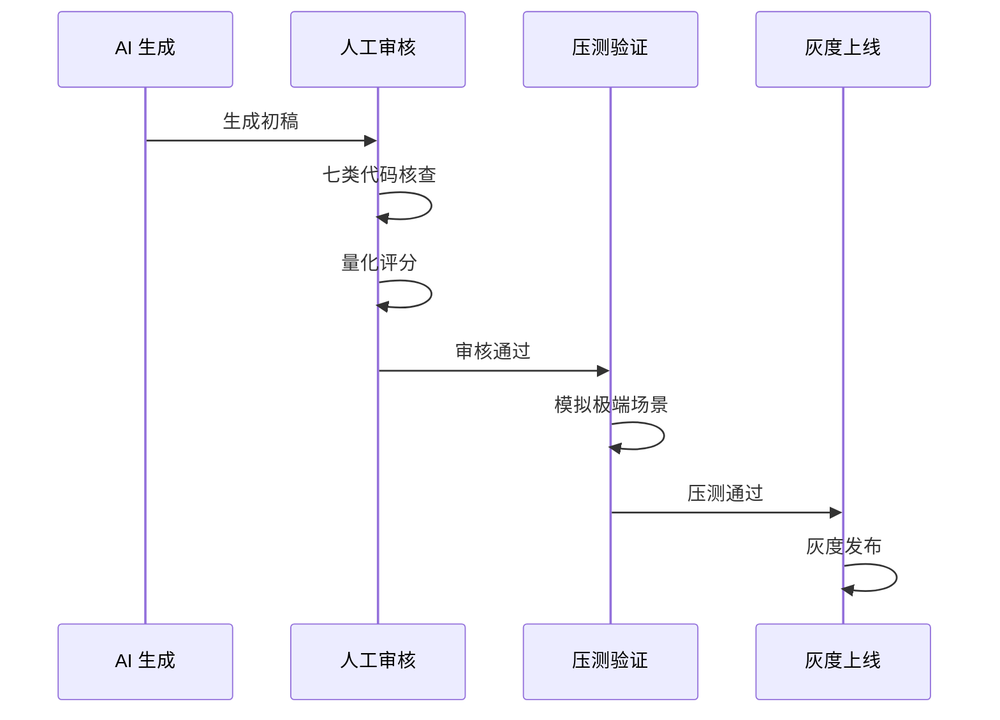

# Redis 缓存代码审核

> **场景定位**：Redis 缓存架构技术场景  
> **核心设计要点**：缓存穿透、缓存击穿、缓存雪崩、数据一致性、大 Key 问题、并发缓存更新

---

## 🎯 一句话定位

**AI 生成的 Redis 缓存代码能直接上线吗？**
```
AI 生成的 Redis 代码看着规范完整，功能能跑通。
但可能藏着缓存穿透、击穿、雪崩的隐患。
可能出现数据不一致、大 Key 拖垮服务的问题。
```

**生活化比喻**：就像 AI 帮你设计了一个仓库管理系统，看着流程齐全，但可能没考虑货物丢失、爆仓、库存对不上的情况。

**核心特点**：AI 快速生成 ≠ 生产可用，需要人工审核。

---

## 💎 核心观点（5 分钟速览版）

> **快速概览**

### 核心观点（3 层认知）

**1. AI 代码链路深度拆解与核查**
```
需要拆解的七类代码：
1. 接口层：参数校验、权限控制
2. 业务层：缓存逻辑、业务处理
3. 数据层：数据库操作、事务控制
4. 工具类：缓存工具、通用方法
5. 异常处理：异常捕获、降级兜底
6. 安全校验：数据脱敏、SQL 注入防护
7. 性能优化：缓存策略、大 Key 检测

生活化比喻：
就像体检要检查各个器官
AI 代码 = 看起来健康的人
深度核查 = 全面体检，发现隐藏疾病
```

**2. AI 代码量化质量分析**
```
量化指标：
- 需求覆盖率：是否覆盖所有业务场景
- 缓存穿透防护：布隆过滤器、空值缓存
- 缓存击穿防护：分布式锁、永不过期
- 缓存雪崩防护：过期时间加随机
- 数据一致性：延迟双删、Canal 订阅
- 大 Key 检测：单 Key < 10KB
- 性能指标：响应时间 < 10ms

生活化比喻：
就像考试成绩，不能凭感觉，要看分数
量化分析 = 给 AI 代码打分
```

**3. AI 代码落地优化**
```
标准流程：
AI 生成初稿 → 人工审核修正 → 代码评审 → 压测验证 → 上线部署

禁止事项：
❌ 禁止直接上线 AI 原生代码
❌ 禁止只调通接口就上线
❌ 禁止忽略缓存三大问题
```

---

## 🚀 一句话精华（如果只能记住一句）

> **Redis 缓存审核三层认知 = 深度拆解（七类代码） + 量化分析（指标评分） + 落地优化（准入标准）**

---

## 一、问题本质：AI 生成的缓存代码容易遗漏关键场景

### ❌ 常见隐患

**隐患 1：缓存穿透**
```java
// AI 生成的代码
public Product getProduct(Long productId) {
    String cacheKey = "product:" + productId;
    
    // 先查缓存
    Product product = redisTemplate.opsForValue().get(cacheKey);
    
    if (product == null) {
        // 缓存未命中，查数据库
        product = productMapper.selectById(productId);
        
        // 写入缓存
        if (product != null) {
            redisTemplate.opsForValue().set(cacheKey, product, 10, TimeUnit.MINUTES);
        }
    }
    
    return product;
}

// 问题：
// ❌ 如果 productId 不存在，每次都查数据库
// ❌ 恶意攻击可以用不存在的 ID 打垮数据库
// ❌ 这就是缓存穿透
```

**隐患 2：缓存击穿**
```java
// AI 生成的代码
public Product getProduct(Long productId) {
    String cacheKey = "product:" + productId;
    
    Product product = redisTemplate.opsForValue().get(cacheKey);
    
    if (product == null) {
        // 缓存未命中，查数据库
        product = productMapper.selectById(productId);
        
        // 问题：高并发下，大量线程同时查数据库
        // ❌ 这就是缓存击穿
    }
    
    return product;
}
```

**隐患 3：缓存雪崩**
```java
// AI 生成的代码
redisTemplate.opsForValue().set(cacheKey, product, 10, TimeUnit.MINUTES);

// 问题：
// ❌ 所有缓存都设置相同的过期时间
// ❌ 同一时刻大量缓存过期
// ❌ 请求全部打到数据库，导致数据库崩溃
// ❌ 这就是缓存雪崩
```

**隐患 4：数据不一致**
```java
// AI 生成的代码
public void updateProduct(Product product) {
    // 更新数据库
    productMapper.updateById(product);
    
    // 删除缓存
    redisTemplate.delete("product:" + product.getId());
}

// 问题：
// ❌ 删除缓存和更新数据库不是原子操作
// ❌ 可能出现数据不一致
```

**隐患 5：大 Key 问题**
```java
// AI 生成的代码
public void saveUserList(List<User> users) {
    // 将整个列表存入一个 Key
    redisTemplate.opsForValue().set("user:list", users);
}

// 问题：
// ❌ 如果 users 很大（如 10 万条），这个 Key 就是大 Key
// ❌ 读写大 Key 会阻塞 Redis，拖垮服务
```

---

## 二、第一层认知：AI 代码链路深度拆解

### 2.1 七类代码核查清单

#### 1. 接口层核查

**检查项**：
```
✅ 参数校验（@NotNull、@Valid）
✅ 权限控制（@PreAuthorize）
✅ 限流保护（@RateLimit）
```

#### 2. 业务层核查（缓存逻辑）

**检查项**：
```
✅ 缓存穿透防护（布隆过滤器、空值缓存）
✅ 缓存击穿防护（分布式锁、永不过期）
✅ 缓存雪崩防护（过期时间加随机）
✅ 数据一致性（延迟双删、Canal 订阅）
✅ 并发缓存更新（分布式锁）
```

**代码示例（完整缓存方案）**：
```java
@Service
public class ProductService {
    
    @Autowired
    private StringRedisTemplate redisTemplate;
    
    @Autowired
    private ProductMapper productMapper;
    
    @Autowired
    private RedissonClient redissonClient;
    
    @Autowired
    private BloomFilterService bloomFilterService;
    
    /**
     * 查询商品（完整缓存方案）
     */
    public Product getProduct(Long productId) {
        String cacheKey = "product:" + productId;
        
        // 1. 布隆过滤器判断（防穿透）
        if (!bloomFilterService.mightContain(productId)) {
            log.info("商品不存在，productId={}", productId);
            return null; // 商品肯定不存在
        }
        
        // 2. 查询缓存
        Product product = redisTemplate.opsForValue().get(cacheKey);
        
        if (product != null) {
            return product; // 缓存命中
        }
        
        // 3. 缓存未命中，加分布式锁（防击穿）
        String lockKey = "product:lock:" + productId;
        RLock lock = redissonClient.getLock(lockKey);
        
        try {
            boolean locked = lock.tryLock(3, TimeUnit.SECONDS);
            
            if (!locked) {
                // 获取锁失败，返回默认值或等待
                return getDefaultProduct(productId);
            }
            
            // 4. 再次查询缓存（双重检查）
            product = redisTemplate.opsForValue().get(cacheKey);
            if (product != null) {
                return product;
            }
            
            // 5. 查询数据库
            product = productMapper.selectById(productId);
            
            if (product != null) {
                // 6. 写入缓存（过期时间加随机值，防雪崩）
                int expireSeconds = 600 + new Random().nextInt(60); // 10 分钟 + 随机 1 分钟
                redisTemplate.opsForValue().set(cacheKey, product, expireSeconds, TimeUnit.SECONDS);
            } else {
                // 7. 空值缓存（防穿透）
                redisTemplate.opsForValue().set(cacheKey, "", 60, TimeUnit.SECONDS);
            }
            
            return product;
            
        } catch (InterruptedException e) {
            Thread.currentThread().interrupt();
            throw new BusinessException("获取锁失败");
        } finally {
            if (lock.isHeldByCurrentThread()) {
                lock.unlock();
            }
        }
    }
    
    /**
     * 更新商品（延迟双删，保证一致性）
     */
    @Transactional
    public void updateProduct(Product product) {
        String cacheKey = "product:" + product.getId();
        
        // 1. 第一次删除缓存
        redisTemplate.delete(cacheKey);
        
        // 2. 更新数据库
        productMapper.updateById(product);
        
        // 3. 延迟双删（异步）
        CompletableFuture.runAsync(() -> {
            try {
                Thread.sleep(500); // 延迟 500ms
                redisTemplate.delete(cacheKey);
            } catch (InterruptedException e) {
                Thread.currentThread().interrupt();
            }
        });
    }
}
```

#### 3. 数据层核查

**检查项**：
```
✅ 事务控制（@Transactional）
✅ SQL 性能（索引、慢查询）
✅ 数据库连接池配置
```

#### 4. 工具类核查

**检查项**：
```
✅ 缓存工具类（统一封装）
✅ Key 命名规范（业务:类型:ID）
✅ 序列化方式（JSON）
```

#### 5. 异常处理核查

**检查项**：
```
✅ Redis 异常捕获（降级到数据库）
✅ 超时处理（设置超时时间）
✅ 异常日志（记录完整堆栈）
```

**代码示例**：
```java
public Product getProduct(Long productId) {
    try {
        return getProductFromCache(productId);
    } catch (RedisException e) {
        log.error("Redis 异常，降级到数据库", e);
        return productMapper.selectById(productId); // 降级
    }
}
```

#### 6. 安全校验核查

**检查项**：
```
✅ 敏感数据脱敏（手机号、身份证）
✅ SQL 注入防护（参数化查询）
✅ XSS 防护（输入过滤）
```

#### 7. 性能优化核查

**检查项**：
```
✅ 大 Key 检测（单 Key < 10KB）
✅ 热 Key 检测（访问频率监控）
✅ 批量操作（pipeline）
✅ 连接池配置（最大连接数、超时时间）
```

**代码示例（避免大 Key）**：
```java
// ❌ 错误做法：大 Key
redisTemplate.opsForValue().set("user:list", userList); // userList 有 10 万条

// ✅ 正确做法：拆分 Key
for (User user : userList) {
    redisTemplate.opsForValue().set("user:" + user.getId(), user);
}

// ✅ 或者使用 Hash
Map<String, User> userMap = userList.stream()
    .collect(Collectors.toMap(User::getId, Function.identity()));
redisTemplate.opsForHash().putAll("user:map", userMap);
```



---

## 三、第二层认知：量化质量分析

### 3.1 量化指标体系

| 指标 | 权重 | 评分标准 | 目标值 |
|------|------|----------|--------|
| **缓存穿透防护** | 20% | 布隆过滤器 + 空值缓存 | 100% |
| **缓存击穿防护** | 20% | 分布式锁 + 双重检查 | 100% |
| **缓存雪崩防护** | 15% | 过期时间加随机 | 100% |
| **数据一致性** | 15% | 延迟双删/Canal | 100% |
| **大 Key 检测** | 10% | 单 Key < 10KB | 0 个大 Key |
| **性能指标** | 10% | 响应时间 < 10ms | ≥ 99% |
| **异常处理** | 10% | 降级兜底完善 | 100% |

### 3.2 测试场景

```
1. 正常场景：缓存命中、未命中
2. 缓存穿透：查询不存在的 Key
3. 缓存击穿：高并发查询同一 Key
4. 缓存雪崩：大量缓存同时过期
5. 数据一致性：更新数据后检查缓存
6. 大 Key 检测：存储大对象
7. Redis 宕机：降级到数据库
```

---

## 四、第三层认知：生产准入红线

### 4.1 标准流程



### 4.2 禁止事项

```
❌ 禁止直接上线 AI 原生代码
❌ 禁止只调通接口就上线
❌ 禁止忽略缓存三大问题（穿透、击穿、雪崩）
❌ 禁止没有降级方案
❌ 禁止存在大 Key
```

---

五、技术深入探讨

### 考点 1：如何解决缓存穿透？

**方案参考**（30 秒版）：
> "缓存穿透是指查询不存在的数据，缓存和数据库都没有。解决方案有两种：1）布隆过滤器，在缓存前加一层过滤器，拦截不存在的 Key；2）空值缓存，查询数据库为空也缓存（TTL 短一些），下次直接返回空。"

**加分回答**：
> "实际生产中，我会结合使用布隆过滤器和空值缓存。布隆过滤器拦截 99% 的不存在 Key，空值缓存兜底。同时要注意布隆过滤器的误判率，定期重建。"

### 考点 2：如何解决缓存击穿？

**方案参考**：
> "缓存击穿是指热点 Key 过期瞬间，大量并发请求打到数据库。解决方案有两种：1）分布式锁，缓存未命中时加锁，只有一个线程查数据库，其他线程等待；2）永不过期，热点数据不设置过期时间，通过后台异步更新。"

**加分回答**：
> "我会用 Redisson 分布式锁，设置超时时间避免死锁。同时使用双重检查，加锁后再查一次缓存。对于超级热点数据，可以用本地缓存（Caffeine）+ Redis 二级缓存。"

### 考点 3：如何解决缓存雪崩？

**方案参考**：
> "缓存雪崩是指大量缓存同时过期，请求全部打到数据库。解决方案：1）过期时间加随机值，避免同一时刻过期；2）多级缓存（本地缓存 + Redis）；3）限流降级，保护数据库。"

**加分回答**：
> "我会给过期时间加一个随机值（如 10 分钟 ± 1 分钟），避免同时过期。同时建立多级缓存架构，本地缓存（Caffeine）抗热点，Redis 做分布式缓存。还要有限流降级方案，Redis 挂了降级到数据库。"

### 考点 4：如何保证缓存和数据库一致性？

**方案参考**：
> "保证一致性有三种方案：1）延迟双删，更新数据库前后各删除一次缓存；2）Canal 订阅 binlog，异步更新缓存；3）强制缓存失效开关，紧急情况下直接查数据库。推荐 Canal 方案，解耦业务代码。"

**加分回答**：
> "我会根据业务场景选择：强一致性场景（如库存）直接查数据库；最终一致性场景（如商品详情）用延迟双删或 Canal。大促期间开启强制缓存失效开关，所有请求走数据库，保证数据正确。"

---

## 六、总结（一句话带走）

### 🎯 一句话总结

> **Redis 缓存审核三层认知 = 深度拆解（七类代码） + 量化分析（指标评分） + 落地优化（准入标准）**

### 🧠 核心记忆点

1. **缓存穿透**：查询不存在的 Key，用布隆过滤器 + 空值缓存解决。
2. **缓存击穿**：热点 Key 过期，用分布式锁 + 双重检查解决。
3. **缓存雪崩**：大量缓存同时过期，用过期时间加随机 + 多级缓存解决。
4. **数据一致性**：用延迟双删、Canal 订阅、强制缓存失效开关解决。
5. **大 Key 问题**：拆分 Key，单 Key < 10KB。

---

**参考视频**：[内卷的琪某人 - AI 帮你生成了 Redis 缓存全套业务代码，你怎么审核验收？](https://www.douyin.com/video/7640055339437657396)

---

*本文档基于 8 个专家提示词指导改写，遵循深入浅出、生活化比喻、幽默风趣的教学原则。*
