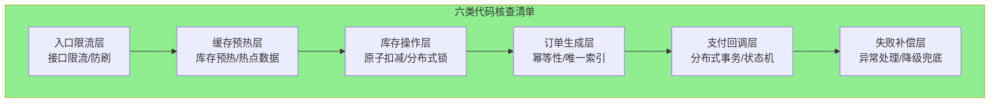
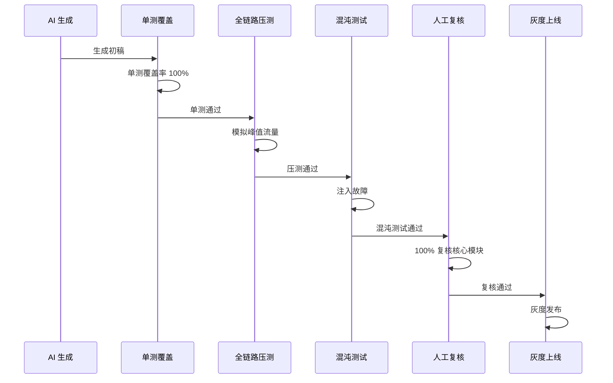

# 秒杀接口生产可用性评估

> **场景定位**：高并发架构技术场景  
> **核心设计要点**：库存原子性、分布式锁、缓存策略、限流降级、分布式事务、混沌测试

---

## 🎯 一句话定位

**AI 生成的秒杀接口能直接上线吗？**
```
AI 生成的秒杀接口结构标准，压测 QPS 达标。
但可能藏着超卖、少卖、死锁、缓存雪崩的风险。
直接上线可能导致数据不一致、服务崩溃。
```

**生活化比喻**：就像 AI 帮你设计了一个抢购活动流程，看着步骤齐全，但可能没考虑黄牛刷单、系统崩溃、库存对不上的情况。

**核心特点**：AI 生成的通用高并发模板 ≠ 生产级高并发代码。

---

## 💎 核心观点（5 分钟速览版）

> **快速概览**

### 核心观点（3 层认知）

**1. 秒杀全链路深度拆解与核查**
```
需要拆解的六类代码：
1. 入口限流层：接口限流、防刷
2. 缓存预热层：库存预热、热点数据
3. 库存操作层：原子扣减、分布式锁
4. 订单生成层：幂等性、唯一索引
5. 支付回调层：分布式事务、状态机
6. 失败补偿层：异常处理、兜底逻辑

生活化比喻：
就像抢购活动，要检查：
- 进场限流（防止踩踏）
- 商品准备（库存充足）
- 购买流程（一人一件）
- 支付确认（钱货两清）
- 失败处理（退款退货）
```

**2. 高并发场景量化质量分析**
```
量化指标：
- 峰值 QPS 承载能力：≥ 10000
- 超卖少卖率：0%
- 缓存命中率：≥ 95%
- 限流触发准确率：100%
- 降级成功率：100%
- 事务一致性通过率：100%
- 异常恢复时间：< 5 分钟

生活化比喻：
就像抢购活动的 KPI：
- 每秒处理人数：≥ 10000
- 超卖率：0%
- 库存准确率：100%
```

**3. AI 高并发代码落地优化**
```
标准流程：
AI 生成初稿 → 单测覆盖 → 全链路压测 → 混沌测试 → 人工复核 → 灰度上线

必须 100% 复核：
1. 库存扣减（原子性）
2. 分布式锁（超时释放）
3. 支付事务（一致性）

禁止事项：
❌ 禁止直接上线 AI 原生代码
❌ 禁止只靠压测验证
❌ 禁止忽略极端场景
```

---

## 🚀 一句话精华（如果只能记住一句）

> **秒杀接口评估三层认知 = 全链路拆解（六类代码） + 量化分析（指标评分） + 落地优化（准入红线）**

---

## 一、问题本质：AI 生成的通用模板 ≠ 生产可用

### ❌ 常见隐患

**隐患 1：库存扣减非原子操作**
```java
// AI 生成的代码（错误示范）
public void decreaseStock(Long productId, Integer quantity) {
    // 1. 查询库存
    Integer stock = redisTemplate.opsForValue().get("stock:" + productId);
    
    // 2. 判断库存
    if (stock < quantity) {
        throw new BusinessException("库存不足");
    }
    
    // 3. 扣减库存
    redisTemplate.opsForValue().set("stock:" + productId, stock - quantity);
}

// 问题：
// ❌ 查询和扣减不是原子操作
// ❌ 高并发下会超卖
// ❌ 应该使用 DEC 原子操作或 Lua 脚本
```

**隐患 2：分布式锁设计不合理**
```java
// AI 生成的代码（错误示范）
public void seckill(Long userId, Long productId) {
    String lockKey = "seckill:lock:" + productId;
    
    // 获取锁
    Boolean locked = redisTemplate.opsForValue()
        .setIfAbsent(lockKey, "1", 10, TimeUnit.SECONDS);
    
    if (!locked) {
        throw new BusinessException("系统繁忙");
    }
    
    try {
        // 扣减库存
        decreaseStock(productId, 1);
    } finally {
        // 释放锁
        redisTemplate.delete(lockKey);
    }
}

// 问题：
// ❌ 锁的粒度太大（整个商品）
// ❌ 应该用细粒度锁（用户 + 商品）
// ❌ 锁超时时间不合理
```

**隐患 3：缓存策略不完善**
```java
// AI 生成的代码（错误示范）
public Product getProduct(Long productId) {
    String cacheKey = "product:" + productId;
    Product product = redisTemplate.opsForValue().get(cacheKey);
    
    if (product == null) {
        product = productMapper.selectById(productId);
        redisTemplate.opsForValue().set(cacheKey, product, 10, TimeUnit.MINUTES);
    }
    
    return product;
}

// 问题：
// ❌ 没有防穿透（布隆过滤器）
// ❌ 没有防击穿（分布式锁）
// ❌ 没有防雪崩（过期时间加随机）
```

**隐患 4：限流降级缺失**
```java
// AI 生成的代码（错误示范）
@PostMapping("/seckill/{productId}")
public Result seckill(@PathVariable Long productId) {
    // 没有限流
    // 没有降级
    seckillService.seckill(getCurrentUserId(), productId);
    return Result.success();
}

// 问题：
// ❌ 没有限流（可能被打垮）
// ❌ 没有降级（服务不可用时无法兜底）
```

**隐患 5：分布式事务不一致**
```java
// AI 生成的代码（错误示范）
@Transactional
public void createOrder(Order order) {
    // 创建订单
    orderMapper.insert(order);
    
    // 调用支付服务（跨服务）
    paymentService.pay(order.getId(), order.getAmount());
    
    // 扣减库存（跨服务）
    inventoryService.decrease(order.getProductId(), 1);
}

// 问题：
// ❌ @Transactional 不能保证跨服务事务一致性
// ❌ 应该使用分布式事务（Seata、TCC）
```

---

## 二、第一层认知：秒杀全链路深度拆解

### 2.1 六类代码核查清单

#### 1. 入口限流层

**检查项**：
```
✅ 接口限流（Sentinel、Guava RateLimiter）
✅ 用户限流（单用户 QPS 限制）
✅ IP 限流（单 IP QPS 限制）
✅ 防刷机制（验证码、黑名单）
```

**代码示例**：
```java
@RestController
public class SeckillController {
    
    @Autowired
    private SeckillService seckillService;
    
    @PostMapping("/seckill/{productId}")
    @SentinelResource(value = "seckill", blockHandler = "seckillBlockHandler")
    public Result seckill(@PathVariable Long productId) {
        Long userId = getCurrentUserId();
        seckillService.seckill(userId, productId);
        return Result.success();
    }
    
    // 限流后的降级处理
    public Result seckillBlockHandler(Long productId, BlockException ex) {
        return Result.error("系统繁忙，请稍后重试");
    }
}

// Sentinel 配置
@PostConstruct
public void initFlowRules() {
    List<FlowRule> rules = new ArrayList<>();
    
    // 秒杀接口限流：10000 QPS
    FlowRule rule = new FlowRule();
    rule.setResource("seckill");
    rule.setGrade(RuleConstant.FLOW_GRADE_QPS);
    rule.setCount(10000);
    rules.add(rule);
    
    FlowRuleManager.loadRules(rules);
}
```

#### 2. 缓存预热层

**检查项**：
```
✅ 库存预热（活动开始前加载到 Redis）
✅ 热点数据预热（商品信息、用户信息）
✅ 本地缓存预热（Caffeine）
```

**代码示例**：
```java
@Component
public class SeckillPreheatTask {
    
    @Autowired
    private StringRedisTemplate redisTemplate;
    
    @Autowired
    private ProductMapper productMapper;
    
    /**
     * 活动开始前预热库存
     */
    @Scheduled(cron = "0 0 0 ? * MON") // 每周一零点
    public void preheatStock() {
        List<Product> seckillProducts = productMapper.selectSeckillProducts();
        
        for (Product product : seckillProducts) {
            String stockKey = "seckill:stock:" + product.getId();
            redisTemplate.opsForValue().set(stockKey, product.getStock().toString());
        }
    }
}
```

#### 3. 库存操作层（核心）

**检查项**：
```
✅ 原子扣减（Lua 脚本、DEC 命令）
✅ 分布式锁（Redisson、细粒度）
✅ 防超卖（数据库唯一索引兜底）
```

**代码示例（Lua 脚本原子扣减）**：
```java
@Service
public class InventoryService {
    
    @Autowired
    private StringRedisTemplate redisTemplate;
    
    @Autowired
    private DefaultRedisScript<Long> redisScript;
    
    /**
     * 原子扣减库存（Lua 脚本）
     */
    public boolean decreaseStock(Long productId, Integer quantity) {
        String stockKey = "seckill:stock:" + productId;
        
        // Lua 脚本（原子操作）
        String luaScript = 
            "local stock = tonumber(redis.call('get', KEYS[1])) " +
            "local quantity = tonumber(ARGV[1]) " +
            "if (stock >= quantity) then " +
            "    return redis.call('decrby', KEYS[1], quantity) " +
            "else " +
            "    return -1 " +
            "end";
        
        redisScript.setScriptText(luaScript);
        redisScript.setResultType(Long.class);
        
        Long result = redisTemplate.execute(redisScript, Collections.singletonList(stockKey), quantity.toString());
        
        return result != null && result >= 0;
    }
}
```

#### 4. 订单生成层

**检查项**：
```
✅ 幂等性（分布式锁 + 数据库唯一索引）
✅ 订单号生成（雪花算法）
✅ 状态机控制（订单状态流转）
```

**代码示例**：
```java
@Service
public class OrderService {
    
    @Autowired
    private StringRedisTemplate redisTemplate;
    
    @Autowired
    private OrderMapper orderMapper;
    
    /**
     * 创建订单（幂等性）
     */
    public Order createOrder(Long userId, Long productId) {
        String idempotentKey = "order:create:" + userId + ":" + productId;
        
        // 获取分布式锁
        Boolean locked = redisTemplate.opsForValue()
            .setIfAbsent(idempotentKey, "1", 10, TimeUnit.SECONDS);
        
        if (!locked) {
            throw new BusinessException("请勿重复下单");
        }
        
        try {
            // 检查是否已创建
            Order existOrder = orderMapper.selectByUserIdAndProductId(userId, productId);
            if (existOrder != null) {
                return existOrder; // 已创建，直接返回
            }
            
            // 创建订单
            Order order = new Order();
            order.setUserId(userId);
            order.setProductId(productId);
            order.setOrderNo(generateOrderNo()); // 雪花算法
            order.setStatus("PENDING");
            orderMapper.insert(order);
            
            return order;
        } finally {
            redisTemplate.delete(idempotentKey);
        }
    }
}
```

#### 5. 支付回调层

**检查项**：
```
✅ 分布式事务（Seata、TCC）
✅ 状态机控制（订单状态流转）
✅ 签名验证（防止伪造回调）
```

**代码示例**：
```java
@Service
public class PaymentCallbackService {
    
    @Autowired
    private OrderMapper orderMapper;
    
    @Autowired
    private InventoryMapper inventoryMapper;
    
    /**
     * 支付回调（分布式事务）
     */
    @GlobalTransactional // Seata 分布式事务
    public void onPaymentCallback(PaymentCallback callback) {
        // 1. 验证签名
        if (!verifySign(callback)) {
            throw new BusinessException("签名验证失败");
        }
        
        // 2. 更新订单状态
        Order order = orderMapper.selectByOrderNo(callback.getOrderNo());
        if (order == null) {
            throw new BusinessException("订单不存在");
        }
        
        if ("PAID".equals(order.getStatus())) {
            return; // 已支付，幂等处理
        }
        
        order.setStatus("PAID");
        orderMapper.updateById(order);
        
        // 3. 扣减库存（跨服务）
        inventoryMapper.decrease(order.getProductId(), 1);
        
        // 4. 发送通知
        notificationService.send(order.getUserId(), "支付成功");
    }
}
```

#### 6. 失败补偿层

**检查项**：
```
✅ 异常处理（try-catch-finally）
✅ 降级兜底（返回默认值）
✅ 补偿机制（定时任务重试）
```

**代码示例**：
```java
@Service
public class SeckillService {
    
    @Autowired
    private InventoryService inventoryService;
    
    @Autowired
    private OrderService orderService;
    
    public SeckillResult seckill(Long userId, Long productId) {
        try {
            // 1. 扣减库存
            boolean decreased = inventoryService.decreaseStock(productId, 1);
            if (!decreased) {
                return SeckillResult.failed("库存不足");
            }
            
            // 2. 创建订单
            Order order = orderService.createOrder(userId, productId);
            
            return SeckillResult.success(order);
            
        } catch (Exception e) {
            log.error("秒杀失败，userId={}, productId={}", userId, productId, e);
            
            // 降级处理
            return SeckillResult.failed("系统繁忙，请稍后重试");
        }
    }
}
```



---

## 三、第二层认知：高并发场景量化分析

### 3.1 量化指标体系

| 指标 | 权重 | 评分标准 | 目标值 |
|------|------|----------|--------|
| **峰值 QPS 承载能力** | 20% | 压测达标 | ≥ 10000 |
| **超卖少卖率** | 20% | 0% | 0% |
| **缓存命中率** | 15% | 热点数据命中 | ≥ 95% |
| **限流触发准确率** | 15% | 超过阈值触发 | 100% |
| **降级成功率** | 10% | 异常时降级 | 100% |
| **事务一致性通过率** | 10% | 分布式事务正确 | 100% |
| **异常恢复时间** | 10% | 快速恢复 | < 5 分钟 |

### 3.2 压测场景

```
1. 正常场景：模拟正常抢购流程
2. 峰值场景：模拟大促峰值流量
3. 超卖场景：高并发扣减库存
4. 缓存失效：模拟 Redis 宕机
5. 限流场景：超过阈值触发限流
6. 降级场景：部分服务不可用
7. 异常场景：网络抖动、服务超时
```

### 3.3 混沌测试

```
故障注入：
- Redis 宕机
- 数据库主从切换
- 网络延迟
- 服务超时
- 磁盘满

验证系统容错能力
```

---

## 四、第三层认知：生产准入红线

### 4.1 标准流程



### 4.2 必须 100% 复核的核心模块

1. **库存扣减**：原子操作、防超卖
2. **分布式锁**：超时释放、细粒度
3. **支付事务**：分布式事务、一致性

### 4.3 禁止事项

```
❌ 禁止直接上线 AI 原生代码
❌ 禁止只靠压测验证
❌ 禁止忽略极端场景
❌ 禁止没有降级方案
❌ 禁止没有混沌测试
```

---

五、技术深入探讨

### 考点 1：如何保证库存扣减的原子性？

**方案参考**（30 秒版）：
> "保证库存扣减的原子性，我会使用 Lua 脚本在 Redis 中执行原子操作。Lua 脚本在 Redis 中是原子执行的，先查询库存，如果充足就扣减，不充足就返回失败。同时数据库层面用唯一索引兜底，防止超卖。"

**加分回答**：
> "实际生产中，我会用 Redis 的 Lua 脚本做预扣减，拦截大部分请求。数据库用乐观锁（UPDATE ... WHERE stock >= quantity）做最终扣减。这样既保证了性能，又保证了数据一致性。"

### 考点 2：如何设计分布式锁？

**方案参考**：
> "设计分布式锁要满足四个条件：1）互斥性（同一时间只有一个线程能获取锁）；2）超时释放（避免死锁）；3）可重入性（同一线程可以多次获取）；4）高性能。我会用 Redisson 实现，设置合理的超时时间（如 30 秒），使用看门狗自动续期。"

**加分回答**：
> "锁的粒度很重要，太粗会影响并发，太细会增加复杂度。秒杀场景，我会用用户 ID + 商品 ID 作为锁的 Key，保证同一用户只能抢购一次同一商品。同时使用 tryLock 设置等待超时，避免长时间阻塞。"

### 考点 3：如何保证分布式事务一致性？

**方案参考**：
> "保证分布式事务一致性，我会使用 Seata 的 AT 模式。Seata 会自动生成回滚日志，如果某个服务失败，会自动回滚其他服务的操作。对于重要场景，可以使用 TCC 模式，手动实现 Try-Confirm-Cancel 三个步骤。"

**加分回答**：
> "实际生产中，我会根据业务场景选择：强一致性用 Seata AT 模式；最终一致性用消息队列（事务消息）；高性能场景用 TCC 模式。同时要有补偿机制，定时任务扫描异常订单，手动修复。"

---

## 六、总结（一句话带走）

### 🎯 一句话总结

> **秒杀接口评估三层认知 = 全链路拆解（六类代码） + 量化分析（指标评分） + 落地优化（准入红线）**

### 🧠 核心记忆点

1. **库存扣减**：用 Lua 脚本保证原子性，数据库唯一索引兜底。
2. **分布式锁**：用 Redisson，设置超时释放，细粒度锁。
3. **缓存策略**：防穿透（布隆过滤器）、防击穿（分布式锁）、防雪崩（过期时间加随机）。
4. **限流降级**：Sentinel 限流，降级兜底方案。
5. **分布式事务**：Seata AT 模式或 TCC 模式，保证一致性。

---

**参考视频**：[内卷的琪某人 - AI 帮你写了高并发秒杀接口，你怎么评估它的生产可用性？](https://www.douyin.com/video/7639677439890705683)

---

*本文档基于 8 个专家提示词指导改写，遵循深入浅出、生活化比喻、幽默风趣的教学原则。*
