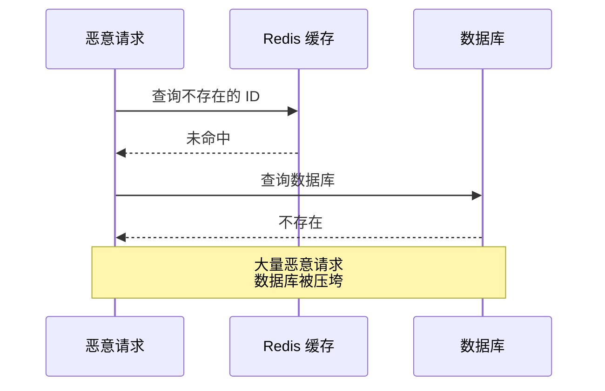
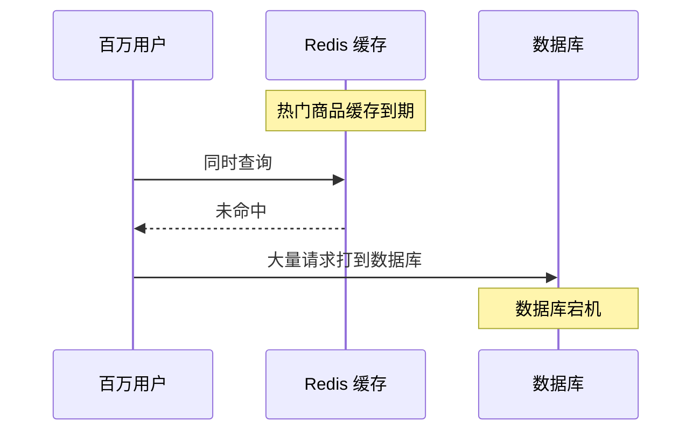
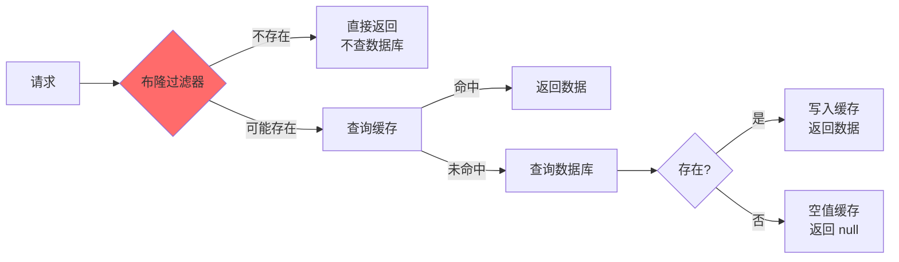
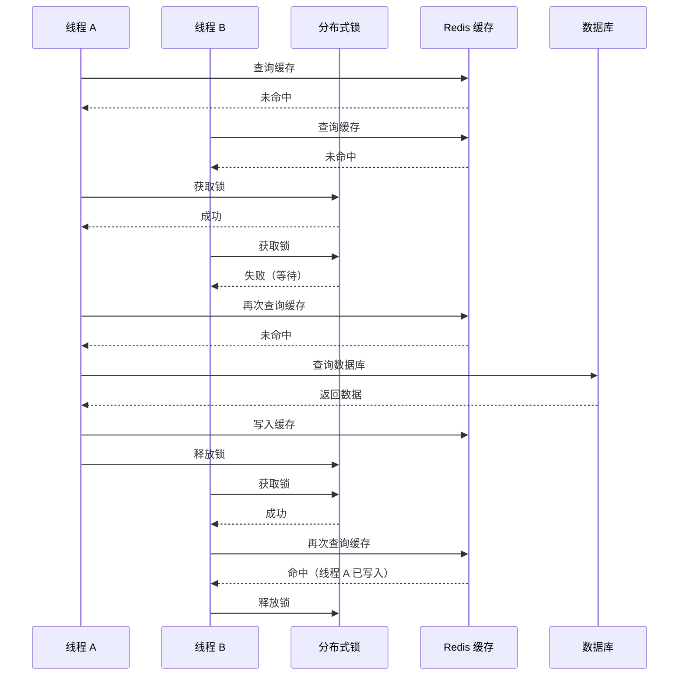
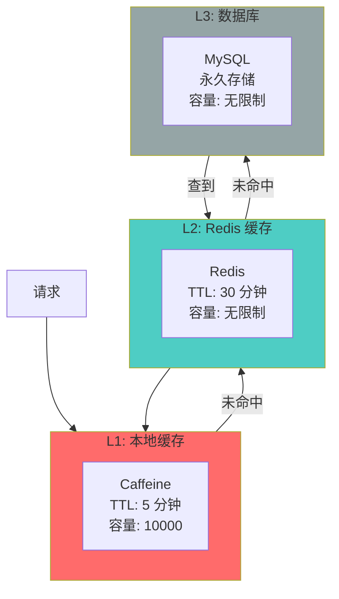

# Redis 缓存异常防护

> **场景定位**：分布式缓存架构技术场景  
> **核心设计要点**：缓存穿透、缓存击穿、缓存雪崩、布隆过滤器、分布式锁、多级缓存

---

## 🎯 一句话定位

**Redis 缓存异常问题是什么？**
```
缓存、过期时间、预热都配置到位，但还是出现致命故障：
- 恶意请求查询不存在的 ID，缓存穿透，数据库 CPU 90%+
- 热门商品缓存到期瞬间，百万级用户同时查询，缓存击穿，数据库宕机
- 多款热门商品缓存集中过期，缓存雪崩，服务瘫痪 1 小时
```

**生活化比喻**：就像你开了一个仓库，加了锁（缓存），设了保质期（过期时间），提前备货（预热），但还是被黄牛刷单（穿透）、抢购时挤爆（击穿）、同时过期导致断货（雪崩）。

**核心特点**：缓存三大问题（穿透、击穿、雪崩）会导致数据库崩溃、服务瘫痪。

---

## 💎 核心观点（5 分钟速览版）

> **快速概览**

### 核心观点（3 层防御）

**1. 缓存基础优化：规避核心隐患**
```
过期时间错开：热门商品 30 分钟 ± 5 分钟，避免集中过期
缓存数据校验：存前校验有效性，避免存储无效数据
避免缓存滥用：禁止缓存高频更新、数据量大、非核心数据

生活化比喻：
过期时间错开 = 不同商品不同保质期，避免同时过期
数据校验 = 入库前检查质量，避免存储废品
避免滥用 = 只缓存核心商品，不缓存所有东西
```

**2. 请求拦截层：拦截异常请求**
```
布隆过滤器：拦截 99% 不存在的 Key（防穿透）
分布式锁：缓存未命中时加锁，防止并发查数据库（防击穿）
限流降级：超过阈值直接拒绝或降级（防雪崩）

生活化比喻：
布隆过滤器 = 门禁系统，不在名单上直接拦住
分布式锁 = 排队机制，一次只进一个人
限流降级 = 限制进场人数，防止踩踏
```

**3. 架构兜底层：多重保障**
```
多级缓存：本地缓存（Caffeine） + Redis + 数据库
降级方案：Redis 挂了降级到数据库
监控告警：缓存命中率、异常请求监控

生活化比喻：
多级缓存 = 三级仓库（本地仓 + 区域仓 + 总仓）
降级方案 = 备用电源，停电时自动切换
监控告警 = 安装监控摄像头，异常立即报警
```

---

## 🚀 一句话精华（如果只能记住一句）

> **Redis 缓存异常防护三层防御 = 基础优化（过期时间错开） + 请求拦截（布隆过滤器/分布式锁/限流） + 架构兜底（多级缓存/降级/监控）**

---

## 一、问题本质：缓存三大致命问题

### 1.1 缓存穿透

**问题描述**：
```
恶意请求查询不存在的商品 ID：
- 缓存中没有（因为商品不存在）
- 数据库中没有（因为商品不存在）
- 每次请求都打到数据库
- 数据库 CPU 飙升到 90%+

生活化比喻：
就像有人不断问前台"张三在哪个部门？"
前台查通讯录没有，查 HR 系统也没有
但问的人太多，前台和 HR 都崩溃了
```



### 1.2 缓存击穿

**问题描述**：
```
热门商品缓存到期瞬间：
- 缓存过期
- 百万级用户同时查询
- 大量请求直接打到数据库
- 数据库宕机

生活化比喻：
就像明星见面会，明星（缓存）突然离开
粉丝（请求）一拥而上，挤爆现场
```



### 1.3 缓存雪崩

**问题描述**：
```
多款热门商品缓存集中过期：
- 同一时刻大量缓存过期
- 请求全部打到数据库
- 数据库崩溃
- 服务瘫痪

生活化比喻：
就像多个明星同时离开
粉丝一拥而上，现场完全失控
```

---

## 二、第一层防御：缓存基础优化

### 2.1 过期时间错开（防雪崩）

**生活化比喻**：
```
过期时间错开 = 不同商品不同保质期
- 热门商品 A：30 分钟 + 2 分钟 = 32 分钟
- 热门商品 B：30 分钟 - 3 分钟 = 27 分钟
- 热门商品 C：30 分钟 + 5 分钟 = 35 分钟

避免同一时刻大量缓存过期
```

**代码示例**：
```java
@Service
public class ProductService {
    
    @Autowired
    private StringRedisTemplate redisTemplate;
    
    public Product getProduct(Long productId) {
        String cacheKey = "product:" + productId;
        
        Product product = redisTemplate.opsForValue().get(cacheKey);
        
        if (product == null) {
            product = productMapper.selectById(productId);
            
            if (product != null) {
                // 过期时间加随机值（30 分钟 ± 5 分钟）
                int baseSeconds = 1800; // 30 分钟
                int randomSeconds = new Random().nextInt(600) - 300; // -5 到 +5 分钟
                int expireSeconds = baseSeconds + randomSeconds;
                
                redisTemplate.opsForValue().set(cacheKey, product, expireSeconds, TimeUnit.SECONDS);
            }
        }
        
        return product;
    }
}
```

### 2.2 缓存数据校验（防穿透）

**代码示例**：
```java
public Product getProduct(Long productId) {
    String cacheKey = "product:" + productId;
    
    // 查询缓存
    String cacheValue = redisTemplate.opsForValue().get(cacheKey);
    
    if (cacheValue != null) {
        // 空值缓存（防穿透）
        if ("".equals(cacheValue)) {
            return null; // 商品不存在
        }
        
        // 反序列化
        Product product = JSON.parseObject(cacheValue, Product.class);
        
        // 校验数据有效性
        if (product != null && product.isValid()) {
            return product;
        }
        
        // 数据无效，删除缓存
        redisTemplate.delete(cacheKey);
    }
    
    // 缓存未命中，查数据库
    Product product = productMapper.selectById(productId);
    
    if (product != null) {
        // 写入缓存
        redisTemplate.opsForValue().set(cacheKey, JSON.toJSONString(product), 30, TimeUnit.MINUTES);
    } else {
        // 空值缓存（防穿透，TTL 短一些）
        redisTemplate.opsForValue().set(cacheKey, "", 60, TimeUnit.SECONDS);
    }
    
    return product;
}
```

### 2.3 避免缓存滥用

**原则**：
```
✅ 适合缓存：
- 读多写少
- 数据量适中
- 核心业务

❌ 不适合缓存：
- 高频更新（如股票价格）
- 数据量大（如视频文件）
- 非核心业务（如日志）
```

---

## 三、第二层防御：请求拦截层

### 3.1 布隆过滤器（防穿透）

**生活化比喻**：
```
布隆过滤器 = 门禁系统
- 存储所有存在的商品 ID
- 查询时先检查布隆过滤器
- 不在过滤器中，直接返回（不查数据库）
- 在过滤器中，再查缓存/数据库

优点：拦截 99% 不存在的 Key
缺点：有误判（可能误认为存在），但不会误认为不存在
```

**代码示例**：
```java
@Component
public class BloomFilterService {
    
    @Autowired
    private ProductMapper productMapper;
    
    private BloomFilter<Integer> bloomFilter;
    
    @PostConstruct
    public void init() {
        // 创建布隆过滤器（预期元素数量 100 万，误判率 1%）
        bloomFilter = BloomFilter.create(
            Funnels.integerFunnel(),
            1000000,
            0.01
        );
        
        // 加载所有存在的商品 ID
        List<Integer> productIds = productMapper.selectAllProductIds();
        for (Integer productId : productIds) {
            bloomFilter.put(productId);
        }
    }
    
    /**
     * 判断商品 ID 是否可能存在
     */
    public boolean mightContain(Integer productId) {
        return bloomFilter.mightContain(productId);
    }
    
    /**
     * 新增商品时添加到布隆过滤器
     */
    public void addProduct(Integer productId) {
        bloomFilter.put(productId);
    }
}

@Service
public class ProductService {
    
    @Autowired
    private BloomFilterService bloomFilterService;
    
    @Autowired
    private StringRedisTemplate redisTemplate;
    
    public Product getProduct(Long productId) {
        // 1. 布隆过滤器判断
        if (!bloomFilterService.mightContain(productId.intValue())) {
            log.info("商品不存在，productId={}", productId);
            return null; // 直接返回，不查数据库
        }
        
        // 2. 查询缓存
        String cacheKey = "product:" + productId;
        String cacheValue = redisTemplate.opsForValue().get(cacheKey);
        
        if (cacheValue != null) {
            if ("".equals(cacheValue)) {
                return null; // 空值缓存
            }
            return JSON.parseObject(cacheValue, Product.class);
        }
        
        // 3. 查询数据库
        Product product = productMapper.selectById(productId);
        
        if (product != null) {
            redisTemplate.opsForValue().set(cacheKey, JSON.toJSONString(product), 30, TimeUnit.MINUTES);
        } else {
            redisTemplate.opsForValue().set(cacheKey, "", 60, TimeUnit.SECONDS);
        }
        
        return product;
    }
}
```



### 3.2 分布式锁（防击穿）

**生活化比喻**：
```
分布式锁 = 排队机制
- 缓存未命中时，加锁
- 只有一个线程查数据库
- 其他线程等待或返回默认值
- 查到数据后写入缓存

就像：
- 只有一个服务员去仓库取货
- 其他服务员在门口等
- 取到货后，大家一起用
```

**代码示例**：
```java
@Service
public class ProductService {
    
    @Autowired
    private RedissonClient redissonClient;
    
    @Autowired
    private StringRedisTemplate redisTemplate;
    
    public Product getProduct(Long productId) {
        String cacheKey = "product:" + productId;
        
        // 1. 查询缓存
        Product product = redisTemplate.opsForValue().get(cacheKey);
        if (product != null) {
            return product;
        }
        
        // 2. 缓存未命中，加分布式锁
        String lockKey = "product:lock:" + productId;
        RLock lock = redissonClient.getLock(lockKey);
        
        try {
            boolean locked = lock.tryLock(3, TimeUnit.SECONDS);
            
            if (!locked) {
                // 获取锁失败，返回默认值或等待
                return getDefaultProduct(productId);
            }
            
            // 3. 再次查询缓存（双重检查）
            product = redisTemplate.opsForValue().get(cacheKey);
            if (product != null) {
                return product;
            }
            
            // 4. 查询数据库
            product = productMapper.selectById(productId);
            
            if (product != null) {
                // 5. 写入缓存
                redisTemplate.opsForValue().set(cacheKey, JSON.toJSONString(product), 30, TimeUnit.MINUTES);
            }
            
            return product;
            
        } catch (InterruptedException e) {
            Thread.currentThread().interrupt();
            throw new BusinessException("获取锁失败");
        } finally {
            if (lock.isHeldByCurrentThread()) {
                lock.unlock();
            }
        }
    }
}
```



### 3.3 限流降级（防雪崩）

**代码示例**：
```java
@RestController
public class ProductController {
    
    @Autowired
    private ProductService productService;
    
    @GetMapping("/product/{productId}")
    @SentinelResource(value = "getProduct", blockHandler = "productBlockHandler")
    public Result<Product> getProduct(@PathVariable Long productId) {
        Product product = productService.getProduct(productId);
        return Result.success(product);
    }
    
    // 限流后的降级处理
    public Result<Product> productBlockHandler(Long productId, BlockException ex) {
        log.warn("商品查询限流，productId={}", productId);
        return Result.error("系统繁忙，请稍后重试");
    }
}

// Sentinel 配置
@PostConstruct
public void initFlowRules() {
    List<FlowRule> rules = new ArrayList<>();
    
    // 商品查询接口限流：10000 QPS
    FlowRule rule = new FlowRule();
    rule.setResource("getProduct");
    rule.setGrade(RuleConstant.FLOW_GRADE_QPS);
    rule.setCount(10000);
    rules.add(rule);
    
    FlowRuleManager.loadRules(rules);
}
```

---

## 四、第三层防御：架构兜底层

### 4.1 多级缓存

**生活化比喻**：
```
多级缓存 = 三级仓库
- L1 本地缓存（Caffeine）：本地仓，最快，容量小
- L2 Redis 缓存：区域仓，快，容量中等
- L3 数据库：总仓，慢，容量大

热点数据：本地缓存直接返回
普通数据：Redis 缓存返回
冷数据：数据库查询
```

**代码示例**：
```java
@Service
public class ProductService {
    
    private Cache<Long, Product> localCache = Caffeine.newBuilder()
        .maximumSize(10000)
        .expireAfterWrite(5, TimeUnit.MINUTES)
        .build();
    
    @Autowired
    private StringRedisTemplate redisTemplate;
    
    @Autowired
    private ProductMapper productMapper;
    
    public Product getProduct(Long productId) {
        // L1: 本地缓存
        Product product = localCache.getIfPresent(productId);
        if (product != null) {
            return product;
        }
        
        // L2: Redis 缓存
        String cacheKey = "product:" + productId;
        String cacheValue = redisTemplate.opsForValue().get(cacheKey);
        if (cacheValue != null) {
            product = JSON.parseObject(cacheValue, Product.class);
            localCache.put(productId, product); // 回写本地缓存
            return product;
        }
        
        // L3: 数据库
        product = productMapper.selectById(productId);
        if (product != null) {
            redisTemplate.opsForValue().set(cacheKey, JSON.toJSONString(product), 30, TimeUnit.MINUTES);
            localCache.put(productId, product); // 回写本地缓存
        }
        
        return product;
    }
}
```



### 4.2 降级方案

**代码示例**：
```java
@Service
public class ProductService {
    
    @Autowired
    private StringRedisTemplate redisTemplate;
    
    public Product getProduct(Long productId) {
        try {
            return getProductFromCache(productId);
        } catch (RedisException e) {
            log.error("Redis 异常，降级到数据库", e);
            return productMapper.selectById(productId); // 降级
        }
    }
    
    private Product getProductFromCache(Long productId) {
        String cacheKey = "product:" + productId;
        String cacheValue = redisTemplate.opsForValue().get(cacheKey);
        
        if (cacheValue != null) {
            return JSON.parseObject(cacheValue, Product.class);
        }
        
        return productMapper.selectById(productId);
    }
}
```

### 4.3 监控告警

**代码示例**：
```java
@Component
public class CacheMonitorService {
    
    @Autowired
    private StringRedisTemplate redisTemplate;
    
    /**
     * 定时监控缓存命中率
     */
    @Scheduled(fixedRate = 60000) // 每分钟检查一次
    public void monitorCacheHitRate() {
        // 获取缓存统计信息
        Properties info = redisTemplate.getRequiredConnectionFactory()
            .getConnection()
            .info();
        
        long hits = Long.parseLong(info.getProperty("keyspace_hits"));
        long misses = Long.parseLong(info.getProperty("keyspace_misses"));
        
        double hitRate = (double) hits / (hits + misses);
        
        if (hitRate < 0.8) { // 命中率低于 80%
            alertService.send("缓存命中率告警：" + hitRate);
        }
    }
    
    /**
     * 监控异常请求
     */
    @Scheduled(fixedRate = 60000)
    public void monitorAbnormalRequests() {
        // 统计不存在的 Key 查询次数
        long abnormalCount = getAbnormalRequestCount();
        
        if (abnormalCount > 1000) { // 超过 1000 次
            alertService.send("异常请求告警：" + abnormalCount);
        }
    }
}
```

---

五、技术深入探讨

### 考点 1：如何解决缓存穿透？

**方案参考**（30 秒版）：
> "缓存穿透是指查询不存在的数据，缓存和数据库都没有。解决方案有两种：1）布隆过滤器，在缓存前加一层过滤器，拦截 99% 不存在的 Key；2）空值缓存，查询数据库为空也缓存（TTL 短一些），下次直接返回空。"

**加分回答**：
> "实际生产中，我会结合使用布隆过滤器和空值缓存。布隆过滤器拦截 99% 的不存在 Key，空值缓存兜底。同时要注意布隆过滤器的误判率，定期重建。对于恶意攻击，还要配合限流降级。"

### 考点 2：如何解决缓存击穿？

**方案参考**：
> "缓存击穿是指热点 Key 过期瞬间，大量并发请求打到数据库。解决方案有两种：1）分布式锁，缓存未命中时加锁，只有一个线程查数据库，其他线程等待；2）永不过期，热点数据不设置过期时间，通过后台异步更新。"

**加分回答**：
> "我会用 Redisson 分布式锁，设置超时时间避免死锁。同时使用双重检查，加锁后再查一次缓存。对于超级热点数据，可以用本地缓存（Caffeine）+ Redis 二级缓存，抗住高并发。"

### 考点 3：如何解决缓存雪崩？

**方案参考**：
> "缓存雪崩是指大量缓存同时过期，请求全部打到数据库。解决方案：1）过期时间加随机值，避免同一时刻过期；2）多级缓存（本地缓存 + Redis）；3）限流降级，保护数据库。"

**加分回答**：
> "我会给过期时间加一个随机值（如 30 分钟 ± 5 分钟），避免同时过期。同时建立多级缓存架构，本地缓存（Caffeine）抗热点，Redis 做分布式缓存。还要有限流降级方案，Redis 挂了降级到数据库。"

---

## 六、总结（一句话带走）

### 🎯 一句话总结

> **Redis 缓存异常防护三层防御 = 基础优化（过期时间错开） + 请求拦截（布隆过滤器/分布式锁/限流） + 架构兜底（多级缓存/降级/监控）**

### 🧠 核心记忆点

1. **缓存穿透**：查询不存在的 Key，用布隆过滤器 + 空值缓存解决。
2. **缓存击穿**：热点 Key 过期，用分布式锁 + 双重检查解决。
3. **缓存雪崩**：大量缓存同时过期，用过期时间加随机 + 多级缓存解决。
4. **多级缓存**：本地缓存（Caffeine）+ Redis + 数据库，三级防护。
5. **降级方案**：Redis 挂了降级到数据库，保证服务可用。

---

**参考视频**：[内卷的琪某人 - 场景提问：分布式缓存（Redis）怎么防止异常问题？](https://www.douyin.com/video/7639300533689355562)

---

*本文档基于 8 个专家提示词指导改写，遵循深入浅出、生活化比喻、幽默风趣的教学原则。*
