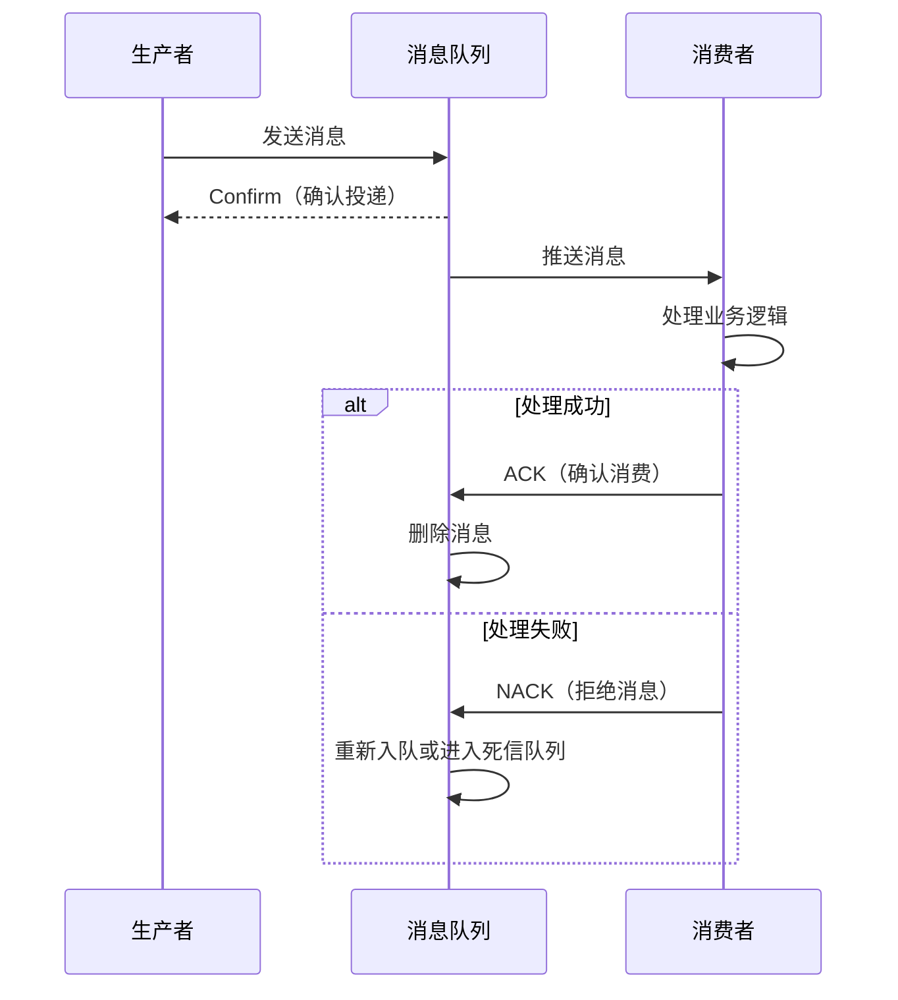

# 消息队列防丢失与防重复

> **场景定位**：分布式消息队列技术场景  
> **核心设计要点**：消息丢失、重复消费、幂等性、死信队列、消息补偿、全链路保障

---

## 🎯 一句话定位

**消息队列消息丢失和重复消费问题是什么？**
```
持久化、ACK、幂等都配置到位，但还是出现问题：
- 支付成功，但用户没收到通知
- 库存未扣减
- 部分订单被重复扣减库存，出现超卖
- 财务对账和库存盘点严重异常
```

**生活化比喻**：就像快递系统，虽然设置了签收确认（ACK）、包裹追踪（持久化）、防重复签收（幂等），但还是出现丢件、重复配送的问题。

**核心特点**：消息丢失和重复消费会导致数据不一致、业务异常。

---

## 💎 核心观点（5 分钟速览版）

> **快速概览**

### 核心观点（3 层防御）

**1. 基础配置兜底：规避核心丢失风险**
```
生产者优化：
- 开启消息确认机制（Publisher Confirm）
- 失败时触发重试和日志告警
- 确保消息成功投递到交换机

消息队列配置：
- 交换机、队列、消息全部开启持久化
- 集群部署，提升可用性
- 避免 MQ 重启、宕机导致消息丢失

消费者规范：
- 手动 ACK（不要自动 ACK）
- 确认消费完成后再提交 ACK
- 禁止消费前提前 ACK

生活化比喻：
生产者确认 = 快递发货确认
持久化 = 包裹有追踪记录
手动 ACK = 签收后才算完成
```

**2. 幂等与重试：解决重复消费问题**
```
幂等细化：
- 按业务场景设计幂等标识
- 数据库唯一索引 + Redis 缓存
- 杜绝重复消费导致的数据错乱

合理重试：
- 消费失败时有限次数重试
- 重试间隔采用退避策略（1s、2s、4s）
- 避免频繁重试占用资源

监控堆积：
- 监控消息队列堆积情况
- 及时扩容消费者
- 避免消息积压过久导致消费超时

生活化比喻：
幂等 = 防重复签收（一人只能签一次）
重试 = 配送失败重新配送（最多 3 次）
监控堆积 = 监控快递站点，爆仓立即处理
```

**3. 异常兜底：应对极端场景**
```
死信队列：
- 重试失败的消息进入死信队列
- 人工介入或定时重试
- 不能丢弃消息

消息补偿：
- 定时任务扫描未处理消息
- 本地消息表保证最终一致性
- 对账机制发现异常数据

监控告警：
- 消息丢失告警
- 重复消费告警
- 堆积告警

生活化比喻：
死信队列 = 疑难件处理中心
消息补偿 = 定时盘点，发现丢件立即补发
监控告警 = 安装监控，异常立即报警
```

---

## 🚀 一句话精华（如果只能记住一句）

> **消息队列防丢失防重复三层防御 = 基础配置（确认/持久化/手动 ACK） + 幂等重试（唯一索引/退避重试/监控堆积） + 异常兜底（死信队列/补偿机制/监控告警）**

---

## 一、问题本质：消息流转的隐性风险

### ❌ 常见误区

**误区 1：开启持久化就够了**
```
问题：
- 持久化只能防止 MQ 宕机丢消息
- 无法防止生产者投递失败
- 无法防止消费者消费失败

解决：
- 生产者确认机制
- 消费者手动 ACK
- 全链路保障
```

**误区 2：手动 ACK 就不会丢消息**
```
问题：
- 消费前提前 ACK，消费失败消息丢失
- 消费后忘记 ACK，消息重复消费
- 网络抖动导致 ACK 失败

解决：
- 消费成功后再 ACK
- 幂等性处理重复消费
- 异常时进入死信队列
```

**误区 3：做了幂等就不会重复消费**
```
问题：
- 幂等标识设计不合理
- 并发场景下幂等失效
- 没有数据库唯一索引兜底

解决：
- 数据库唯一索引 + Redis 分布式锁
- 细粒度幂等标识（订单 ID + 操作类型）
- 状态机控制
```

---

## 二、第一层防御：基础配置兜底

### 2.1 生产者优化（消息确认）

**代码示例（RabbitMQ 生产者确认）**：
```java
@Configuration
public class RabbitMQConfig {
    
    @Bean
    public RabbitTemplate rabbitTemplate(ConnectionFactory connectionFactory) {
        RabbitTemplate template = new RabbitTemplate(connectionFactory);
        
        // 开启 publisher confirm 机制
        template.setConfirmCallback((correlationData, ack, cause) -> {
            if (ack) {
                log.info("消息成功投递到交换机");
            } else {
                log.error("消息投递到交换机失败：{}", cause);
                // 重试或记录到数据库
                retryOrSaveToDB(correlationData);
            }
        });
        
        // 开启 publisher return 机制（路由失败时回调）
        template.setReturnCallback((message, replyCode, replyText, exchange, routingKey) -> {
            log.error("消息路由失败：{} {} {}", replyCode, replyText, routingKey);
            // 重试或记录到数据库
        });
        
        //  mandatory 设置为 true，消息无法路由时返回给生产者
        template.setMandatory(true);
        
        return template;
    }
}

@Service
public class OrderMessageProducer {
    
    @Autowired
    private RabbitTemplate rabbitTemplate;
    
    @Autowired
    private MessageMapper messageMapper;
    
    public void sendOrderMessage(Order order) {
        // 创建消息
        Message message = new Message();
        message.setOrderId(order.getId());
        message.setType("ORDER_CREATED");
        message.setPayload(JSON.toJSONString(order));
        message.setStatus("PENDING");
        
        // 保存到数据库（本地消息表）
        messageMapper.insert(message);
        
        // 发送消息
        CorrelationData correlationData = new CorrelationData();
        correlationData.setId(message.getId().toString());
        
        rabbitTemplate.convertAndSend(
            "order-exchange",
            "order.created",
            message,
            correlationData
        );
        
        // 更新状态为发送中
        message.setStatus("SENDING");
        messageMapper.updateById(message);
    }
    
    /**
     * 定时扫描发送失败的消息（补偿机制）
     */
    @Scheduled(fixedRate = 60000) // 每分钟扫描一次
    public void compensateFailedMessages() {
        List<Message> messages = messageMapper.selectByStatus("SENDING");
        
        for (Message message : messages) {
            // 检查是否超时（如 5 分钟）
            if (System.currentTimeMillis() - message.getCreatedAt().getTime() > 5 * 60 * 1000) {
                // 超时未确认，重新发送
                rabbitTemplate.convertAndSend(
                    "order-exchange",
                    "order.created",
                    message.getPayload()
                );
                
                // 更新重试次数
                message.setRetryCount(message.getRetryCount() + 1);
                messageMapper.updateById(message);
            }
        }
    }
}
```

### 2.2 消息队列配置（持久化 + 集群）

**代码示例**：
```java
@Configuration
public class RabbitMQQueueConfig {
    
    /**
     *  durable = true：队列持久化
     */
    @Bean
    public Queue orderQueue() {
        return QueueBuilder.durable("order-queue")
            .withArgument("x-message-ttl", 86400000) // 消息 TTL：24 小时
            .withArgument("x-max-length", 1000000) // 最大长度：100 万
            .build();
    }
    
    /**
     * 交换机持久化
     */
    @Bean
    public DirectExchange orderExchange() {
        return new DirectExchange("order-exchange", true, false);
    }
    
    /**
     * 绑定
     */
    @Bean
    public Binding orderBinding(Queue orderQueue, DirectExchange orderExchange) {
        return BindingBuilder.bind(orderQueue).to(orderExchange).with("order.created");
    }
}

// 消息持久化
// 默认情况下，RabbitMQ 发送的消息是持久的
Message message = new Message(
    payload.getBytes(),
    MessagePropertiesBuilder.newInstance()
        .setDeliveryMode(MessageDeliveryMode.PERSISTENT) // 消息持久化
        .build()
);
```

### 2.3 消费者规范（手动 ACK）

**代码示例**：
```java
@Component
@RabbitListener(queues = "order-queue")
public class OrderMessageConsumer {
    
    @Autowired
    private OrderService orderService;
    
    @RabbitHandler
    public void onMessage(Message message, Channel channel) throws IOException {
        long deliveryTag = message.getMessageProperties().getDeliveryTag();
        
        try {
            // 解析消息
            String payload = new String(message.getBody());
            Order order = JSON.parseObject(payload, Order.class);
            
            // 处理业务逻辑
            orderService.processOrder(order);
            
            // 手动 ACK（消费成功后再确认）
            channel.basicAck(deliveryTag, false);
            
        } catch (Exception e) {
            log.error("消息消费失败", e);
            
            // 消费失败，拒绝消息
            // requeue = true：重新入队（会重复消费）
            // requeue = false：进入死信队列
            channel.basicNack(deliveryTag, false, false);
        }
    }
}

// application.yml 配置
/*
spring:
  rabbitmq:
    listener:
      simple:
        acknowledge-mode: manual  # 手动 ACK
        prefetch: 1  # 每次只取一条消息
        retry:
          enabled: true
          max-attempts: 3  # 最大重试次数
          initial-interval: 1000  # 初始重试间隔
          multiplier: 2  # 重试间隔倍数
*/
```



---

## 三、第二层防御：幂等与重试

### 3.1 幂等细化（数据库唯一索引 + Redis）

**代码示例**：
```java
@Service
public class OrderService {
    
    @Autowired
    private StringRedisTemplate redisTemplate;
    
    @Autowired
    private OrderMapper orderMapper;
    
    @Autowired
    private InventoryMapper inventoryMapper;
    
    /**
     * 处理订单消息（幂等性）
     */
    @Transactional
    public void processOrder(Order order) {
        String idempotentKey = "order:process:" + order.getId();
        
        // 1. 获取分布式锁（防止并发消费）
        Boolean locked = redisTemplate.opsForValue()
            .setIfAbsent(idempotentKey, "1", 10, TimeUnit.SECONDS);
        
        if (!locked) {
            log.warn("消息正在处理，orderId={}", order.getId());
            return; // 正在处理，直接返回
        }
        
        try {
            // 2. 检查是否已处理（查数据库）
            Order existOrder = orderMapper.selectById(order.getId());
            if (existOrder != null && "PROCESSED".equals(existOrder.getStatus())) {
                log.info("消息已处理，orderId={}", order.getId());
                return; // 已处理，直接返回
            }
            
            // 3. 处理业务逻辑
            // 扣减库存（数据库唯一索引兜底）
            inventoryMapper.decreaseWithUnique(order.getProductId(), 1);
            
            // 更新订单状态
            order.setStatus("PROCESSED");
            orderMapper.updateById(order);
            
        } finally {
            // 4. 释放锁
            redisTemplate.delete(idempotentKey);
        }
    }
}

// 数据库唯一索引
/*
CREATE TABLE inventory_log (
    id BIGINT PRIMARY KEY,
    order_id BIGINT NOT NULL,
    product_id BIGINT NOT NULL,
    quantity INT NOT NULL,
    UNIQUE KEY uk_order_id (order_id)  -- 唯一索引，防止重复扣减
);
*/
```

### 3.2 合理重试（退避策略）

**代码示例**：
```java
@Component
@RabbitListener(queues = "order-queue")
public class OrderMessageConsumer {
    
    @Autowired
    private OrderService orderService;
    
    @Autowired
    private StringRedisTemplate redisTemplate;
    
    @RabbitHandler
    public void onMessage(Message message, Channel channel) throws IOException {
        long deliveryTag = message.getMessageProperties().getDeliveryTag();
        
        // 获取重试次数
        Integer retryCount = getRetryCount(message);
        
        try {
            // 处理业务逻辑
            String payload = new String(message.getBody());
            Order order = JSON.parseObject(payload, Order.class);
            orderService.processOrder(order);
            
            // 消费成功，ACK
            channel.basicAck(deliveryTag, false);
            
        } catch (Exception e) {
            log.error("消息消费失败，第 {} 次重试", retryCount, e);
            
            if (retryCount < 3) {
                // 重试次数未达上限，重新入队
                // 延迟重试（指数退避）
                long delay = (long) Math.pow(2, retryCount) * 1000; // 1s, 2s, 4s
                
                // 更新重试次数
                updateRetryCount(message, retryCount + 1);
                
                // 延迟重新入队
                channel.basicNack(deliveryTag, false, true);
                
            } else {
                // 重试次数达上限，进入死信队列
                log.error("重试次数达上限，进入死信队列");
                channel.basicNack(deliveryTag, false, false);
            }
        }
    }
    
    private Integer getRetryCount(Message message) {
        String messageId = message.getMessageProperties().getMessageId();
        String countStr = redisTemplate.opsForValue().get("mq:retry:" + messageId);
        return countStr == null ? 0 : Integer.parseInt(countStr);
    }
    
    private void updateRetryCount(Message message, Integer count) {
        String messageId = message.getMessageProperties().getMessageId();
        redisTemplate.opsForValue().set("mq:retry:" + messageId, count.toString(), 1, TimeUnit.HOURS);
    }
}
```

### 3.3 监控堆积

**代码示例**：
```java
@Component
public class MQMonitorService {
    
    @Autowired
    private RabbitAdmin rabbitAdmin;
    
    /**
     * 定时监控消息堆积
     */
    @Scheduled(fixedRate = 60000) // 每分钟检查一次
    public void monitorMessageAccumulation() {
        // 获取队列信息
        Properties queueProperties = rabbitAdmin.getQueueProperties("order-queue");
        
        if (queueProperties != null) {
            Integer messageCount = (Integer) queueProperties.get("QUEUE_MESSAGE_COUNT");
            
            if (messageCount > 10000) {
                // 堆积超过 1 万条，发送告警
                sendAlert("消息堆积告警：堆积数量=" + messageCount);
                
                // 自动扩容消费者
                scaleUpConsumers();
            }
        }
    }
    
    private void sendAlert(String message) {
        // 发送钉钉告警
        System.out.println("[ALERT] " + message);
    }
    
    private void scaleUpConsumers() {
        // 动态扩容消费者
        System.out.println("自动扩容消费者");
    }
}
```

---

## 四、第三层防御：异常兜底

### 4.1 死信队列

**代码示例**：
```java
@Configuration
public class DeadLetterQueueConfig {
    
    /**
     * 死信交换机
     */
    @Bean
    public DirectExchange deadLetterExchange() {
        return new DirectExchange("dlx-exchange", true, false);
    }
    
    /**
     * 死信队列
     */
    @Bean
    public Queue deadLetterQueue() {
        return QueueBuilder.durable("dlx-queue").build();
    }
    
    /**
     * 绑定
     */
    @Bean
    public Binding deadLetterBinding(Queue deadLetterQueue, DirectExchange deadLetterExchange) {
        return BindingBuilder.bind(deadLetterQueue).to(deadLetterExchange).with("dlx");
    }
    
    /**
     * 业务队列（配置死信交换机）
     */
    @Bean
    public Queue orderQueue() {
        return QueueBuilder.durable("order-queue")
            .withArgument("x-dead-letter-exchange", "dlx-exchange")
            .withArgument("x-dead-letter-routing-key", "dlx")
            .build();
    }
}

// 死信队列消费者
@Component
@RabbitListener(queues = "dlx-queue")
public class DeadLetterConsumer {
    
    @Autowired
    private DeadLetterMapper deadLetterMapper;
    
    @RabbitHandler
    public void onMessage(Message message) {
        String payload = new String(message.getBody());
        
        // 记录死信消息
        DeadLetter deadLetter = new DeadLetter();
        deadLetter.setPayload(payload);
        deadLetter.setReason("消费失败");
        deadLetter.setCreatedAt(new Date());
        deadLetterMapper.insert(deadLetter);
        
        // 发送告警
        sendAlert("消息进入死信队列：" + payload);
        
        // 可以定时重试或人工介入
    }
}
```

### 4.2 消息补偿（本地消息表）

**代码示例**：
```java
@Service
public class MessageCompensationService {
    
    @Autowired
    private MessageMapper messageMapper;
    
    @Autowired
    private RabbitTemplate rabbitTemplate;
    
    /**
     * 定时扫描未处理消息（补偿机制）
     */
    @Scheduled(fixedRate = 300000) // 每 5 分钟扫描一次
    public void compensateUnprocessedMessages() {
        // 查询 30 分钟内未处理的消息
        List<Message> messages = messageMapper.selectUnprocessed(30);
        
        for (Message message : messages) {
            try {
                // 重新发送消息
                rabbitTemplate.convertAndSend(
                    "order-exchange",
                    "order.created",
                    message.getPayload()
                );
                
                // 更新状态
                message.setStatus("RETRYING");
                message.setRetryCount(message.getRetryCount() + 1);
                messageMapper.updateById(message);
                
            } catch (Exception e) {
                log.error("补偿消息失败", e);
            }
        }
    }
    
    /**
     * 对账机制（发现异常数据）
     */
    @Scheduled(cron = "0 0 2 * * ?") // 每天凌晨 2 点
    public void reconciliation() {
        // 查询已支付但未处理的订单
        List<Order> orders = orderMapper.selectPaidButUnprocessed();
        
        for (Order order : orders) {
            // 发送告警
            sendAlert("发现异常订单：已支付但未处理，orderId=" + order.getId());
            
            // 自动补偿
            messageMapper.insert(createCompensationMessage(order));
        }
    }
}
```

### 4.3 监控告警

**代码示例**：
```java
@Component
public class MQAlertService {
    
    /**
     * 消息丢失告警
     */
    public void alertMessageLost(String messageId) {
        sendAlert("消息丢失告警：messageId=" + messageId);
    }
    
    /**
     * 重复消费告警
     */
    public void alertDuplicateConsumption(String messageId) {
        sendAlert("重复消费告警：messageId=" + messageId);
    }
    
    /**
     * 堆积告警
     */
    public void alertMessageAccumulation(int count) {
        sendAlert("消息堆积告警：堆积数量=" + count);
    }
    
    private void sendAlert(String message) {
        // 发送钉钉告警
        System.out.println("[ALERT] " + message);
    }
}
```

---

五、技术深入探讨

### 考点 1：如何保证消息不丢失？

**方案参考**（30 秒版）：
> "保证消息不丢失要从三个方面：1）生产者开启消息确认机制（Publisher Confirm），确保消息成功投递到交换机；2）交换机、队列、消息全部开启持久化，避免 MQ 宕机丢消息；3）消费者手动 ACK，确认消费完成后再提交 ACK。同时要有补偿机制，如本地消息表，定时扫描未发送成功的消息重新发送。"

**加分回答**：
> "实际生产中，我会使用本地消息表保证最终一致性。业务操作和消息写入在同一事务中，定时任务扫描未发送成功的消息重新发送。同时要监控消息轨迹，发现消息丢失立即告警。对于重要消息，可以冗余发送到多个队列，提高可靠性。"

### 考点 2：如何保证幂等性？

**方案参考**：
> "保证幂等性要用数据库唯一索引 + Redis 分布式锁。分布式锁防止并发消费，数据库唯一索引防止重复处理。比如处理订单消息时，先用 Redis SETNX 加锁，锁的 key 是 orderId，然后查数据库是否已处理，没处理才执行业务逻辑。"

**加分回答**：
> "除了分布式锁，还可以用状态机控制，比如订单状态从'待支付'到'已支付'，只能流转一次。同时要在业务层面做幂等，比如库存扣减时，先查询是否已扣减，避免重复扣减。幂等标识要细粒度，用订单 ID + 操作类型，而不是只用订单 ID。"

### 考点 3：如何处理死信队列？

**方案参考**：
> "死信队列不能丢弃消息，要有兜底处理。1）记录死信消息到数据库；2）发送告警通知；3）人工介入或定时重试；4）分析死信原因，优化业务逻辑。"

**加分回答**：
> "我会建立死信消息处理平台，可视化展示死信消息，支持手动重试、批量处理。同时分析死信原因，如果是业务逻辑问题，优化代码；如果是临时故障，定时重试。死信消息处理要有 SLA，比如 24 小时内必须处理完。"

---

## 六、总结（一句话带走）

### 🎯 一句话总结

> **消息队列防丢失防重复三层防御 = 基础配置（确认/持久化/手动 ACK） + 幂等重试（唯一索引/退避重试/监控堆积） + 异常兜底（死信队列/补偿机制/监控告警）**

### 🧠 核心记忆点

1. **消息丢失**：生产者确认 + 持久化 + 手动 ACK + 本地消息表补偿。
2. **重复消费**：数据库唯一索引 + Redis 分布式锁 + 状态机控制。
3. **死信队列**：重试失败的消息进入死信队列，不能丢弃，要人工介入或定时重试。
4. **消息补偿**：定时任务扫描未处理消息，重新发送；对账机制发现异常数据。
5. **监控告警**：监控消息丢失、重复消费、堆积情况，及时告警。

---

**参考视频**：[内卷的琪某人 - 场景提问：消息队列怎么避免消息丢失和重复消费？](https://www.douyin.com/video/7637813085767716131)

---

*本文档基于 8 个专家提示词指导改写，遵循深入浅出、生活化比喻、幽默风趣的教学原则。*
