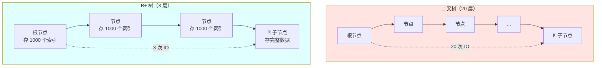
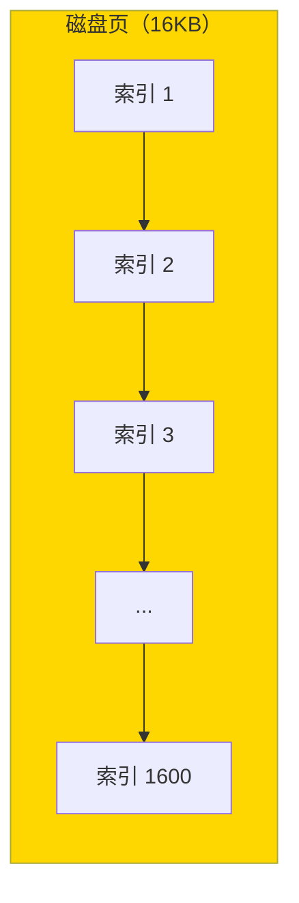
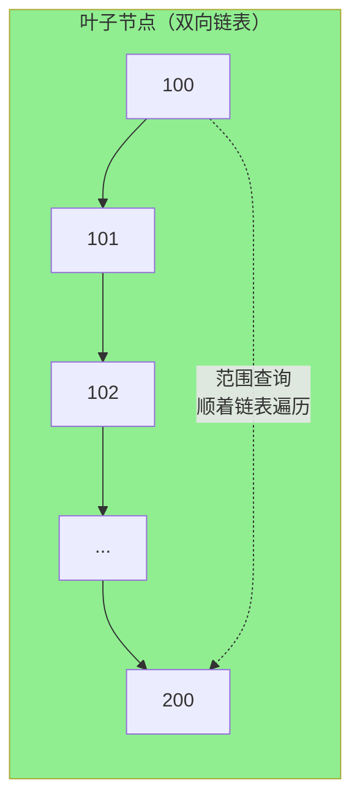
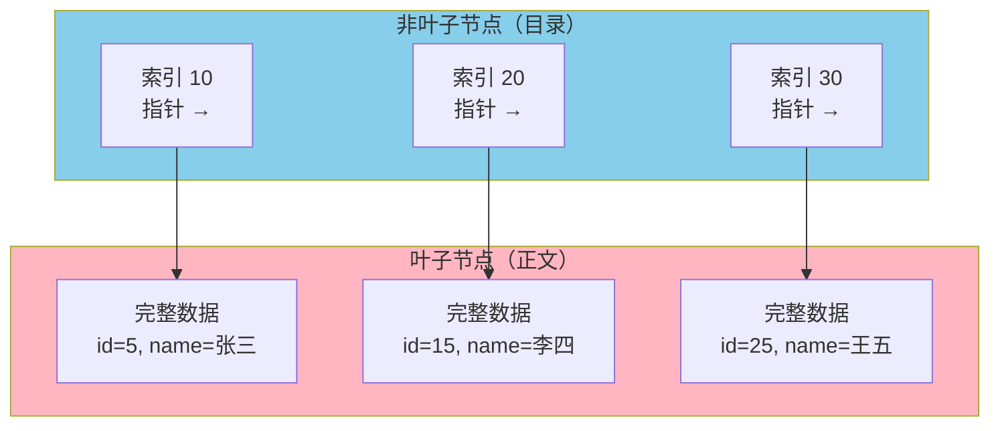

# MySQL 索引 B+树原理

> **场景定位**：数据库底层原理技术要点  
> **核心设计要点**：B+树结构、磁盘 IO、页存储、范围查询、叶子节点链表、非叶子节点优化

---

## 🎯 一句话定位

**MySQL 索引为什么用 B+ 树？**
```
二叉树、红黑树也能平衡高度，为什么 MySQL 偏偏用 B+ 树？
因为：
- 二叉树每个节点存储数据少，树很高，磁盘 IO 频繁
- 红黑树范围查询效率低，需要逐个节点遍历
- B+ 树高度低、范围查询快、节点利用率高
```

**生活化比喻**：就像查字典，二叉树像一页只写一个字，翻很多次才能找到；B+ 树像一页写很多字，翻几次就找到了，而且所有的字在最后用线串起来，方便查找一个范围的字。

**核心特点**：B+ 树是专门为磁盘存储和数据库查询优化的数据结构。

---

## 💎 核心观点（5 分钟速览版）

> **快速概览**

### 核心观点（3 个本质）

**1. 本质一：磁盘 IO 与页存储的适配**
```
数据库数据存在磁盘，磁盘读写按"页"为单位（默认 16KB）

二叉树/红黑树的问题：
- 每个节点存储数据少（只有 1-2 个子节点）
- 树的高度很高（百万数据需要 20+ 层）
- 查询一条数据要频繁磁盘 IO（20+ 次）

B+ 树的优势：
- 每个节点可以存大量索引键（多路平衡）
- 树的高度极低（3-4 层就能存千万级数据）
- 一次查询只需要 2-3 次磁盘 IO

生活化比喻：
二叉树 = 一页只写 1 个字，翻 20 次找到
B+ 树 = 一页写 1000 个字，翻 3 次找到
```

**2. 本质二：遍历范围查询天然优势**
```
业务中大量场景：范围查询、分页查询、全表扫描

二叉树/红黑树的问题：
- 只能逐个节点遍历
- 范围查询需要中序遍历整棵树
- 效率极低

B+ 树的优势：
- 所有数据都在叶子节点
- 叶子节点用双向链表串联
- 范围查询、分页只需要顺着链表遍历
- 不需要来回跳转树节点

生活化比喻：
二叉树 = 查字典要一页页翻
B+ 树 = 所有字在最后用线串起来，直接顺着线找
```

**3. 本质三：非叶子节点只存索引、不存数据**
```
B+ 树的设计：
- 非叶子节点只存索引键和子节点指针
- 不存完整行数据
- 相同磁盘页大小下能存放更多索引条目
- 进一步压低树的高度

生活化比喻：
非叶子节点 = 目录（只有章节名和页码）
叶子节点 = 正文（完整内容）
目录页可以写很多章节名，不用写正文
```

---

## 🚀 一句话精华（如果只能记住一句）

> **B+树三大优势 = 适配磁盘页存储（树低 IO 少） + 叶子节点链表（范围查询快） + 非叶子节点只存索引（利用率高）**

---

## 一、问题本质：二叉树为什么不适合做索引？

### 1.1 二叉树的问题

**生活化比喻**：
```
二叉树 = 一页只写 1 个字
- 每个节点只有 1-2 个子节点
- 100 万个字，需要 20 层
- 找一个字要翻 20 次（20 次磁盘 IO）

B+ 树 = 一页写 1000 个字
- 每个节点可以有 1000 个子节点
- 100 万个字，只需要 3 层
- 找一个字只要翻 3 次（3 次磁盘 IO）
```

**图示对比**：


### 1.2 红黑树的问题

**生活化比喻**：
```
红黑树 = 虽然平衡了高度，但：
- 每个节点还是只有 2 个子节点
- 树的高度还是很高
- 范围查询需要中序遍历，效率低

就像：
虽然字典每页写的字多了，但还是不如 B+ 树每页写得多
而且查范围时还要来回翻
```

---

## 二、B+ 树的核心设计

### 2.1 多路平衡搜索树

**生活化比喻**：
```
B+ 树 = 多叉树
- 每个节点可以有多个子节点（如 1000 个）
- 树的高度极低
- 3-4 层就能存千万级数据

就像：
- 二叉树：每层 2 个分支
- B+ 树：每层 1000 个分支
- 同样 100 万数据，二叉树 20 层，B+ 树 3 层
```

**代码示例（B+ 树结构）**：
```
B+ 树示例（简化版）：

根节点（非叶子）：[10, 20, 30]
  ↓       ↓       ↓       ↓
[5,8]  [12,15]  [22,25]  [32,35]  <- 叶子节点
  ↓       ↓        ↓        ↓
数据    数据     数据     数据

叶子节点用双向链表串联：
[5,8] <-> [12,15] <-> [22,25] <-> [32,35]
```

### 2.2 磁盘页存储适配

**生活化比喻**：
```
磁盘页 = 字典的一页
- 默认大小 16KB
- 一次 IO 读取一页

B+ 树的设计：
- 一个节点 = 一个磁盘页（16KB）
- 一个节点可以存 1000 个索引键
- 树的高度 = 磁盘 IO 次数

计算示例：
- 假设每个索引键 10 字节
- 一个页可以存 16KB / 10B = 1600 个索引
- 3 层 B+ 树可以存：1600 × 1600 × 1600 ≈ 40 亿条数据
- 查询只需要 3 次 IO
```

**图示**：


### 2.3 叶子节点双向链表

**生活化比喻**：
```
叶子节点双向链表 = 所有数据用线串起来
- 范围查询：从起点顺着链表遍历到终点
- 分页查询：直接跳到指定位置
- 全表扫描：从头到尾遍历

就像：
- 所有字在最后用线串起来
- 查"从 A 到 M"的字，直接从 A 顺着线找到 M
- 不用来回翻字典
```

**代码示例（范围查询）**：
```sql
-- 范围查询（B+ 树优势明显）
SELECT * FROM users WHERE id BETWEEN 100 AND 200;

-- B+ 树的处理过程：
-- 1. 从根节点找到 id=100 的叶子节点（3 次 IO）
-- 2. 顺着叶子节点链表遍历到 id=200（顺序 IO，很快）

-- 二叉树的处理过程：
-- 1. 找到 id=100 的节点（20 次 IO）
-- 2. 中序遍历到 id=200（需要来回跳转，很慢）
```

**图示**：


### 2.4 非叶子节点只存索引

**生活化比喻**：
```
非叶子节点 = 目录
- 只存索引键和子节点指针
- 不存完整行数据
- 相同页大小下能存更多索引

就像：
- 目录页只写章节名和页码
- 不写正文内容
- 一页可以写很多章节

好处：
- 节点利用率高
- 树的高度更低
- 查询效率更高
```

**图示**：


---

## 三、B+ 树 vs 二叉树 vs 红黑树

### 3.1 对比表

| 特性 | 二叉树 | 红黑树 | B+ 树 |
|------|--------|--------|-------|
| **每个节点子节点数** | 2 个 | 2 个 | 多个（1000+） |
| **树的高度** | 很高（20+ 层） | 较高（15+ 层） | 很低（3-4 层） |
| **磁盘 IO 次数** | 20+ 次 | 15+ 次 | 2-3 次 |
| **范围查询** | 慢（中序遍历） | 慢（中序遍历） | 快（链表遍历） |
| **插入/删除** | 快 | 快（旋转平衡） | 较慢（页分裂/合并） |
| **适用场景** | 内存数据 | 内存数据 | 磁盘数据 |
| **数据库使用** | ❌ | ❌ | ✅ |

### 3.2 为什么 B+ 树适合数据库？

```
数据库的特点：
1. 数据存在磁盘，不是内存
2. 磁盘 IO 是性能瓶颈
3. 大量范围查询、分页查询
4. 数据量大（百万、千万级）

B+ 树的优势：
1. 树高度低，磁盘 IO 少（2-3 次）
2. 叶子节点链表，范围查询快
3. 非叶子节点只存索引，利用率高
4. 适合大数据量（3 层存千万级）
```

---

四、技术深入探讨

### 考点 1：为什么不用二叉树做索引？

**方案参考**（30 秒版）：
> "二叉树每个节点只有 2 个子节点，树的高度很高。100 万数据需要 20+ 层，查询一条数据要 20+ 次磁盘 IO，性能很差。而且范围查询需要中序遍历整棵树，效率低。B+ 树每个节点可以有 1000 个子节点，3 层就能存千万级数据，查询只需要 2-3 次 IO，范围查询用叶子节点链表，效率更高。"

**加分回答**：
> "二叉树适合内存数据，因为内存访问快，高度高一点影响不大。但数据库数据存在磁盘，磁盘 IO 慢，必须减少 IO 次数。B+ 树通过多路平衡，降低树高度，减少 IO。同时叶子节点用双向链表串联，范围查询只需要顺序遍历，不需要来回跳转树节点。"

### 考点 2：B+ 树如何适配磁盘存储？

**方案参考**：
> "B+ 树适配磁盘存储有三个设计：1）一个节点 = 一个磁盘页（16KB），可以存 1000+ 个索引键，树高度低，IO 少；2）非叶子节点只存索引和指针，不存完整数据，相同页大小下能存更多索引；3）叶子节点用双向链表串联，范围查询时只需要顺序 IO，不需要随机 IO。"

**加分回答**：
> "具体来说，MySQL InnoDB 默认页大小 16KB，假设每个索引键 10 字节，一个页可以存 1600 个索引。3 层 B+ 树可以存 1600^3 ≈ 40 亿条数据，查询只需要 3 次 IO。而非叶子节点只存索引，不存数据，可以进一步降低树高度。叶子节点链表让范围查询变成顺序 IO，比随机 IO 快很多。"

### 考点 3：B+ 树范围查询为什么快？

**方案参考**：
> "B+ 树所有数据都在叶子节点，叶子节点用双向链表串联。范围查询时，先找到起点（3 次 IO），然后顺着链表遍历到终点，只需要顺序 IO，不需要来回跳转树节点。而二叉树、红黑树范围查询需要中序遍历整棵树，需要频繁跳转，效率低。"

**加分回答**：
> "顺序 IO 比随机 IO 快很多，因为磁盘是机械结构，顺序读取不用频繁移动磁头。B+ 树叶子节点链表让范围查询变成顺序 IO，性能提升明显。同时 B+ 树支持分页查询，可以直接跳到指定位置，不需要遍历前面的数据。"

---

## 五、总结（一句话带走）

### 🎯 一句话总结

> **B+树三大优势 = 适配磁盘页存储（树低 IO 少） + 叶子节点链表（范围查询快） + 非叶子节点只存索引（利用率高）**

### 🧠 核心记忆点

1. **为什么不用二叉树？** 每个节点只有 2 个子节点，树很高（20+ 层），磁盘 IO 多（20+ 次），范围查询慢。
2. **B+ 树为什么适合磁盘？** 每个节点可以有 1000+ 个子节点，树很低（3-4 层），磁盘 IO 少（2-3 次）。
3. **范围查询为什么快？** 所有数据在叶子节点，叶子节点用双向链表串联，范围查询顺着链表遍历，顺序 IO。
4. **非叶子节点为什么只存索引？** 不存完整数据，相同页大小下能存更多索引，进一步降低树高度。

---

**参考视频**：[内卷的琪某人 - 场景提问：MySQL 索引为什么不用二叉树，偏偏要用 B+ 树？](https://www.douyin.com/video/7637441976119397647)

---

*本文档基于 8 个专家提示词指导改写，遵循深入浅出、生活化比喻、幽默风趣的教学原则。*
