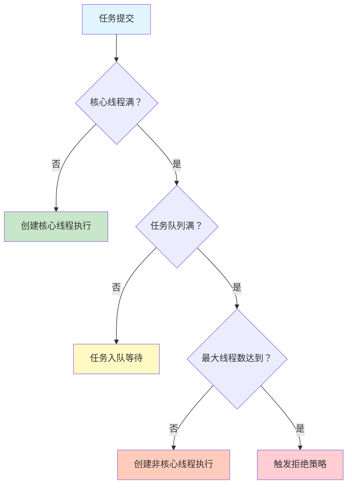

# Java 线程池核心参数与原理

> **场景定位**：多线程并发技术场景  
> **核心设计要点**：核心线程数、最大线程数、任务队列、拒绝策略、参数设置、工作流程

---

## 🎯 一句话定位

**线程池核心问题是什么？**
```
线程池不是创建几个线程复用那么简单：
- 核心线程数和最大线程数的区别是什么？
- 任务队列的作用是什么？
- 拒绝策略有哪几种？
- 参数怎么设置才合理？
- 线程空闲时会怎么处理？
```

**生活化比喻**：就像银行网点，核心员工（核心线程）长期在岗，忙碌时招临时工（非核心线程），客户太多就排队（任务队列），队列满了就拒绝新客户（拒绝策略）。

**核心特点**：线程池的核心价值是线程复用、控制并发数量、减少资源消耗，参数设置必须结合业务场景。

---

## 💎 核心观点（5 分钟速览版）

> **快速概览**

### 核心观点（3 个维度）

**1. 5 个核心参数（缺一不可）**
```
核心线程数（corePoolSize）：
- 线程池中长期存活的线程
- 即使空闲也不会销毁（除非设置 allowCoreThreadTimeOut）

最大线程数（maximumPoolSize）：
- 线程池中允许存在的最大线程数量
- 核心线程满后，会创建非核心线程处理任务

空闲线程存活时间（keepAliveTime）：
- 非核心线程空闲后，保持存活的时间
- 超时后会被销毁释放资源

时间单位（unit）：
- 空闲线程存活时间的单位（毫秒、秒等）

任务队列（workQueue）：
- 用于存放等待执行的任务
- 核心线程满后，任务会先进入队列
- 队列满后才会创建非核心线程

生活化比喻：
核心线程 = 银行正式员工（长期在岗）
最大线程 = 正式员工 + 临时工（最多这么多人）
存活时间 = 临时工没活干多久后走人
任务队列 = 客户排队等候区
```

**2. 工作原理（核心流程）**
```
任务提交后的完整流程：
1. 判断核心线程池是否已满
   - 未满：创建核心线程执行任务
   - 已满：进入下一步

2. 判断任务队列是否已满
   - 未满：将任务放入队列等待
   - 已满：进入下一步

3. 判断最大线程数是否达到上限
   - 未达到：创建非核心线程执行任务
   - 已达到：进入下一步

4. 触发拒绝策略
   - 处理无法执行的任务

生活化比喻：
客户来银行 → 有柜员空着 → 直接办理
→ 柜员都忙 → 排队等候
→ 队列满了 → 叫临时工
→ 临时工也满了 → 拒绝新客户
```

**3. 4 种拒绝策略（主流）**
```
AbortPolicy（默认）：
- 直接抛出异常
- 阻止程序运行

CallerRunsPolicy：
- 由调用线程（提交任务的线程）直接执行该任务
- 不丢弃任务，但会降低提交速度

DiscardPolicy：
- 静默丢弃无法执行的任务
- 不抛异常、不提示

DiscardOldestPolicy：
- 丢弃队列中最老的任务
- 重新尝试提交当前任务

生活化比喻：
AbortPolicy = 直接拒绝，告诉客户"满了，下次再来"
CallerRunsPolicy = 让客户自己办理（提交任务的线程自己执行）
DiscardPolicy = 静默拒绝，不告诉客户
DiscardOldestPolicy = 让排队最久的客户离开，新客户进来
```

---

## 🚀 一句话精华（如果只能记住一句）

> **线程池三板斧 = 5 个核心参数（核心/最大/队列/存活/单位） + 4 步工作流程（核心→队列→非核心→拒绝） + 参数设置（CPU 密集/IO 密集/有界队列）**

---

## 一、5 个核心参数详解

### 1.1 核心线程数（corePoolSize）

**生活化比喻**：
```
核心线程 = 银行正式员工
- 长期在岗，即使没客户也不走
- 除非设置 allowCoreThreadTimeOut（空闲也走）

就像：
- 银行至少保留 5 个柜员
- 即使没人排队，也在岗
- 随时准备服务客户
```

**代码示例**：
```java
ThreadPoolExecutor executor = new ThreadPoolExecutor(
    5,  // corePoolSize：核心线程数 5
    10, // maximumPoolSize：最大线程数 10
    60, // keepAliveTime：空闲线程存活时间
    TimeUnit.SECONDS, // 时间单位
    new ArrayBlockingQueue<>(100) // 任务队列
);
```

### 1.2 最大线程数（maximumPoolSize）

**生活化比喻**：
```
最大线程 = 正式员工 + 临时工
- 核心线程满后，会创建非核心线程
- 非核心线程空闲超过 keepAliveTime 会被销毁

就像：
- 银行最多 10 个柜员（5 正式 + 5 临时）
- 忙碌时招临时工
- 不忙了临时工就走
```

### 1.3 空闲线程存活时间（keepAliveTime）

**生活化比喻**：
```
存活时间 = 临时工没活干多久后走人
- 非核心线程空闲后，保持存活的时间
- 超时后会被销毁释放资源

就像：
- 临时工 60 秒没活干，就走人
- 避免资源浪费
```

### 1.4 任务队列（workQueue）

**生活化比喻**：
```
任务队列 = 客户排队等候区
- 核心线程满后，任务会先进入队列
- 队列满后才会创建非核心线程

两种队列：
- 无界队列（LinkedBlockingQueue）：队列无限大，可能内存溢出
- 有界队列（ArrayBlockingQueue）：队列有限大小，推荐使用

就像：
- 银行等候区有 100 个座位
- 满了就不让进了
- 避免等候区无限大，挤爆银行
```

**代码示例**：
```java
// ❌ 错误做法：无界队列，可能内存溢出
new LinkedBlockingQueue() // 无界队列

// ✅ 正确做法：有界队列
new ArrayBlockingQueue<>(100) // 有界队列，容量 100
```

### 1.5 时间单位（unit）

```
时间单位：
- TimeUnit.MILLISECONDS（毫秒）
- TimeUnit.SECONDS（秒）
- TimeUnit.MINUTES（分钟）
```

---

## 二、工作原理（核心流程）

### 2.1 任务提交流程

**生活化比喻**：
```
客户来银行办理业务：
1. 有柜员空着 → 直接办理（创建核心线程）
2. 柜员都忙 → 排队等候（任务入队）
3. 队列满了 → 叫临时工（创建非核心线程）
4. 临时工也满了 → 拒绝新客户（触发拒绝策略）
```

**代码示例**：
```java
ThreadPoolExecutor executor = new ThreadPoolExecutor(
    5,  // 核心线程数
    10, // 最大线程数
    60, // 空闲线程存活时间
    TimeUnit.SECONDS,
    new ArrayBlockingQueue<>(100) // 任务队列
);

// 提交 15 个任务
for (int i = 0; i < 15; i++) {
    executor.execute(() -> {
        System.out.println("任务执行，线程：" + Thread.currentThread().getName());
    });
}

// 执行过程：
// 1. 前 5 个任务：创建 5 个核心线程执行
// 2. 第 6-15 个任务：进入队列等待
// 3. 如果队列满了（100 个），才会创建非核心线程
```

### 2.2 流程图



---

## 三、4 种拒绝策略

### 3.1 AbortPolicy（默认）

**生活化比喻**：
```
AbortPolicy = 直接拒绝，告诉客户"满了，下次再来"
- 直接抛出 RejectedExecutionException 异常
- 阻止程序运行
- 默认策略
```

**代码示例**：
```java
executor.setRejectedExecutionHandler(new ThreadPoolExecutor.AbortPolicy());

// 触发时抛出异常
Exception in thread "main" java.util.concurrent.RejectedExecutionException
```

### 3.2 CallerRunsPolicy

**生活化比喻**：
```
CallerRunsPolicy = 让客户自己办理
- 由调用线程（提交任务的线程）直接执行该任务
- 不丢弃任务，但会降低提交速度

就像：
- 银行满了，让客户自己到柜台办理
- 客户（提交任务的线程）自己干活
- 不丢弃任务，但客户要等
```

**代码示例**：
```java
executor.setRejectedExecutionHandler(new ThreadPoolExecutor.CallerRunsPolicy());

// 触发时，提交任务的线程自己执行
public void submitTask() {
    executor.execute(() -> {
        System.out.println("任务执行");
    });
    // 如果线程池满了，这行代码所在的线程自己执行任务
}
```

### 3.3 DiscardPolicy

**生活化比喻**：
```
DiscardPolicy = 静默拒绝，不告诉客户
- 静默丢弃无法执行的任务
- 不抛异常、不提示

就像：
- 银行满了，默默拒绝
- 客户不知道被拒绝了
- 任务丢失，没有任何提示
```

**代码示例**：
```java
executor.setRejectedExecutionHandler(new ThreadPoolExecutor.DiscardPolicy());

// 触发时，任务被丢弃，没有任何异常
```

### 3.4 DiscardOldestPolicy

**生活化比喻**：
```
DiscardOldestPolicy = 让排队最久的客户离开，新客户进来
- 丢弃队列中最老的任务
- 重新尝试提交当前任务

就像：
- 银行等候区满了
- 让排队最久的客户离开
- 新客户进来排队
```

**代码示例**：
```java
executor.setRejectedExecutionHandler(new ThreadPoolExecutor.DiscardOldestPolicy());

// 触发时，丢弃队列中最老的任务，重新提交当前任务
```

---

## 四、参数设置核心技巧

### 4.1 核心线程数设置

**生活化比喻**：
```
核心线程数 = 根据业务类型设置

CPU 密集型任务：
- 主要消耗 CPU 资源（计算、加密等）
- 核心线程数 = CPU 核心数 + 1
- 多一个线程防止某个线程暂停时其他线程顶上

IO 密集型任务：
- 主要消耗 IO 资源（数据库查询、文件读写等）
- 核心线程数 = CPU 核心数 × 2
- IO 等待时线程空闲，可以多开线程

就像：
- CPU 密集型 = 厨师做菜（一直忙着炒）
- IO 密集型 = 服务员点菜（等客户点单，空闲时可以服务多桌）
```

**代码示例**：
```java
// 获取 CPU 核心数
int cpuCores = Runtime.getRuntime().availableProcessors();

// CPU 密集型
int corePoolSizeForCpu = cpuCores + 1;

// IO 密集型
int corePoolSizeForIo = cpuCores * 2;
```

### 4.2 最大线程数设置

**生活化比喻**：
```
最大线程数 = 避免设置过大
- 线程过多会导致上下文切换频繁
- 消耗资源，性能下降

就像：
- 银行不能招太多临时工
- 临时工太多，管理成本高
- 反而效率下降
```

### 4.3 队列选择

**生活化比喻**：
```
队列选择 = 优先用有界队列

无界队列（LinkedBlockingQueue）：
- 队列无限大
- 可能导致内存溢出
- 不推荐

有界队列（ArrayBlockingQueue）：
- 队列有限大小
- 避免内存溢出
- 推荐使用

就像：
- 无界队列 = 等候区无限大，挤爆银行
- 有界队列 = 等候区 100 个座位，满了就拒绝
```

---

## 五、常见误区规避

### 误区 1：线程池参数随便设置

```
问题：
- 核心线程过多，资源浪费
- 队列无界，内存溢出
- 最大线程过大，上下文切换频繁

解决：
- 根据业务场景设置
- CPU 密集型 vs IO 密集型
- 优先用有界队列
```

### 误区 2：忘记关闭线程池

```
问题：
- 线程泄漏
- 耗尽系统资源

解决：
- 应用关闭时，调用 executor.shutdown()
- 等待任务执行完成
- 强制关闭：executor.shutdownNow()
```

**代码示例**：
```java
// 正确关闭线程池
executor.shutdown();

try {
    // 等待任务执行完成（最多 60 秒）
    if (!executor.awaitTermination(60, TimeUnit.SECONDS)) {
        // 超时，强制关闭
        executor.shutdownNow();
    }
} catch (InterruptedException e) {
    executor.shutdownNow();
}
```

### 误区 3：任务执行时间过长

```
问题：
- 线程池阻塞
- 影响整体并发性能

解决：
- 任务拆分，避免长时间占用线程
- 异步处理，快速返回
- 监控任务执行时间
```

---

六、技术深入探讨

### 考点 1：线程池核心参数有哪些？

**方案参考**（30 秒版）：
> "线程池有 5 个核心参数：1）核心线程数（corePoolSize）：线程池中长期存活的线程；2）最大线程数（maximumPoolSize）：线程池中允许存在的最大线程数量；3）空闲线程存活时间（keepAliveTime）：非核心线程空闲后保持存活的时间；4）时间单位（unit）：空闲线程存活时间的单位；5）任务队列（workQueue）：用于存放等待执行的任务。"

**加分回答**：
> "核心线程数是线程池的骨干，即使空闲也不会销毁（除非设置 allowCoreThreadTimeOut）。最大线程数是线程池的上限，核心线程满后会创建非核心线程。任务队列用于缓冲任务，核心线程满后任务入队，队列满后才会创建非核心线程。空闲线程存活时间是非核心线程的'保质期'，超时后会被销毁。"

### 考点 2：线程池的工作原理是什么？

**方案参考**：
> "线程池接收任务后的流程：1）判断核心线程池是否已满，未满则创建核心线程执行任务；2）核心线程满则判断任务队列是否已满，未满则将任务放入队列等待；3）队列满则判断最大线程数是否达到上限，未达到则创建非核心线程执行任务；4）最大线程数已满，则触发拒绝策略，处理无法执行的任务。"

**加分回答**：
> "核心思想是'能省则省'：优先用核心线程，核心线程满了就排队，队列满了才创建非核心线程，非核心线程满了就拒绝。这样既保证了性能，又避免了资源浪费。实际生产中，我会根据业务场景设置合理的参数，CPU 密集型任务核心线程数设为 CPU 核心数 + 1，IO 密集型任务设为 CPU 核心数 × 2。"

### 考点 3：拒绝策略有哪几种？

**方案参考**：
> "4 种主流拒绝策略：1）AbortPolicy（默认）：直接抛出异常，阻止程序运行；2）CallerRunsPolicy：由调用线程（提交任务的线程）直接执行该任务；3）DiscardPolicy：静默丢弃无法执行的任务，不抛异常、不提示；4）DiscardOldestPolicy：丢弃队列中最老的任务，重新尝试提交当前任务。"

**加分回答**：
> "实际生产中，我会根据业务场景选择拒绝策略：重要任务用 CallerRunsPolicy，保证任务不丢失；不重要的任务用 DiscardPolicy，避免阻塞；需要快速响应的任务用 AbortPolicy，立即抛出异常通知调用方。同时要监控拒绝策略触发情况，及时告警。"

---

## 七、总结（一句话带走）

### 🎯 一句话总结

> **线程池三板斧 = 5 个核心参数（核心/最大/队列/存活/单位） + 4 步工作流程（核心→队列→非核心→拒绝） + 参数设置（CPU 密集/IO 密集/有界队列）**

### 🧠 核心记忆点

1. **5 个核心参数**：核心线程数、最大线程数、空闲线程存活时间、时间单位、任务队列。
2. **工作原理**：核心线程 → 任务队列 → 非核心线程 → 拒绝策略。
3. **4 种拒绝策略**：AbortPolicy（抛异常）、CallerRunsPolicy（调用线程执行）、DiscardPolicy（静默丢弃）、DiscardOldestPolicy（丢弃最老任务）。
4. **参数设置**：CPU 密集型 = CPU 核心数 + 1，IO 密集型 = CPU 核心数 × 2。
5. **队列选择**：优先用有界队列（ArrayBlockingQueue），避免内存溢出。

---

**参考视频**：[内卷的琪某人 - 场景提问：线程池核心参数及工作原理是什么？](https://www.douyin.com/video/7634460859582008610)

---

*本文档基于 8 个专家提示词指导改写，遵循深入浅出、生活化比喻、幽默风趣的教学原则。*
