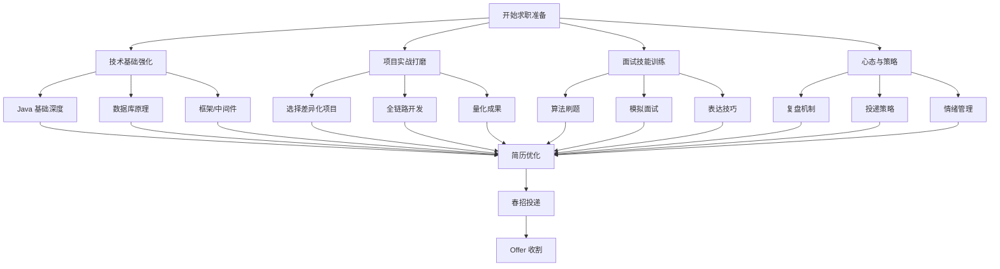

# 双非本科 Java 后端求职指南：春招稳拿 Offer 的硬核标准

> **场景定位**：求职策略与备战指南  
> **核心设计要点**：Java 基础深度、数据库原理、框架源码、项目实战、技术要点、心态策略

---

## 🎯 一句话定位

**双非本科 Java 后端求职解决什么问题？**
```
在学历不占优势的情况下，如何通过硬核技术实力和差异化竞争策略，
在春招中脱颖而出，稳拿 Offer？
就像打游戏，装备不行就得靠操作和意识碾压对手。
```

**生活化比喻**：
求职就像打仗，需要四件武器：
- **技术硬度 = 武器锋利度**：你的刀够不够快，能不能一剑封喉
- **项目实战 = 战场经验**：有没有上过战场，打过硬仗
- **面试表现 = 临场发挥**：能不能在关键时刻稳定输出
- **心态策略 = 后勤保障**：能不能持续作战，越挫越勇

**核心特点**：学历是门槛，但技术实力才是决定性因素。双非不可怕，可怕的是没有核心竞争力。

---

## 💎 核心观点（5 分钟速览版）

> **快速概览**

### 四个维度的硬核标准

**1. 技术硬度：基础必须扎实到骨子里**
```
✅ Java 基础：
   - ConcurrentHashMap 能画出分段锁/红黑树结构
   - 讲清 putVal 流程、扩容触发条件、并发安全原理
   - 对比 HashMap、HashTable、ConcurrentHashMap 线程安全差异
   - 死磕：JVM 运行时数据区、G1/ZGC、线程池参数、ThreadLocal、CAS

✅ 数据库：
   - 手绘 InnoDB 聚簇索引结构
   - 讲清 MVCC 实现原理
   - 大表查询优化、死锁场景处理方案
   - 死磕：事务原理、行锁/表锁/意向锁、索引失效、分库分表

✅ 框架/中间件：
   - SpringBoot 自动装配流程、一级缓存原理
   - RocketMQ 消息重试、死信队列机制
   - MyBatis 一二级缓存原理
   - 死磕：SpringCloud、Redis 分布式锁、Kafka、分布式事务
```

**2. 项目实战：必须扛住层层深挖**
```
✅ 全链路能力：
   - 需求分析 → 架构设计 → 接口开发 → 线上排查 → 性能调优
   
✅ 差异化项目（避开同质化）：
   - ❌ 基础管理系统（太普通）
   - ✅ 分布式商城、微服务权限平台、日志采集分析系统
   
✅ 量化成果（用数据说话）：
   - "引入 Redis 缓存 + 异步处理，接口响应时间缩短 80%"
   - "通过分库分表，单表数据承载量提升 10 倍"
```

**3. 面试表现：手撕代码 + 沟通表达**
```
✅ 算法能力：
   - LeetCode 高频中等题
   - 重点：链表、二叉树、动态规划、多线程编程题
   
✅ 沟通技巧：
   - 复杂技术点用画图/举例讲明白
   - 自我介绍埋技术亮点伏笔
   - 引导场景提问你擅长的模块
   
✅ 应对难题：
   - 先讲思路再谈排查方法
   - 绝不直接说"不会"
```

**4. 心态策略：复盘 + 投递 + 坚持**
```
✅ 复盘强度：
   - 每场讨论到此立刻整理错题
   - 当天补齐知识漏洞
   - 把面试当成高效学习
   
✅ 投递强度：
   - 海投 + 精准内推并行
   - 通过学长、牛客、招聘平台找内推
   - 跳过简历初筛卡死环节
   
✅ 核心公式：
   扎实技术 + 差异化项目 + 稳定发挥 + 高频复盘 + 持续投递 = Offer
```

---

## 🚀 一句话精华（如果只能记住一句）

> **双非春招上岸 = 技术硬度（ConcurrentHashMap/MVCC/Spring 源码）+ 差异化项目（分布式商城/微服务）+ 技术要点（画图+举例+引导）+ 复盘投递（错题本+内推）**

---

## 一、求职准备全景图

### 1.1 求职准备流程



### 1.2 时间规划（建议 3-6 个月）

```
第 1-2 个月：技术基础强化
   - Java 基础深度（集合、并发、JVM）
   - 数据库原理（MySQL、Redis）
   - 框架源码（Spring、MyBatis）

第 3-4 个月：项目实战打磨
   - 选择 2-3 个差异化项目
   - 全链路开发（需求→设计→开发→优化）
   - 量化成果（性能提升数据）

第 5-6 个月：面试冲刺
   - 算法刷题（LeetCode 高频 200 题）
   - 模拟面试（每周 2-3 次）
   - 海投 + 内推并行
```

---

## 二、技术硬度：基础必须扎实到骨子里

### 2.1 Java 基础深度

#### 问题本质

场景提问 ConcurrentHashMap 时，不是想听定义，而是想考察：
- 你是否真正理解底层原理
- 能否画出数据结构
- 能否讲清并发安全机制
- 能否对比不同实现方案的优劣

#### 核心考点

**1. ConcurrentHashMap 底层结构（JDK 1.8）**

```java
// JDK 1.8 ConcurrentHashMap 核心结构
public class ConcurrentHashMap<K,V> {
    // 节点数组
    transient volatile Node<K,V>[] table;
    
    // 扩容时的新数组
    transient volatile Node<K,V>[] nextTable;
    
    // 基数计数器（用于 size()）
    private transient volatile CounterCell[] counterCells;
    
    // Node 节点（链表）
    static class Node<K,V> {
        final int hash;
        final K key;
        volatile V val;
        volatile Node<K,V> next;
    }
    
    // 树节点（红黑树）
    static final class TreeNode<K,V> extends Node<K,V> {
        TreeNode<K,V> parent;
        TreeNode<K,V> left;
        TreeNode<K,V> right;
        TreeNode<K,V> prev;
        boolean red;
    }
}
```

**数据结构图示**：
```
ConcurrentHashMap 结构（JDK 1.8）：
┌─────────────────────────────────────────────┐
│  Node[] table (数组 + 链表 + 红黑树)         │
├─────────────────────────────────────────────┤
│  [0] → Node → Node → null                   │
│  [1] → TreeNode (红黑树)                     │
│  [2] → Node → null                          │
│  [3] → null                                 │
│  ...                                        │
│  [n] → Node → null                          │
└─────────────────────────────────────────────┘

并发控制：
- JDK 1.7：Segment 分段锁（ReentrantLock）
- JDK 1.8：Node 头节点锁（synchronized）+ CAS
```

**2. putVal 流程详解**

```java
final V putVal(K key, V value, boolean onlyIfAbsent) {
    // 1. 计算 hash 值
    int hash = spread(key.hashCode());
    
    // 2. 检查 table 是否初始化
    if (table == null || table.length == 0) {
        table = initTable(); // CAS 初始化
    }
    
    // 3. 定位桶位置
    int i = (table.length - 1) & hash;
    Node<K,V> f = table[i];
    
    // 4. 桶为空，直接插入（CAS）
    if (f == null) {
        if (casTabAt(table, i, new Node<K,V>(hash, key, value))) {
            break;
        }
    }
    // 5. 正在扩容，帮助扩容
    else if (f.hash == MOVED) {
        table = helpTransfer(table, f);
    }
    // 6. 桶不为空，加锁插入
    else {
        synchronized (f) { // 锁住头节点
            if (f.hash == hash) { // 头节点就是要找的
                // 覆盖或跳过
            } else if (f instanceof TreeNode) {
                // 红黑树插入
                ((TreeNode<K,V>)f).putTreeVal(...);
            } else {
                // 链表插入（尾插法）
                for (int binCount = 0; ; ++binCount) {
                    if (e.next == null) {
                        e.next = new Node<K,V>(hash, key, value);
                        // 链表长度 >= 8，转为红黑树
                        if (binCount >= TREEIFY_THRESHOLD - 1) {
                            treeifyBin(table, i);
                        }
                        break;
                    }
                }
            }
        }
    }
    
    // 7. 统计 size，判断是否需要扩容
    addCount(1L, binCount);
    return null;
}
```

**关键流程**：
```
1. 计算 hash → 定位桶位置
2. 桶为空 → CAS 插入（无锁）
3. 正在扩容 → 帮助扩容
4. 桶不为空 → synchronized 锁头节点 → 插入
5. 链表长度 >= 8 → 转红黑树
6. 统计 size → 判断扩容（size > threshold）
```

**3. 扩容机制**

```java
// 扩容触发条件
private final void addCount(long x, int check) {
    // 统计元素个数
    long s = sumCount();
    if (check >= 0) {
        // 判断是否需要扩容
        if (s > (long)(sizeCtl - ((sizeCtl >>> 1) + 1))) {
            // sizeCtl = threshold = capacity * loadFactor
            // 当 size > threshold 时触发扩容
            transfer(table, null);
        }
    }
}

// 扩容过程（多线程协助）
private final void transfer(Node<K,V>[] tab, Node<K,V>[] nextTab) {
    int n = tab.length, stride;
    // 计算每个线程处理的桶数量（stride >= 16）
    if ((stride = (NCPU > 1) ? (n >>> 3) / NCPU : n) < 16) {
        stride = 16;
    }
    
    // 分配任务：每个线程处理 [i, i+stride) 的桶
    for (int i = table.length - 1; i >= 0; ) {
        // 迁移桶中的元素到新数组
        // 链表/红黑树拆分到两个位置
    }
}
```

**扩容关键点**：
- 触发条件：`size > threshold`（threshold = capacity * loadFactor）
- 多线程协助：将数组分成多个 stride，每个线程处理一部分
- 扩容时访问：通过 ForwardingNode 标识正在扩容，引导线程帮助扩容

#### 面试 Q&A

**Q1：ConcurrentHashMap 如何保证线程安全？**

**方案参考**：
```
JDK 1.8 采用 Node 头节点锁 + CAS 保证线程安全：
1. 插入时，如果桶为空，使用 CAS 插入（无锁）
2. 如果桶不为空，使用 synchronized 锁住头节点
3. 只锁一个桶，粒度细，并发度高
```

**加分回答**：
```
JDK 1.8 相比 1.7 的改进：
1. 锁粒度：Segment 分段锁 → Node 头节点锁（更细）
2. 数据结构：数组 + 链表 → 数组 + 链表 + 红黑树（查询 O(n) → O(log n)）
3. 并发插入：ReentrantLock → synchronized + CAS（更轻量）
4. 扩容优化：单线程扩容 → 多线程协助扩容（更快）
```

**Q2：为什么链表长度 >= 8 时转红黑树？**

**方案参考**：
```
链表长度过长时，查询时间复杂度从 O(1) 退化到 O(n)
转红黑树后，查询时间复杂度为 O(log n)
选择 8 是基于泊松分布的统计结果，冲突概率极低
```

**加分回答**：
```
1. 理想情况下，hash 分布均匀，链表长度符合泊松分布
2. 链表长度达到 8 的概率约为 0.00000006（千万分之六）
3. 红黑树节点占用空间是链表节点的 2 倍
4. 只有当树节点数 <= 6 时，才退化为链表（避免频繁转换）
5. 这是时间和空间的权衡
```

**Q3：HashMap、HashTable、ConcurrentHashMap 的区别？**

**方案参考**：
```
1. HashMap：非线程安全，性能好，JDK 1.8 数组 + 链表 + 红黑树
2. HashTable：线程安全（synchronized 锁整个表），性能差，已淘汰
3. ConcurrentHashMap：线程安全，JDK 1.8 Node 锁 + CAS，性能最优
```

**加分回答**：
```
对比维度：
┌──────────────────┬──────────┬──────────────┬─────────────────┐
│ 特性             │ HashMap  │ HashTable    │ ConcurrentHashMap│
├──────────────────┼──────────┼──────────────┼─────────────────┤
│ 线程安全         │ ❌       │ ✅           │ ✅              │
│ 锁粒度           │ 无       │ 全表锁       │ Node 锁（细粒度）│
│ null key/value   │ ✅       │ ❌           │ ❌              │
│ 数据结构(1.8)    │ 数组+链表│ 数组+链表    │ 数组+链表+红黑树 │
│ 性能             │ 高       │ 低           │ 高              │
│ 推荐场景         │ 单线程   │ 已淘汰       │ 多线程          │
└──────────────────┴──────────┴──────────────┴─────────────────┘
```

### 2.2 数据库原理

#### 核心考点

**1. InnoDB 聚簇索引结构**

```
聚簇索引（Clustered Index）：
┌─────────────────────────────────────────────┐
│  B+ 树结构                                   │
├─────────────────────────────────────────────┤
│  非叶子节点：只存索引键值                      │
│  ┌────────────────────────────────────┐     │
│  │  [10] [20] [30] [40]               │     │
│  │   ↓    ↓    ↓    ↓                 │     │
│  └────────────────────────────────────┘     │
│                                            │
│  叶子节点：存索引键值 + 完整数据行            │
│  ┌────────────────────────────────────┐     │
│  │  [10, row1] → [20, row2] → [30, row3] │  │
│  │       ↓         ↓         ↓          │  │
│  │  [40, row4] → [50, row5] → [60, row6] │  │
│  └────────────────────────────────────┘     │
│       ↓ 双向链表                            │
└─────────────────────────────────────────────┘

特点：
1. 主键索引 = 聚簇索引
2. 数据行存储在叶子节点
3. 一张表只有一个聚簇索引
4. 查询快（一次 IO 就能获取完整数据）
```

**2. MVCC 实现原理**

```java
// InnoDB 每行数据隐藏字段
ROW {
    DB_TRX_ID: 6 byte,  // 最近修改该行的事务 ID
    DB_ROLL_PTR: 7 byte, // 回滚指针（指向 undo log）
    DB_ROW_ID: 6 byte,   // 隐藏自增 ID
    ... // 用户数据
}

// MVCC 核心：Read View
Read View {
    m_ids: [],        // 生成 Read View 时，活跃（未提交）事务 ID 列表
    min_trx_id: 10,   // m_ids 中最小的事务 ID
    max_trx_id: 20,   // 生成 Read View 时，系统应该分配给下一个事务的 ID
    creator_trx_id: 5 // 生成该 Read View 的事务 ID
}

// 可见性判断算法
boolean isVisible(row, readView) {
    // 1. row.trx_id < min_trx_id → 可见（事务已提交）
    if (row.trx_id < readView.min_trx_id) {
        return true;
    }
    
    // 2. row.trx_id >= max_trx_id → 不可见（事务在 Read View 之后开启）
    if (row.trx_id >= readView.max_trx_id) {
        return false;
    }
    
    // 3. min_trx_id <= row.trx_id < max_trx_id
    //    如果 row.trx_id 在 m_ids 中 → 不可见（事务还未提交）
    //    如果 row.trx_id 不在 m_ids 中 → 可见（事务已提交）
    if (readView.m_ids.contains(row.trx_id)) {
        return false;
    } else {
        return true;
    }
}

// 如果不可见，沿着 undo log 链找到可见的版本
```

**生活化比喻**：
```
MVCC 就像拍照：
- Read View = 快门按下的一瞬间
- 只有快门之前的事务（已提交）才能被拍到
- 快门之后的事务（未提交）拍不到
- 如果当前版本不可见，沿着 undo log（历史照片）找到可见的版本
```

**3. 索引失效场景**

```sql
-- 1. 最左前缀原则（联合索引 (a, b, c)）
SELECT * FROM t WHERE a = 1 AND b = 2 AND c = 3; -- ✅ 生效
SELECT * FROM t WHERE a = 1 AND b = 2;           -- ✅ 生效
SELECT * FROM t WHERE a = 1;                     -- ✅ 生效
SELECT * FROM t WHERE b = 2 AND c = 3;           -- ❌ 失效（缺少 a）
SELECT * FROM t WHERE a = 1 AND c = 3;           -- ⚠️ 部分生效（只用 a）

-- 2. 对索引列使用函数
SELECT * FROM t WHERE YEAR(create_time) = 2024;  -- ❌ 失效
-- 优化：改为范围查询
SELECT * FROM t WHERE create_time >= '2024-01-01' 
                  AND create_time < '2025-01-01'; -- ✅ 生效

-- 3. 隐式类型转换
SELECT * FROM t WHERE phone = 13800138000;       -- ❌ 失效（phone 是 VARCHAR）
-- 优化：加引号
SELECT * FROM t WHERE phone = '13800138000';     -- ✅ 生效

-- 4. LIKE 以 % 开头
SELECT * FROM t WHERE name LIKE '%张';           -- ❌ 失效
SELECT * FROM t WHERE name LIKE '张%';           -- ✅ 生效

-- 5. OR 条件
SELECT * FROM t WHERE a = 1 OR b = 2;            -- ❌ 失效（a、b 都有索引）
-- 优化：改为 UNION
SELECT * FROM t WHERE a = 1
UNION
SELECT * FROM t WHERE b = 2;                     -- ✅ 生效

-- 6. 不等号
SELECT * FROM t WHERE a != 1;                    -- ❌ 失效（大部分存储引擎）
SELECT * FROM t WHERE a <> 1;                    -- ❌ 失效
-- 优化：改为 IN
SELECT * FROM t WHERE a IN (0, 2, 3, 4, 5);      -- ✅ 生效

-- 7. IS NULL / IS NOT NULL
SELECT * FROM t WHERE a IS NULL;                 -- ⚠️ 可能失效（取决于数据分布）
```

#### 面试 Q&A

**Q1：MySQL 事务隔离级别有哪些？**

**方案参考**：
```
1. READ UNCOMMITTED（读未提交）：脏读、不可重复读、幻读
2. READ COMMITTED（读已提交）：不可重复读、幻读（Oracle 默认）
3. REPEATABLE READ（可重复读）：幻读（MySQL 默认，通过 MVCC + Next-Key Lock 解决）
4. SERIALIZABLE（串行化）：性能最差
```

**加分回答**：
```
MySQL 默认 RR 级别如何解决幻读：
1. 快照读（普通 SELECT）：通过 MVCC，Read View 在事务开始时创建，整个事务期间不变
2. 当前读（SELECT FOR UPDATE / INSERT / UPDATE / DELETE）：通过 Next-Key Lock（行锁 + 间隙锁）
   - 锁住记录 + 锁住间隙，防止其他事务插入
```

**Q2：Redis 缓存与数据库双写一致性如何保证？**

**方案参考**：
```
常见方案：Cache Aside Pattern（旁路缓存模式）
1. 读：先读缓存，命中则返回；未命中则读 DB，写入缓存
2. 写：先更新 DB，再删除缓存

问题：删除缓存失败怎么办？
解决：重试机制 / 延迟双删
```

**加分回答**：
```
延迟双删：
1. 先删除缓存
2. 更新 DB
3. 延迟 N 毫秒（如 500ms）再删除缓存

目的：在延迟期间，如果有其他线程读取旧数据并写入缓存，第二次删除可以清理掉

更优方案：Canal 监听 MySQL binlog，异步更新缓存
1. 更新 DB
2. Canal 监听到 binlog 变更
3. 发送 MQ 消息
4. 消费者更新/删除缓存
```

### 2.3 框架/中间件

#### 核心考点

**1. SpringBoot 自动装配流程**

```java
// 1. 启动类
@SpringBootApplication
public class Application {
    public static void main(String[] args) {
        SpringApplication.run(Application.class, args);
    }
}

// 2. @SpringBootApplication = @Configuration + @EnableAutoConfiguration + @ComponentScan

// 3. @EnableAutoConfiguration 核心
@Target(ElementType.TYPE)
@Retention(RetentionPolicy.RUNTIME)
@Import(AutoConfigurationImportSelector.class)
public @interface EnableAutoConfiguration {
    // ...
}

// 4. AutoConfigurationImportSelector 加载自动配置类
public class AutoConfigurationImportSelector implements ImportSelector {
    @Override
    public String[] selectImports(AnnotationMetadata metadata) {
        // 从 META-INF/spring.factories 加载所有自动配置类
        List<String> configurations = getCandidateConfigurations(annotationMetadata);
        // 过滤（@Conditional 条件判断）
        configurations = getConfigurationClassList(configurations);
        return StringUtils.toStringArray(configurations);
    }
}

// 5. 自动配置类示例（RedisAutoConfiguration）
@Configuration
@ConditionalOnClass(RedisOperations.class) // classpath 下有 Redis 类
public class RedisAutoConfiguration {
    
    @Bean
    @ConditionalOnMissingBean // 容器中没有 RedisTemplate 时创建
    public RedisTemplate<Object, Object> redisTemplate(...) {
        RedisTemplate<Object, Object> template = new RedisTemplate<>();
        // 设置序列化、连接工厂等
        return template;
    }
}
```

**自动装配流程**：
```
1. @SpringBootApplication 包含 @EnableAutoConfiguration
2. @EnableAutoConfiguration 导入 AutoConfigurationImportSelector
3. 从 META-INF/spring.factories 加载所有自动配置类
4. 根据 @Conditional 条件过滤（classpath、配置属性、Bean 是否存在）
5. 符合条件的自动配置类注册到 Spring 容器
6. 自动创建 Bean（如 RedisTemplate、DataSource 等）
```

**2. RocketMQ 消息重试与死信队列**

```
消息重试机制：
┌─────────────────────────────────────────────┐
│  生产者 → Broker → 消费者                    │
│                    ↓                         │
│              消费失败？                       │
│                    ↓                         │
│              返回 RECONSUME_LATER            │
│                    ↓                         │
│              进入重试队列                     │
│                    ↓                         │
│              延迟重新投递                     │
│              （10s, 30s, 1m, 2m...）          │
│                    ↓                         │
│              重试 16 次后进入死信队列          │
└─────────────────────────────────────────────┘

重试间隔：
第 1 次：10s
第 2 次：30s
第 3 次：1m
第 4 次：2m
...
第 16 次：2h

死信队列（DLQ, Dead Letter Queue）：
- 重试 16 次后仍失败的消息
- 队列名称：%DLQ%ConsumerGroup
- 可以人工处理或定时任务补偿
```

**代码示例**：
```java
// 消费者处理消息
public class OrderConsumer implements MessageListenerConcurrently {
    
    @Override
    public ConsumeConcurrentlyStatus consumeMessage(
            List<MessageExt> msgs, 
            ConsumeConcurrentlyContext context) {
        
        for (MessageExt msg : msgs) {
            try {
                // 处理订单
                processOrder(msg);
                return ConsumeConcurrentlyStatus.CONSUME_SUCCESS;
            } catch (Exception e) {
                log.error("消费失败: {}", msg.getMsgId(), e);
                
                // 获取重试次数
                int retryTimes = msg.getReconsumeTimes();
                log.info("第 {} 次重试", retryTimes);
                
                // 超过 3 次，记录日志，人工处理
                if (retryTimes >= 3) {
                    log.error("重试次数过多，进入死信队列: {}", msg.getMsgId());
                    // 可以发送到死信队列或记录到数据库
                }
                
                // 返回稍后重试
                return ConsumeConcurrentlyStatus.RECONSUME_LATER;
            }
        }
        return ConsumeConcurrentlyStatus.CONSUME_SUCCESS;
    }
}
```

---

## 三、项目实战：必须扛住层层深挖

### 3.1 差异化项目选择

**生活化比喻**：
```
技术评审每天看几百份简历，都是"商城管理系统"、"图书管理系统"
就像去面试厨师，人人都说会做番茄炒蛋
你得会做佛跳墙、满汉全席，才能脱颖而出
```

**推荐项目**：

| 项目类型 | 技术栈 | 亮点 |
|---------|--------|------|
| 分布式商城 | SpringCloud + Redis + RocketMQ | 高并发、分布式事务、限流熔断 |
| 微服务权限平台 | Spring Security + OAuth2 + JWT | 认证授权、单点登录、权限模型 |
| 日志采集分析系统 | Kafka + Elasticsearch + Kibana | 海量数据处理、实时分析 |
| 秒杀系统 | Redis + Lua + 限流 | 高并发、库存扣减、防超卖 |
| 短链接服务 | Redis + BloomFilter | 高并发读写、布隆过滤器 |

### 3.2 全链路开发

**以秒杀系统为例**：

```
需求分析：
- 用户场景：限时抢购，库存有限
- 核心问题：高并发、防超卖、防刷单

架构设计：
┌─────────────────────────────────────────────┐
│  前端 → CDN 静态化 → 网关限流                │
│              ↓                              │
│         Redis 预扣减库存                     │
│              ↓                              │
│         MQ 异步下单                          │
│              ↓                              │
│         消费者创建订单                       │
│              ↓                              │
│         MySQL 扣减库存                       │
└─────────────────────────────────────────────┘

接口开发：
- 秒杀接口：/seckill/{itemId}
- 查询接口：/seckill/query/{orderId}

性能优化：
- Redis 预扣减库存（避免 DB 压力）
- Lua 脚本保证原子性
- MQ 异步削峰
- 限流（令牌桶/滑动窗口）

量化成果：
- QPS 从 500 提升到 5000（10 倍）
- 接口响应时间从 200ms 降到 50ms（4 倍）
- 库存准确率 100%（Redis + Lua 保证）
```

**代码示例（Redis Lua 扣减库存）**：
```lua
-- seckill.lua
-- KEYS[1]: 库存 key
-- KEYS[2]: 已购买用户集合 key
-- ARGV[1]: 用户 ID

-- 1. 判断库存是否充足
local stock = tonumber(redis.call('get', KEYS[1]))
if stock <= 0 then
    return -1 -- 库存不足
end

-- 2. 判断用户是否已购买（防重复购买）
if redis.call('sismember', KEYS[2], ARGV[1]) == 1 then
    return -2 -- 重复购买
end

-- 3. 扣减库存
redis.call('decr', KEYS[1])

-- 4. 记录已购买用户
redis.call('sadd', KEYS[2], ARGV[1])

return 1 -- 秒杀成功
```

**Java 调用 Lua 脚本**：
```java
public class SeckillService {
    
    @Autowired
    private StringRedisTemplate redisTemplate;
    
    // Lua 脚本
    private static final String SECKILL_LUA = 
        "local stock = tonumber(redis.call('get', KEYS[1]))\n" +
        "if stock <= 0 then return -1 end\n" +
        "if redis.call('sismember', KEYS[2], ARGV[1]) == 1 then return -2 end\n" +
        "redis.call('decr', KEYS[1])\n" +
        "redis.call('sadd', KEYS[2], ARGV[1])\n" +
        "return 1";
    
    public Result seckill(Long itemId, Long userId) {
        String stockKey = "seckill:stock:" + itemId;
        String userKey = "seckill:users:" + itemId;
        
        // 执行 Lua 脚本
        Long result = redisTemplate.execute(
            new DefaultRedisScript<>(SECKILL_LUA, Long.class),
            Arrays.asList(stockKey, userKey),
            userId.toString()
        );
        
        if (result == -1) {
            return Result.error("库存不足");
        } else if (result == -2) {
            return Result.error("重复购买");
        }
        
        // 发送 MQ 异步创建订单
        mqProducer.send("seckill-order", new OrderMessage(itemId, userId));
        
        return Result.success("秒杀成功，请等待订单创建");
    }
}
```

### 3.3 量化成果

**错误示范**：
```
❌ 优化了系统性能
❌ 提升了用户体验
❌ 解决了高并发问题
```

**正确示范**：
```
✅ 引入 Redis 缓存 + 异步处理，接口响应时间从 200ms 降到 50ms，提升 75%
✅ 通过分库分表，单表数据承载量从 500 万提升到 5000 万，提升 10 倍
✅ 使用线程池优化批量处理，QPS 从 500 提升到 3000，提升 6 倍
✅ 引入布隆过滤器，缓存穿透率从 5% 降到 0.01%，降低 99.8%
```

---

## 四、面试表现：手撕代码 + 沟通表达

### 4.1 算法刷题策略

**重点题型**：
```
1. 链表（20%）
   - 反转链表
   - 合并两个有序链表
   - 判断环、找入环点

2. 二叉树（25%）
   - 层序遍历
   - 最大深度
   - 验证 BST
   - 最近公共祖先

3. 动态规划（20%）
   - 斐波那契数列
   - 爬楼梯
   - 最长递增子序列
   - 背包问题

4. 多线程编程（15%）
   - 生产者消费者
   - 交替打印
   - 死锁演示

5. 其他（20%）
   - 二分查找
   - 排序算法
   - 字符串处理
```

**代码示例（反转链表）**：
```java
// 迭代法
public ListNode reverseList(ListNode head) {
    ListNode prev = null;
    ListNode curr = head;
    
    while (curr != null) {
        ListNode next = curr.next; // 保存下一个节点
        curr.next = prev;          // 反转指针
        prev = curr;               // prev 前进
        curr = next;               // curr 前进
    }
    
    return prev;
}

// 递归法
public ListNode reverseList(ListNode head) {
    // 递归终止条件
    if (head == null || head.next == null) {
        return head;
    }
    
    // 递归反转后续链表
    ListNode newHead = reverseList(head.next);
    
    // 反转当前节点
    head.next.next = head;
    head.next = null;
    
    return newHead;
}
```

### 4.2 沟通技巧

**生活化比喻**：
```
面试就像相亲，不是问一答一
而是要引导对方感兴趣的话题

自我介绍 = 开场白（埋下钩子）
技术评审提问 = 顺着钩子聊
遇到难题 = 转移话题到你的强项
```

**自我介绍模板**：
```
技术评审您好，我叫 XXX，来自 XXX 大学，Java 后端开发方向。

在校期间，我主要研究了分布式系统和微服务架构，
独立开发了 2 个分布式项目：
1. 分布式商城：基于 SpringCloud，QPS 达到 5000
2. 日志采集系统：基于 Kafka + Elasticsearch，日处理日志 1000 万条

技术栈方面，我熟悉：
- Java 基础：集合、并发、JVM
- 数据库：MySQL 调优、Redis 缓存
- 框架：Spring、MyBatis、RocketMQ

最近在研究分布式事务解决方案，对 Seata 的 AT 模式比较感兴趣。

希望能加入贵公司，谢谢！
```

**埋钩子技巧**：
```
"最近在研究分布式事务解决方案" 
→ 引导场景提问：Seata 的 AT 模式原理是什么？

"独立开发了分布式商城，QPS 达到 5000"
→ 引导场景提问：如何做到 5000 QPS？做了哪些优化？

"日处理日志 1000 万条"
→ 引导场景提问：海量数据处理方案？如何保证性能？
```

**遇到难题的应对**：
```
❌ 错误：这个我不会
✅ 正确：这个问题我了解不深，但我的思路是...
         如果遇到这个问题，我会先...然后...
         虽然没深入研究，但我对相关技术 XXX 比较熟悉...
```

---

## 五、心态与策略：复盘 + 投递 + 坚持

### 5.1 复盘机制

**错题本模板**：
```markdown
## 2024-01-15 字节跳动一面

### 问题 1：ConcurrentHashMap 的扩容机制？
**回答情况**：只说了多线程扩容，没讲清具体流程
**正确答案**：
1. 触发条件：size > threshold
2. 多线程协助：数组分成多个 stride，每个线程处理一部分
3. ForwardingNode：标识正在扩容，引导线程帮助扩容
**复习计划**：✅ 已复习源码，整理笔记

### 问题 2：MySQL 的 Next-Key Lock 是什么？
**回答情况**：完全不知道
**正确答案**：
Next-Key Lock = 行锁 + 间隙锁
- 行锁：锁住记录本身
- 间隙锁：锁住记录之间的间隙，防止插入
- 作用：解决幻读问题（RR 级别）
**复习计划**：⏳ 明天复习 MySQL 锁机制
```

### 5.2 投递策略

**生活化比喻**：
```
求职就像撒网捕鱼
- 海投：广撒网，覆盖更多机会
- 内推：精准捕鱼，成功率更高

最佳策略：海投 + 内推并行
```

**投递渠道**：
```
1. 招聘平台（海投）
   - 牛客网
   - BOSS 直聘
   - 拉勾网
   - 智联招聘

2. 内推（优先）
   - 学长学姐（成功率最高）
   - 技术社区（掘金、CSDN）
   - 微信群（Java 技术交流群）
   - GitHub（开源项目作者）

3. 校园宣讲（高质量）
   - 关注目标公司宣讲会
   - 现场投递简历
```

### 5.3 情绪管理

**生活化比喻**：
```
求职是一场马拉松，不是短跑
- 被拒是常态，不是你的问题
- 每次面试都是学习机会
- 坚持到最后，Offer 自然会来
```

**应对拒绝**：
```
1. 接受现实：被拒不代表你不行，只是暂时不匹配
2. 复盘总结：这次面试哪里没做好？
3. 补齐短板：针对薄弱环节强化训练
4. 继续前进：下一家会更好
```

---

六、技术深入探讨

### 考点 1：ConcurrentHashMap 底层原理

**方案参考**：
```
JDK 1.8 的 ConcurrentHashMap 采用 Node 数组 + 链表 + 红黑树结构，
通过 Node 头节点锁 + CAS 保证线程安全。

put 流程：
1. 计算 hash 值，定位桶位置
2. 桶为空，CAS 插入（无锁）
3. 桶不为空，synchronized 锁头节点，插入链表或红黑树
4. 链表长度 >= 8，转红黑树
5. 统计 size，判断是否需要扩容
```

**加分回答**：
```
相比 JDK 1.7 的改进：
1. 锁粒度：Segment 分段锁 → Node 头节点锁（更细）
2. 数据结构：数组 + 链表 → 数组 + 链表 + 红黑树（查询更快）
3. 并发插入：ReentrantLock → synchronized + CAS（更轻量）
4. 扩容优化：单线程扩容 → 多线程协助扩容（更快）

扩容触发条件：size > threshold（threshold = capacity * loadFactor）
扩容时，数组分成多个 stride，每个线程处理一部分，提高并发度
```

### 考点 2：MySQL MVCC 原理

**方案参考**：
```
MVCC（Multi-Version Concurrency Control）多版本并发控制，
通过保存数据的历史版本，实现读写不冲突。

核心组件：
1. 隐藏字段：DB_TRX_ID（最近修改的事务 ID）、DB_ROLL_PTR（回滚指针）
2. Undo Log：保存数据的历史版本
3. Read View：事务的可见性快照

可见性判断：
- row.trx_id < min_trx_id → 可见
- row.trx_id >= max_trx_id → 不可见
- min_trx_id <= row.trx_id < max_trx_id → 看是否在 m_ids 中
```

**加分回答**：
```
不同隔离级别的 Read View 创建时机：
- READ COMMITTED：每次 SELECT 都创建新的 Read View
- REPEATABLE READ：事务开始时创建 Read View，整个事务期间不变

RC 级别会出现不可重复读，因为每次查询的 Read View 不同
RR 级别通过 MVCC + Next-Key Lock 解决幻读
```

### 考点 3：SpringBoot 自动装配原理

**方案参考**：
```
SpringBoot 自动装配流程：
1. @SpringBootApplication 包含 @EnableAutoConfiguration
2. @EnableAutoConfiguration 导入 AutoConfigurationImportSelector
3. 从 META-INF/spring.factories 加载所有自动配置类
4. 根据 @Conditional 条件过滤（classpath、配置属性、Bean 是否存在）
5. 符合条件的自动配置类注册到 Spring 容器，自动创建 Bean
```

**加分回答**：
```
自动配置类示例（RedisAutoConfiguration）：
- @ConditionalOnClass：classpath 下有 Redis 类才生效
- @ConditionalOnMissingBean：容器中没有 RedisTemplate 才创建
- @ConfigurationProperties：绑定 application.yml 中的配置

自定义 starter：
1. 创建 autoconfigure 模块（自动配置类）
2. 创建 starter 模块（依赖 autoconfigure）
3. 在 META-INF/spring.factories 中注册自动配置类
```

---

## 七、总结

### 一句话总结

> **双非本科 Java 后端春招上岸 = 技术硬度（ConcurrentHashMap/MVCC/Spring 源码）+ 差异化项目（分布式商城/微服务/日志系统）+ 技术要点（画图+举例+引导）+ 复盘投递（错题本+内推并行）**

### 核心记忆点

```
1. 技术硬度
   - Java 基础：ConcurrentHashMap、JVM、线程池、ThreadLocal
   - 数据库：聚簇索引、MVCC、事务、锁
   - 框架：SpringBoot 自动装配、RocketMQ 消息重试

2. 项目实战
   - 差异化：分布式商城、微服务权限、日志采集
   - 全链路：需求 → 设计 → 开发 → 优化
   - 量化：用数据说话（QPS、响应时间、数据量）

3. 面试表现
   - 算法：LeetCode 高频 200 题
   - 沟通：画图 + 举例 + 引导
   - 应对：先讲思路，不说"不会"

4. 心态策略
   - 复盘：每场面试整理错题
   - 投递：海投 + 内推并行
   - 坚持：被拒是常态，继续前进
```

---

## 参考资源

**视频来源**：  
📺 [给大家普及一下双非本科Java后端春招拿Offer的硬核标准](https://www.douyin.com/video/7633435208465135720)

**推荐刷题**：
- [LeetCode 高频 100 题](https://leetcode.cn/problemset/all/)
- [牛客网面经](https://www.nowcoder.com/discuss)

**推荐项目**：
- [SpringCloud 分布式商城](https://github.com/)
- [秒杀系统实战](https://github.com/)

---

> **最后的话**：学历是门槛，但技术实力才是决定性因素。扎实的技术功底 + 差异化项目 + 稳定面试发挥 + 高频复盘 + 持续投递 = 双非春招上岸 Offer。加油！💪
