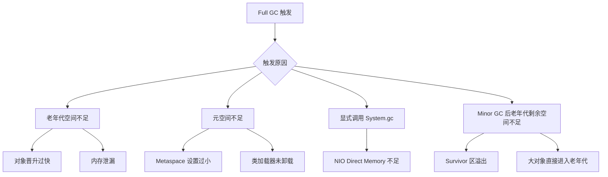

# 175. JVM 调优与 Full GC 频繁触发

> **场景定位**：Java 后端 / JVM 性能调优 / 线上故障排查  
> **核心设计要点**：Full GC 触发机制、对象晋升策略、内存泄漏排查、JVM 参数调优

---

## 🎯 一句话定位

**Full GC 就像仓库大扫除**：不是垃圾太多（老年代满），就是打扫太慢（回收器效率低），或者是打扫时间不对（参数配置不合理）。

---

## 💎 核心观点（5 分钟速览版）

### 三个本质原因

| 本质 | 核心问题 | 典型表现 |
|------|----------|----------|
| **本质一** | 对象晋升过快，老年代被快速占满 | Survivor 区过小、大对象未拆分 |
| **本质二** | 内存泄漏未排查，无效对象长期占用 | 连接未关闭、静态集合未清理、ThreadLocal 未 remove |
| **本质三** | JVM 参数配置不合理，加剧 Full GC | Metaspace 过小、G1 Region 设置不当、频繁 `System.gc()` |

---

## 🚀 一句话精华

**Full GC 频繁 ≠ 内存不够，而是「对象来得太快、走得太慢、扫得不勤」**

---

## 详细章节

### 一、问题本质：Full GC 触发机制

Full GC（Full Garbage Collection）是 JVM 对**整个堆内存**（包括新生代和老年代）以及**元空间**进行的垃圾回收。

#### 触发条件



#### Full GC 的影响

- **停顿时间长**：Full GC 通常需要秒级停顿，远超 Minor GC 的毫秒级
- **影响用户体验**：服务响应变慢、超时、甚至假死
- **吞吐量下降**：GC 时间占比升高，业务处理时间减少

---

### 二、三层防御详解

#### 防御一：控制对象晋升速度

**问题场景**：对象在新生代存活 2 次 Minor GC 后就进入老年代，导致老年代快速填满。

**核心机制**：

```java
// JVM 参数：-XX:MaxTenuringThreshold=15
// 默认值：15（Parallel GC）或 6（G1 GC）
// 含义：对象经过 N 次 Minor GC 后才会晋升到老年代
```

**Survivor 区过小的危害**：

```
新生代 = Eden + 2 * Survivor
假设：Eden=100M, Survivor=10M
当 Minor GC 后存活对象 > 10M 时，多余对象直接进入老年代
→ 老年代快速填满 → Full GC 频繁
```

**解决方案**：

```bash
# 调整新生代与老年代比例
-Xms4g -Xmx4g                    # 堆总大小
-Xmn2g                           # 新生代大小
-XX:SurvivorRatio=8              # Eden:S0:S1 = 8:1:1
-XX:MaxTenuringThreshold=15      # 提高晋升阈值

# G1 专属参数
-XX:G1HeapRegionSize=8M          # Region 大小（1M-32M）
-XX:MaxGCPauseMillis=200         # 目标停顿时间
-XX:InitiatingHeapOccupancyPercent=45  # 触发并发标记的堆占用率
```

**大对象拆分策略**：

```java
// ❌ 错误：大对象直接进入老年代
List<User> users = jdbcTemplate.query("SELECT * FROM users", ...);

// ✅ 正确：分批查询，避免大对象
int batchSize = 10000;
int offset = 0;
while (true) {
    List<User> batch = jdbcTemplate.query(
        "SELECT * FROM users LIMIT ?, ?", offset, batchSize);
    if (batch.isEmpty()) break;
    processBatch(batch);
    offset += batchSize;
}
```

---

#### 防御二：排查内存泄漏

**内存泄漏的本质**：无效对象被强引用持有，无法被 GC 回收。

**典型场景与代码示例**：

##### 场景 1：未关闭的连接

```java
// ❌ 错误：连接未关闭，导致资源泄漏
public void queryData() {
    Connection conn = dataSource.getConnection();
    PreparedStatement stmt = conn.prepareStatement("SELECT * FROM users");
    ResultSet rs = stmt.executeQuery();
    while (rs.next()) {
        // 处理数据
    }
    // 忘记关闭连接！
}

// ✅ 正确：使用 try-with-resources
public void queryData() {
    try (Connection conn = dataSource.getConnection();
         PreparedStatement stmt = conn.prepareStatement("SELECT * FROM users");
         ResultSet rs = stmt.executeQuery()) {
        while (rs.next()) {
            // 处理数据
        }
    } catch (SQLException e) {
        log.error("查询失败", e);
    }
}
```

##### 场景 2：静态集合未清理

```java
// ❌ 错误：静态集合持续增长，永不清理
public class CacheManager {
    private static final Map<String, Object> cache = new HashMap<>();
    
    public void addCache(String key, Object value) {
        cache.put(key, value);
    }
    
    // 没有 remove 方法，cache 只增不减
}

// ✅ 正确：使用弱引用或定期清理
public class CacheManager {
    private static final Map<String, WeakReference<Object>> cache = new WeakHashMap<>();
    
    public void addCache(String key, Object value) {
        cache.put(key, new WeakReference<>(value));
    }
    
    public void cleanExpired() {
        // 定期清理过期缓存
        cache.entrySet().removeIf(entry -> entry.getValue().get() == null);
    }
}
```

##### 场景 3：ThreadLocal 未 remove

```java
// ❌ 错误：ThreadLocal 使用后未清理
public class UserContext {
    private static final ThreadLocal<User> currentUser = new ThreadLocal<>();
    
    public void setUser(User user) {
        currentUser.set(user);
    }
    
    // 忘记调用 remove()
}

// ✅ 正确：在 finally 块中清理
public class UserContext {
    private static final ThreadLocal<User> currentUser = new ThreadLocal<>();
    
    public void setUser(User user) {
        currentUser.set(user);
    }
    
    public static void clear() {
        currentUser.remove();
    }
}

// 使用时
try {
    userContext.setUser(user);
    // 业务逻辑
} finally {
    userContext.clear();  // 必须清理
}
```

**内存泄漏排查工具**：

```bash
# 1. 导出堆内存快照
jmap -dump:format=b,file=heap.hprof <pid>

# 2. 使用 MAT (Memory Analyzer Tool) 分析
# 打开 heap.hprof → Leak Suspects → 查看可疑泄漏点

# 3. 使用 Arthas 在线诊断
jattach <pid> load arthas-agent.jar
# 进入 Arthas 后执行
heapdump /tmp/heap.hprof
```

---

#### 防御三：优化 JVM 参数配置

**Metaspace 配置**：

```bash
# ❌ 错误：Metaspace 设置过小，频繁扩容触发 Full GC
-XX:MetaspaceSize=64m -XX:MaxMetaspaceSize=128m

# ✅ 正确：根据类加载数量合理设置
-XX:MetaspaceSize=256m -XX:MaxMetaspaceSize=512m
```

**G1 回收器调优**：

```bash
# G1 核心参数
-XX:+UseG1GC                          # 启用 G1
-Xms8g -Xmx8g                         # 堆大小
-XX:G1HeapRegionSize=8M               # Region 大小
-XX:MaxGCPauseMillis=200              # 目标停顿时间
-XX:G1NewSizePercent=10               # 新生代最小占比
-XX:G1MaxNewSizePercent=30            # 新生代最大占比
-XX:InitiatingHeapOccupancyPercent=45 # 并发标记触发阈值
-XX:G1ReservePercent=10               # 预留空间
```

**避免显式调用 System.gc()**：

```java
// ❌ 错误：强制触发 Full GC
System.gc();  // 每次调用都会触发 Full GC

// ✅ 正确：让 JVM 自动管理 GC
// 如果必须触发，使用 JMX 或 Arthas 在运维层面操作
```

---

### 三、排查思路实战

#### Step 1：分析 GC 日志

```bash
# 开启 GC 日志
-XX:+PrintGCDetails -XX:+PrintGCDateStamps -XX:+PrintGCTimeStamps
-Xloggc:/data/logs/gc.log

# 分析工具
gceasy -i gc.log -o report.html  # 在线分析
GCViewer -i gc.log               # 本地工具
```

**关键指标**：

| 指标 | 正常值 | 异常表现 |
|------|--------|----------|
| Full GC 频率 | 几小时一次 | 十几分钟一次 |
| Full GC 后老年代占用 | < 30% | > 70% |
| Minor GC 耗时 | < 100ms | > 500ms |
| Full GC 耗时 | < 2s | > 5s |

#### Step 2：排查内存泄漏

```bash
# 1. 查看堆内存使用情况
jmap -heap <pid>

# 2. 导出堆内存快照
jmap -dump:live,format=b,file=heap.hprof <pid>

# 3. 使用 MAT 分析
# 打开 heap.hprof → Leak Suspects → 查看支配树
# 找到占用内存最大的对象和引用链

# 4. 使用 Arthas 在线诊断
jattach <pid> load arthas-agent.jar
# 进入 Arthas
vmtool --action getInstances --className java.util.HashMap --limit 10
```

#### Step 3：优化新生代与老年代比例

```bash
# 根据业务特点调整
# 场景 1：短生命周期对象多（Web 请求）
-Xmn3g -XX:SurvivorRatio=8

# 场景 2：长生命周期对象多（缓存服务）
-Xmn1g -XX:SurvivorRatio=4

# 动态调整（G1）
-XX:G1NewSizePercent=20
-XX:G1MaxNewSizePercent=40
```

#### Step 4：调整回收器参数

```bash
# Parallel GC（吞吐量优先）
-XX:+UseParallelGC -XX:ParallelGCThreads=8
-XX:MaxGCPauseMillis=200

# CMS GC（低延迟，JDK 14 已移除）
-XX:+UseConcMarkSweepGC -XX:CMSInitiatingOccupancyFraction=75

# G1 GC（平衡延迟和吞吐量，推荐）
-XX:+UseG1GC -XX:MaxGCPauseMillis=200
```

---

技术深入探讨

### 考点一：Full GC 频繁触发的原因

**方案参考**：

Full GC 频繁触发主要有三个原因：

1. **对象晋升过快**：Survivor 区过小，对象经过 2 次 Minor GC 后直接进入老年代；大对象未拆分，直接绕过新生代进入老年代。
2. **内存泄漏**：存在未关闭的连接、未清理的静态集合、ThreadLocal 未 remove 等情况，导致无效对象长期持有强引用，无法被回收。
3. **JVM 参数配置不合理**：Metaspace 过小频繁扩容、G1 Region 大小设置不当、频繁调用 `System.gc()` 等。

**加分回答**：

除了上述原因，还需要关注：

- **Minor GC 后老年代剩余空间不足**：即使老年代没满，但 Minor GC 后存活对象无法放入老年代，也会触发 Full GC。
- **元空间不足**：加载的类过多（如动态代理、反射生成大量类），Metaspace 频繁扩容触发 Full GC。
- **显式调用 System.gc()**：某些框架或代码中显式调用，强制触发 Full GC。
- **NIO Direct Memory 不足**：使用 Netty 等框架时，堆外内存不足也会触发 Full GC。

排查时需要结合 GC 日志、堆内存快照、MAT 工具，定位具体是晋升过快、内存泄漏还是参数配置问题。

---

### 考点二：如何排查内存泄漏

**方案参考**：

1. **导出堆内存快照**：使用 `jmap -dump:live,format=b,file=heap.hprof <pid>` 导出。
2. **使用 MAT 分析**：打开快照文件，查看 Leak Suspects 报告，找到占用内存最大的对象和引用链。
3. **定位泄漏点**：根据引用链找到代码中未关闭的资源（连接、静态集合、ThreadLocal 等）。
4. **修复并验证**：修复后再次导出快照，对比内存占用是否下降。

**加分回答**：

- **实时监控**：使用 Arthas 的 `heapdump` 命令在线诊断，或使用 Prometheus + Grafana 监控堆内存使用率。
- **弱引用优化**：对于缓存场景，使用 `WeakHashMap` 或 `WeakReference`，让 GC 自动回收无用对象。
- **资源管理**：使用 try-with-resources 管理资源，避免忘记关闭。
- **代码审查**：重点检查静态集合、ThreadLocal、监听器、回调函数等容易泄漏的地方。

---

### 考点三：G1 回收器调优参数

**方案参考**：

G1 核心参数：

- `-XX:+UseG1GC`：启用 G1 回收器。
- `-XX:MaxGCPauseMillis=200`：目标停顿时间（默认 200ms）。
- `-XX:G1HeapRegionSize=8M`：Region 大小（1M-32M，必须是 2 的幂）。
- `-XX:InitiatingHeapOccupancyPercent=45`：触发并发标记的堆占用率阈值。
- `-XX:G1NewSizePercent=10` / `-XX:G1MaxNewSizePercent=30`：新生代占比范围。

**加分回答**：

- **Region 大小选择**：Region 过大导致回收粒度粗，过小导致管理开销大。一般设置为 4M-16M，根据堆大小调整。
- **停顿时间目标**：`MaxGCPauseMillis` 不是硬限制，G1 会尽量满足，但不保证。设置过小会导致频繁回收，吞吐量下降。
- **并发标记阈值**：`InitiatingHeapOccupancyPercent` 默认 45%，过低导致频繁并发标记，过高导致 Full GC。
- **Mixed GC 调优**：`-XX:G1MixedGCCountTarget=8` 控制 Mixed GC 次数，`-XX:G1HeapWastePercent=5` 控制可回收垃圾占比阈值。

---

## 总结

### 一句话总结

**Full GC 频繁 ≠ 内存不够，核心是「对象晋升过快、内存泄漏、参数配置不合理」三层问题，需结合 GC 日志和堆快照精准定位。**

### 核心记忆点

1. **三个本质**：对象晋升过快、内存泄漏、JVM 参数不合理
2. **排查四步**：分析 GC 日志 → 导出堆快照 → MAT 分析 → 定位泄漏点
3. **防御三招**：控制晋升速度、排查内存泄漏、优化 JVM 参数
4. **G1 调优**：Region 大小、停顿时间、并发标记阈值、Mixed GC 次数

---

## 参考视频链接

📺 [场景提问：JVM 调优做了，为什么 Full GC 还是频繁触发？](https://www.douyin.com/video/7632321817966152546)
