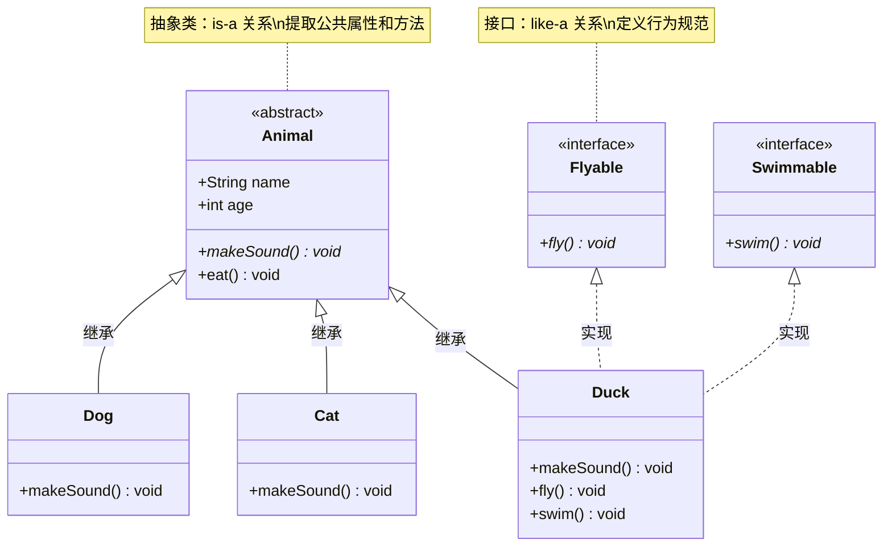

# 接口和抽象类的区别

**场景定位**：Java 基础 / 面向对象设计  
**核心设计要点**：接口与抽象类的本质区别、使用场景、继承特性、JDK 版本演进

---

## 🎯 一句话定位

**接口 = 行业规范标准**（如 USB 接口标准、WiFi 协议）  
**抽象类 = 产品设计模板**（如手机设计图纸、汽车底盘平台）

> 生活比喻：  
> - **接口**像是"WiFi 协议"——所有设备只要支持这个协议就能连接，不管你是手机、电脑还是智能电视  
> - **抽象类**像是"汽车底盘平台"——同一平台的车型共享发动机、悬挂等基础设计，但外观、内饰可以不同

---

## 💎 核心观点（5 分钟速览版）

### 核心区别一句话

| 维度 | 抽象类 | 接口 |
|------|--------|------|
| **设计目的** | 提取公共属性 + 通用逻辑（代码复用） | 定义行为规范（能力扩展） |
| **关系表达** | is-a 关系（"是什么"） | like-a 关系（"像什么/能做什么"） |
| **继承** | 只能单继承 | 支持多实现 |
| **成员变量** | 可以有普通变量、静态变量 | 只能有常量（public static final） |
| **构造方法** | 有 | 无 |
| **方法** | 任意修饰符，抽象/具体方法 | JDK 8 前只能抽象方法；JDK 8+ 支持 default/static 方法 |

### 设计原则

```
抽象类 → 为复用而生（提取公共代码）
接口   → 为规范而生（定义行为契约）
```

**禁止混用**：为了继承而继承会导致代码结构混乱，扩展性极差。

---

## 🚀 一句话精华

**抽象类是模板，接口是规范；抽象类解决"是什么"，接口解决"能做什么"。**

---

## 📖 详细讲解

### 一、问题本质：为什么需要两种机制？

面向对象设计的两大核心需求：

1. **代码复用** → 抽象类（提取公共逻辑）
2. **行为标准化** → 接口（定义统一规范）

> 💡 **设计哲学**：  
> - 抽象类回答："这类事物长什么样？有什么共同特征？"  
> - 接口回答："这类事物能做什么？需要遵守什么规范？"

### 二、核心区别详解

#### 1️⃣ 继承与实现

**抽象类 - 单继承**
```java
// 一个类只能继承一个抽象类
abstract class Animal {
    abstract void makeSound();
}

class Dog extends Animal {  // ✅ 正确
    void makeSound() { System.out.println("汪汪"); }
}

class Cat extends Animal {  // ✅ 正确
    void makeSound() { System.out.println("喵喵"); }
}

// class Bird extends Animal, Flyable { }  // ❌ 错误，Java 不支持多继承
```

**接口 - 多实现**
```java
// 一个类可以实现多个接口
interface Flyable {
    void fly();
}

interface Swimmable {
    void swim();
}

class Duck extends Animal implements Flyable, Swimmable {
    void makeSound() { System.out.println("嘎嘎"); }
    
    public void fly() { System.out.println("鸭子会飞"); }
    
    public void swim() { System.out.println("鸭子会游泳"); }
}
```

#### 2️⃣ 成员特性对比

**抽象类的成员**
```java
abstract class Vehicle {
    // 普通成员变量
    protected String brand;
    private int speed;
    
    // 静态变量
    public static int totalVehicles = 0;
    
    // 构造方法
    public Vehicle(String brand) {
        this.brand = brand;
        totalVehicles++;
    }
    
    // 抽象方法
    abstract void start();
    
    // 具体方法
    public void stop() {
        System.out.println("车辆停止");
    }
}
```

**接口的成员（JDK 8+）**
```java
interface Chargeable {
    // 只能有常量（默认 public static final）
    int MAX_VOLTAGE = 220;  // 等同于 public static final int MAX_VOLTAGE = 220;
    
    // 抽象方法（默认 public abstract）
    void charge();
    
    // JDK 8+ 默认方法
    default void checkBattery() {
        System.out.println("检查电池状态");
    }
    
    // JDK 8+ 静态方法
    static boolean isVoltageSafe(int voltage) {
        return voltage <= MAX_VOLTAGE;
    }
    
    // ❌ 不能有成员变量
    // int batteryLevel;  // 编译错误
    
    // ❌ 不能有构造方法
    // Chargeable() { }  // 编译错误
}
```

#### 3️⃣ 使用场景区分

**场景 1：用抽象类 - 提取公共逻辑**

```java
// 抽象类：订单模板
abstract class Order {
    protected String orderId;
    protected double amount;
    
    public Order(String orderId, double amount) {
        this.orderId = orderId;
        this.amount = amount;
    }
    
    // 通用逻辑：计算折扣
    public double calculateDiscount() {
        return amount * 0.1;  // 默认 10% 折扣
    }
    
    // 抽象方法：子类实现具体支付方式
    abstract void pay();
}

// 普通订单
class RegularOrder extends Order {
    public RegularOrder(String orderId, double amount) {
        super(orderId, amount);
    }
    
    void pay() {
        System.out.println("普通订单支付：" + (amount - calculateDiscount()));
    }
}

// VIP 订单
class VIPOrder extends Order {
    public VIPOrder(String orderId, double amount) {
        super(orderId, amount);
    }
    
    @Override
    public double calculateDiscount() {
        return amount * 0.2;  // VIP 20% 折扣
    }
    
    void pay() {
        System.out.println("VIP 订单支付：" + (amount - calculateDiscount()));
    }
}
```

**场景 2：用接口 - 定义行为规范**

```java
// 接口：支付能力
interface Payable {
    void pay(double amount);
}

// 接口：退款能力
interface Refundable {
    boolean refund(String orderId);
}

// 接口：查询能力
interface Queryable {
    String getBalance();
}

// 微信支付：实现多个接口
class WeChatPay implements Payable, Refundable, Queryable {
    public void pay(double amount) {
        System.out.println("微信支付：" + amount + "元");
    }
    
    public boolean refund(String orderId) {
        System.out.println("微信退款：" + orderId);
        return true;
    }
    
    public String getBalance() {
        return "微信余额：1000元";
    }
}

// 支付宝：实现多个接口
class Alipay implements Payable, Refundable, Queryable {
    public void pay(double amount) {
        System.out.println("支付宝支付：" + amount + "元");
    }
    
    public boolean refund(String orderId) {
        System.out.println("支付宝退款：" + orderId);
        return true;
    }
    
    public String getBalance() {
        return "支付宝余额：2000元";
    }
}
```

### 三、类图关系



### 四、JDK 版本演进

#### JDK 8 之前
```java
interface OldInterface {
    // 只能有抽象方法
    void method1();
    void method2();
}
```

**问题**：接口新增方法时，所有实现类都要修改。

#### JDK 8+（默认方法）
```java
interface NewInterface {
    // 抽象方法
    void method1();
    
    // 默认方法（JDK 8 新增）
    default void method2() {
        System.out.println("默认实现");
    }
    
    // 静态方法（JDK 8 新增）
    static void method3() {
        System.out.println("静态方法");
    }
}

class Implementation implements NewInterface {
    public void method1() {
        System.out.println("实现抽象方法");
    }
    
    // method2() 可以选择重写或不重写
}
```

**优势**：接口可以添加新方法而不破坏现有实现，解决了"接口演进"问题。

---

🎯 技术深入探讨

### 考点 1：接口和抽象类的核心区别

**方案参考**：
> 1. **设计目的不同**：抽象类用于代码复用，提取公共逻辑；接口用于定义行为规范。
> 2. **继承关系不同**：抽象类只能单继承，体现 is-a 关系；接口支持多实现，体现 like-a 关系。
> 3. **成员限制不同**：抽象类可以有构造方法、成员变量、任意修饰符的方法；接口只能有常量，JDK 8 后支持 default 和 static 方法。

**加分回答**：
> 从设计模式角度看，抽象类是"模板方法模式"的基础，接口是"策略模式"和"适配器模式"的核心。实际项目中，抽象类用于构建类层次结构（如 Java 的 Collection 体系），接口用于定义能力契约（如 Comparable、Serializable）。

---

### 考点 2：为什么 Java 不支持多继承但支持多实现？

**方案参考**：
> **多继承的问题**：如果类 A 继承 B 和 C，而 B 和 C 都有相同的方法，编译器无法确定调用哪个方法（菱形继承问题）。
>
> **多实现的安全**：接口的抽象方法没有实现，由实现类决定具体逻辑，不存在歧义。即使多个接口有同名方法，实现类只需实现一次。

**加分回答**：
> Java 8 后接口有 default 方法，如果多个接口的 default 方法冲突，实现类必须重写该方法消除歧义。例如：
> ```java
> interface A { default void method() { System.out.println("A"); } }
> interface B { default void method() { System.out.println("B"); } }
> 
> class C implements A, B {
>     public void method() {
>         // 必须重写，或指定调用：A.super.method();
>     }
> }
> ```

---

### 考点 3：实际项目中如何选择？

**方案参考**：
> - **用抽象类**：多个类有公共属性和逻辑，且是 is-a 关系。例如：`Order`、`User` 等实体类的基类。
> - **用接口**：定义能力规范，且需要跨类层次使用。例如：`Serializable`、`Comparable`、`Runnable`。
> - **组合使用**：抽象类实现接口的部分方法，子类继承抽象类并实现剩余方法。

**加分回答**：
> 实际项目中遵循"接口优先"原则：
> 1. 优先定义接口，保持灵活性
> 2. 发现重复逻辑时，提取抽象类或默认方法
> 3. 避免为了复用而滥用继承，优先使用组合
> 
> 例如 Spring 的 `JdbcTemplate` 使用模板方法模式（抽象类），而 `DataSource` 是接口，支持多种数据库连接池实现。

---

## 📝 总结

### 一句话总结

**抽象类是模板，接口是规范；抽象类解决"是什么"，接口解决"能做什么"。**

### 核心记忆点

| 要点 | 内容 |
|------|------|
| **本质** | 抽象类 = 代码复用；接口 = 行为规范 |
| **继承** | 抽象类单继承；接口多实现 |
| **成员** | 抽象类可有构造方法、变量；接口只能有常量 |
| **JDK 8+** | 接口支持 default/static 方法 |
| **设计原则** | 抽象类为复用而生，接口为规范而生 |

---

## 🔗 参考视频

[抖音视频：场景提问：接口和抽象类的区别是什么？](https://www.douyin.com/video/7631515093347437824)

---

## 💡 延伸思考

1. **Java 9+ 接口新特性**：私有方法（`private`）
2. **抽象类能否没有抽象方法？** 可以，但失去抽象意义
3. **接口能否继承抽象类？** 不能，接口只能继承接口
4. **实际项目中如何平衡复用与灵活性？** 优先组合，谨慎继承
