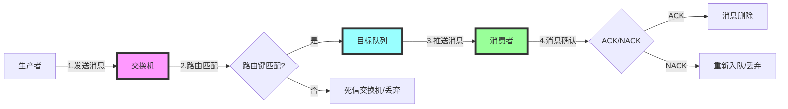
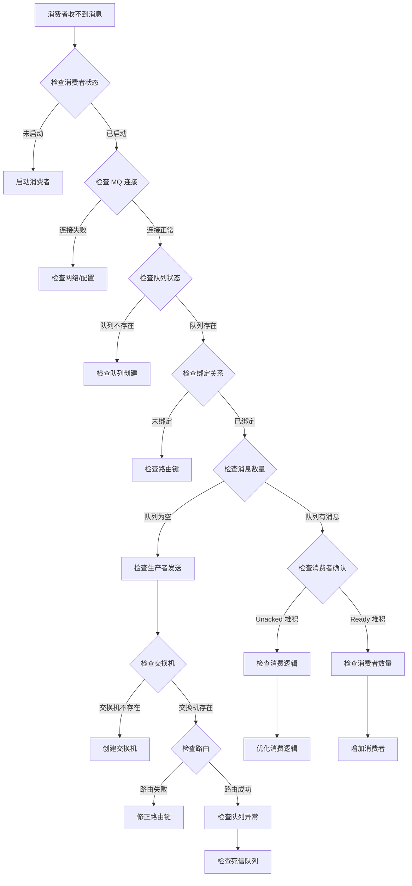

# RabbitMQ 消息消费失败排查：生产者确认发送成功，消费者却收不到消息

## 技术场景型与难度

- **题型**：消息队列故障排查 + 分布式系统问题定位
- **核心设计要点**：
  1. RabbitMQ 消息流转机制（交换机 → 队列 → 消费者）
  2. 消息确认机制（Publisher Confirm、Consumer Ack）
  3. 持久化配置（消息、队列、交换机持久化）
  4. 死信队列与消息丢失场景
  5. 集群高可用与故障转移

---

## 🎯 一句话定位（生活化比喻）

**RabbitMQ 就像一个快递系统**：

- **生产者** = 发件人（把包裹交给快递公司）
- **交换机** = 快递分拣中心（根据地址决定包裹去向）
- **队列** = 快递柜（包裹暂时存放的地方）
- **消费者** = 收件人（从快递柜取包裹）
- **消息路由** = 快递员根据地址分配包裹到对应快递柜
- **消息确认** = 签收凭证（证明包裹已送达）

**问题本质**：发件人说"我已经把包裹交给快递公司了"（生产者确认发送成功），但收件人就是没收到包裹。可能的原因：

1. 分拣中心搞错了地址，包裹根本没到正确的快递柜（路由失败）
2. 包裹到了快递柜，但快递柜满了或者坏了，包裹被丢弃（队列异常）
3. 收件人收到取件通知但没去取，或者取件后没签收，导致系统认为没送达（确认机制问题）
4. 快递公司在转运过程中丢件，尤其是遇到系统故障时（持久化缺失）

---

## 💎 核心观点（5 分钟速览版）

### 三层防御体系

```
第一层：消息路由防御
├─ 交换机与队列绑定检查
├─ 路由键配置验证
└─ 死信队列兜底机制

第二层：消息确认防御
├─ 生产者确认机制（Publisher Confirm）
├─ 消费者手动确认（Manual Ack）
└─ 消费失败重试与补偿

第三层：持久化防御
├─ 消息持久化（deliveryMode=2）
├─ 队列持久化（durable=true）
└─ 交换机持久化（durable=true）
```

### 核心问题分类

| 问题层级 | 典型场景 | 根本原因 | 解决方案 |
|---------|---------|---------|---------|
| **路由层** | 消息路由成功但未进入队列 | 队列未绑定死信交换机、路由键错误 | 检查绑定关系、配置死信队列 |
| **确认层** | 消息被重复消费或丢失 | 自动确认导致失败消息丢失、未手动确认导致消息堆积 | 开启手动确认、实现幂等消费 |
| **持久化层** | MQ 重启后消息丢失 | 消息/队列/交换机未持久化 | 三者全部持久化 |

---

## 🚀 一句话精华

**消息发出去但收不到，不是消费者没启动，而是：路由绑定隐藏坑、确认机制用错、持久化配置缺失——这三层防御缺一不可。**

---

## 详细章节

### 一、问题本质：消息流转的完整链路

#### 1.1 RabbitMQ 消息流转流程图



#### 1.2 消息可能丢失的 5 个环节

| 环节 | 丢失原因 | 发生概率 | 排查难度 |
|------|---------|---------|---------|
| **生产者 → 交换机** | 交换机不存在或网络问题 | 低 | 容易（Publisher Confirm） |
| **交换机 → 队列** | 路由键错误、队列未绑定 | 中 | 中等（需检查绑定关系） |
| **队列存储** | 队列满、消息过期、队列被删除 | 中 | 困难（需监控队列状态） |
| **队列 → 消费者** | 消费者未确认、消费失败 | 高 | 困难（需检查确认机制） |
| **MQ 宕机** | 未持久化消息丢失 | 高 | 困难（需检查持久化配置） |

---

### 二、第一层防御：消息路由成功 ≠ 投递到队列

#### 2.1 问题场景

**生产者日志显示**：
```
2024-01-15 10:23:45 INFO  - 消息发送成功，交换机：order.exchange，路由键：order.create
2024-01-15 10:23:45 INFO  - Publisher Confirm：消息已路由成功
```

**但消费者就是收不到消息！**

#### 2.2 隐藏问题 1：队列未绑定死信交换机

**什么是死信交换机（DLX）？**

死信交换机是一个特殊的交换机，当消息在队列中遇到以下情况时，会被路由到死信交换机：

1. **队列达到最大长度**（x-max-length）
2. **消息过期**（x-message-ttl）
3. **消息被拒绝**（basic.reject / basic.nack）且不再入队

**如果没有配置死信交换机，这些消息会直接丢失！**

**生活化比喻**：
> 快递柜满了，新来的包裹没地方放。如果没有设置"溢出处理机制"（死信队列），这些包裹直接扔垃圾桶。

**代码示例（Java + Spring Boot）**：

```java
@Configuration
public class RabbitMQConfig {
    
    // 定义死信交换机
    @Bean
    public DirectExchange deadLetterExchange() {
        return new DirectExchange("order.dlx.exchange", true, false);
    }
    
    // 定义死信队列
    @Bean
    public Queue deadLetterQueue() {
        return QueueBuilder.durable("order.dlq.queue")
                .withArgument("x-dead-letter-exchange", "")  // 使用默认交换机
                .withArgument("x-dead-letter-routing-key", "order.dlq.queue")
                .build();
    }
    
    // 定义业务队列，并绑定死信交换机
    @Bean
    public Queue orderQueue() {
        return QueueBuilder.durable("order.create.queue")
                .withArgument("x-max-length", 10000)  // 队列最大长度
                .withArgument("x-message-ttl", 300000)  // 消息过期时间 5 分钟
                .withArgument("x-dead-letter-exchange", "order.dlx.exchange")  // 绑定死信交换机
                .withArgument("x-dead-letter-routing-key", "order.dlq")  // 死信路由键
                .build();
    }
    
    // 绑定业务队列到交换机
    @Bean
    public Binding orderBinding() {
        return BindingBuilder.bind(orderQueue())
                .to(new DirectExchange("order.exchange"))
                .with("order.create");
    }
}
```

#### 2.3 隐藏问题 2：路由键配置错误

**常见错误场景**：

```java
// 生产者发送消息
rabbitTemplate.convertAndSend("order.exchange", "order.create", orderMessage);

// 但队列绑定时路由键写错了
@Bean
public Binding orderBinding() {
    return BindingBuilder.bind(orderQueue())
            .to(new DirectExchange("order.exchange"))
            .with("order.created");  // ❌ 错误：应该是 order.create
}
```

**排查方法**：

```bash
# 查看交换机绑定的路由键
rabbitmqadmin list bindings source_name destination_name routing_key

# 查看队列绑定关系
rabbitmqctl list_queues name bindings
```

#### 2.4 隐藏问题 3：队列异常状态

**队列可能处于异常状态**：

| 状态 | 表现 | 原因 | 解决方案 |
|------|------|------|---------|
| **队列被删除** | 消息无法进入队列 | 手动删除或代码误删 | 检查 RabbitMQ 管理界面日志 |
| **队列暂停** | 消息堆积但不消费 | 运维手动暂停 | `rabbitmqctl pause_queue <queue_name>` |
| **队列达到上限** | 新消息被丢弃或进入死信 | 消费速度跟不上 | 增加消费者、优化消费逻辑 |

---

### 三、第二层防御：消费者确认机制的坑

#### 3.1 问题场景

**场景 1：自动确认导致消息丢失**

```java
// ❌ 错误配置：开启自动确认
@RabbitListener(queues = "order.create.queue", ackMode = "AUTO")
public void handleOrderMessage(OrderMessage message) {
    // 业务逻辑执行失败，抛出异常
    int result = 10 / 0;  // ArithmeticException
    
    // 但消息已经被 MQ 认为已消费，直接删除！
    // 消息永久丢失！
}
```

**场景 2：手动确认但未调用 ACK**

```java
// ❌ 错误配置：手动确认但忘记调用 channel.basicAck()
@RabbitListener(queues = "order.create.queue", ackMode = "MANUAL")
public void handleOrderMessage(Message message, Channel channel) {
    try {
        // 业务逻辑
        processOrder(message);
        
        // 忘记调用 basicAck，消息一直停留在 Unacked 状态
    } catch (Exception e) {
        // 忘记调用 basicNack 或 basicReject
        log.error("处理失败", e);
    }
}
```

#### 3.2 正确的消费者确认机制

**完整示例（Java + Spring Boot）**：

```java
@Configuration
public class RabbitMQConsumerConfig {
    
    @Bean
    public SimpleRabbitListenerContainerFactory rabbitListenerContainerFactory(
            ConnectionFactory connectionFactory) {
        SimpleRabbitListenerContainerFactory factory = new SimpleRabbitListenerContainerFactory();
        factory.setConnectionFactory(connectionFactory);
        factory.setAcknowledgeMode(AcknowledgeMode.MANUAL);  // 手动确认
        factory.setPrefetchCount(1);  // 每次只拉取一条消息
        factory.setConcurrentConsumers(5);  // 并发消费者数量
        return factory;
    }
}

@Component
public class OrderMessageConsumer {
    
    private static final Logger log = LoggerFactory.getLogger(OrderMessageConsumer.class);
    
    @RabbitListener(queues = "order.create.queue")
    public void handleOrderMessage(Message message, Channel channel) throws IOException {
        long deliveryTag = message.getMessageProperties().getDeliveryTag();
        
        try {
            // 1. 解析消息
            String body = new String(message.getBody(), StandardCharsets.UTF_8);
            OrderMessage orderMessage = JSON.parseObject(body, OrderMessage.class);
            
            // 2. 幂等性检查（防止重复消费）
            if (isAlreadyProcessed(orderMessage.getOrderId())) {
                log.info("消息已处理，直接确认：orderId={}", orderMessage.getOrderId());
                channel.basicAck(deliveryTag, false);
                return;
            }
            
            // 3. 执行业务逻辑
            processOrder(orderMessage);
            
            // 4. 手动确认消息
            channel.basicAck(deliveryTag, false);
            log.info("消息消费成功：orderId={}", orderMessage.getOrderId());
            
        } catch (Exception e) {
            log.error("消息消费失败：deliveryTag={}", deliveryTag, e);
            
            // 5. 拒绝消息，requeue=true 表示重新入队
            // requeue=false 表示丢弃或进入死信队列
            channel.basicNack(deliveryTag, false, false);
        }
    }
    
    private void processOrder(OrderMessage orderMessage) {
        // 业务逻辑：创建订单
        // ...
    }
    
    private boolean isAlreadyProcessed(String orderId) {
        // 使用 Redis 或数据库检查消息是否已处理
        // 实现幂等性
        return redisTemplate.hasKey("order:processed:" + orderId);
    }
}
```

#### 3.3 消息确认机制对比

| 确认模式 | 配置 | 优点 | 缺点 | 适用场景 |
|---------|------|------|------|---------|
| **自动确认** | `ackMode=AUTO` | 简单，不会堆积 | 消费失败消息丢失 | 对消息丢失不敏感的场景 |
| **手动确认** | `ackMode=MANUAL` | 消息不丢失，可重试 | 需要手动管理 ACK | 对消息可靠性要求高的场景 |
| **无确认** | `ackMode=NONE` | 性能最高 | 消息可能丢失 | 实时性要求高、可容忍丢失 |

#### 3.4 消息重复消费与幂等性

**问题**：消费者处理完消息后，在调用 `basicAck` 之前宕机，导致消息重新入队，被其他消费者重复消费。

**解决方案：实现幂等性消费**

```java
@Component
public class IdempotentOrderConsumer {
    
    @Autowired
    private RedisTemplate<String, String> redisTemplate;
    
    @Autowired
    private OrderService orderService;
    
    @RabbitListener(queues = "order.create.queue")
    public void handleOrderMessage(Message message, Channel channel) throws IOException {
        long deliveryTag = message.getMessageProperties().getDeliveryTag();
        String body = new String(message.getBody(), StandardCharsets.UTF_8);
        OrderMessage orderMessage = JSON.parseObject(body, OrderMessage.class);
        
        String orderId = orderMessage.getOrderId();
        String idempotentKey = "order:processed:" + orderId;
        
        try {
            // 1. 使用 Redis SETNX 实现幂等性检查
            Boolean setResult = redisTemplate.opsForValue()
                    .setIfAbsent(idempotentKey, "1", 24, TimeUnit.HOURS);
            
            if (Boolean.FALSE.equals(setResult)) {
                // 已处理过，直接确认
                log.info("消息已处理，跳过：orderId={}", orderId);
                channel.basicAck(deliveryTag, false);
                return;
            }
            
            // 2. 执行业务逻辑
            orderService.createOrder(orderMessage);
            
            // 3. 确认消息
            channel.basicAck(deliveryTag, false);
            
        } catch (Exception e) {
            // 4. 处理失败，删除幂等键，允许重试
            redisTemplate.delete(idempotentKey);
            channel.basicNack(deliveryTag, false, true);  // 重新入队
        }
    }
}
```

---

### 四、第三层防御：持久化配置缺失导致消息丢失

#### 4.1 问题场景

**场景：MQ 重启后消息全部丢失**

```
2024-01-15 10:00:00 INFO  - 发送消息：orderId=12345
2024-01-15 10:05:00 ERROR - RabbitMQ 服务重启
2024-01-15 10:06:00 INFO  - RabbitMQ 服务启动成功
2024-01-15 10:10:00 WARN  - 消费者收不到消息，队列已空！
```

#### 4.2 持久化的三个维度

| 维度 | 配置项 | 默认值 | 说明 |
|------|--------|--------|------|
| **消息持久化** | `deliveryMode` | 1（非持久化） | 1=非持久化，2=持久化 |
| **队列持久化** | `durable` | true | 队列元数据是否持久化 |
| **交换机持久化** | `durable` | true | 交换机元数据是否持久化 |

**⚠️ 重要**：三者必须同时设置，缺一不可！

#### 4.3 完整的持久化配置示例

```java
@Configuration
public class RabbitMQPersistenceConfig {
    
    // 1. 定义持久化交换机
    @Bean
    public DirectExchange orderExchange() {
        return new DirectExchange("order.exchange", true, false);
        //                                         ↑ durable=true
    }
    
    // 2. 定义持久化队列
    @Bean
    public Queue orderQueue() {
        return new Queue("order.create.queue", true);
        //                                       ↑ durable=true
    }
    
    // 3. 绑定队列到交换机
    @Bean
    public Binding orderBinding() {
        return BindingBuilder.bind(orderQueue())
                .to(orderExchange())
                .with("order.create");
    }
}

// 4. 发送持久化消息
@Service
public class OrderProducer {
    
    @Autowired
    private RabbitTemplate rabbitTemplate;
    
    public void sendOrderMessage(OrderMessage orderMessage) {
        // 设置消息持久化
        rabbitTemplate.setConfirmCallback((correlationData, ack, cause) -> {
            if (ack) {
                log.info("消息发送成功：{}", correlationData);
            } else {
                log.error("消息发送失败：{}", cause);
            }
        });
        
        MessagePostProcessor messagePostProcessor = message -> {
            MessageProperties props = message.getMessageProperties();
            props.setDeliveryMode(MessageDeliveryMode.PERSISTENT);  // 消息持久化
            props.setContentType(MessageProperties.CONTENT_TYPE_JSON);
            return message;
        };
        
        rabbitTemplate.convertAndSend(
                "order.exchange",
                "order.create",
                orderMessage,
                messagePostProcessor
        );
    }
}
```

#### 4.4 集群环境下的持久化

**单机 vs 集群对比**：

| 环境 | 单节点宕机 | 消息丢失风险 | 解决方案 |
|------|-----------|-------------|---------|
| **单机模式** | MQ 不可用 | 未持久化消息丢失 | 开启持久化 |
| **普通集群** | 主节点宕机 | 主节点未同步消息丢失 | 镜像队列 |
| **镜像队列集群** | 主节点宕机 | 自动切换到从节点 | 配置镜像队列策略 |
| **Quorum 队列** | 主节点宕机 | 基于 Raft 协议，数据不丢失 | 推荐使用 |

**镜像队列配置示例**：

```bash
# 设置所有队列镜像到所有节点
rabbitmqctl set_policy ha-all "^" '{"ha-mode":"all"}'

# 设置特定队列镜像到指定节点
rabbitmqctl set_policy ha-three "^order\." '{"ha-mode":"exactly","ha-params":3}'
```

**Quorum 队列配置（推荐）**：

```java
@Bean
public Queue quorumQueue() {
    return QueueBuilder.durable("order.create.queue")
            .quorum()  // 使用 Quorum 队列
            .withArgument("x-quorum-initial-group-size", 3)  // 3 个副本
            .build();
}
```

---

### 五、完整排查流程

#### 5.1 排查流程图



#### 5.2 排查命令速查表

```bash
# 1. 查看队列状态
rabbitmqctl list_queues name messages consumers ready unacknowledged

# 2. 查看交换机绑定关系
rabbitmqctl list_bindings source_name source_kind destination_name destination_kind routing_key

# 3. 查看队列详细信息
rabbitmqadmin get queue=order.create.queue

# 4. 查看死信队列
rabbitmqctl list_queues name | grep dlq

# 5. 查看集群状态
rabbitmqctl cluster_status

# 6. 查看持久化配置
rabbitmqadmin list queues name durable auto_delete
rabbitmqadmin list exchanges name durable
```

---

技术深入探讨

### 考点 1：消息路由成功但未进入队列的原因

**方案参考**：

消息路由成功但未进入队列，主要有三个原因：

1. **队列未绑定死信交换机**：当队列达到最大长度、消息过期或队列被删除时，消息会直接丢失，而不是进入死信队列。
2. **路由键配置错误**：生产者发送消息时使用的路由键与队列绑定时使用的路由键不一致。
3. **队列处于异常状态**：队列被手动删除、暂停或达到上限。

**加分回答**：

在实际项目中，我会通过以下方式预防：

1. **配置死信队列**：为所有业务队列绑定死信交换机，确保异常消息不丢失。
2. **开启 Publisher Confirm**：生产者发送消息后，等待 MQ 的确认回调，确保消息真正进入队列。
3. **监控告警**：使用 Prometheus + Grafana 监控队列长度、消费者数量、消息堆积情况，设置告警阈值。
4. **单元测试**：编写测试用例验证路由键匹配逻辑，避免配置错误。

---

### 考点 2：消费者确认机制的选择

**方案参考**：

RabbitMQ 有三种确认模式：

1. **自动确认（AUTO）**：消费者接收到消息后，MQ 立即认为消息已消费并删除。优点是简单，缺点是消费失败会导致消息丢失。
2. **手动确认（MANUAL）**：消费者处理完消息后，需要显式调用 `channel.basicAck()` 确认。优点是消息不丢失，缺点是需要手动管理。
3. **无确认（NONE）**：MQ 发送消息后不等待确认，性能最高但可能丢失消息。

推荐在生产环境使用手动确认，并实现幂等性消费。

**加分回答**：

手动确认的关键是正确处理异常情况：

```java
try {
    // 业务逻辑
    processMessage(message);
    // 成功则确认
    channel.basicAck(deliveryTag, false);
} catch (Exception e) {
    // 失败则拒绝，requeue=false 进入死信队列
    channel.basicNack(deliveryTag, false, false);
}
```

同时需要实现幂等性消费，防止消息重复消费：

1. **唯一消息 ID**：为每条消息生成唯一 ID，消费前检查是否已处理。
2. **数据库去重**：使用数据库唯一约束或乐观锁。
3. **Redis 去重**：使用 `SETNX` 记录已处理的消息 ID。

---

### 考点 3：消息持久化的配置

**方案参考**：

RabbitMQ 持久化包括三个维度：

1. **消息持久化**：设置 `deliveryMode=2`（PERSISTENT），消息会写入磁盘。
2. **队列持久化**：创建队列时设置 `durable=true`，队列元数据会持久化。
3. **交换机持久化**：创建交换机时设置 `durable=true`，交换机元数据会持久化。

三者必须同时设置，缺一不可。

**加分回答**：

在集群环境下，还需要考虑数据同步：

1. **镜像队列**：通过 `ha-mode` 策略将队列镜像到多个节点，主节点宕机时自动切换。
2. **Quorum 队列**：基于 Raft 协议，提供强一致性保证，推荐使用。

```java
// Quorum 队列配置
@Bean
public Queue quorumQueue() {
    return QueueBuilder.durable("order.queue")
            .quorum()
            .withArgument("x-quorum-initial-group-size", 3)
            .build();
}
```

同时要注意持久化对性能的影响：

1. **磁盘 I/O**：持久化消息会写入磁盘，影响性能。可以使用 SSD 或 RAM Disk 提升性能。
2. **批量确认**：消费者可以批量确认消息，减少 I/O 次数。
3. ** lazy 队列**：将消息尽快写入磁盘，减少内存占用。

---

## 总结

### 一句话总结

**RabbitMQ 消息发出去但消费者收不到，核心原因是：路由绑定隐藏坑（队列未绑定死信交换机、路由键错误）、消息确认机制用错（自动确认导致丢失、未确认导致堆积）、持久化配置缺失（消息/队列/交换机未持久化）——三层防御缺一不可。**

### 核心记忆点

```
📦 三层防御体系：
├─ 第一层：路由防御
│   ├─ 检查交换机与队列绑定
│   ├─ 验证路由键一致性
│   └─ 配置死信队列兜底
│
├─ 第二层：确认防御
│   ├─ 生产者：Publisher Confirm
│   ├─ 消费者：手动 Ack + 幂等性
│   └─ 失败处理：Nack + 死信队列
│
└─ 第三层：持久化防御
    ├─ 消息持久化：deliveryMode=2
    ├─ 队列持久化：durable=true
    └─ 交换机持久化：durable=true

🔍 排查思路：
1. 检查消费者状态与连接
2. 检查队列状态与绑定关系
3. 检查消息数量与确认状态
4. 检查持久化配置
5. 检查集群高可用配置
```

---

## 参考视频链接

- **抖音视频**：https://www.douyin.com/video/7631153259687726388
- **视频标题**：场景提问：RabbitMQ 消息发出去了，为什么消费者就是收不到

---

## 附录：完整代码示例

### A. 生产者完整示例

```java
@Service
@Slf4j
public class ReliableOrderProducer {
    
    @Autowired
    private RabbitTemplate rabbitTemplate;
    
    @Autowired
    private RedisTemplate<String, String> redisTemplate;
    
    /**
     * 可靠消息发送
     */
    public void sendOrderMessage(OrderMessage orderMessage) {
        String messageId = UUID.randomUUID().toString();
        String correlationId = orderMessage.getOrderId() + "_" + messageId;
        
        // 1. 设置生产者确认回调
        rabbitTemplate.setConfirmCallback((correlationData, ack, cause) -> {
            if (ack) {
                log.info("消息发送成功：correlationId={}", correlationData.getId());
                // 更新消息状态为已发送
                redisTemplate.opsForValue().set(
                    "mq:message:status:" + correlationData.getId(),
                    "SENT",
                    24, TimeUnit.HOURS
                );
            } else {
                log.error("消息发送失败：correlationId={}, cause={}", 
                    correlationData.getId(), cause);
                // 重试或记录到数据库，后续补偿
            }
        });
        
        // 2. 设置消息回退回调（路由失败时触发）
        rabbitTemplate.setReturnsCallback(returned -> {
            log.error("消息路由失败：exchange={}, routingKey={}, replyCode={}, replyText={}",
                returned.getExchange(),
                returned.getRoutingKey(),
                returned.getReplyCode(),
                returned.getReplyText());
            // 记录到数据库，人工介入处理
        });
        
        // 3. 构建消息
        MessagePostProcessor messagePostProcessor = message -> {
            MessageProperties props = message.getMessageProperties();
            props.setMessageId(messageId);
            props.setCorrelationId(correlationId);
            props.setDeliveryMode(MessageDeliveryMode.PERSISTENT);  // 消息持久化
            props.setContentType(MessageProperties.CONTENT_TYPE_JSON);
            props.setExpiration("300000");  // 消息过期时间 5 分钟
            return message;
        };
        
        // 4. 发送消息
        rabbitTemplate.setMandatory(true);  // 开启消息回退
        rabbitTemplate.convertAndSend(
            "order.exchange",
            "order.create",
            orderMessage,
            messagePostProcessor
        );
        
        log.info("消息已发送：orderId={}, messageId={}", 
            orderMessage.getOrderId(), messageId);
    }
}
```

### B. 消费者完整示例

```java
@Component
@Slf4j
public class ReliableOrderConsumer {
    
    @Autowired
    private OrderService orderService;
    
    @Autowired
    private RedisTemplate<String, String> redisTemplate;
    
    @RabbitListener(queues = "order.create.queue")
    public void handleOrderMessage(Message message, Channel channel) throws IOException {
        long deliveryTag = message.getMessageProperties().getDeliveryTag();
        String messageId = message.getMessageProperties().getMessageId();
        String correlationId = message.getMessageProperties().getCorrelationId();
        
        try {
            // 1. 解析消息
            String body = new String(message.getBody(), StandardCharsets.UTF_8);
            OrderMessage orderMessage = JSON.parseObject(body, OrderMessage.class);
            String orderId = orderMessage.getOrderId();
            
            log.info("收到消息：orderId={}, messageId={}, deliveryTag={}", 
                orderId, messageId, deliveryTag);
            
            // 2. 幂等性检查
            String idempotentKey = "order:processed:" + orderId;
            Boolean setResult = redisTemplate.opsForValue()
                .setIfAbsent(idempotentKey, "1", 24, TimeUnit.HOURS);
            
            if (Boolean.FALSE.equals(setResult)) {
                log.warn("消息已处理，跳过：orderId={}", orderId);
                channel.basicAck(deliveryTag, false);
                return;
            }
            
            // 3. 执行业务逻辑
            orderService.createOrder(orderMessage);
            
            // 4. 确认消息
            channel.basicAck(deliveryTag, false);
            log.info("消息消费成功：orderId={}", orderId);
            
            // 5. 更新消息状态
            if (correlationId != null) {
                redisTemplate.opsForValue().set(
                    "mq:message:status:" + correlationId,
                    "CONSUMED",
                    24, TimeUnit.HOURS
                );
            }
            
        } catch (Exception e) {
            log.error("消息消费失败：deliveryTag={}", deliveryTag, e);
            
            // 6. 拒绝消息，不重新入队，进入死信队列
            channel.basicNack(deliveryTag, false, false);
        }
    }
}
```

### C. 死信队列消费者示例

```java
@Component
@Slf4j
public class DeadLetterQueueConsumer {
    
    @Autowired
    private AlertService alertService;
    
    @RabbitListener(queues = "order.dlq.queue")
    public void handleDeadLetterMessage(Message message, Channel channel) throws IOException {
        long deliveryTag = message.getMessageProperties().getDeliveryTag();
        
        try {
            // 1. 解析死信消息
            String body = new String(message.getBody(), StandardCharsets.UTF_8);
            log.error("收到死信消息：{}", body);
            
            // 2. 记录到数据库，人工介入
            DeadLetterRecord record = new DeadLetterRecord();
            record.setMessageId(message.getMessageProperties().getMessageId());
            record.setMessageBody(body);
            record.setReason(message.getMessageProperties().getHeader("x-death"));
            record.setCreateTime(new Date());
            
            // 保存到数据库
            deadLetterRepository.save(record);
            
            // 3. 发送告警
            alertService.sendAlert("RabbitMQ 死信消息告警", body);
            
            // 4. 确认消息
            channel.basicAck(deliveryTag, false);
            
        } catch (Exception e) {
            log.error("死信消息处理失败", e);
            // 死信消息处理失败，重新入队
            channel.basicNack(deliveryTag, false, true);
        }
    }
}
```

---

**文档版本**：v1.0  
**最后更新**：2026-10-22  
**适用版本**：RabbitMQ 3.x+、Spring Boot 2.x+
