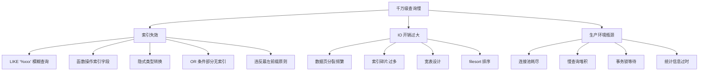
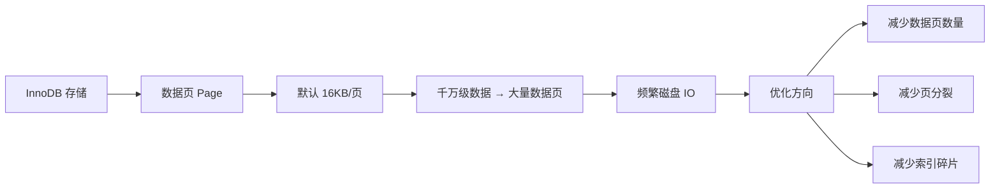
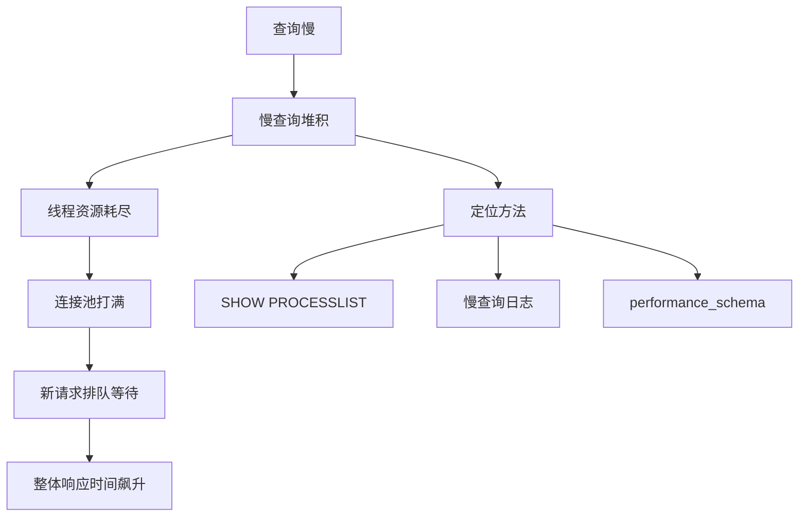
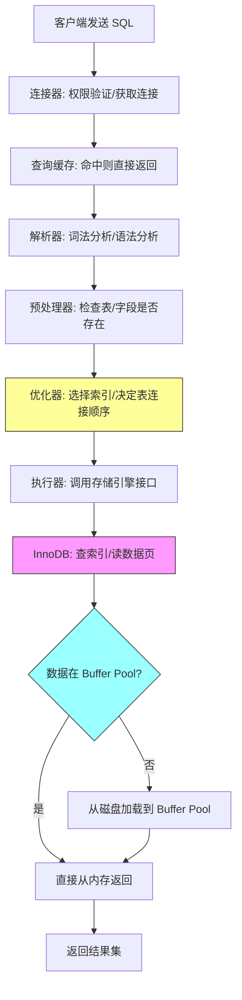

# MySQL 千万级数据查询优化

> **场景定位**：数据库性能优化 / 高频实战题  
> **核心设计要点**：索引失效场景、InnoDB 存储引擎原理、执行计划分析、生产环境瓶颈定位、SQL 优化实战

---

## 🎯 一句话定位

**MySQL 千万级查询慢的核心原因是什么？**
```
不是数据量太大，而是"有效数据过滤效率低"
就像在千万本书的图书馆找一本书，不是图书馆太大，而是你没有用目录（索引），在一本本翻
```

**生活化比喻**：
把 MySQL 想象成一个**超大型图书馆**：
- 千万级数据 = 图书馆有 1000 万本书
- 索引 = 图书目录系统（按书名/作者/分类编号）
- 全表扫描 = 没有目录，从第一本书开始一本本翻
- 回表 = 在目录找到了编号，但要跑到书架上去拿书
- 索引失效 = 目录存在但用不了（比如你只记得书的一部分内容，模糊搜索）

**核心特点**：索引效率、IO 开销、执行计划、锁竞争、事务设计

---

## 💎 核心观点（5 分钟速览版）

> **快速概览**

### 本质一：慢查询的根因是"有效数据过滤效率低"，不是数据量大

```
❌ 错误认知：数据量大所以慢 → 加索引就行
✅ 正确认知：索引失效 + 全表扫描 + 回表代价大 才是慢的核心原因

常见索引失效场景：
  1. LIKE '%xxx' 模糊查询以 % 开头 → 索引失效
  2. 对索引字段使用函数 → WHERE YEAR(create_time) = 2024
  3. 隐式类型转换 → 字符串字段用数字查询
  4. OR 条件中有一列没有索引 → 整个查询走全表扫描
  5. 联合索引不满足最左前缀原则 → 跳过左列直接用右列
```

### 本质二：InnoDB 存储结构与执行计划的底层限制

```
InnoDB 以"页"为单位读写数据，默认 16KB/页
千万级数据 → 数据页数量巨大 → 频繁磁盘 IO

底层问题：
  1. 主键设计不合理 → 数据页频繁分裂
  2. 索引碎片过多 → 查询需要加载更多页
  3. 宽表设计 → 每页存储行数减少 → IO 成本上升
  4. ORDER BY / GROUP BY 无索引支撑 → filesort 排序消耗 CPU
```

### 本质三：生产环境的性能瓶颈远不止查询本身

```
生产环境真正的杀手：
  1. 数据库连接池耗尽 → 请求排队等待连接
  2. 慢查询堆积 → 占用大量线程，正常查询被阻塞
  3. 事务锁等待 → 行锁变表锁，大面积阻塞
  4. 长事务不释放 → 占用连接 + undo log 膨胀
  5. 统计信息过时 → 优化器选错执行计划（有索引却不用）
```

---

## 🚀 一句话精华

> **MySQL 千万级查询慢的本质不是数据量大，而是索引失效导致全表扫描、IO 开销过大、执行计划不合理，再加上生产环境中的锁竞争和事务设计问题，共同拖垮了查询性能。**

---

## 📖 详细章节

### 一、问题本质：为什么千万级数据查询慢？

#### 1.1 慢查询的三大根因



#### 1.2 生活化理解

想象你在一个有 1000 万本书的图书馆找一本关于"Java 并发编程"的书：

| 场景 | 对应 MySQL | 效率 |
|------|-----------|------|
| 有完善的图书检索系统，输入书名直接定位到书架编号 | 精确索引查询 | 🟢 毫秒级 |
| 有目录但模糊搜索"Java"，需要逐条比对 | LIKE 'Java%' 索引范围扫描 | 🟡 百毫秒级 |
| 只记得书里有"并发"两个字，需要从第一本书开始翻内容 | LIKE '%并发%' 全表扫描 | 🔴 秒级甚至更慢 |
| 目录存在但坏了，只能自己一排排找 | 索引失效（函数/类型转换等） | 🔴 秒级 |
| 图书馆只有 1 个通道，其他人在搬书挡着路 | 锁竞争、连接池耗尽 | 🔴 阻塞等待 |

---

### 二、第一层防御：索引优化——让查询"有的放矢"

#### 2.1 索引失效的五大场景

```sql
-- 准备测试表
CREATE TABLE orders (
    id BIGINT PRIMARY KEY AUTO_INCREMENT,
    user_name VARCHAR(50),        -- 用户姓名
    phone VARCHAR(20),            -- 手机号
    amount DECIMAL(10,2),         -- 订单金额
    status TINYINT,               -- 订单状态
    create_time DATETIME,         -- 创建时间
    detail TEXT,                  -- 订单详情（大字段）
    INDEX idx_user_name (user_name),
    INDEX idx_phone (phone),
    INDEX idx_status_time (status, create_time)
) ENGINE=InnoDB;

-- ============================================
-- ❌ 场景 1：LIKE 以 % 开头 → 索引失效
-- ============================================
-- 慢查询（全表扫描）
SELECT * FROM orders WHERE user_name LIKE '%张';
-- 优化：改用后缀索引或搜索引擎（ES）

-- ✅ 以 % 结尾可以走索引
SELECT * FROM orders WHERE user_name LIKE '张%';

-- ============================================
-- ❌ 场景 2：对索引字段使用函数 → 索引失效
-- ============================================
-- 慢查询（全表扫描）
SELECT * FROM orders WHERE YEAR(create_time) = 2024;

-- ✅ 优化：改为范围查询，索引生效
SELECT * FROM orders 
WHERE create_time >= '2024-01-01 00:00:00' 
  AND create_time < '2025-01-01 00:00:00';

-- ============================================
-- ❌ 场景 3：隐式类型转换 → 索引失效
-- ============================================
-- phone 是 VARCHAR 类型，传入数字导致隐式转换
SELECT * FROM orders WHERE phone = 13800138000;

-- ✅ 优化：类型匹配，索引生效
SELECT * FROM orders WHERE phone = '13800138000';

-- ============================================
-- ❌ 场景 4：OR 条件部分无索引 → 全表扫描
-- ============================================
-- status 有索引，但 amount 没有索引 → 整个查询走全表扫描
SELECT * FROM orders WHERE status = 1 OR amount > 100;

-- ✅ 优化：给 amount 加索引，或改写为 UNION
SELECT * FROM orders WHERE status = 1
UNION ALL
SELECT * FROM orders WHERE amount > 100;

-- ============================================
-- ❌ 场景 5：联合索引违反最左前缀原则
-- ============================================
-- 联合索引 idx_status_time (status, create_time)
-- 跳过 status 直接用 create_time → 索引失效
SELECT * FROM orders WHERE create_time > '2024-01-01';

-- ✅ 优化：遵循最左前缀
SELECT * FROM orders 
WHERE status = 1 AND create_time > '2024-01-01';
```

#### 2.2 用 EXPLAIN 分析执行计划

```sql
-- 查看查询执行计划
EXPLAIN SELECT * FROM orders WHERE user_name = '张三';

-- 关键指标解读：
-- type:     system > const > eq_ref > ref > range > index > ALL
--           ALL = 全表扫描（最差），需要优化
-- key:      实际使用的索引，NULL 表示没有用索引
-- rows:     预估扫描行数，越少越好
-- Extra:    Using filesort（需排序）、Using temporary（需临时表）
--           出现这些说明需要优化
```

#### 2.3 覆盖索引：消除回表

```sql
-- 回表：通过辅助索引找到主键，再通过主键索引找到完整行数据
-- 代价：两次索引查找

-- ✅ 覆盖索引：查询的列都在索引中，不需要回表
-- 建立联合索引
ALTER TABLE orders ADD INDEX idx_status_amount (status, amount);

-- 只需要 status 和 amount，都在索引中，无需回表
SELECT status, amount FROM orders WHERE status = 1;

-- 注意：SELECT * 无法使用覆盖索引（* 包含 detail 等大字段）
```

---

### 三、第二层防御：存储结构优化——减少 IO 开销

#### 3.1 InnoDB 数据页原理



#### 3.2 主键设计优化

```sql
-- ❌ 错误：使用 UUID 作为主键
-- UUID 无序 → 插入时频繁触发数据页分裂 → IO 开销大
CREATE TABLE bad_design (
    id CHAR(36) PRIMARY KEY,  -- UUID
    name VARCHAR(100)
);

-- ✅ 正确：使用自增 ID 或雪花算法 ID
-- 有序递增 → 新数据总是追加到末尾 → 不会触发页分裂
CREATE TABLE good_design (
    id BIGINT PRIMARY KEY AUTO_INCREMENT,
    name VARCHAR(100)
);

-- 或使用雪花算法（分布式场景）
CREATE TABLE snowflake_design (
    id BIGINT PRIMARY KEY,  -- 雪花算法生成的有序 ID
    name VARCHAR(100)
);
```

#### 3.3 避免宽表设计

```sql
-- ❌ 宽表：字段过多，尤其是大字段（TEXT/BLOB）
-- 每页存储行数少 → 查询需要加载更多数据页
CREATE TABLE wide_table (
    id BIGINT PRIMARY KEY,
    name VARCHAR(50),
    -- ... 20 多个普通字段
    avatar MEDIUMBLOB,         -- 头像（大字段）
    resume TEXT,               -- 简历（大字段）
    attachment LONGBLOB        -- 附件（超大字段）
);

-- ✅ 优化：垂直拆分，大字段单独存表
CREATE TABLE user_base (
    id BIGINT PRIMARY KEY,
    name VARCHAR(50),
    -- 只保留常用字段
);

CREATE TABLE user_detail (
    user_id BIGINT PRIMARY KEY,
    avatar_url VARCHAR(255),   -- 存 URL，不存文件
    resume_url VARCHAR(255),
    attachment_url VARCHAR(255)
);
```

#### 3.4 定期维护索引碎片

```sql
-- 查看索引碎片情况
SELECT 
    table_name,
    index_name,
    data_free,                          -- 碎片大小
    ROUND(data_free / data_length * 100, 2) AS fragment_ratio
FROM information_schema.tables
WHERE table_schema = 'your_database'
ORDER BY data_free DESC;

-- 重建表，消除碎片（Online DDL，不锁表）
ALTER TABLE orders ENGINE=InnoDB;

-- 或使用 OPTIMIZE TABLE（会锁表，慎用）
OPTIMIZE TABLE orders;
```

---

### 四、第三层防御：生产环境瓶颈定位

#### 4.1 连接池与慢查询问题



```sql
-- 查看当前正在执行的查询
SHOW PROCESSLIST;

-- 查看正在运行的事务
SELECT * FROM information_schema.innodb_trx;

-- 查看锁等待情况
SELECT * FROM information_schema.innodb_lock_waits;

-- 开启慢查询日志
SET GLOBAL slow_query_log = 'ON';
SET GLOBAL long_query_time = 1;  -- 超过 1 秒的查询记录

-- 查看最慢的 SQL
SELECT * FROM mysql.slow_log ORDER BY query_time DESC LIMIT 10;
```

#### 4.2 事务设计优化

```sql
-- ❌ 长事务：事务中夹杂 RPC 调用、文件操作
BEGIN;
  UPDATE orders SET status = 1 WHERE id = 100;
  -- 调用外部接口（耗时 2 秒）
  CALL external_api();
  UPDATE inventory SET stock = stock - 1 WHERE sku_id = 200;
COMMIT;

-- ✅ 优化：事务尽量短小，只包含必要的数据库操作
-- 1. 先执行外部调用
CALL external_api();
-- 2. 再开事务
BEGIN;
  UPDATE orders SET status = 1 WHERE id = 100;
  UPDATE inventory SET stock = stock - 1 WHERE sku_id = 200;
COMMIT;

-- ❌ 大事务：一次性操作百万行数据
BEGIN;
  UPDATE orders SET status = 0 WHERE create_time < '2020-01-01';
  -- 影响 200 万行，锁持有时间长，undo log 膨胀
COMMIT;

-- ✅ 优化：分批处理
-- 每次处理 1000 行，循环执行
DELETE FROM orders WHERE create_time < '2020-01-01' LIMIT 1000;
```

#### 4.3 统计信息更新

```sql
-- MySQL 优化器依赖统计信息选择执行计划
-- 统计信息过时会选错执行计划（有索引却走全表扫描）

-- 查看表的统计信息
SELECT 
    table_name, 
    table_rows, 
    avg_row_length, 
    data_length, 
    index_length
FROM information_schema.tables
WHERE table_schema = 'your_database';

-- 手动更新统计信息
ANALYZE TABLE orders;
```

---

### 五、查询执行全流程



> **关键优化点**：
> - 优化器（F）：统计信息准确 → 选对执行计划
> - 存储引擎（H）：索引命中 → 减少数据页加载
> - Buffer Pool（I）：热点数据在内存 → 减少磁盘 IO

---

🎤 技术深入探讨

### 考点一：MySQL 单表千万级数据查询慢，如何排查和优化？

**方案参考**：
```
查询慢的核心原因有三个层面：

第一，索引层面：索引失效导致全表扫描。常见原因包括 LIKE '%xxx' 模糊查询、
对索引字段使用函数、隐式类型转换、违反最左前缀原则等。通过 EXPLAIN 分析
执行计划，确认 type 是否为 ALL，key 是否为 NULL，快速定位问题。

第二，存储层面：InnoDB 以 16KB 数据页为单位读写，千万级数据页数量巨大，
频繁磁盘 IO。宽表设计、索引碎片、数据页分裂都会加剧 IO 消耗。优化方式包括
垂直拆分大字段、定期 OPTIMIZE TABLE 消除碎片、使用有序主键避免页分裂。

第三，生产环境：连接池耗尽、慢查询堆积、事务锁等待都会阻塞正常查询。
通过 SHOW PROCESSLIST、慢查询日志、performance_schema 定位瓶颈。
事务设计要短小，避免长事务和大事务。
```

**加分回答**：
```
除了上述三点，我补充几个实战中容易忽略的点：

1. 覆盖索引优化：如果查询的列都在索引中，可以避免回表，减少一次索引查找。
   比如 SELECT status, amount FROM orders WHERE status = 1，
   建立联合索引 (status, amount) 就可以覆盖。

2. 统计信息过时：MySQL 优化器依赖统计信息选执行计划，如果统计信息过时，
   明明有索引却不走。可以通过 ANALYZE TABLE 手动更新统计信息。

3. 分页优化：千万级数据 LIMIT 1000000, 10 会扫描 100 万 + 10 行，
   可以改为延迟关联：
   SELECT * FROM orders 
   INNER JOIN (SELECT id FROM orders ORDER BY id LIMIT 1000000, 10) t
   USING(id);

4. 分区表：如果数据有明显的时间特征，可以按时间做分区表，
   查询时只扫描对应分区，减少扫描范围。
```

---

### 考点二：索引失效的常见场景有哪些？

**方案参考**：
```
索引失效的常见场景有五种：

1. LIKE 以 % 开头：LIKE '%xxx' 无法使用索引，因为索引是有序的，
   前缀不确定就无法定位。

2. 对索引字段使用函数：WHERE YEAR(create_time) = 2024，
   对每一行计算函数值再比较，索引失效。
   优化为范围查询：create_time >= '2024-01-01' AND create_time < '2025-01-01'

3. 隐式类型转换：字符串字段用数字查询，MySQL 会隐式转换导致索引失效。
   确保查询条件和字段类型一致。

4. OR 条件部分无索引：WHERE a = 1 OR b = 2，如果 b 没有索引，
   整个查询走全表扫描。优化为 UNION ALL 或给 b 加索引。

5. 联合索引违反最左前缀：索引 (a, b, c)，查询只用 b 和 c，
   跳过了 a，索引失效。必须从最左列开始连续使用。
```

**加分回答**：
```
补充几个容易忽略的场景：

6. 不等于（!= / <>）：部分情况下优化器认为全表扫描更快，会放弃索引。

7. IS NULL / IS NOT NULL：取决于 NULL 值占比，如果大部分数据是 NULL，
   IS NOT NULL 可能走全表扫描。

8. 字符集不匹配：关联表的字符集或排序规则不一致，
   MySQL 需要隐式转换，导致索引失效。

9. 优化器评估全表扫描更快：如果查询需要返回大部分数据，
   优化器可能认为全表扫描比索引 + 回表更快，这是正常的成本选择。

实战中通过 EXPLAIN 查看执行计划，重点关注 type 和 key 字段，
快速定位索引是否生效。
```

---

### 考点三：如何定位和优化生产环境的慢查询？

**方案参考**：
```
生产环境慢查询的定位和优化分三步：

第一步：定位慢查询
- 开启慢查询日志：SET GLOBAL slow_query_log = 'ON'，设置 long_query_time = 1
- 查看当前执行中的查询：SHOW PROCESSLIST，找到 State 为 Sending data 的
- 使用 performance_schema 查询历史慢 SQL

第二步：分析原因
- EXPLAIN 分析执行计划，关注 type（是否 ALL）、key（是否用索引）、
  rows（扫描行数）、Extra（是否 filesort/temporary）
- 检查是否锁等待：SELECT * FROM information_schema.innodb_lock_waits
- 检查事务情况：SELECT * FROM information_schema.innodb_trx

第三步：优化
- 索引优化：添加合适的索引，消除索引失效
- SQL 改写：避免 SELECT *，用覆盖索引，大事务拆小事务
- 架构层面：读写分离、分库分表、引入缓存
```

**加分回答**：
```
补充生产环境的实战经验：

1. 慢查询告警：接入监控系统（如 Prometheus + Grafana），
   慢查询超过阈值自动告警，而不是等用户反馈。

2. SQL 审计：上线前通过 EXPLAIN 审核所有 SQL，
   禁止全表扫描的 SQL 上线到生产环境。

3. 索引使用率监控：
   SELECT * FROM sys.schema_unused_indexes;
   定期清理无用索引，索引本身也有维护成本。

4. 连接池配置：合理设置最大连接数、空闲超时时间，
   避免连接池耗尽。推荐 HikariCP，性能最好。

5. 分页优化：深分页（LIMIT 1000000, 10）性能极差，
   改为游标分页（WHERE id > last_id LIMIT 10）或延迟关联。
```

---

## 📝 总结

### 一句话总结

> **MySQL 千万级查询慢的本质不是数据量大，而是索引失效导致全表扫描、IO 开销过大、执行计划不合理，再加上生产环境中的锁竞争和事务设计问题。**

### 核心记忆点

```
🧠 三个本质：
  1. 索引失效 → 全表扫描 → 扫描行数过多
  2. 存储限制 → 数据页 IO → 磁盘读取频繁
  3. 生产瓶颈 → 连接耗尽 → 锁等待阻塞

🔧 五大索引失效场景：
  1. LIKE '%xxx'
  2. 函数操作索引字段
  3. 隐式类型转换
  4. OR 条件部分无索引
  5. 违反最左前缀原则

⚡ 三层防御体系：
  第一层：索引优化（EXPLAIN 分析 + 覆盖索引 + 最左前缀）
  第二层：存储优化（有序主键 + 垂直拆分 + 消除碎片）
  第三层：生产优化（慢查询日志 + 短事务 + 连接池配置）

🎯 技术方案总结：
  先讲本质（三个层面）→ 再讲排查方法（EXPLAIN/慢查询日志）
  → 最后讲优化方案（索引/SQL改写/架构层面）
```

---

## 📺 参考视频

[场景提问：MySQL 单表数据量千万级，查询为什么还这么慢？](https://www.douyin.com/video/7630775216125283624)
