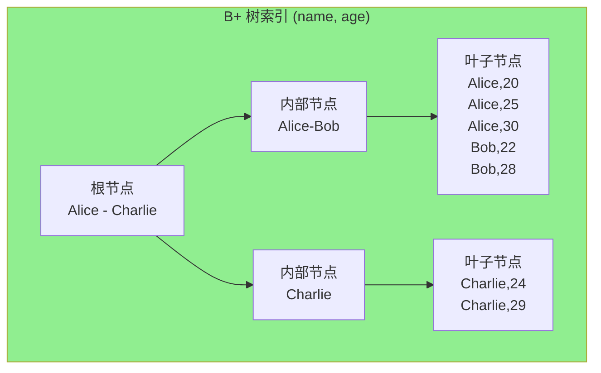
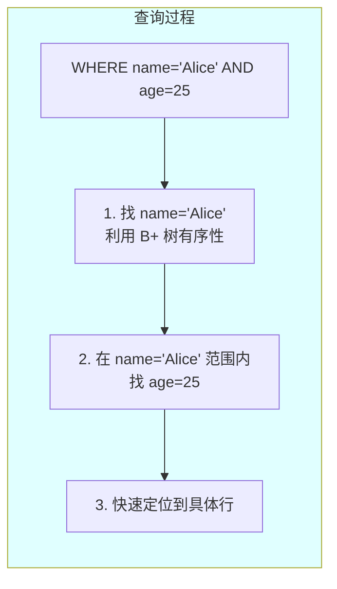
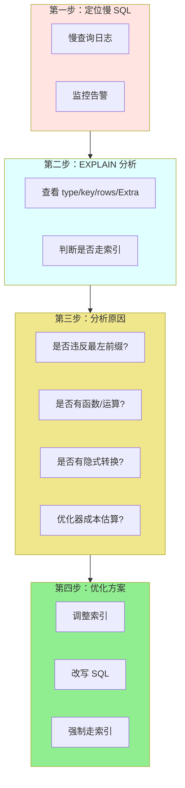
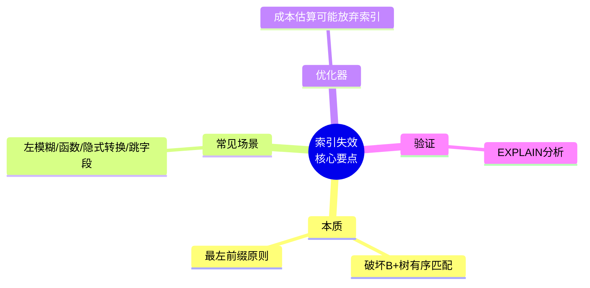

# MySQL 索引失效深度解析


---

## 🎯 场景引入

**索引失效解决什么问题？**
```
理解为什么有索引却用不上
避免"建了索引却走全表扫描"的慢 SQL 问题
```

**生活化比喻**：
就像**字典查字**——字典按拼音排序（B+ 树有序），你可以快速定位"中"字（走索引）。但如果有人说"帮我找一个包含'中'字的词"（左模糊 `%中%`），你就得从第一页翻到最后一页（全表扫描），因为开头不确定，没法用拼音排序快速定位。

**核心特点**：所有失效场景本质上都是同一个原因——破坏了 B+ 树的有序匹配逻辑。

---

## 💎 核心设计要点速览

### 核心观点（5 个关键点）

**1. 索引生效的本质：B+ 树有序匹配**
```
✅ MySQL 索引 = 有序的 B+ 树
   - 叶子节点按索引列值从小到大排序
   - 查询时从最左列开始按顺序匹配
   - 沿着树的分支快速定位

❌ 索引失效 = 破坏有序匹配
   - 跳过中间列、打乱顺序
   - 无法利用 B+ 树有序性
   - 只能逐行扫描（全表扫描）
```

**2. 最左前缀原则**
```
联合索引 (a, b, c)：
✅ 走索引：WHERE a=1、WHERE a=1 AND b=2、WHERE a=1 AND b=2 AND c=3
❌ 不走索引：WHERE b=2、WHERE c=3、WHERE b=2 AND c=3（跳过了 a）

本质：必须从最左列开始连续匹配
```

**3. 常见失效场景（本质都是破坏有序匹配）**
```
① like 左模糊：%xxx（前缀不固定，无法定位）
② 对索引列用函数/运算：WHERE YEAR(create_time)=2024（原始值被改了）
③ 隐式类型转换：WHERE phone=13800138000（字符串传了数字）
④ 联合索引跳字段：WHERE b=2（跳过了 a）
⑤ OR 条件：WHERE a=1 OR b=2（有一侧列无索引 / 非等值条件时无法 Index Merge）
```

**4. 优化器成本估算**
```
即使符合匹配规则，优化器也可能放弃索引：
- 估算全表扫描成本 < 索引扫描成本
- 比如：查询结果占全表 80%，回表代价太大
- 优化器主动选择全表扫描
```

**5. 验证方法：explain**
```
用 EXPLAIN 验证是否走索引：
- type: ALL（全表扫描）/ index（全索引扫描）/ range（范围）/ ref（等值）
- key: 实际使用的索引
- rows: 预估扫描行数
- Extra: Using filesort（文件排序）/ Using temporary（临时表）
```

---

## 🚀 一句话精华

> **索引失效本质 = 破坏了 B+ 树的有序匹配逻辑 + 最左前缀原则 + 优化器成本估算（即使符合规则也可能放弃索引）**

---

## 一、底层逻辑：B+ 树有序匹配

### 1.1 B+ 树索引结构

**生活化比喻**：
```
B+ 树 = 字典的拼音目录
- 按拼音排序：a, b, c, d, ...
- 快速定位：查"中"字，直接翻到"zhong"部分
- 不用从第一页翻到最后

索引列的值 = 拼音
B+ 树叶子节点 = 按拼音排序的页面
```

**数据结构**：
```
联合索引 (name, age) 的 B+ 树：

先按 name 排序：
- Alice
- Bob
- Charlie

name 相同再按 age 排序：
- Alice, 20
- Alice, 25
- Alice, 30
- Bob, 22
- Bob, 28
```



### 1.2 有序匹配逻辑

**查询示例**：
```sql
-- 走索引（从最左列开始匹配）
SELECT * FROM users WHERE name = 'Alice' AND age = 25;

匹配过程：
1. 先找 name = 'Alice'（利用索引有序性，快速定位）
2. 再找 age = 25（在 name='Alice' 的范围内继续找）
3. 快速定位到具体行
```



**失效场景**：
```sql
-- 不走索引（跳过最左列）
SELECT * FROM users WHERE age = 25;

匹配过程：
1. 想直接找 age=25
2. 但 B+ 树先按 name 排序，age 无序
3. 无法利用 B+ 树有序性
4. 只能逐行扫描（全表扫描）
```

---

## 二、最左前缀原则

### 2.1 联合索引匹配规则

**联合索引 (a, b, c)**：
```
B+ 树排序规则：
1. 先按 a 排序
2. a 相同再按 b 排序
3. b 相同再按 c 排序
```

**匹配示例**：

| 查询条件 | 是否走索引 | 原因 | 生活化比喻 |
|---------|-----------|------|-----------|
| `WHERE a=1` | ✅ 走 | 从最左列开始 | 查字典先找首字母 |
| `WHERE a=1 AND b=2` | ✅ 走 | 连续匹配 | 先找首字母，再找第二个字母 |
| `WHERE a=1 AND b=2 AND c=3` | ✅ 走 | 完整匹配 | 三个字母都找到了 |
| `WHERE b=2` | ❌ 不走 | 跳过 a | 不找首字母，直接找第二个字母 |
| `WHERE c=3` | ❌ 不走 | 跳过 a、b | 不找前两个字母，直接找第三个 |
| `WHERE b=2 AND c=3` | ❌ 不走 | 跳过 a | 跳过首字母 |

### 2.2 生活化比喻

**字典查字**：
```
联合索引 (a, b, c) = 三个字母的单词

查询 WHERE a='A' AND b='B' AND c='C'：
→ 先找首字母 A（走索引）
→ 再找第二个字母 B（走索引）
→ 再找第三个字母 C（走索引）
→ 快速定位到单词 ABC ✅

查询 WHERE b='B' AND c='C'：
→ 跳过首字母，直接找第二个字母 B
→ 但字典按首字母排序，第二个字母无序
→ 无法快速定位，只能逐页翻（全表扫描）❌
```

### 2.3 代码示例

```sql
-- 创建联合索引
CREATE INDEX idx_abc ON table_name(a, b, c);

-- ✅ 走索引
EXPLAIN SELECT * FROM table_name WHERE a = 1;
EXPLAIN SELECT * FROM table_name WHERE a = 1 AND b = 2;
EXPLAIN SELECT * FROM table_name WHERE a = 1 AND b = 2 AND c = 3;

-- ❌ 不走索引
EXPLAIN SELECT * FROM table_name WHERE b = 2;
EXPLAIN SELECT * FROM table_name WHERE c = 3;
EXPLAIN SELECT * FROM table_name WHERE b = 2 AND c = 3;
```

---

## 三、常见失效场景（本质都是破坏有序匹配）

### 3.1 like 左模糊

**失效原因**：
```sql
-- ❌ 左模糊：%xxx
SELECT * FROM users WHERE name LIKE '%张';

匹配过程：
1. 想找"以'张'结尾"的记录
2. 但 B+ 树按前缀排序（开头确定）
3. 结尾不确定，无法利用有序性
4. 只能全表扫描
```

**生活化比喻**：
```
左模糊 = 找一个"以'中'结尾"的词
- 字典按拼音开头排序
- 结尾不确定，没法快速定位
- 只能从第一页翻到最后
```

**对比：右模糊**
```sql
-- ✅ 右模糊：xxx%
SELECT * FROM users WHERE name LIKE '张%';

匹配过程：
1. 想找"以'张'开头"的记录
2. B+ 树按前缀排序，前缀确定
3. 可以利用有序性，快速定位
4. 走索引
```

**生活化比喻**：
```
右模糊 = 找一个"以'zhang'开头"的词
- 字典按拼音开头排序
- 开头确定，可以快速定位
- 直接翻到"zhang"部分 ✅
```

### 3.2 对索引列用函数/运算

**失效原因**：
```sql
-- ❌ 对索引列用函数
SELECT * FROM orders WHERE YEAR(create_time) = 2024;

匹配过程：
1. B+ 树存的是 create_time 的原始值（如 2024-01-01 10:00:00）
2. 查询条件是对 create_time 做函数运算（YEAR）
3. 优化器没法用计算后的值（2024）去匹配 B+ 树节点
4. 只能逐行计算后比对（全表扫描）
```

**生活化比喻**：
```
对索引列用函数 = 把字典里的字都改了
- 字典存的是原值
- 查询条件用了计算后的值
- 对不上，只能逐行比对
```

**解决方案**：
```sql
-- ✅ 改为范围查询
SELECT * FROM orders 
WHERE create_time >= '2024-01-01' 
  AND create_time < '2025-01-01';
```

### 3.3 隐式类型转换

**失效原因**：
```sql
-- 假设 phone 字段是 VARCHAR 类型
-- ❌ 隐式类型转换
SELECT * FROM users WHERE phone = 13800138000;  -- 传了数字

匹配过程：
1. B+ 树存的是字符串（'13800138000'）
2. 查询条件传了数字（13800138000）
3. MySQL 把字符串列隐式转换为数字
4. 相当于对索引列用了函数
5. 索引失效
```

**生活化比喻**：
```
隐式类型转换 = 把字典里的字都翻译成数字
- 字典存的是汉字
- 查询用了数字
- 对不上，只能逐行转换比对
```

**解决方案**：
```sql
-- ✅ 传正确的类型
SELECT * FROM users WHERE phone = '13800138000';  -- 传字符串
```

### 3.4 OR 条件

> **核心结论**：`OR` 能不能走索引，取决于**两边的列是否都有可用索引**，以及优化器的成本计算。

#### 3.4.1 能走索引的情况

**① 同列的 OR → 转成 IN，必走索引**
```sql
-- 等价于 WHERE status IN (1, 2)
SELECT * FROM orders WHERE status = 1 OR status = 2;
```

原理：优化器把同列的 `OR` 改写成 `IN`，走普通的索引范围扫描（range）。

**② 不同列的 OR，且两列都有索引 → 走 Index Merge**
```sql
-- 假设 a 和 b 都各自有单列索引
SELECT * FROM t WHERE a = 1 OR b = 2;
```

原理：MySQL 分别用 `a` 索引和 `b` 索引扫描，然后对结果取并集。

执行计划特征：
```
type: index_merge
Extra: Using union(idx_a, idx_b); Using where
```

前置条件：
- `OR` 两边的列**都必须有索引**（单列索引或联合索引的最左前缀）
- 只对 `=`、`IN` 这种等值条件有效（`>`、`<`、`LIKE` 一般不行）

**③ 联合索引需要注意**
```sql
-- 假设联合索引 (a, b)
SELECT * FROM t WHERE a = 1 OR a = 2;  -- ✅ 走索引（同列转 IN）
SELECT * FROM t WHERE a = 1 OR b = 2;  -- ❌ 通常不走联合索引
```

联合索引对不同列的 `OR` 不友好，因为违背了最左前缀原则。

#### 3.4.2 不能走索引（全表扫描）的情况

**① OR 两边有任一列没索引**
```sql
-- a 有索引，b 没索引
SELECT * FROM t WHERE a = 1 OR b = 2;  -- ❌ 全表扫描
```

原因：优化器发现 `b` 没索引，需要回表扫描，索性直接全表扫更划算。

**② OR 条件中含函数/计算**
```sql
-- 对索引列做了计算
SELECT * FROM t WHERE a = 1 OR UPPER(name) = 'ABC';  -- ❌
```

**③ 不同列 + 范围查询的 OR**
```sql
-- 即使 a, b 都有索引，范围条件也难以触发 index merge
SELECT * FROM t WHERE a = 1 OR b > 10;  -- 通常全表扫
```

#### 3.4.3 场景对比表

| 场景 | 是否走索引 | 原因 |
|------|-----------|------|
| 同列 `OR`（如 `a=1 OR a=2`） | ✅ 走 | 改写为 `IN` |
| 不同列 `OR`，都有单列索引 | ✅ 走 Index Merge | 分别扫描取并集 |
| 不同列 `OR`，有一列无索引 | ❌ 全表扫 | 无索引列需回表 |
| `OR` 含函数/计算 | ❌ 全表扫 | 索引失效 |
| `OR` 含范围查询（>、<、LIKE） | ❌ 通常全表扫 | Index Merge 不支持 |

#### 3.4.4 优化方案：改写为 UNION ALL

```sql
-- 原 SQL（可能全表扫）
SELECT * FROM t WHERE a = 1 OR b = 2;

-- 改写后（两部分都走索引）
SELECT * FROM t WHERE a = 1
UNION ALL
SELECT * FROM t WHERE b = 2;
```

优势：即使没有 Index Merge，`UNION ALL` 的两个分支也能各自走索引，性能更稳定可控。

**生活化比喻**：
```
OR = 一个人同时去两个书架找书，两边没目录就都只能一本本翻
UNION ALL = 派两个人分别去各找各的，各自都能用目录快速定位
```

### 3.5 失效场景总结表

| 失效场景 | 示例 | 本质原因 | 生活化比喻 |
|---------|------|---------|-----------|
| **like 左模糊** | `WHERE name LIKE '%张'` | 前缀不固定，无法定位 | 找"以'中'结尾"的词 |
| **对索引列用函数** | `WHERE YEAR(create_time)=2024` | 原始值被改了 | 把字典里的字都改了 |
| **隐式类型转换** | `WHERE phone=13800138000`（字符串传数字） | 原始值被改了 | 把字典里的字翻译成数字 |
| **联合索引跳字段** | `WHERE b=2`（跳过 a） | 破坏了有序匹配 | 不找首字母，直接找第二个 |
| **OR 条件** | `WHERE a=1 OR b=2`（有一列无索引） | 另一侧列需回表，无法走 Index Merge | 一个书架没目录 |

---

## 四、优化器成本估算

### 4.1 即使符合规则也可能放弃索引

**核心逻辑**：
```
优化器会估算两种方案的成本：
① 走索引扫描 + 回表
② 全表扫描

选择成本更低的方案
```

**示例**：
```sql
-- 假设 status 字段有索引，但 80% 的记录 status=1
SELECT * FROM orders WHERE status = 1;

优化器估算：
① 走索引：扫描 80% 的数据 + 回表（代价大）
② 全表扫描：扫描 100% 的数据（代价小）

优化器选择：全表扫描（成本更低）
```

**生活化比喻**：
```
优化器 = 快递分拣员

查询"status=1 的订单"：
- 走索引：先查索引，再回表取数据（80% 都要取）
- 全表扫描：直接从头到尾扫一遍

分拣员想：80% 都要取，还不如直接全扫一遍，更快
→ 选择全表扫描
```

### 4.2 查看优化器决策

```sql
-- 用 EXPLAIN 查看
EXPLAIN SELECT * FROM orders WHERE status = 1;

-- 输出：
-- type: ALL（全表扫描）
-- key: NULL（没走索引）
-- rows: 100000（预估扫描行数）
```

**强制走索引**：
```sql
-- 强制使用索引
SELECT * FROM orders FORCE INDEX (idx_status) WHERE status = 1;
```

---

## 五、验证方法：explain

### 5.1 explain 关键字段

| 字段 | 含义 | 关注点 |
|------|------|--------|
| **type** | 访问类型 | ALL（全表扫描）/ index（全索引扫描）/ range（范围）/ ref（等值）/ const（主键） |
| **key** | 实际使用的索引 | NULL 表示没走索引 |
| **rows** | 预估扫描行数 | 越少越好 |
| **Extra** | 额外信息 | Using filesort（文件排序）/ Using temporary（临时表）/ Using index（覆盖索引） |

### 5.2 type 详解

| type | 含义 | 性能 | 生活化比喻 |
|------|------|------|-----------|
| **system** | 表只有一行 | ⭐⭐⭐⭐⭐ | 字典只有一页 |
| **const** | 主键/唯一索引等值查询 | ⭐⭐⭐⭐⭐ | 直接翻到指定页 |
| **eq_ref** | JOIN 时主键/唯一索引等值查询 | ⭐⭐⭐⭐⭐ | 快速定位 |
| **ref** | 非唯一索引等值查询 | ⭐⭐⭐⭐ | 按拼音查找 |
| **range** | 索引范围扫描 | ⭐⭐⭐ | 按拼音范围查找 |
| **index** | 全索引扫描 | ⭐⭐ | 把索引翻一遍 |
| **ALL** | 全表扫描 | ⭐ | 从第一页翻到最后 |

### 5.3 示例

```sql
-- ✅ 走索引（type=ref）
EXPLAIN SELECT * FROM users WHERE name = 'Alice';
-- type: ref
-- key: idx_name
-- rows: 1

-- ❌ 不走索引（type=ALL）
EXPLAIN SELECT * FROM users WHERE age = 25;
-- type: ALL
-- key: NULL
-- rows: 100000
```

---

## 六、生产实践：慢 SQL 优化

### 6.1 优化流程



### 6.2 优化示例

**慢 SQL**：
```sql
-- 执行时间：5 秒
SELECT * FROM orders 
WHERE DATE(create_time) = '2024-01-01'
  AND status = 1;
```

**分析**：
```sql
EXPLAIN SELECT * FROM orders 
WHERE DATE(create_time) = '2024-01-01'
  AND status = 1;

-- 输出：
-- type: ALL（全表扫描）
-- key: NULL
-- rows: 1000000
```

**问题**：
1. 对索引列 `create_time` 用了函数 `DATE()`
2. 索引失效，全表扫描

**优化方案**：
```sql
-- ✅ 改为范围查询
SELECT * FROM orders 
WHERE create_time >= '2024-01-01 00:00:00'
  AND create_time < '2024-01-02 00:00:00'
  AND status = 1;

-- 创建联合索引
CREATE INDEX idx_time_status ON orders(create_time, status);
```

**优化后**：
```sql
EXPLAIN SELECT * FROM orders 
WHERE create_time >= '2024-01-01 00:00:00'
  AND create_time < '2024-01-02 00:00:00'
  AND status = 1;

-- 输出：
-- type: range
-- key: idx_time_status
-- rows: 1000
-- 执行时间：0.01 秒
```

---


---

## 七、总结



### 🎯 方案总结

> **索引失效本质 = 破坏了 B+ 树的有序匹配逻辑 + 最左前缀原则 + 优化器成本估算（即使符合规则也可能放弃索引）+ EXPLAIN 验证**

### 🧠 核心要点

1. **索引为什么失效？** 破坏了 B+ 树的有序匹配逻辑（最左前缀原则）。
2. **常见失效场景？** like 左模糊、对索引列用函数/运算、隐式类型转换、联合索引跳字段、OR 条件（有一侧列无索引）。
3. **本质是什么？** 所有失效场景都是破坏了最左前缀匹配原则。
4. **符合规则就一定走索引？** 不一定，优化器会估算成本，全表扫描成本更低时会放弃索引。
5. **OR 什么时候走索引？** 同列 OR 转 IN 必走；不同列 OR 需两边都有索引才走 Index Merge；否则改写 UNION ALL。
6. **怎么验证？** 用 EXPLAIN 查看 type、key、rows、Extra。

---

