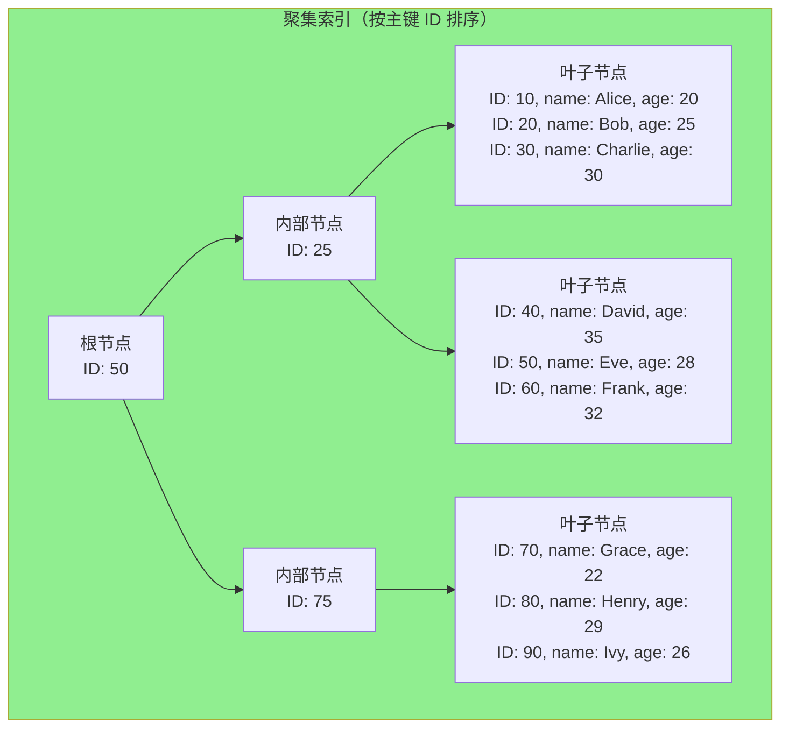
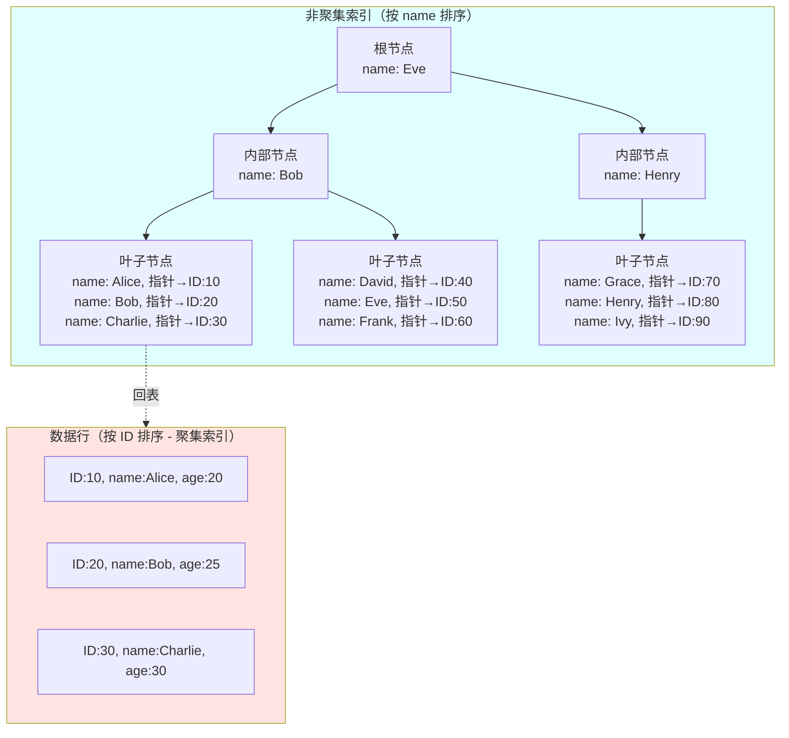
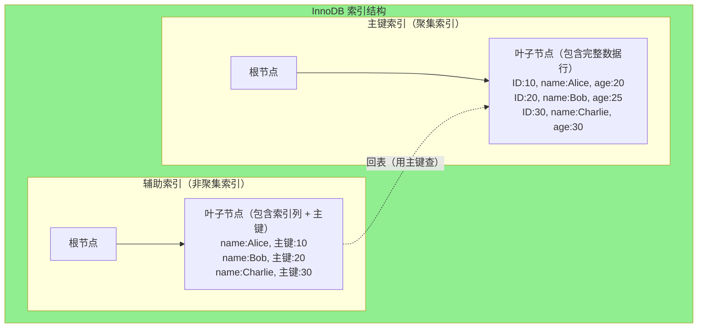
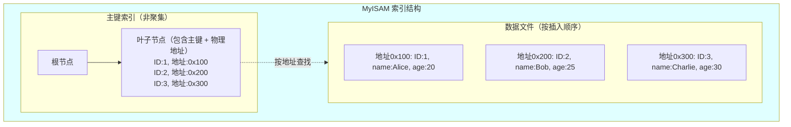
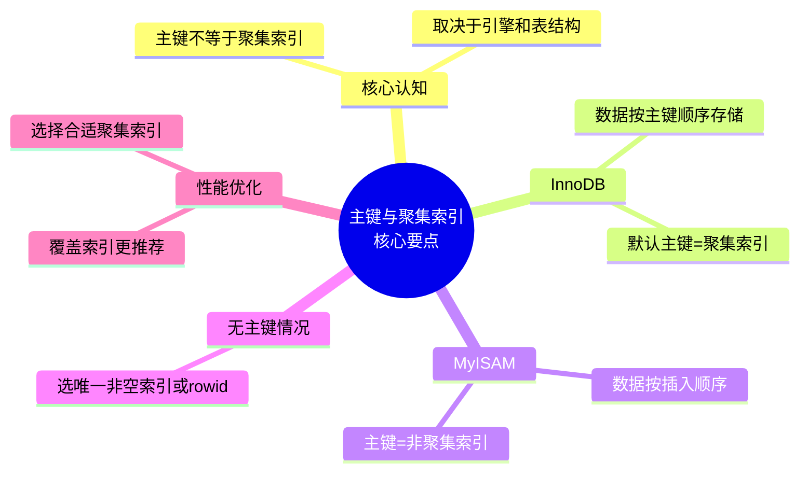

# 主键与聚集索引深度解析


---

## 🎯 场景引入

**主键与聚集索引解决什么问题？**
```
理解数据库索引的组织方式
数据按什么顺序存储，查询时如何快速定位
```

**生活化比喻**：
就像**图书馆的图书排列方式**——聚集索引就像按书号排列，书号就是书的物理位置，按书号找书最快（直接定位到书架）。非聚集索引就像按书名排列的目录，先查目录找到书号，再按书号去书架找书（需要"回表"）。

**核心特点**：主键默认是聚集索引（InnoDB），但这不是必然的，取决于引擎实现和表结构。

---

## 💎 核心设计要点速览

### 核心观点（5 个关键点）

**1. 聚集索引 vs 非聚集索引**
```
聚集索引（Clustered Index）：
- 数据按索引列的顺序物理存储
- 叶子节点包含完整的数据行
- 一个表只能有一个聚集索引
- 查询性能最高（直接定位到数据行）

非聚集索引（Non-Clustered Index）：
- 索引和数据分开存储
- 叶子节点包含索引列值 + 指向数据行的指针
- 一个表可以有多个非聚集索引
- 查询需要"回表"（先查索引，再查数据）
```

**2. InnoDB 引擎：主键 = 聚集索引（默认）**
```
✅ InnoDB 默认规则：
   - 主键作为聚集索引
   - 数据按主键顺序物理存储
   - 主键查询直接定位到数据行
   
生活化比喻：
   - InnoDB = 按书号排列的图书馆
   - 书号（主键）= 书的物理位置
   - 按书号找书最快
```

**3. MyISAM 引擎：主键 ≠ 聚集索引**
```
❌ MyISAM 规则：
   - 主键是非聚集索引
   - 数据和索引分开存储
   - 数据按插入顺序存储
   - 主键索引指向数据的物理地址
   
生活化比喻：
   - MyISAM = 按插入顺序摆放的图书馆
   - 主键索引 = 目录卡片
   - 先查目录，再按地址找书
```

**4. InnoDB 没有主键时的聚集索引选择**
```
优先级：
① 主键（如果有）
② 第一个唯一非空索引（如果没有主键）
③ 内部生成的 rowid（如果既没有主键也没有唯一索引）

生活化比喻：
   - 图书馆必须按某种顺序排列
   - 优先用书号（主键）
   - 没有书号就用 ISBN（唯一索引）
   - 都没有就自己编一个内部编号（rowid）
```

**5. 聚集索引的选择影响查询性能**
```
常规场景：
- 用 InnoDB + 主键作为聚集索引
- 按主键查询性能最高
- 范围查询也能利用数据的有序性

特殊场景：
- 查询主要依赖其他唯一字段
- 主键查询很少
- 可以考虑调整聚集索引选择
- 让更常用的查询字段作为聚集索引
- 减少回表开销
```

---

## 🚀 一句话精华

> **主键 ≠ 聚集索引（不是必然的），取决于引擎实现（InnoDB 默认是，MyISAM 不是）和表结构（没有主键时选唯一索引或 rowid）**

---

## 一、聚集索引 vs 非聚集索引

### 1.1 聚集索引（Clustered Index）

**定义**：
```
数据按索引列的顺序物理存储
叶子节点包含完整的数据行
一个表只能有一个聚集索引
```

**生活化比喻**：
```
聚集索引 = 按书号排列的图书馆
- 书号小的在左边，书号大的在右边
- 书直接放在对应位置
- 按书号找书，直接走到对应位置
- 最快，不用查目录
```

**数据结构**：


**特点**：
- ✅ 数据按索引列有序存储
- ✅ 叶子节点包含完整数据行
- ✅ 查询性能最高（直接定位）
- ❌ 一个表只能有一个聚集索引
- ❌ 插入顺序影响性能（需要维护有序性）

### 1.2 非聚集索引（Non-Clustered Index）

**定义**：
```
索引和数据分开存储
叶子节点包含索引列值 + 指向数据行的指针
一个表可以有多个非聚集索引
```

**生活化比喻**：
```
非聚集索引 = 图书目录卡片
- 目录按书名排序
- 每张卡片记录：书名 + 书号
- 先查目录找到书号
- 再按书号去书架找书
- 需要"回表"（多一步）
```

**数据结构**：


**特点**：
- ✅ 一个表可以有多个非聚集索引
- ✅ 索引独立于数据存储
- ❌ 查询需要"回表"（先查索引，再查数据）
- ❌ 性能比聚集索引低（多一步）

### 1.3 对比表

| 特性 | 聚集索引 | 非聚集索引 |
|------|---------|-----------|
| **数量** | 一个表只能有一个 | 一个表可以有多个 |
| **数据存储** | 叶子节点包含完整数据行 | 叶子节点包含索引列 + 指针 |
| **查询性能** | ⭐⭐⭐⭐⭐（直接定位） | ⭐⭐⭐⭐（需要回表） |
| **插入性能** | ⭐⭐⭐（需要维护有序性） | ⭐⭐⭐⭐（不影响数据顺序） |
| **生活化比喻** | 按书号排列的图书馆 | 图书目录卡片 |

---

## 二、InnoDB 引擎：主键 = 聚集索引（默认）

### 2.1 InnoDB 索引结构

**核心规则**：
```
InnoDB 默认：
- 主键作为聚集索引
- 数据按主键顺序物理存储
- 主键查询直接定位到数据行
```

**生活化比喻**：
```
InnoDB = 按书号排列的图书馆
- 书号（主键）= 书的物理位置
- 书按书号从小到大排列
- 按书号找书最快（直接走到对应位置）
- 按书名找书需要先查目录（非聚集索引），再按书号找书（回表）
```

**数据结构**：


**查询示例**：
```sql
-- 主键查询（走聚集索引，最快）
SELECT * FROM users WHERE id = 10;
-- 直接定位到数据行，一次查找

-- 辅助索引查询（需要回表）
SELECT * FROM users WHERE name = 'Alice';
-- 1. 先查辅助索引，找到主键 ID=10
-- 2. 再用主键查聚集索引，找到完整数据行
-- 两次查找
```

### 2.2 InnoDB 主键查询性能

**为什么主键查询最快？**
```
主键 = 聚集索引
数据按主键顺序物理存储
主键查询直接定位到数据行
不需要回表
```

**生活化比喻**：
```
按书号找书 = 直接走到对应书架
按书名找书 = 先查目录卡片，再走到对应书架

按书号找书更快（少一步）
```

---

## 三、MyISAM 引擎：主键 ≠ 聚集索引

### 3.1 MyISAM 索引结构

**核心规则**：
```
MyISAM：
- 主键是非聚集索引
- 数据和索引分开存储
- 数据按插入顺序存储
- 主键索引指向数据的物理地址
```

**生活化比喻**：
```
MyISAM = 按插入顺序摆放的图书馆
- 先借的书放在前面，后借的放在后面
- 主键索引 = 目录卡片（记录书号 + 物理地址）
- 先查目录卡片，再按地址找书
- 数据和索引分开
```

**数据结构**：


**对比 InnoDB**：

| 特性 | InnoDB | MyISAM |
|------|--------|--------|
| **主键索引类型** | 聚集索引 | 非聚集索引 |
| **数据存储** | 按主键顺序 | 按插入顺序 |
| **叶子节点** | 包含完整数据行 | 包含主键 + 物理地址 |
| **查询性能** | ⭐⭐⭐⭐⭐（直接定位） | ⭐⭐⭐⭐（需要按地址查找） |
| **事务支持** | ✅ 支持 | ❌ 不支持 |

### 3.2 MyISAM 的适用场景

**适用场景**：
```
- 大量读操作，少量写操作
- 不需要事务支持
- 对查询性能要求不高
- 老系统、特殊存储场景
```

**不适用场景**：
```
- 高并发读写
- 需要事务支持
- 需要外键约束
- 现代应用（基本都用 InnoDB）
```

---

## 四、InnoDB 没有主键时的聚集索引选择

### 4.1 优先级规则

**InnoDB 聚集索引选择优先级**：
```
① 主键（如果有）
② 第一个唯一非空索引（如果没有主键）
③ 内部生成的 rowid（如果既没有主键也没有唯一索引）
```

**生活化比喻**：
```
图书馆必须按某种顺序排列：
1. 优先用书号（主键）
2. 没有书号就用 ISBN（唯一非空索引）
3. 都没有就自己编一个内部编号（rowid）
```

### 4.2 示例

**示例 1：有主键**
```sql
CREATE TABLE users (
    id INT PRIMARY KEY,
    name VARCHAR(50)
);

-- 聚集索引 = id（主键）
```

**示例 2：没有主键，有唯一非空索引**
```sql
CREATE TABLE users (
    user_id INT NOT NULL UNIQUE,
    name VARCHAR(50)
);

-- 聚集索引 = user_id（第一个唯一非空索引）
```

**示例 3：既没有主键也没有唯一索引**
```sql
CREATE TABLE users (
    name VARCHAR(50),
    age INT
);

-- 聚集索引 = rowid（内部生成）
```

**查看 rowid**：
```sql
-- 查看内部 rowid
SELECT _rowid, name, age FROM users;
```

---

## 五、聚集索引的选择影响查询性能

### 5.1 常规场景

**最佳实践**：
```
使用 InnoDB 引擎
用主键作为聚集索引
按主键查询性能最高
范围查询也能利用数据的有序性
```

**示例**：
```sql
-- 创建表（主键作为聚集索引）
CREATE TABLE orders (
    id BIGINT PRIMARY KEY,
    user_id INT,
    amount DECIMAL(10,2),
    create_time DATETIME
);

-- 按主键查询（最快）
SELECT * FROM orders WHERE id = 100;

-- 范围查询（利用有序性）
SELECT * FROM orders 
WHERE id BETWEEN 100 AND 200;
```

### 5.2 特殊场景

**问题场景**：
```
表结构：
CREATE TABLE users (
    id BIGINT PRIMARY KEY,
    email VARCHAR(100) UNIQUE,
    name VARCHAR(50)
);

查询模式：
- 90% 的查询按 email 查询
- 10% 的查询按 id 查询

问题：
- 聚集索引 = id（主键）
- 按 email 查询需要回表
- 性能不优
```

**优化方案**：
```sql
-- 方案 1：调整聚集索引选择
CREATE TABLE users (
    id BIGINT,
    email VARCHAR(100) UNIQUE NOT NULL,
    name VARCHAR(50),
    UNIQUE KEY idx_email (email)  -- 让 email 作为第一个唯一非空索引
    -- 注意：需要删除主键约束，或者不设置主键
);

-- 聚集索引 = email（第一个唯一非空索引）
-- 按 email 查询不需要回表，性能提升

-- 方案 2：覆盖索引（推荐）
CREATE TABLE users (
    id BIGINT PRIMARY KEY,
    email VARCHAR(100) UNIQUE,
    name VARCHAR(50)
);

-- 创建覆盖索引
CREATE INDEX idx_email_name ON users(email, name);

-- 按 email 查询（覆盖索引，不需要回表）
SELECT email, name FROM users WHERE email = 'test@example.com';
```

**生活化比喻**：
```
常规场景 = 图书馆按书号排列（主键）
- 大部分人按书号找书
- 按书号找书最快

特殊场景 = 图书馆按 ISBN 排列（email）
- 大部分人按 ISBN 找书
- 按 ISBN 找书最快
- 按书号找书需要查目录
```

---


---

## 六、总结



### 🎯 方案总结

> **主键 ≠ 聚集索引（不是必然的），取决于引擎实现（InnoDB 默认是，MyISAM 不是）和表结构（没有主键时选唯一索引或 rowid）+ 聚集索引代表数据的物理存储顺序，主键是唯一约束**

### 🧠 核心要点

1. **主键一定是聚集索引吗？** 不是，取决于引擎实现和表结构。
2. **InnoDB 呢？** InnoDB 默认主键作为聚集索引，数据按主键顺序物理存储。
3. **MyISAM 呢？** MyISAM 主键是非聚集索引，数据和索引分开存储。
4. **InnoDB 没有主键呢？** 选择第一个唯一非空索引作为聚集索引；如果连唯一索引都没有，生成内部 rowid 作为聚集索引。
5. **本质是什么？** 聚集索引代表数据的物理存储顺序，主键是数据的唯一约束，二者本质不是一个概念。

---

