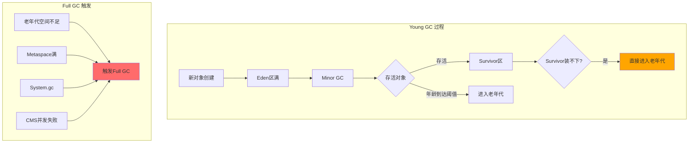
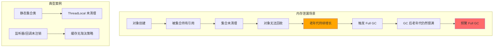
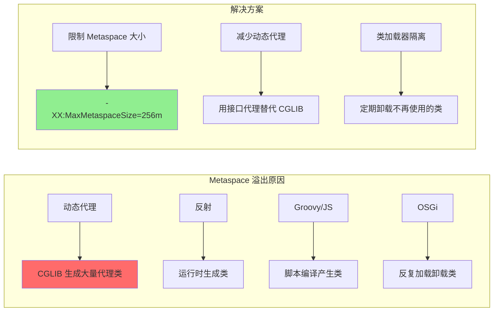
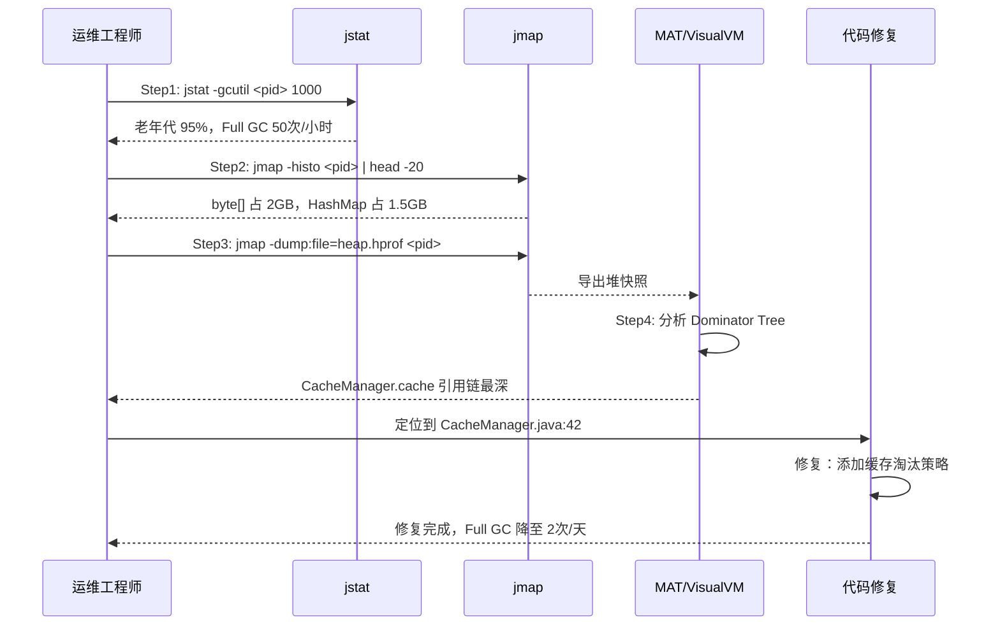
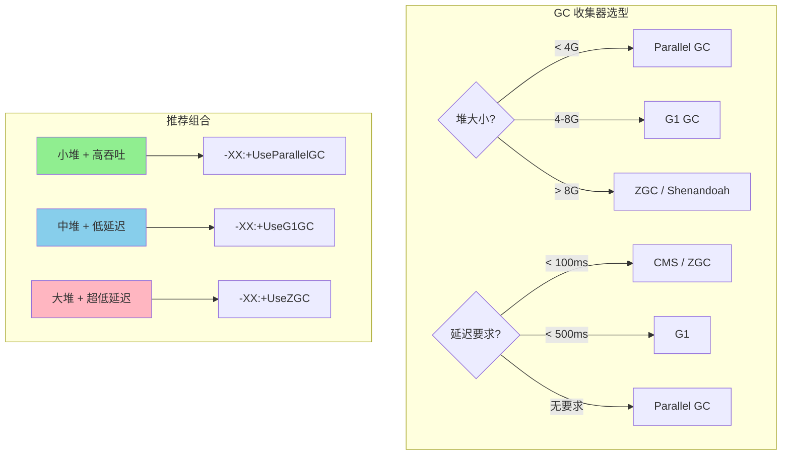
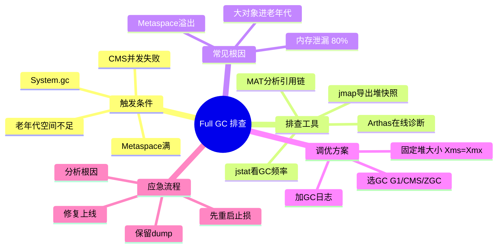
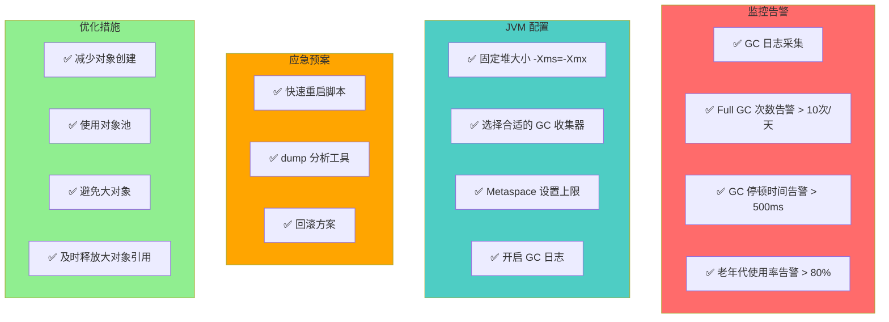
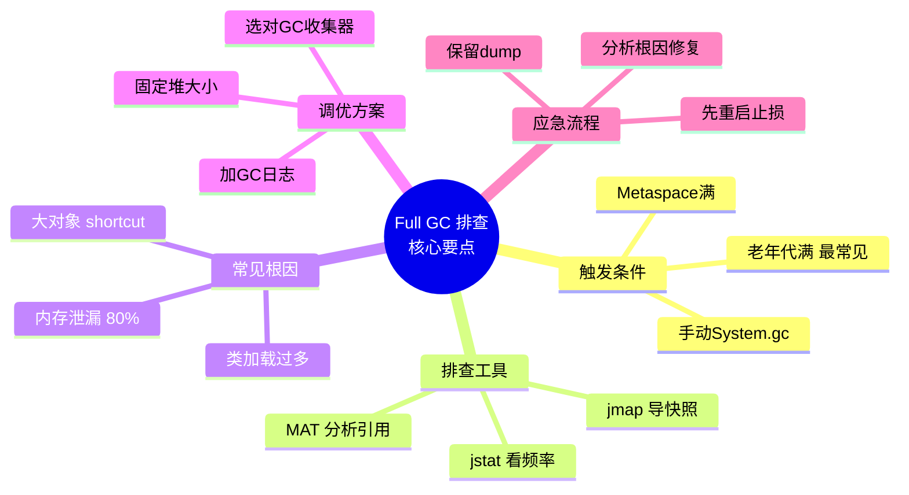

# 线上频繁 Full GC 排查

> **场景**：JVM 性能调优 / 线上故障排查  
> **核心设计要点**：GC 机制、内存模型、排查工具链、调优实战

---

## 🎯 问题定位

**频繁 Full GC 是什么问题？**
```
你的 JVM 就像一个仓库，Full GC 就是"大扫除"。
偶尔扫一次正常，但如果一天扫 10 次，说明仓库堆满了垃圾，或者仓库太小了。
```

**生活化比喻**：
就像你家的垃圾桶，正常情况下每周倒一次（Young GC）。但如果垃圾桶太小，或者你疯狂制造垃圾（内存泄漏），就得每天倒好几次（Full GC），而且每次倒垃圾全家都得停下手头的事（Stop The World）。

**核心特点**：Full GC 不是病，频繁 Full GC 才是病。关键看频率和停顿时间。

---

## 💎 核心要点速览

### 核心观点（5 个关键点）

**1. Full GC 触发条件：四大元凶**
```
① 老年代空间不足（最常见，像仓库堆满了）
② Metaspace 满（类加载太多，像身份证发完了）
③ System.gc() 手动触发（老板让你打扫，你就得打扫）
④ CMS 并发失败（打扫过程中又有人扔垃圾，只能暂停再扫）
```

**2. 排查工具链：五件套**
```
jstat -gcutil：看 GC 频率和各区使用率（像监控摄像头）
jmap -heap：看堆内存分布（像仓库盘点）
jmap -dump：导出堆快照（像拍照留证）
MAT / VisualVM：分析堆快照（像侦探破案）
Arthas：线上诊断神器（像远程医生）
```

**3. 常见根因：三大嫌疑人**
```
内存泄漏（80% 的情况）：对象用了不扔，像借书不还
大对象直接进入老年代：大数组、大字符串，像大件家具直接进仓库
Metaspace 溢出：动态代理/反射太多，像名片印太多盒子装不下
```

**4. 排查四步法**
```
Step1：看 GC 日志（jstat -gcutil 1000）→ 确认哪个区满了
Step2：dump 堆内存（jmap -dump:format=b,file=heap.hprof）
Step3：MAT 分析 → 找到占用最大的对象和引用链
Step4：定位代码 → 修复泄漏或调整参数
```

**5. 调优三板斧**
```
① 调堆大小：-Xms4g -Xmx4g（别动态扩缩，容易触发 Full GC）
② 选 GC 收集器：G1 适合大堆（>6G），CMS 适合低延迟
③ 加 GC 日志：-XX:+PrintGCDetails -XX:+PrintGCDateStamps
```

---

## 🚀 一句话精华

> **频繁 Full GC = 先看哪个区满了（jstat）→ 再 dump 分析谁占了内存（MAT）→ 最后修代码或调参数**

---

## 一、Full GC 触发条件：什么时候会触发？

### 生活化比喻

```
想象你的 JVM 是一个三层仓库：
- 年轻代（Young）：新货区，90% 的货进这里，很快就卖出去了
- 老年代（Old）：老货区，卖不出去的货堆这里
- Metaspace： metadata 区，存货物的说明书

Full GC 就是"全仓库大扫除"，触发条件有四种：

1. 老年代满了（最常见）
   → 像老货区堆满了，必须大扫除清理

2. Metaspace 满了
   → 像说明书盒子满了，装不下新的说明书

3. 手动调用 System.gc()
   → 像老板说"今天大扫除"，你就得扫

4. CMS 并发清除失败
   → 像一边打扫一边还有人扔垃圾，只能暂停营业再扫
```

### 1.1 老年代空间不足



**关键点**：
- ✅ Young GC 回收年轻代，Full GC 回收整个堆（年轻代 + 老年代）
- ✅ Full GC 耗时通常是 Young GC 的 10-100 倍
- ✅ 频繁 Full GC 说明老年代回收效率低或空间不足

### 1.2 Metaspace 溢出

```
生活化比喻：
Metaspace 就像"名片盒"，每个加载的类都有一张名片。
如果名片盒满了（Metaspace 溢出），新的类就加载不进来。

常见原因：
- 动态代理太多（CGLIB、反射生成大量代理类）
- JSP、Groovy 等动态语言编译产生大量类
- OSGi 框架反复加载卸载类

解决方案：
-XX:MaxMetaspaceSize=256m  # 限制上限
-XX:MetaspaceSize=128m     # 初始大小
```

---

## 二、排查工具链：五件套

### 工具概览

```
排查 Full GC 就像破案：
jstat → 监控摄像头（实时看 GC 频率）
jmap → 现场拍照（dump 堆内存）
MAT → 侦探分析（找出谁占了内存）
Arthas → 远程医生（线上实时诊断）
GC 日志 → 监控录像（回溯历史）
```

### 2.1 jstat：实时监控 GC

```bash
# 每 1 秒打印一次 GC 统计
jstat -gcutil <pid> 1000

# 输出示例：
#  S0     S1     E      O      M     CCS    YGC     YGCT    FGC    FGCT     GCT
#  0.00  50.00  20.00  85.00  95.00 90.00    120    2.345     15    8.567   10.912
#        ↑             ↑      ↑              ↑               ↑
#     Survivor   Eden区   老年代  Metaspace   Young GC次数   Full GC次数
```

**关键指标解读**：

| 指标 | 含义 | 正常值 | 异常值 | 说明 |
|------|------|--------|--------|------|
| O（Old） | 老年代使用率 | < 70% | > 85% | 持续升高说明内存泄漏 |
| M（Metaspace） | Metaspace 使用率 | < 80% | > 95% | 接近 100% 会触发 Full GC |
| FGC | Full GC 次数 | < 10/天 | > 100/天 | 频繁 Full GC 的核心指标 |
| FGCT | Full GC 总耗时 | < 5s | > 30s | 影响系统响应时间 |

### 2.2 jmap：导出堆快照

```bash
# 查看堆内存分布
jmap -heap <pid>

# 导出堆快照（生产环境慎用，会触发 Full GC）
jmap -dump:format=b,file=heap.hprof <pid>

# 只统计对象数量（轻量级）
jmap -histo <pid> | head -20
```

### 2.3 Arthas：线上诊断神器

```bash
# 启动 Arthas
java -jar arthas-boot.jar

# 查看 GC 信息
dashboard

# 查看堆内存 top 对象
heapdump /tmp/heap.hprof

# 实时看内存变化
vmtool --action getInstances --className java.util.HashMap --limit 10

# 查看类加载器
classloader -t
```

### 2.4 Go 语言排查脚本

```go
package main

import (
    "fmt"
    "os/exec"
    "strconv"
    "strings"
    "time"
)

// GCMonitor 监控 JVM GC 状态
type GCMonitor struct {
    pid         int
    threshold   float64 // 老年代使用率阈值
    checkInterval time.Duration
}

func NewGCMonitor(pid int, threshold float64) *GCMonitor {
    return &GCMonitor{
        pid:           pid,
        threshold:     threshold,
        checkInterval: 5 * time.Second,
    }
}

// CheckGC 检查 GC 状态
func (m *GCMonitor) CheckGC() error {
    cmd := exec.Command("jstat", "-gcutil", strconv.Itoa(m.pid), "1000", "1")
    output, err := cmd.Output()
    if err != nil {
        return fmt.Errorf("jstat 执行失败: %v", err)
    }
    
    lines := strings.Split(string(output), "\n")
    if len(lines) < 2 {
        return fmt.Errorf("jstat 输出异常")
    }
    
    // 解析老年代使用率
    fields := strings.Fields(lines[1])
    if len(fields) < 6 {
        return fmt.Errorf("jstat 字段不足")
    }
    
    oldUsage, _ := strconv.ParseFloat(fields[3], 64)
    fgCount, _ := strconv.Atoi(fields[7])
    
    fmt.Printf("[%s] 老年代: %.1f%%, Full GC 次数: %d\n",
        time.Now().Format("15:04:05"), oldUsage, fgCount)
    
    if oldUsage > m.threshold {
        fmt.Printf("⚠️  警告：老年代使用率 %.1f%% 超过阈值 %.1f%%\n",
            oldUsage, m.threshold)
    }
    
    return nil
}

// Monitor 持续监控
func (m *GCMonitor) Monitor() {
    ticker := time.NewTicker(m.checkInterval)
    defer ticker.Stop()
    
    for range ticker.C {
        if err := m.CheckGC(); err != nil {
            fmt.Printf("❌ 检查失败: %v\n", err)
        }
    }
}

func main() {
    // 监控 PID 12345，老年代阈值 80%
    monitor := NewGCMonitor(12345, 80.0)
    monitor.Monitor()
}
```

---

## 三、常见根因分析

### 根因概览

```
频繁 Full GC 的三大嫌疑人：

1. 内存泄漏（80% 的情况）
   像借书不还：对象用了不释放，老年代越堆越满
   
2. 大对象直接进入老年代
   像大件家具直接进仓库：大数组、大字符串跳过年轻代
   
3. Metaspace 溢出
   像名片盒满了：动态代理/反射生成太多类
```

### 3.1 内存泄漏



**典型代码示例（Java 泄漏场景）**：

```java
// ❌ 内存泄漏：静态 Map 无限增长
public class CacheManager {
    private static Map<String, Object> cache = new HashMap<>();
    
    public void addCache(String key, Object value) {
        cache.put(key, value); // 永远不删除，老年代越来越满
    }
}

// ✅ 修复方案：使用有界缓存
public class FixedCacheManager {
    private static Map<String, Object> cache = new LinkedHashMap<>(1000, 0.75f, true) {
        @Override
        protected boolean removeEldestEntry(Map.Entry eldest) {
            return size() > 10000; // 超过 1 万条淘汰最老的
        }
    };
}
```

**Go 语言排查工具**：

```go
package main

import (
    "bufio"
    "fmt"
    "os"
    "regexp"
    "sort"
    "strconv"
    "strings"
)

// HeapObject 堆对象统计
type HeapObject struct {
    ClassName string
    Count     int64
    Size      int64
}

// ParseHeapDump 解析 jmap -histo 输出
func ParseHeapDump(filename string) ([]HeapObject, error) {
    file, err := os.Open(filename)
    if err != nil {
        return nil, err
    }
    defer file.Close()
    
    var objects []HeapObject
    scanner := bufio.NewScanner(file)
    
    // 匹配格式： num    #instances    #bytes    class name
    re := regexp.MustCompile(`^\s*(\d+):\s+(\d+)\s+(\d+)\s+(.+)$`)
    
    for scanner.Scan() {
        line := scanner.Text()
        matches := re.FindStringSubmatch(line)
        if matches == nil {
            continue
        }
        
        count, _ := strconv.ParseInt(matches[2], 10, 64)
        size, _ := strconv.ParseInt(matches[3], 10, 64)
        className := strings.TrimSpace(matches[4])
        
        objects = append(objects, HeapObject{
            ClassName: className,
            Count:     count,
            Size:      size,
        })
    }
    
    // 按大小排序
    sort.Slice(objects, func(i, j int) bool {
        return objects[i].Size > objects[j].Size
    })
    
    return objects, nil
}

// PrintTopLeakSuspects 打印疑似泄漏的类
func PrintTopLeakSuspects(objects []HeapObject, topN int) {
    fmt.Println("🔍 Top 内存占用类（疑似泄漏）：")
    fmt.Println(strings.Repeat("-", 60))
    
    limit := topN
    if len(objects) < limit {
        limit = len(objects)
    }
    
    for i := 0; i < limit; i++ {
        obj := objects[i]
        sizeMB := float64(obj.Size) / 1024 / 1024
        fmt.Printf("%2d. %-40s %8.2f MB (%d 个实例)\n",
            i+1, obj.ClassName, sizeMB, obj.Count)
    }
}

func main() {
    if len(os.Args) < 2 {
        fmt.Println("用法: go run heap_analyzer.go <jmap_histo_output.txt>")
        os.Exit(1)
    }
    
    objects, err := ParseHeapDump(os.Args[1])
    if err != nil {
        fmt.Printf("解析失败: %v\n", err)
        os.Exit(1)
    }
    
    PrintTopLeakSuspects(objects, 20)
}
```

### 3.2 大对象直接进入老年代

```
生活化比喻：
正常流程：新对象 → 年轻代 → 多次 GC 存活 → 老年代
大对象 shortcut：大对象 → 直接老年代（像大件家具走 VIP 通道）

常见大对象：
- 大数组（byte[] 10MB）
- 大字符串（String 拼接 SQL）
- 大集合（一次性加载 10 万条数据到 List）

触发条件：
-XX:PretenureSizeThreshold=512000  # 超过 512KB 直接进老年代
```

### 3.3 Metaspace 溢出



---

## 四、排查四步法（实战流程）

### 排查流程比喻

```
排查 Full GC 就像看病：
Step1：量体温（jstat）→ 确认是否发烧（GC 频率）
Step2：验血（jmap -histo）→ 看哪个指标异常（哪个区满了）
Step3：拍 CT（jmap -dump）→ 详细检查（导出堆快照）
Step4：诊断开方（MAT 分析）→ 找到病因（内存泄漏点）→ 治疗（修代码/调参数）
```

### 完整排查流程



### 排查命令速查表

| 步骤 | 命令 | 目的 | 耗时 |
|------|------|------|------|
| Step1 | `jstat -gcutil <pid> 1000` | 看 GC 频率和各区使用率 | 实时 |
| Step2 | `jmap -histo <pid> \| head -20` | 看对象数量 Top 20 | < 1s |
| Step3 | `jmap -dump:file=heap.hprof <pid>` | 导出堆快照 | 10-60s |
| Step4 | MAT 分析 heap.hprof | 找泄漏点和引用链 | 5-10min |

---

## 五、调优方案

### 5.1 堆大小调优

```
生活化比喻：
堆大小就像仓库面积：
- 太小：货物堆满了，频繁大扫除（Full GC）
- 太大：大扫除时间太长（GC 停顿时间长）
- 合适：既不满也不空，偶尔小扫除（Young GC）

经验法则：
- 堆大小 = 物理内存的 60-80%（留空间给 OS 和其他进程）
- -Xms 和 -Xmx 设置成一样（避免动态扩缩容触发 GC）
- 一般 4-8G 足够，超过 8G 考虑 G1 GC
```

**推荐 JVM 参数**：

```bash
# 基础配置（4G 堆）
-Xms4g -Xmx4g                    # 固定堆大小
-Xmn2g                           # 年轻代 2G（堆的 50%）
-XX:MetaspaceSize=128m           # Metaspace 初始大小
-XX:MaxMetaspaceSize=256m        # Metaspace 上限

# GC 选择
-XX:+UseG1GC                     # G1 适合大堆（>6G）
-XX:MaxGCPauseMillis=200         # 目标停顿时间 200ms
-XX:G1HeapRegionSize=4m          # Region 大小

# 或者选 CMS（适合低延迟场景）
-XX:+UseConcMarkSweepGC
-XX:CMSInitiatingOccupancyFraction=75  # 老年代 75% 触发 CMS
-XX:+UseCMSInitiatingOccupancyOnly

# GC 日志（必加）
-Xloggc:/data/logs/gc.log
-XX:+PrintGCDetails
-XX:+PrintGCDateStamps
-XX:+PrintGCTimeStamps
```

### 5.2 GC 收集器选择



### 5.3 Go 语言 GC 日志分析工具

```go
package main

import (
    "bufio"
    "fmt"
    "os"
    "regexp"
    "strings"
)

// GCEvent GC 事件
type GCEvent struct {
    Timestamp string
    Pause     float64 // 停顿时间（ms）
    HeapBefore int64  // GC 前堆大小（KB）
    HeapAfter  int64  // GC 后堆大小（KB）
    IsFullGC  bool
}

// AnalyzeGCLog 分析 GC 日志
func AnalyzeGCLog(filename string) error {
    file, err := os.Open(filename)
    if err != nil {
        return err
    }
    defer file.Close()
    
    var events []GCEvent
    scanner := bufio.NewScanner(file)
    
    // 匹配 Full GC 日志行
    fullGCRe := regexp.MustCompile(`\[Full GC.*?(\d+)K->(\d+)K.*?([\d.]+) secs\]`)
    
    for scanner.Scan() {
        line := scanner.Text()
        
        if matches := fullGCRe.FindStringSubmatch(line); matches != nil {
            heapBefore, _ := parseInt(matches[1])
            heapAfter, _ := parseInt(matches[2])
            pause, _ := parseFloat(matches[3])
            
            events = append(events, GCEvent{
                HeapBefore: heapBefore,
                HeapAfter:  heapAfter,
                Pause:      pause * 1000, // 转为毫秒
                IsFullGC:   true,
            })
        }
    }
    
    // 统计
    fmt.Printf("📊 Full GC 统计：\n")
    fmt.Printf("总次数: %d\n", len(events))
    
    if len(events) > 0 {
        var totalPause float64
        var maxPause float64
        
        for _, e := range events {
            totalPause += e.Pause
            if e.Pause > maxPause {
                maxPause = e.Pause
            }
        }
        
        avgPause := totalPause / float64(len(events))
        fmt.Printf("平均停顿: %.2f ms\n", avgPause)
        fmt.Printf("最大停顿: %.2f ms\n", maxPause)
        fmt.Printf("总停顿时间: %.2f s\n", totalPause/1000)
    }
    
    return nil
}

func parseInt(s string) (int64, error) {
    var result int64
    fmt.Sscanf(s, "%d", &result)
    return result, nil
}

func parseFloat(s string) (float64, error) {
    var result float64
    fmt.Sscanf(s, "%f", &result)
    return result, nil
}

func main() {
    if len(os.Args) < 2 {
        fmt.Println("用法: go run gc_analyzer.go <gc.log>")
        os.Exit(1)
    }
    
    if err := AnalyzeGCLog(os.Args[1]); err != nil {
        fmt.Printf("分析失败: %v\n", err)
        os.Exit(1)
    }
}
```

---

## 六、技术要点深入探讨

```mermaid
graph TB
    subgraph Q1["Q1: Young GC 和 Full GC 区别?"]
        A1[Young GC] --> A2[只回收年轻代]
        A2 --> A3[速度快 停顿短]
        A4[Full GC] --> A5[回收整个堆 + Metaspace]
        A5 --> A6[速度慢 停顿长]
    end
    
    subgraph Q2["Q2: 如何判断内存泄漏?"]
        B1[jmap -histo 看对象数量] --> B2[某个类实例数持续增长]
        B2 --> B3[dump 分析引用链]
        B3 --> B4[找到持有引用的代码]
    end
    
    subgraph Q3["Q3: G1 和 CMS 区别?"]
        C1[G1] --> C2[Region化内存管理]
        C2 --> C3[可预测停顿时间]
        C4[CMS] --> C5[标记清除算法]
        C5 --> C6[低延迟但会产生碎片]
    end
    
    subgraph Q4["Q4: 线上 Full GC 频繁怎么应急?"]
        D1[先重启释放内存] --> D2[保留现场 dump]
        D2 --> D3[分析 dump 找根因]
        D3 --> D4[修复代码重新上线]
    end
    
    style Q1 fill:#FFE4E1
    style Q2 fill:#E0FFFF
    style Q3 fill:#F0E68C
    style Q4 fill:#DDA0DD
```



### 详细解析

**Q1: Young GC 和 Full GC 的区别？**  
Young GC 只回收年轻代（Eden + Survivor），速度快（通常 < 100ms），触发频率高（每秒几次到每分钟几次）。Full GC 回收整个堆（年轻代 + 老年代）和 Metaspace，速度慢（通常几百毫秒到几秒），触发频率低（理想情况下 < 10 次/天）。Full GC 会 Stop The World，影响系统响应。

**Q2: 如何判断是否存在内存泄漏？**  
三步法：
1. **看趋势**：用 `jstat -gcutil` 监控老年代使用率，如果持续升高不下降，说明可能泄漏
2. **看对象**：用 `jmap -histo` 看哪些类的实例数量异常多（比如 HashMap 占了 2GB）
3. **看引用链**：dump 堆内存，用 MAT 分析 Dominator Tree，找到 GC Root 到泄漏对象的引用链，定位到代码

**Q3: G1 和 CMS 的区别？**  
- **G1**：Region 化内存管理（把堆分成 2048 个 Region），可预测停顿时间（`-XX:MaxGCPauseMillis`），适合大堆（>6G），不会有内存碎片
- **CMS**：标记清除算法，低延迟但会产生内存碎片，需要定期 Full GC 整理，适合小堆 + 低延迟场景
- **推荐**：JDK 11+ 用 G1，JDK 17+ 可以考虑 ZGC（停顿时间 < 1ms）

**Q4: 线上 Full GC 频繁，怎么应急？**  
先止损再排查：
1. **重启服务**：释放内存，恢复服务（保留 dump 文件）
2. **保留现场**：`jmap -dump:file=heap.hprof <pid>` 导出堆快照
3. **分析根因**：MAT 分析 dump，找泄漏点
4. **修复上线**：修代码或调参数，灰度发布
5. **监控验证**：上线后持续监控 GC 日志，确认 Full GC 频率恢复正常

---

## 七、方案总结



**方案总结**：

> **触发条件**：Full GC 主要在四种情况触发：老年代空间不足（最常见）、Metaspace 满、手动调用 System.gc()、CMS 并发失败。
> 
> **排查工具**：五件套——jstat 看 GC 频率、jmap 导出堆快照、MAT 分析引用链、Arthas 在线诊断、GC 日志回溯历史。
> 
> **常见根因**：80% 是内存泄漏（对象用了不释放），其次是对象直接进入老年代、Metaspace 溢出。
> 
> **调优方案**：固定堆大小（-Xms=-Xmx），选择合适的 GC 收集器（G1 适合大堆），必加 GC 日志。
> 
> **应急流程**：先重启止损，保留 dump 文件，分析根因后修复代码，灰度上线并持续监控。

---

## 八、生产环境 Checklist



**部署检查清单**：

| 类别 | 检查项 | 状态 | 说明 |
|------|--------|------|------|
| **监控告警** | GC 日志采集 | ⬜ | -Xloggc 输出到文件 |
| | Full GC 次数告警 | ⬜ | > 10次/天 告警 |
| | GC 停顿时间告警 | ⬜ | > 500ms 告警 |
| | 老年代使用率告警 | ⬜ | > 80% 告警 |
| **JVM 配置** | 固定堆大小 | ⬜ | -Xms=-Xmx 避免动态扩缩 |
| | 选择 GC 收集器 | ⬜ | G1/CMS/ZGC 根据场景选 |
| | Metaspace 上限 | ⬜ | -XX:MaxMetaspaceSize=256m |
| | 开启 GC 日志 | ⬜ | -XX:+PrintGCDetails |
| **应急预案** | 快速重启脚本 | ⬜ | 5 分钟内重启完成 |
| | dump 分析工具 | ⬜ | MAT / VisualVM 就绪 |
| | 回滚方案 | ⬜ | 代码回滚 + 配置回滚 |
| **优化措施** | 减少对象创建 | ⬜ | 对象池、复用 |
| | 避免大对象 | ⬜ | 大数组、大字符串拆分 |
| | 及时释放引用 | ⬜ | null 赋值、集合清理 |

---

## 九、总结



### 🎯 一句话总结

> **频繁 Full GC = 先看哪个区满了（jstat）→ 再 dump 分析谁占了内存（MAT）→ 最后修代码或调参数**

### 🧠 核心记忆点

1. **Full GC 触发条件**：老年代满（80%）、Metaspace 满、System.gc()、CMS 并发失败。
2. **排查五件套**：jstat 看频率、jmap 导快照、MAT 分析引用链、Arthas 在线诊断、GC 日志回溯。
3. **80% 是内存泄漏**：对象用了不释放，像借书不还。找到引用链，修复代码。
4. **调优三板斧**：固定堆大小（-Xms=-Xmx）、选对 GC（G1 适合大堆）、加 GC 日志。
5. **应急流程**：先重启止损 → 保留 dump → 分析根因 → 修复上线 → 监控验证。

---

*本文档遵循深入浅出、生活化比喻、幽默风趣的教学原则。*
