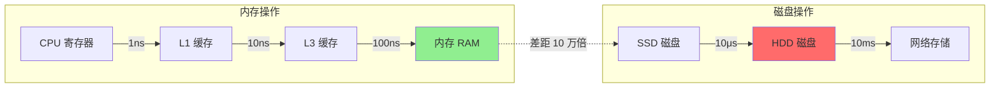
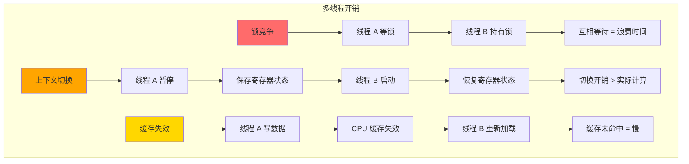
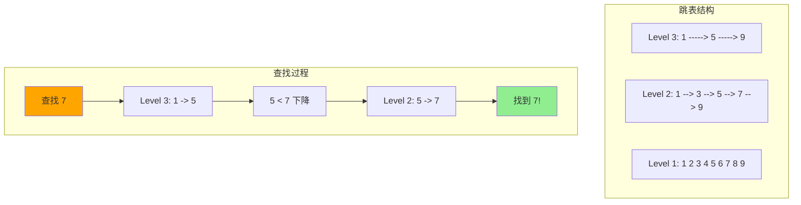
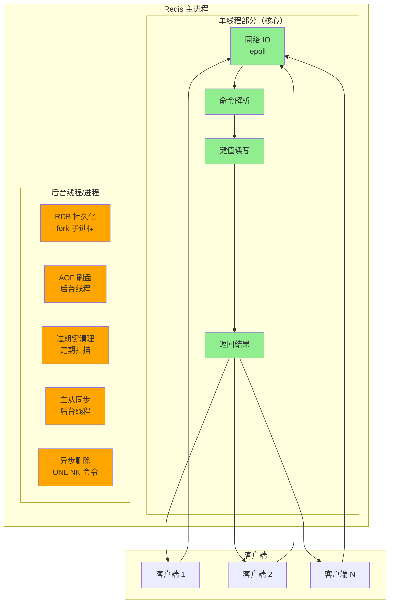
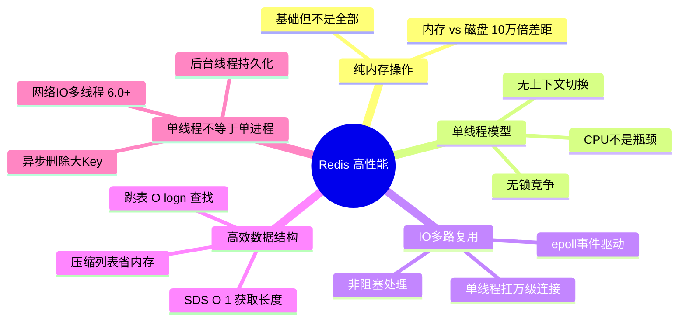
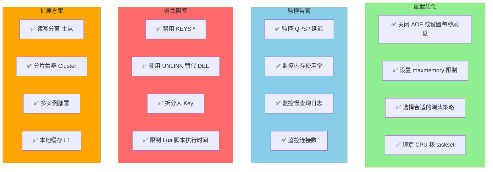
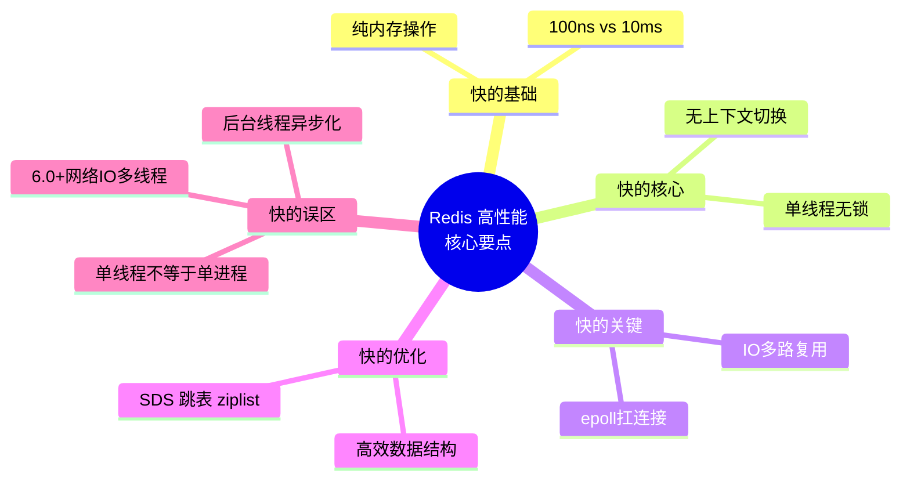

# Redis 单线程高性能原理

> **场景**：Redis 核心原理 / 性能优化  
> **核心设计要点**：内存操作、单线程模型、IO 多路复用、高效数据结构

---

## 🎯 场景引入

**Redis 为什么这么快？**
```
生活化比喻：
Redis 就像一个超级快的外卖小哥——
他只有一条胳膊（单线程），但他跑得快（纯内存操作），
而且一次能接 10000 个订单（IO 多路复用），
所以比 10 个普通小哥加起来还快。
```

**核心特点**：Redis 的快不是靠"堆 CPU 核心数"，而是靠**架构设计**。给它 100 个核也不会更快，因为瓶颈不在 CPU。

---

## 💎 核心要点速览

### 核心观点（5 个关键点）

**1. 纯内存操作（基础但不够）**
```
✅ 内存读写速度：100ns 级别
❌ 磁盘读写速度：10ms 级别（慢 10 万倍）
⚠️ 但同样是内存数据库，Memcached 性能不如 Redis
→ 内存操作是基础，但不是全部
```

**2. 单线程模型避免锁竞争和上下文切换**
```
❌ 多线程的问题：
   - 锁竞争（多个线程抢同一把锁，像 10 个人抢一个厕所）
   - 上下文切换（线程切换有开销，像同时做 10 件事效率反而低）
✅ 单线程的优势：
   - 无需加锁（没有竞争，像一个人独占整个厨房）
   - 无上下文切换（一条道走到黑，效率更高）
```

**3. IO 多路复用（epoll）支撑高并发连接**
```
✅ epoll 机制：一个线程同时监听上万个连接
   - 哪个连接有数据就处理哪个（非阻塞）
   - 不用傻等某一个连接（像服务员同时看 100 桌，哪桌需要服务就去哪桌）
❌ 传统模型：一个连接一个线程
   - 10000 个连接 = 10000 个线程（内存爆炸，上下文切换爆炸）
```

**4. 高效数据结构**
```
- SDS（简单动态字符串）：O(1) 获取长度，像量身高直接看记录
- 跳表（Skip List）：有序集合的快速查找，像字典的拼音索引
- 压缩列表（Ziplist）：小数据量的内存优化，像把小物件装进信封
- 整数集合（Intset）：纯整数集合的极致优化
```

**5. 单线程 ≠ 整个进程只有一个线程**
```
✅ 单线程部分：网络 IO + 键值对读写（核心路径）
✅ 多线程/后台进程：
   - RDB 持久化（fork 子进程）
   - AOF 刷盘（后台线程）
   - 过期键清理（惰性删除 + 定期清理）
   - 主从同步（后台线程）
→ 后台任务不阻塞主线程的读写
```

---

## 🚀 一句话精华

> **Redis 快 = 纯内存操作（基础） + 单线程无锁无切换（核心） + IO 多路复用扛连接（关键） + 高效数据结构（优化）**

---

## 一、纯内存操作：快的基础

### 生活化比喻

```
内存操作 vs 磁盘操作：
就像"心算" vs "查字典"

心算（内存）：2 + 3 = 5（瞬间出结果）
查字典（磁盘）：2 + 3 = ？（翻字典找答案，慢 10 万倍）

但同样是"心算"，不同的人算得也快慢不同：
- 普通人：1 + 1 = 2（快，但只能算简单的）
- 数学天才：微积分也能秒算（Redis 的高效数据结构）

所以 Redis 快的基础是内存操作，但核心差距在"算法"（数据结构）。
```

### 1.1 内存 vs 磁盘性能对比



| 存储介质 | 访问时间 | 对比 | 生活化比喻 |
|----------|----------|------|------------|
| CPU 寄存器 | 1ns | 基准 | 心算 |
| L1 缓存 | 10ns | 10x | 查小抄 |
| 内存 RAM | 100ns | 100x | 查字典 |
| SSD | 10μs | 10,000x | 去图书馆 |
| HDD | 10ms | 100,000x | 跨城取书 |

### 1.2 为什么同样是内存数据库，Redis 更快？

```
Memcached vs Redis：
- 都是内存数据库
- 都是单线程
- 但 Redis 性能更好

核心差距：
1. 数据结构：Redis 有丰富的数据结构（String/Hash/List/Set/ZSet），Memcached 只有简单 K-V
2. 持久化：Redis 支持 RDB + AOF，Memcached 不支持
3. 集群：Redis 支持 Cluster / Sentinel，Memcached 客户端分片
```

---

## 二、单线程模型：为什么反而更快？

### 生活化比喻

```
多线程 vs 单线程：
就像"10 个厨师共用一个厨房" vs "1 个厨师独占整个厨房"

10 个厨师（多线程）：
- 抢锅（锁竞争）
- 抢调料（锁竞争）
- 互相等（死锁）
- 切换任务（上下文切换）
→ 看起来人多，实际上效率低

1 个厨师（单线程）：
- 独占厨房（无锁）
- 一条道走到黑（无上下文切换）
- 心里清晰（无竞态条件）
→ 看起来人少，实际上效率高

关键：Redis 的操作大多是内存操作（CPU 密集度不高），单线程足够了。
如果是 CPU 密集型任务（如加密），单线程就会成瓶颈。
```

### 2.1 多线程的三大开销



| 开销类型 | 说明 | 耗时占比 | 生活化比喻 |
|----------|------|----------|------------|
| 锁竞争 | 多线程抢锁，等待释放 | 20-30% | 10 个人抢 1 个厕所 |
| 上下文切换 | 线程切换保存/恢复状态 | 10-20% | 同时做 10 件事，效率反而低 |
| 缓存失效 | 多核 CPU 缓存不一致 | 5-10% | A 改了数据，B 的缓存失效了 |

### 2.2 单线程的优势

```
✅ 无需加锁：没有竞争，不需要 mutex / rwlock
✅ 无上下文切换：一条道走到黑，不用保存/恢复状态
✅ 无竞态条件：不需要考虑并发安全问题
✅ 代码简单：不需要处理复杂的并发逻辑

⚠️ 但单线程的瓶颈：
- CPU 密集操作（如加密、大 Key 删除）会阻塞整个 Redis
- 解决方案：后台线程处理（lazy deletion、UNLINK 命令）
```

---

## 三、IO 多路复用：单线程如何扛高并发？

### 生活化比喻

```
传统模型（一个连接一个线程）：
像餐厅"一桌一个服务员"
- 100 桌 = 100 个服务员
- 服务员大部分时间在等客人点菜（阻塞等待）
- 浪费人力，效率低

IO 多路复用（一个线程处理所有连接）：
像餐厅"1 个服务员看 100 桌"
- 哪个桌举手了（有数据就绪）就去哪桌
- 不用傻等某一桌（非阻塞）
- 1 个人干 100 个人的活

epoll 就是那个"眼观六路"的服务员
```

### 3.1 三种 IO 多路复用机制对比


| 机制 | 原理 | 复杂度 | 最大连接数 | 推荐度 | 生活化比喻 |
|------|------|--------|------------|--------|------------|
| **select** | 轮询所有 FD | O(n) | 1024 | ❌ | 逐个敲门问"有人吗" |
| **poll** | 轮询链表 | O(n) | 无限制 | ⭐⭐ | 拿名单逐个问 |
| **epoll** | 事件回调 | O(1) | 10 万+ | ⭐⭐⭐⭐⭐ | 谁举手就去哪 |

### 3.2 epoll 工作原理

```go
package main

import (
    "fmt"
    "net"
    "os"
)

// RedisStyleServer 模拟 Redis 单线程事件循环
type RedisStyleServer struct {
    listener net.Listener
    clients  map[net.Conn]bool
}

func NewRedisStyleServer(port string) *RedisStyleServer {
    return &RedisStyleServer{
        clients: make(map[net.Conn]bool),
    }
}

// Start 启动事件循环（模拟 epoll）
func (s *RedisStyleServer) Start() error {
    listener, err := net.Listen("tcp", ":"+port)
    if err != nil {
        return err
    }
    s.listener = listener
    
    fmt.Println("🚀 Redis-style 单线程服务器启动，监听端口", port)
    
    // 事件循环（类似 Redis 的 aeMain）
    for {
        // 1. 接受新连接（类似 epoll_wait）
        conn, err := listener.Accept()
        if err != nil {
            fmt.Println("Accept error:", err)
            continue
        }
        
        s.clients[conn] = true
        fmt.Printf("✅ 新连接: %s (当前连接数: %d)\n", conn.RemoteAddr(), len(s.clients))
        
        // 2. 处理连接（单线程串行处理）
        go s.handleConnection(conn)
    }
}

func (s *RedisStyleServer) handleConnection(conn net.Conn) {
    defer func() {
        conn.Close()
        delete(s.clients, conn)
        fmt.Printf("❌ 连接关闭: %s (剩余连接数: %d)\n", conn.RemoteAddr(), len(s.clients))
    }()
    
    buf := make([]byte, 1024)
    for {
        // 读取数据（非阻塞）
        n, err := conn.Read(buf)
        if err != nil {
            return
        }
        
        // 处理命令（单线程串行）
        cmd := string(buf[:n])
        response := s.processCommand(cmd)
        
        // 返回结果
        conn.Write([]byte(response))
    }
}

func (s *RedisStyleServer) processCommand(cmd string) string {
    // 模拟 Redis 命令处理
    switch {
    case cmd == "PING":
        return "+PONG\r\n"
    case cmd == "GET key":
        return "$3\r\nfoo\r\n"
    case cmd == "SET key value":
        return "+OK\r\n"
    default:
        return "-ERR unknown command\r\n"
    }
}

func main() {
    port := "6379"
    if len(os.Args) > 1 {
        port = os.Args[1]
    }
    
    server := NewRedisStyleServer(port)
    if err := server.Start(); err != nil {
        fmt.Printf("启动失败: %v\n", err)
        os.Exit(1)
    }
}
```

### 3.3 Redis 事件循环源码解析

```
Redis 事件循环核心代码（简化版）：

// aeMain 是 Redis 的事件循环主函数
void aeMain(aeEventLoop *eventLoop) {
    eventLoop->stop = 0;
    while (!eventLoop->stop) {
        // 1. 调用 epoll_wait 等待事件
        aeProcessEvents(eventLoop, ...);
        
        // 2. 处理时间事件（定时任务）
        aeProcessTimeEvents(eventLoop);
    }
}

// aeProcessEvents 处理文件事件
void aeProcessEvents(aeEventLoop *eventLoop, int flags) {
    // epoll_wait 返回就绪的 FD
    numevents = aeApiPoll(eventLoop, ...);
    
    // 遍历处理每个就绪事件
    for (i = 0; i < numevents; i++) {
        int fd = eventLoop->fired[i].fd;
        int mask = eventLoop->fired[i].mask;
        
        // 调用对应的回调函数
        if (mask & AE_READABLE) {
            eventLoop->readEvents[fd]->proc(eventLoop, fd, ...);
        }
        if (mask & AE_WRITABLE) {
            eventLoop->writeEvents[fd]->proc(eventLoop, fd, ...);
        }
    }
}

关键：
- 单线程循环处理所有事件
- epoll_wait 非阻塞等待
- 哪个连接有数据就处理哪个
```

---

## 四、高效数据结构：快的秘密武器

### 生活化比喻

```
Redis 的数据结构就像"工具箱"：

String（字符串）：像"万能扳手"
- 可以存字符串、数字、二进制
- GET/SET 时间复杂度 O(1)

Hash（哈希表）：像"收纳盒"
- 一个 Key 存多个字段
- HGET/HSET 时间复杂度 O(1)

List（列表）：像"排队叫号"
- 先进先出（FIFO）
- LPUSH/RPOP 时间复杂度 O(1)

Set（集合）：像"抽奖箱"
- 无序、去重
- SADD/SISMEMBER 时间复杂度 O(1)

ZSet（有序集合）：像"排行榜"
- 有序、去重
- ZADD/ZRANGEBYSCORE 时间复杂度 O(log n)
```

### 4.1 SDS（简单动态字符串）

```mermaid
graph TB
    subgraph "C 字符串"
        A1[h] --> A2[e]
        A2 --> A3[l]
        A3 --> A4[l]
        A4 --> A5[o]
        A5 --> A6[\0]
        A6 -.->|获取长度 O n| A7[遍历到 \0]
    end
    
    subgraph "SDS"
        B1[len: 5] --> B2[free: 0]
        B2 --> B3[buf: hello]
        B3 -.->|获取长度 O 1| B4[直接读 len]
    end
    
    style A7 fill:#FF6B6B
    style B4 fill:#90EE90
```

**SDS vs C 字符串**：

| 特性 | C 字符串 | SDS | 生活化比喻 |
|------|----------|-----|------------|
| 获取长度 | O(n) 遍历 | O(1) 直接读 len | 量身高：逐个量 vs 看记录 |
| 二进制安全 | ❌（\0 截断） | ✅ | 存图片 vs 存文字 |
| 追加优化 | O(n) 重新分配 | O(1) 预分配空间 | 搬家 vs 扩建 |
| 内存管理 | 手动 free | 自动管理 | 手动 vs 自动洗碗机 |

### 4.2 跳表（Skip List）



**跳表的优势**：
- ✅ 查找 O(log n)：像字典的拼音索引，跳着找
- ✅ 实现简单：比平衡树（AVL/红黑树）容易实现
- ✅ 范围查询高效：ZRANGEBYSCORE 直接定位

### 4.3 压缩列表（Ziplist）

```
生活化比喻：
压缩列表就像"把小物件装进信封"

普通列表：每个元素单独存储（像每个苹果单独装箱）
压缩列表：多个元素连续存储（像一箱苹果紧凑摆放）

优势：内存利用率高，适合小数据量
劣势：修改需要重新分配（像信封满了要换大信封）

触发条件：
- 元素个数 < 128
- 单个元素 < 64 字节
→ 自动升级为双向链表（linked list）
```

---

## 五、单线程 ≠ 整个进程只有一个线程

### 生活化比喻

```
Redis 的"单线程"指的是：
✅ 网络 IO + 键值读写 = 单线程（核心路径）

但 Redis 进程还有其他线程/进程：
✅ RDB 持久化：fork 子进程（像分身去拍照）
✅ AOF 刷盘：后台线程（像清洁工偷偷打扫）
✅ 过期键清理：惰性删除 + 定期清理（像随手扔垃圾）
✅ 主从同步：后台线程（像信使送信）
✅ unlink 删除：后台线程（4.0+ 异步删除大 Key）

关键：后台任务不阻塞主线程的读写
```

### 5.1 Redis 进程架构



### 5.2 阻塞命令与优化

```
⚠️ 会阻塞主线程的命令：
- KEYS *：遍历所有 Key，O(n) 复杂度
- DEL key：删除大 Key（如 10 万个元素的 Hash）
- FLUSHALL：清空所有数据
- 复杂的 Lua 脚本

✅ 优化方案：
- SCAN 替代 KEYS：分批遍历，不阻塞
- UNLINK 替代 DEL：异步删除，后台线程处理
- 拆分大 Key：大 Hash 拆成多个小 Hash
- 限制 Lua 脚本执行时间
```

**Go 语言示例：正确使用 SCAN**

```go
package main

import (
    "context"
    "fmt"
    "github.com/go-redis/redis/v8"
)

// ScanKeys 使用 SCAN 替代 KEYS（不阻塞）
func ScanKeys(ctx context.Context, rdb *redis.Client, pattern string) error {
    var cursor uint64
    
    for {
        // SCAN 分批遍历，每次 100 个
        keys, nextCursor, err := rdb.Scan(ctx, cursor, pattern, 100).Result()
        if err != nil {
            return fmt.Errorf("SCAN 失败: %v", err)
        }
        
        // 处理这批 Key
        for _, key := range keys {
            fmt.Printf("找到 Key: %s\n", key)
        }
        
        // 更新游标
        cursor = nextCursor
        
        // 游标回到 0，遍历完成
        if cursor == 0 {
            break
        }
    }
    
    return nil
}

// DeleteLargeKey 异步删除大 Key
func DeleteLargeKey(ctx context.Context, rdb *redis.Client, key string) error {
    // ❌ 错误：DEL 会阻塞主线程
    // return rdb.Del(ctx, key).Err()
    
    // ✅ 正确：UNLINK 异步删除（Redis 4.0+）
    return rdb.Unlink(ctx, key).Err()
}

// SplitLargeHash 拆分大 Hash
func SplitLargeHash(ctx context.Context, rdb *redis.Client, data map[string]string) error {
    // ❌ 错误：一个 Hash 存 10 万个字段
    // return rdb.HMSet(ctx, "large_hash", data).Err()
    
    // ✅ 正确：拆分成多个小 Hash
    batchSize := 1000
    batchNum := 0
    
    for key, value := range data {
        batchKey := fmt.Sprintf("hash:%d", batchNum)
        
        err := rdb.HSet(ctx, batchKey, key, value).Err()
        if err != nil {
            return err
        }
        
        // 每 1000 个字段换一个 Hash
        if rdb.HLen(ctx, batchKey).Val() >= int64(batchSize) {
            batchNum++
        }
    }
    
    return nil
}

func main() {
    ctx := context.Background()
    rdb := redis.NewClient(&redis.Options{
        Addr: "localhost:6379",
    })
    
    // 使用 SCAN 遍历 Key
    if err := ScanKeys(ctx, rdb, "user:*"); err != nil {
        fmt.Printf("扫描失败: %v\n", err)
    }
}
```

---

## 六、技术要点深入探讨


### 详细解析

**Q1: Redis 为什么用单线程？**  
Redis 的核心操作是内存读写，CPU 不是瓶颈。多线程的开销（锁竞争、上下文切换、缓存失效）反而比单线程大。单线程无需加锁、无上下文切换，在内存操作场景下效率更高。就像 1 个厨师独占厨房，比 10 个厨师抢厨房效率高。

**Q2: 单线程为什么能同时处理上万连接？**  
靠 IO 多路复用（epoll）。一个线程同时监听上万个连接，哪个连接有数据就绪就处理哪个，非阻塞等待。就像 1 个服务员看 100 桌，哪桌举手就去哪桌，不用傻等某一桌。

**Q3: Redis 6.0 为什么引入多线程？**  
Redis 6.0 引入多线程是为了解决**网络 IO 瓶颈**（不是命令执行瓶颈）。多线程处理网络请求的读取和响应，但**命令执行仍然是单线程**，保证原子性。这样可以利用多核 CPU 处理网络 IO，提升吞吐量。

**Q4: 如何使用多核 CPU？**  
部署多个 Redis 实例，每个实例绑定一个 CPU 核（通过 taskset 或 affinity），客户端做分片路由。就像开 10 家分店，每家店一个厨师，顾客根据地域就近选择。

---

## 七、方案总结



**方案总结**：

> **纯内存操作**：内存读写速度是磁盘的 10 万倍，这是快的基础。但同样是内存数据库，Redis 比其他快，核心在架构设计。
> 
> **单线程模型**：避免了多线程的锁竞争、上下文切换、缓存失效。Redis 的核心操作是内存读写，CPU 不是瓶颈，单线程反而更快。就像 1 个厨师独占厨房，比 10 个厨师抢厨房效率高。
> 
> **IO 多路复用**：通过 epoll 机制，一个线程同时监听上万个连接，哪个连接有数据就处理哪个，非阻塞。
> 
> **高效数据结构**：SDS（O(1) 获取长度）、跳表（O(log n) 查找）、压缩列表（省内存）。
> 
> **单线程 ≠ 单进程**：后台线程处理持久化、异步删除、主从同步。Redis 6.0+ 引入多线程处理网络 IO，但命令执行仍然单线程。

---

## 八、生产环境 Checklist



**部署检查清单**：

| 类别 | 检查项 | 状态 | 说明 |
|------|--------|------|------|
| **配置优化** | 关闭 AOF 或每秒刷盘 | ⬜ | appendfsync everysec |
| | 设置 maxmemory | ⬜ | 物理内存的 70-80% |
| | 选择淘汰策略 | ⬜ | allkeys-lru / volatile-lru |
| | 绑定 CPU 核 | ⬜ | taskset -c 0 redis-server |
| **监控告警** | QPS / 延迟监控 | ⬜ | INFO stats |
| | 内存使用率监控 | ⬜ | INFO memory |
| | 慢查询日志 | ⬜ | slowlog get 128 |
| | 连接数监控 | ⬜ | INFO clients |
| **避免阻塞** | 禁用 KEYS * | ⬜ | 用 SCAN 替代 |
| | 使用 UNLINK | ⬜ | 异步删除大 Key |
| | 拆分大 Key | ⬜ | Hash 拆分、List 分页 |
| | 限制 Lua 脚本 | ⬜ | lua-time-limit 5000 |
| **扩展方案** | 读写分离 | ⬜ | 主从 + Sentinel |
| | 分片集群 | ⬜ | Redis Cluster |
| | 多实例部署 | ⬜ | 每个实例绑一个核 |
| | 本地缓存 L1 | ⬜ | Caffeine / GoCache |

---

## 九、总结（一句话带走）



### 🎯 一句话总结

> **Redis 快 = 纯内存操作（基础） + 单线程无锁无切换（核心） + IO 多路复用扛连接（关键） + 高效数据结构（优化）**

### 🧠 核心记忆点

1. **为什么不用多线程？** 锁竞争、上下文切换、缓存失效的开销 > 多线程收益。Redis 核心操作是内存读写，CPU 不是瓶颈。
2. **单线程怎么扛高并发？** IO 多路复用（epoll），一个线程监听万级连接，哪桌需要就去哪桌。
3. **高效数据结构**：SDS（O(1) 获取长度）、跳表（O(log n) 查找）、压缩列表（省内存）。
4. **单线程 ≠ 单进程**：后台线程处理持久化、异步删除、主从同步。Redis 6.0+ 网络 IO 多线程，但命令执行仍单线程。
5. **如何使用多核？** 部署多个实例，每个绑一个核，客户端分片。
