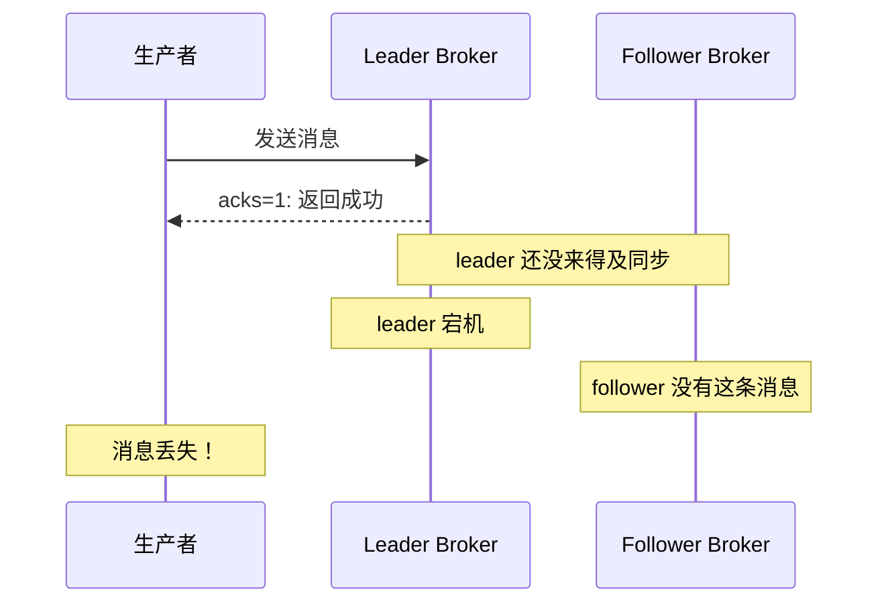
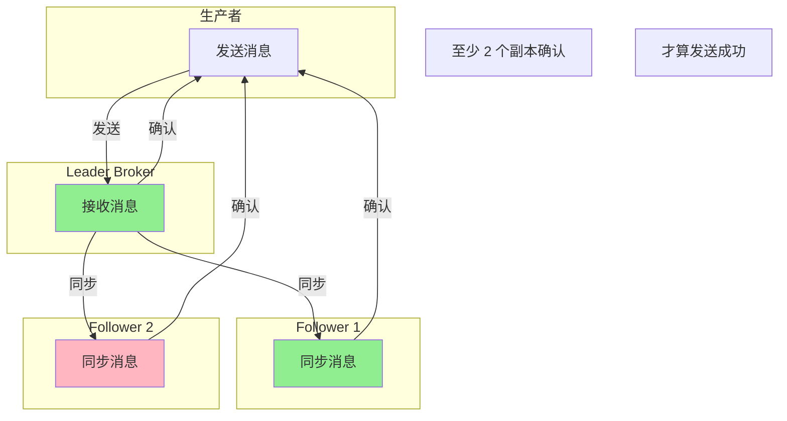

# Kafka 消息一定不会丢失吗？

> **场景**：消息队列可靠性设计  
> **核心设计要点**：生产者确认机制、Broker 刷盘策略、多副本同步、消息可靠性配置

---

## 🎯 场景引入

**Kafka 消息一定不会丢失吗？**
```
答案：不是！配置不对的话，Kafka 丢消息比谁都快。
```

**生活化比喻**：
就像寄快递——你以为快递公司一定不丢包裹？错！如果你选的是"最便宜、最快"的服务（默认配置），包裹丢了也没人赔。但如果你选了"保价+签收确认"（ack=all + 多副本），包裹就安全了。

**核心特点**：Kafka 的可靠性不是天生的，而是**配置出来的**。

---

## 💎 核心要点速览

### 核心观点（3 个关键层）

**1. 默认配置下为什么会丢消息？**
```
❌ 生产者：发出去就不管（acks=1，只等 leader 确认）
❌ Broker：写到操作系统页缓存，不立刻刷到物理磁盘
❌ 单节点故障：broker 宕机/断电，页缓存里的数据直接丢失

生活化比喻：
就像你把信扔进邮筒就走了，邮局还没收件，邮筒就被偷了。
```

**2. 如何配置才能保证消息不丢？**
```
✅ 生产者：acks=all（所有 follower 确认才算成功）
✅ Broker：min.insync.replicas=2（至少写入 2 个副本）
✅ 刷盘策略：同步刷盘（每条消息都刷到物理磁盘）

生活化比喻：
就像寄快递，要求"收件人签字+拍照留证+保价"，三重保障。
```

**3. 分场景配置策略**
```
核心业务（订单/支付）：acks=all + 同步副本确认 → 极高可靠性
非核心业务（日志/埋点）：默认配置 → 最高吞吐量

生活化比喻：
重要文件用顺丰保价，普通文件用平邮，按需选择。
```

---

## 🚀 一句话精华

> **Kafka 消息可靠性 = 生产者 acks=all（全副本确认） + min.insync.replicas（最小同步副本数） + 合理刷盘策略**

---

## 一、默认配置下为什么容易丢消息？

### 1.1 生产者的"甩手掌柜"模式

**默认配置**：`acks=1`
```
生活化比喻：
就像你把信扔进邮筒就走了，不管邮局收没收到。
生产者发完消息就不管了，只要 leader 收到就算成功。

技术问题：
生产者发送消息 → leader broker 收到 → 返回成功
但如果 leader 还没来得及同步给 follower 就宕机了，消息就丢了。
```



### 1.2 Broker 的"拖延症"

**默认刷盘策略**：异步刷盘
```
生活化比喻：
就像餐厅服务员把你点的菜记在纸上（页缓存），但没立刻交给厨师（物理磁盘）。
如果服务员突然晕倒（broker 宕机），纸上的菜就没人交了。

技术问题：
消息写入 → 操作系统页缓存（内存） → 定时批量刷到物理磁盘
如果刷盘前 broker 宕机，页缓存里的数据全丢。
```

### 1.3 单节点故障的"多米诺骨牌"

**场景**：Broker 突然宕机/断电
```
页缓存里还没落地的数据 → 直接丢失
就像你写了一页笔记，还没来得及复印，原件就被风吹走了。
```

---

## 二、如何配置才能保证消息不丢？

### 2.1 生产者确认机制（acks 参数）

**生活化比喻**：
```
acks=0：生产者发完就不管，像把信扔进邮筒
acks=1：leader 收到就返回成功，像 leader 签收
acks=all：所有 follower 都收到才返回成功，像全员签收

核心区别：
acks=0：性能最高，可靠性最低（可能丢）
acks=1：性能中等，可靠性中等（leader 挂了会丢）
acks=all：性能最低，可靠性最高（全员确认，绝不丢失）
```

| acks 值 | 确认机制 | 性能 | 可靠性 | 适用场景 |
|---------|----------|------|--------|----------|
| **0** | 生产者发了就走 | ⭐⭐⭐⭐⭐ | ⭐（可能丢） | 日志采集（允许丢） |
| **1** | leader 收到即可 | ⭐⭐⭐⭐ | ⭐⭐⭐（leader 挂了会丢） | 一般业务 |
| **all** | 所有同步副本确认 | ⭐⭐ | ⭐⭐⭐⭐⭐（绝不丢失） | 订单/支付（核心业务） |

**代码示例**（生产者配置）：
```java
// 核心业务：订单、支付
Properties props = new Properties();
props.put("bootstrap.servers", "localhost:9092");
props.put("acks", "all");  // 关键配置：全副本确认
props.put("retries", 3);   // 失败重试 3 次
props.put("key.serializer", "org.apache.kafka.common.serialization.StringSerializer");
props.put("value.serializer", "org.apache.kafka.common.serialization.StringSerializer");

KafkaProducer<String, String> producer = new KafkaProducer<>(props);
producer.send(new ProducerRecord<>("order-topic", "order-123", "order-data"));
```

### 2.2 多副本同步机制（min.insync.replicas）

**生活化比喻**：
```
min.insync.replicas=2：
就像重要文件要复印 2 份，分别交给 2 个人保管。
只要其中 1 个人没收到，就不算完成。

好处：
即使 1 个人丢了文件，另 1 个人还有备份。
```

**配置示例**：
```properties
# broker 配置
replication.factor=3          # 每个分区 3 个副本
min.insync.replicas=2         # 至少 2 个副本写入成功
```

**工作原理**：


### 2.3 刷盘策略优化

**异步刷盘**（默认，性能优先）：
```
消息写入 → 页缓存（内存） → 定时批量刷盘（每秒一次）
优点：性能高
缺点：宕机时可能丢数据
```

**同步刷盘**（可靠性优先）：
```
消息写入 → 页缓存 → 立刻刷到物理磁盘 → 返回成功
优点：绝不丢数据
缺点：性能低（磁盘 IO 慢）
```

**生活化比喻**：
```
异步刷盘：就像批量洗衣服，攒够一桶再洗（快，但可能丢衣服）
同步刷盘：就像每件衣服立刻洗（慢，但每件都洗了）
```

---

## 三、分场景配置策略

### 3.1 核心业务（订单/支付）

**配置**：
```properties
# 生产者
acks=all                    # 全副本确认
retries=3                   # 失败重试
enable.idempotence=true     # 幂等性（防重复）

# Broker
replication.factor=3        # 3 个副本
min.insync.replicas=2       # 至少 2 个副本写入
flush.messages=1            # 每条消息都刷盘（最严格）
```

**生活化比喻**：
```
就像寄重要文件：
- 顺丰保价（acks=all）
- 收件人签字（min.insync.replicas=2）
- 拍照留证（同步刷盘）
三重保障，绝不丢失。
```

### 3.2 非核心业务（日志/埋点）

**配置**：
```properties
# 生产者
acks=1                      # leader 确认即可
retries=0                   # 不重试

# Broker
replication.factor=2        # 2 个副本
min.insync.replicas=1       # 1 个副本写入即可
flush.messages=10000        # 每 10000 条消息刷一次盘
```

**生活化比喻**：
```
就像寄普通邮件：
- 平邮（acks=1）
- 不用签字（min.insync.replicas=1）
- 批量处理（异步刷盘）
追求速度，允许少量丢失。
```

---

## 四、技术要点深入探讨

### Q1: 默认配置下 Kafka 会丢消息吗？
**答**：会。默认 acks=1（只等 leader 确认），Broker 异步刷盘，单节点故障时页缓存里的数据会丢失。就像寄信不挂号，丢了也没人赔。

### Q2: 如何保证消息绝对不丢？
**答**：三重保障：
1. **生产者**：acks=all（全副本确认）
2. **Broker**：min.insync.replicas=2（至少 2 个副本写入）
3. **刷盘**：同步刷盘（每条消息都刷到物理磁盘）

但要注意：性能会下降，核心业务才用这种配置。

### Q3: 如何平衡性能和可靠性？
**答**：分场景配置：
- **核心业务**（订单/支付）：acks=all + 同步副本 → 极高可靠性
- **非核心业务**（日志/埋点）：默认配置 → 最高吞吐量

就像重要文件用顺丰保价，普通文件用平邮，按需选择。

### Q4: 生产者发送失败怎么办？
**答**：
- **重试机制**：retries=3，失败自动重试
- **幂等性**：enable.idempotence=true，防止重复发送
- **事务**：Kafka 事务保证 exactly-once（精确一次）

---

## 五、方案总结

> **默认配置**：Kafka 默认配置下会丢消息，生产者 acks=1（只等 leader 确认），Broker 异步刷盘，单节点故障时页缓存数据会丢失。
> 
> **如何保证不丢**：三重保障——生产者 acks=all（全副本确认）+ min.insync.replicas=2（至少 2 个副本写入）+ 同步刷盘（每条消息都刷到物理磁盘）。
> 
> **分场景配置**：核心业务（订单/支付）用高可靠配置，非核心业务（日志/埋点）用默认配置追求性能。
> 
> **本质**：Kafka 的可靠性不是天生的，而是配置出来的。判断消息会不会丢的本质是看全链路的可靠配置等级，而不是中间件本身的名号。

---

## 六、生产环境 Checklist（部署检查清单）

| 类别 | 检查项 | 状态 | 生活化比喻 |
|------|--------|------|------------|
| **生产者配置** | acks=all（核心业务） | ⬜ | 全员签收 |
| | retries=3（失败重试） | ⬜ | 失败再来 |
| | enable.idempotence=true（幂等性） | ⬜ | 防重复发送 |
| **Broker 配置** | replication.factor=3（3 副本） | ⬜ | 复印 3 份 |
| | min.insync.replicas=2（至少 2 副本） | ⬜ | 至少 2 人保管 |
| | flush.messages=1（同步刷盘） | ⬜ | 每件立刻洗 |
| **监控告警** | 消息堆积监控 | ⬜ | 快递积压告警 |
| | 副本同步延迟监控 | ⬜ | 快递同步延迟 |
| **降级方案** | Broker 挂了自动切换 | ⬜ | 备用快递员 |

---

## 七、总结（一句话带走）

### 🎯 一句话总结

> **Kafka 消息可靠性 = 生产者 acks=all（全副本确认） + min.insync.replicas（最小同步副本数） + 合理刷盘策略**

### 🧠 核心记忆点

1. **默认配置会丢消息**：生产者甩手掌柜（acks=1），Broker 拖延症（异步刷盘），单节点故障就丢。
2. **如何保证不丢**：三重保障——acks=all + min.insync.replicas=2 + 同步刷盘。
3. **分场景配置**：核心业务用高可靠（顺丰保价），非核心业务用高性能（平邮）。
4. **本质**：Kafka 的可靠性是配置出来的，不是天生的。
