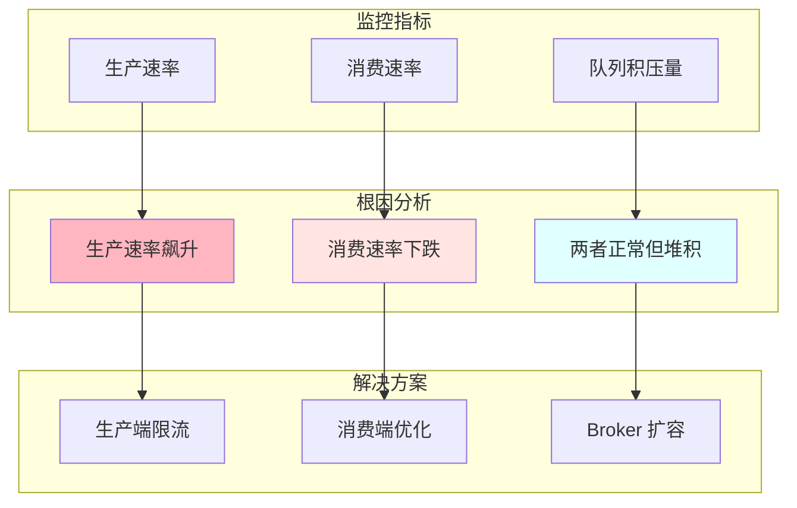
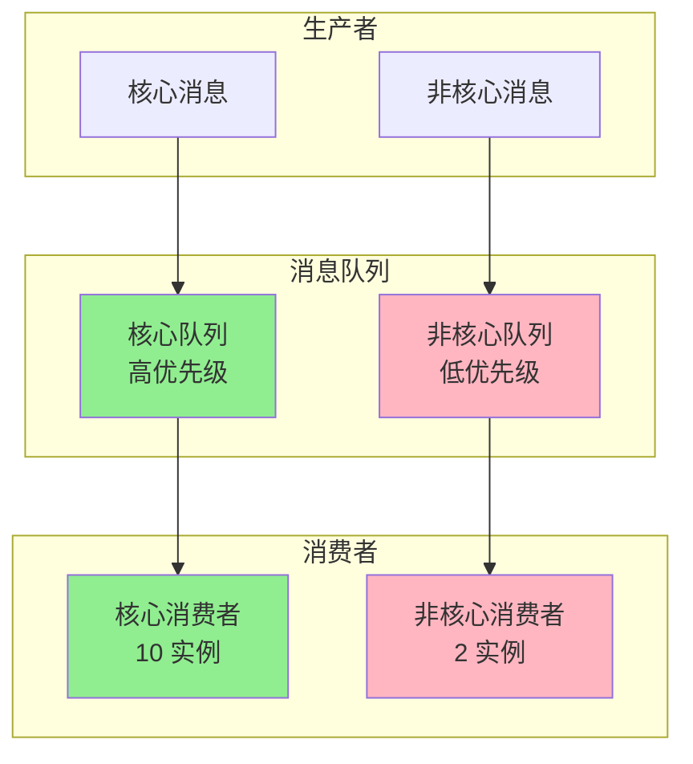

# 消息积压处理：别再只会说扩容消费者

> **场景**：消息队列运维  
> **核心设计要点**：根因定位、分级治理、应急处理、前置预防

---

## 🎯 场景引入

**消息积压还只会说扩容消费者？**
```
❌ 错误认知：消息积压 = 消费能力不足 → 扩容消费者
✅ 正确认知：消息积压 = 生产/消费/Broker 三环节失衡 → 根因定位 + 分级治理
```

**生活化比喻**：
就像交通拥堵——你第一反应是"加车道"（扩容消费者）？错！可能是：
- 车祸导致车流停滞（Broker 瓶颈）
- 早高峰车流量暴增（生产端突增）
- 红绿灯设置不合理（消费逻辑慢）

不同原因，解法完全不同。上来就加车道，可能越加越堵。

---

## 💎 核心要点速览

### 核心观点（3 个层次）

**1. 核心认知误区：把扩容当万能解法**
```
❌ 跳过根因定位，上来就扩容
✅ 先定位是生产端、消费端还是 Broker 端的问题

定位方法：
- 生产速率飙升 → 生产端问题
- 消费速率下跌 → 消费端问题
- 两者都正常但堆积 → Broker 端瓶颈
```

**2. 分环节应急处理**
```
生产端突增：限流降级非核心消息，令牌桶削峰
消费端变慢：优化消费逻辑（异步化、批量处理），再扩容
Broker 瓶颈：调整刷盘策略，迁移积压队列到空闲节点
```

**3. 前置治理与分级思维**
```
前置监控：消费延迟时长、队列积压量、生产消费速率差
消息分级：核心消息优先消费，非核心消息允许积压
容量规划：按峰值流量 1.5 倍预留容量

核心认知：不是所有积压都要处理到零，非核心消息允许短时间积压
```

---

## 🚀 一句话精华

> **消息积压处理 = 根因定位（生产/消费/Broker 三环节） + 分级治理（核心优先） + 前置预防（监控 + 容量规划）**

---

## 一、核心认知误区：把扩容当万能解法

### ❌ 常见错误

**典型场景**：
```
线上消息队列出现持续积压，消费延迟越来越高，怎么处理？

❌ 错误做法：扩容消费者，多加几个消费实例，调大消费线程数。
✅ 正确做法：先定位根因，再分级处理。
```

**为什么错？**
```
生活化比喻：
就像医生看病，病人说"我头疼"，医生说"给你开点止痛药"。
不问原因就给药，可能是脑瘤、可能是感冒、可能是没睡好。
不同原因，治法完全不同。

技术问题：
消息积压分三个环节：
1. 生产端流量突增（早高峰车流量暴增）
2. 消费端处理变慢（红绿灯设置不合理）
3. Broker 端性能瓶颈（车祸导致车流停滞）

上来就扩容消费者，就像头疼就吃止痛药，治标不治本。
```

---

## 二、根因定位：三环节分析法

### 2.1 定位方法

**核心指标**：
```
生产速率 vs 消费速率：
- 生产速率飙升 → 生产端问题
- 消费速率下跌 → 消费端问题
- 两者都正常但堆积 → Broker 端瓶颈
```



### 2.2 生产端流量突增

**场景**：
```
生活化比喻：
就像双十一零点，订单量瞬间暴增 3 倍。
不是消费端变慢了，是生产端突然来太多消息了。

技术问题：
- 活动开始，消息量瞬间暴增
- 上游服务异常重试，产生大量重复消息
- 定时任务集中触发
```

**定位方法**：
```bash
# 查看生产速率
kafka-consumer-groups.sh --bootstrap-server localhost:9092 \
  --describe --group my-group
  
# 输出示例：
TOPIC          PARTITION  CURRENT-OFFSET  LOG-END-OFFSET  LAG
order-topic    0          1000            5000            4000  ← 积压 4000 条
order-topic    1          1000            5000            4000  ← 积压 4000 条
```

**应急处理**：
```
1. 限流降级非核心消息
   - 日志消息：直接丢弃或暂存本地
   - 核心消息：用令牌桶削峰，限制生产速率

2. 临时扩容生产者
   - 增加生产者实例，分散压力
   - 但这只是治标，还要优化消费端
```

### 2.3 消费端处理变慢

**场景**：
```
生活化比喻：
就像餐厅厨房做菜太慢，不是客人点菜太多，是厨师炒菜太慢。

技术问题：
- 消费逻辑复杂，单条消息处理耗时 100ms
- 数据库查询慢，没有索引
- 外部服务调用超时（第三方支付接口慢）
```

**定位方法**：
```bash
# 查看消费速率
kafka-consumer-groups.sh --bootstrap-server localhost:9092 \
  --describe --group my-group
  
# 查看消费者日志
grep "process time" consumer.log | tail -10
# 输出：process time: 100ms  ← 单条消息处理耗时 100ms
```

**应急处理**：
```
1. 优化消费逻辑（优先级最高）
   - 非核心操作异步化（发邮件、写日志）
   - 批量处理数据库（批量 insert 代替单条 insert）
   - 添加数据库索引

2. 扩容消费者实例
   - 增加消费者实例数
   - 增加消费线程数
   - 但这不是治本之策，优化逻辑更重要
```

**代码示例**（优化消费逻辑）：
```java
// ❌ 优化前：单条处理，耗时 100ms
public void consume(Message msg) {
    saveToDB(msg);        // 10ms
    sendEmail(msg);       // 50ms（阻塞）
    writeLog(msg);        // 40ms（阻塞）
}

// ✅ 优化后：异步化，耗时 10ms
public void consume(Message msg) {
    saveToDB(msg);                    // 10ms（核心操作）
    CompletableFuture.runAsync(() -> sendEmail(msg));  // 异步
    CompletableFuture.runAsync(() -> writeLog(msg));   // 异步
}
```

### 2.4 Broker 端性能瓶颈

**场景**：
```
生活化比喻：
就像高速公路收费站太少，车再多也过不来。
不是车的问题，是路的问题。

技术问题：
- Broker 磁盘 IO 打满（同步刷盘太频繁）
- 网络带宽打满（副本同步占用太多带宽）
- 分区数太少（单分区压力过大）
```

**定位方法**：
```bash
# 查看 Broker 磁盘 IO
iostat -x 1 10
# 输出：%util: 95%  ← 磁盘 IO 打满

# 查看 Broker 网络带宽
iftop -t -s 10
# 输出：带宽使用率 90%  ← 网络带宽打满
```

**应急处理**：
```
1. 调整刷盘策略
   - 同步刷盘 → 异步刷盘（临时降低可靠性，换取性能）
   
2. 关闭不必要的同步复制
   - replication.factor=3 → 2（减少副本同步）
   
3. 迁移积压队列
   - 把积压队列迁移到空闲 Broker
   - 先缓解故障，再做扩容
```

---

## 三、分级治理：前置预防与工程化思维

### 3.1 前置监控

**核心监控指标**：
```
1. 消费延迟时长（Consumer Lag Time）
   - 消息从生产到消费的时间差
   - 超过 5 秒告警，超过 30 秒严重告警

2. 队列积压量（Queue Backlog）
   - 当前未消费的消息数量
   - 超过 10000 条告警，超过 100000 条严重告警

3. 生产消费速率差（Rate Difference）
   - 生产速率 - 消费速率
   - 差值持续为正，说明积压在增加
```

**监控代码示例**（Prometheus + Grafana）：
```yaml
# Prometheus 配置
scrape_configs:
  - job_name: 'kafka'
    static_configs:
      - targets: ['localhost:9308']
    metrics_path: /metrics

# 告警规则
groups:
  - name: kafka-alerts
    rules:
      - alert: ConsumerLagHigh
        expr: kafka_consumer_lag > 10000
        for: 5m
        annotations:
          summary: "消费者积压超过 10000 条"
```

### 3.2 消息分级

**核心思想**：
```
不是所有消息都同等重要！
- 核心消息（订单/支付）：优先消费，专属队列
- 非核心消息（日志/埋点）：低优先级，允许积压
```

**实现方案**：
```
1. 多队列分级
   - 核心队列：order-queue（高优先级）
   - 非核心队列：log-queue（低优先级）

2. 消费者分级
   - 核心消费者：10 个实例（专属）
   - 非核心消费者：2 个实例（共享）

3. 峰值期自动降级
   - 非核心消息延迟消费
   - 核心消息优先消费
```



### 3.3 容量规划

**核心原则**：
```
按峰值流量的 1.5 倍预留容量
- 日常流量 1000 QPS → 预留 1500 QPS 容量
- 避免流量一涨就出故障
```

**容量计算公式**：
```
消费者数量 = 峰值流量 / 单消费者处理能力 × 1.5

示例：
- 峰值流量：10000 条/秒
- 单消费者处理能力：100 条/秒
- 消费者数量 = 10000 / 100 × 1.5 = 150 个
```

---

## 四、技术要点深入探讨

### Q1: 消息积压了，第一反应怎么处理？
**答**：先定位根因，再分级处理。看生产速率和消费速率的差值：
- 生产速率飙升 → 生产端问题，先限流降级
- 消费速率下跌 → 消费端问题，先优化逻辑，再扩容
- 两者都正常但堆积 → Broker 端瓶颈，调整刷盘策略

### Q2: 消费者线程已经拉满，消费速度到顶了，还是积压，怎么办？
**答**：
1. **优化消费逻辑**：异步化、批量处理，减少单条消息耗时
2. **扩容消费者实例**：增加实例数，分散压力
3. **如果积压在 Broker 端**：调整刷盘策略，迁移积压队列

### Q3: 如何区分是消费变慢了还是生产变快了？
**答**：看监控指标：
- 生产速率飙升 → 生产端问题
- 消费速率下跌 → 消费端问题
- 两者都正常但堆积 → Broker 端瓶颈

### Q4: 非核心消息积压了，也要扩容吗？
**答**：不一定。非核心消息允许短时间积压，低峰期自动消化就行。为了追求零积压无限扩容，是典型的过度设计。

---

## 五、方案总结

> **核心认知**：消息积压不等于消费能力不足，不能上来就扩容。要先定位根因，再分级处理。
> 
> **根因定位**：看生产速率和消费速率的差值。生产速率飙升是生产端问题，消费速率下跌是消费端问题，两者都正常但堆积是 Broker 端瓶颈。
> 
> **分环节处理**：
> - 生产端突增：限流降级非核心消息，令牌桶削峰
> - 消费端变慢：先优化消费逻辑（异步化、批量处理），再扩容
> - Broker 瓶颈：调整刷盘策略，迁移积压队列
> 
> **前置预防**：核心监控消费延迟时长、队列积压量、生产消费速率差；消息分级，核心消息优先消费；容量规划按峰值 1.5 倍预留。
> 
> **核心认知**：不是所有积压都要处理到零，非核心消息允许短时间积压。

---

## 六、生产环境 Checklist（部署检查清单）

| 类别 | 检查项 | 状态 | 生活化比喻 |
|------|--------|------|------------|
| **根因定位** | 生产速率监控 | ⬜ | 车流量监控 |
| | 消费速率监控 | ⬜ | 车速监控 |
| | 队列积压量监控 | ⬜ | 拥堵长度监控 |
| **应急处理** | 限流降级方案 | ⬜ | 交通管制 |
| | 消费者扩容方案 | ⬜ | 加车道 |
| | Broker 迁移方案 | ⬜ | 分流到其他高速 |
| **前置预防** | 多级阈值告警 | ⬜ | 提前预警 |
| | 消息分级策略 | ⬜ | VIP 通道 |
| | 容量规划（1.5 倍） | ⬜ | 预留车道 |

---

## 七、总结（一句话带走）

### 🎯 一句话总结

> **消息积压处理 = 根因定位（生产/消费/Broker 三环节） + 分级治理（核心优先） + 前置预防（监控 + 容量规划）**

### 🧠 核心记忆点

1. **不要上来就扩容**：先定位根因，是生产端、消费端还是 Broker 端的问题。
2. **分环节处理**：生产端限流，消费端优化，Broker 端调整。
3. **前置预防**：监控 + 消息分级 + 容量规划。
4. **核心认知**：不是所有积压都要处理到零，非核心消息允许短时间积压。
