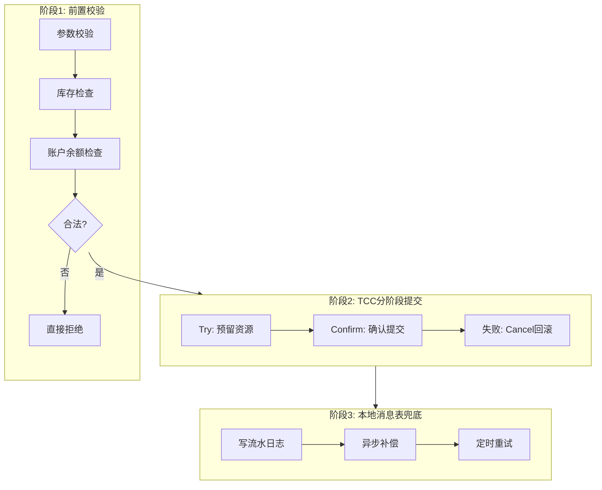
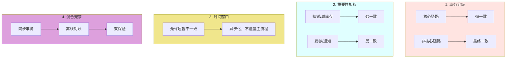
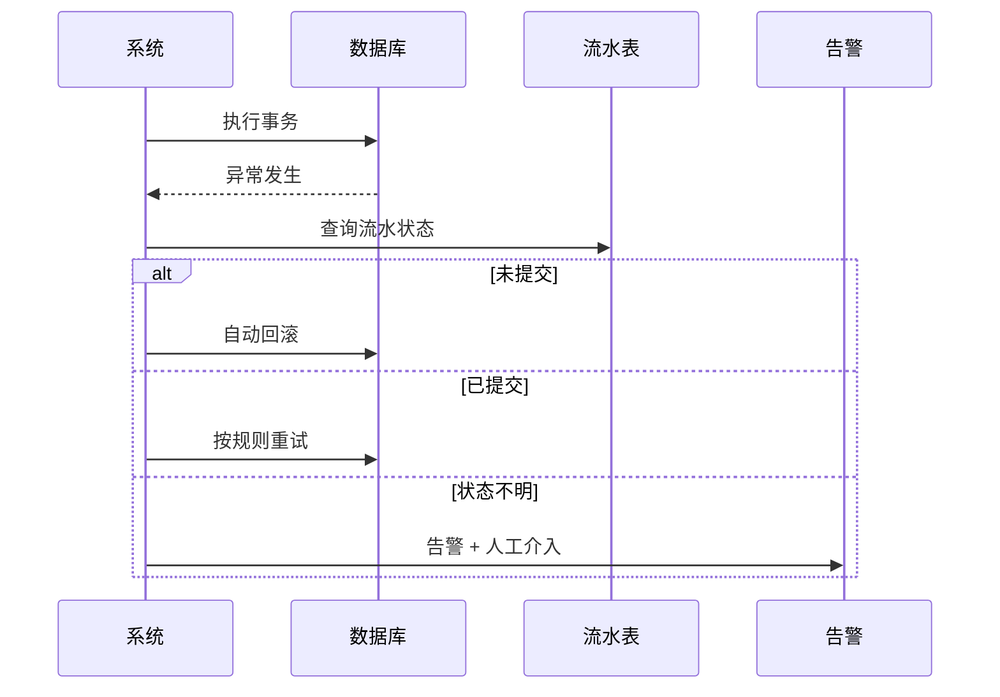
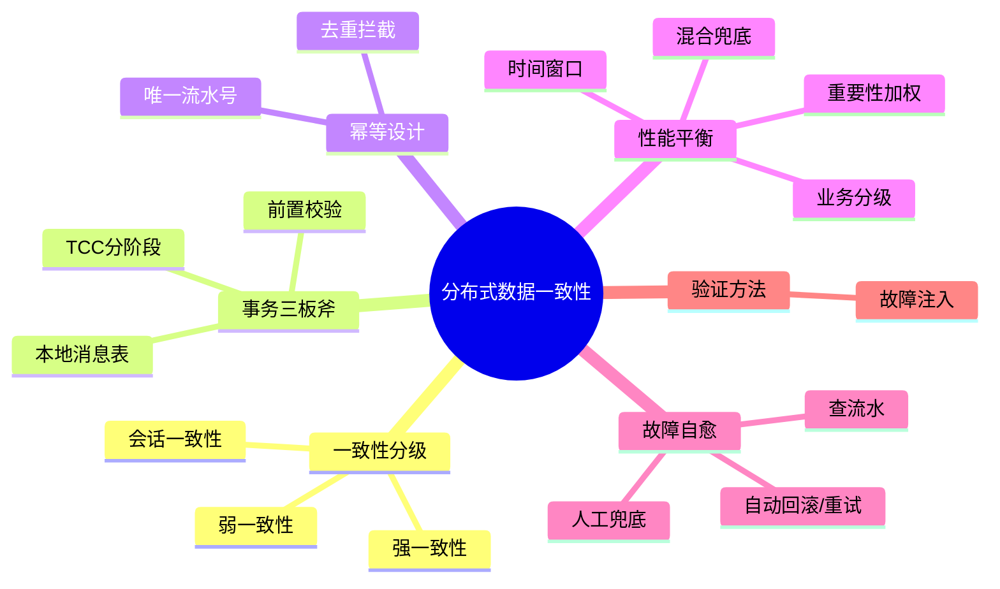

# 分布式数据一致性

> **场景**：后端分布式系统设计  
> **核心设计要点**：一致性分级、事务方案、幂等设计、性能与一致性权衡、故障补偿

---

## 🎯 场景引入

**分布式数据一致性解决什么问题？**
```
一句话：跨库/跨服务的多步操作，怎么保证数据最终是对得上的？
```

**生活化比喻**：
就像你在淘宝下单付款——扣款、减库存、加积分、发优惠券分布在 4 个不同的系统里。你希望的是：要么全成功，要么全回滚，最怕的就是钱扣了但库存没减，系统原地"精分"。

**核心特点**：没有银弹，只有取舍。强一致拖垮性能，最终一致留坑，关键看业务底线在哪。

---

## 💎 核心要点速览

### 核心观点（5 个关键点）

**1. 一致性分三级，别只说强/最终**
```
强一致性：事务提交后所有节点立刻同步（像银行转账，必须同时到账）
弱一致性：容忍短暂不一致窗口（像微博粉丝数，晚几秒无所谓）
会话一致性：同一用户会话内保证读自己更新（90% 的人会漏这个！）
```

**2. 事务三板斧：校验 → 分阶段 → 兜底**
```
前置校验：请求进来先拦截非法操作，别等事务开了再回滚
分阶段提交：TCC（Try-Confirm-Cancel），资源先预留再确认
本地消息表：写流水日志做补偿依据，不全靠中间件
```

**3. 幂等是防弹衣，不是可选项**
```
核心：按唯一流水号去重，不是傻傻重复执行
生活化比喻： ATM 取款，同一笔请求提交 10 次也只能吐一次钱
```

**4. 性能与一致性打组合拳**
```
业务分级：核心支付走强一致，非核心通知走最终一致
重要性加权：扣钱 vs 发券，两套标准
混合兜底：同步事务 + 离线对账，双保险
```

**5. 事务要学会自愈**
```
异常时：查流水 → 未提交自动回滚 → 已提交按规则重试 → 悬而未决走人工
血泪坑：关键流水号、事务状态必须原样入库，丢了上下文 = 翻车现场
```

---

## 🚀 一句话精华

> **分布式一致性 = 分级（强/弱/会话）+ 分阶段（TCC）+ 幂等（流水号去重）+ 兜底（本地消息表 + 对账）+ 自愈（异常重试 + 人工兜底）**

---

## 一、一致性到底分几级？

### 📊 三级一致性模型

**生活化比喻**：
```
强一致性：你和朋友转账，双方账户必须同时变化，有一方失败就全部回滚
弱一致性：微博热搜榜，延迟 10 秒看到旧数据也无所谓
会话一致性：你刚改了收货地址，刷新页面必须看到新的，但别人看不到无所谓
```

| 一致性级别 | 定义 | 性能代价 | 典型场景 | 生活化比喻 |
|-----------|------|---------|---------|-----------|
| **强一致性** | 事务提交后所有节点立刻同步 | ⭐⭐⭐⭐⭐（最高） | 银行转账、库存扣减 | 银行转账，双方必须同时到账 |
| **弱一致性** | 容忍短暂不一致窗口 | ⭐（最低） | 微博粉丝数、商品销量 | 热搜榜延迟几秒更新 |
| **会话一致性** | 同一用户会话内保证读自己更新 | ⭐⭐⭐（中等） | 用户个人中心、购物车 | 你改了自己的地址，自己必须立刻看到 |

### 技术选型建议

> 一致性分三级：**强一致、弱一致、会话一致**。核心支付链路走强一致，非核心通知走弱一致，用户维度数据走会话一致。面向 C 端的系统如果没有会话一致性，用户刚付完款刷新就显示未支付，直接原地炸锅。

---

## 二、事务怎么保证不翻车？

### 📊 工程三板斧

**生活化比喻**：
```
就像拆快递：
前置校验：签收前先检查包裹有没有破损，有问题直接拒收
分阶段提交：先签字（Try）→ 确认收货（Confirm）→ 有问题退货（Cancel）
本地消息表：快递单留底，出事了可以查单号追溯
```



### 幂等设计

**生活化比喻**：
```
幂等就像 ATM 取款：
- 同一笔请求（同一张卡、同一个金额、同一个时间戳）提交 10 次
- 只能吐一次钱
- 靠什么？流水号唯一性

技术实现：
- 唯一流水号 = 商户订单号 + 操作类型
- 用数据库唯一索引或 Redis 去重
```

```go
// 幂等性实现示例
type IdempotentChecker struct {
    redis *redis.Client
}

func (c *IdempotentChecker) CheckAndSet(txnID string) (bool, error) {
    // 使用 SETNX，如果 key 已存在说明重复请求
    ok, err := c.redis.SetNX(txnID, "1", 24*time.Hour).Result()
    if err != nil {
        return false, err
    }
    return ok, nil // ok=true 首次请求，ok=false 重复请求
}
```

---

## 三、性能与一致性怎么平衡？

### 📊 组合拳四件套



> **设计建议**：好的一致性方案，选的不是最严的标准，是业务里最合适的底线。

---

## 四、服务宕机了怎么办？（事务自愈）

### 📊 异常处理策略

**生活化比喻**：
```
事务自愈就像免疫系统：
- 出异常时先查流水状态
- 没提交的 → 自动回滚（像白细胞消灭病毒）
- 已提交的 → 按规则重试（像发烧是身体的自我修复）
- 悬而未决的 → 人工对账兜底（像重病去医院）
```



### ⚠️ 血泪坑

```
关键流水号、事务状态、操作上下文必须原样入库！
丢了上下文 = 系统开始重复扣钱、重复发货
这是真实项目里最常见的翻车现场，没有之一！
```

---

## 五、补偿逻辑怎么不变成垃圾场？

### 📊 收敛与闭环

**生活化比喻**：
```
补偿逻辑就像衣柜：
- 长期不穿的衣服要扔掉（下线旧逻辑）
- 已被新方案替代的旧脚本要清理
- 不然越堆越多，找衣服比买衣服还难

验证方法：故障注入
- 故意断网、故意宕机、故意重复发请求
- 看数据对不对、回滚干不干净、补偿有没有重复执行
```

---

## 六、深度设计问题

```mermaid
graph TB
    subgraph Q1["Q1: 一致性分级?"]
        A1[强一致] --> A2[弱一致]
        A2 --> A3[会话一致]
    end

    subgraph Q2["Q2: 事务怎么不翻车?"]
        B1[前置校验] --> B2[TCC分阶段]
        B2 --> B3[本地消息表]
        B3 --> B4[幂等去重]
    end

    subgraph Q3["Q3: 性能与一致平衡?"]
        C1[业务分级] --> C2[重要性加权]
        C2 --> C3[时间窗口]
        C3 --> C4[混合兜底]
    end

    subgraph Q4["Q4: 宕机怎么办?"]
        D1[查流水] --> D2[自动回滚/重试]
        D2 --> D3[人工兜底]
    end

    subgraph Q5["Q5: 补偿逻辑怎么管?"]
        E1[下线旧逻辑] --> E2[故障注入验证]
    end

    style Q1 fill:#FFE4E1
    style Q2 fill:#E0FFFF
    style Q3 fill:#F0E68C
    style Q4 fill:#DDA0DD
    style Q5 fill:#90EE90
```



### 技术解析

**Q1: 一致性分几级？**
> 三级：强一致、弱一致、会话一致。核心支付走强一致，非核心通知走弱一致，用户维度数据走会话一致。面向 C 端没有会话一致性，用户刚付完款刷新就显示未支付，直接炸锅。

**Q2: 事务怎么保证不翻车？**
> 三板斧：前置校验拦截非法请求，TCC 分阶段提交资源先预留再确认，本地消息表兜底补偿。还有绝杀级要点——幂等，按唯一流水号去重，防止重复执行让数据越改越乱。

**Q3: 性能和一致性怎么平衡？**
> 组合拳四件套：业务分级（核心走强一致，非核心走最终一致）、重要性加权（扣钱 vs 发券两套标准）、时间窗口（允许短暂不一致异步化）、混合兜底（同步事务 + 离线对账双保险）。

**Q4: 服务宕机了怎么办？**
> 事务要学会自愈：出异常先查流水状态，未提交自动回滚，已提交按规则重试，悬而未决走人工对账。血泪坑：关键流水号、事务状态必须原样入库，丢了上下文就是翻车现场。

**Q5: 补偿逻辑怎么管理？**
> 要有收敛机制：长期不触发的补偿逻辑、已被新流程替代的旧方案要下线。验证方法：故障注入——故意断网、宕机、重复发请求，看数据对不对、回滚干不干净。

---

## 七、方案总结



---

## 八、生产环境 Checklist

| 类别 | 检查项 | 状态 | 生活化比喻 |
|------|--------|------|-----------|
| **一致性分级** | 核心链路强一致 | ⬜ | 银行转账 |
| | 非核心链路最终一致 | ⬜ | 微博粉丝数 |
| | 会话一致性保证 | ⬜ | 个人中心 |
| **事务方案** | 前置校验 | ⬜ | 签收前检查 |
| | TCC 分阶段提交 | ⬜ | 拆快递三步 |
| | 本地消息表 | ⬜ | 快递单留底 |
| **幂等设计** | 唯一流水号 | ⬜ | ATM 取款 |
| | 去重拦截 | ⬜ | 防重复提交 |
| **故障处理** | 异常自动回滚 | ⬜ | 免疫系统 |
| | 重试机制 | ⬜ | 自我修复 |
| | 人工兜底 | ⬜ | 重病去医院 |
| **验证** | 故障注入测试 | ⬜ | 体检 |

---

## 九、总结（一句话带走）

### 🎯 一句话总结

> **分布式一致性 = 分级（强/弱/会话）+ 分阶段（TCC）+ 幂等（流水号去重）+ 兜底（本地消息表 + 对账）+ 自愈（异常重试 + 人工兜底）**

### 🧠 核心记忆点

1. **一致性三级**：强一致、弱一致、会话一致，别只说前两个
2. **事务三板斧**：前置校验、TCC、本地消息表
3. **幂等是防弹衣**：唯一流水号去重，不是傻傻重复执行
4. **性能与一致打组合拳**：业务分级 + 重要性加权 + 时间窗口 + 混合兜底
5. **事务要自愈**：异常查流水 → 自动回滚/重试 → 人工兜底
6. **验证靠故障注入**：故意断网、宕机、重复发请求
