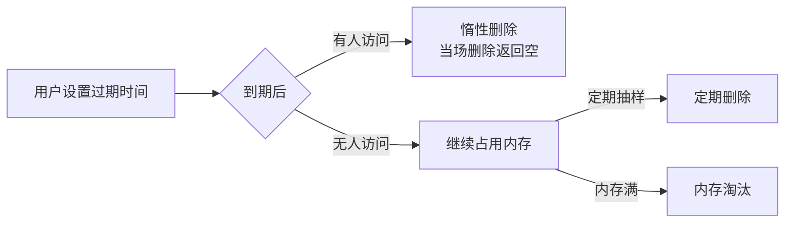
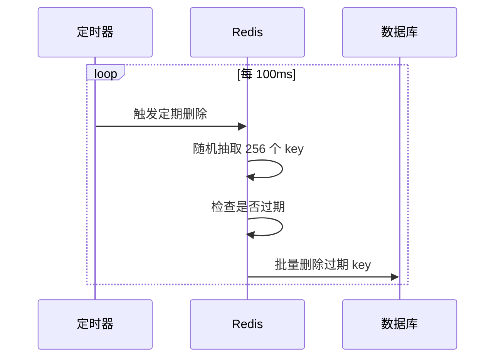
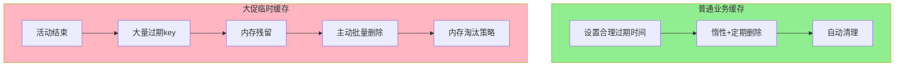
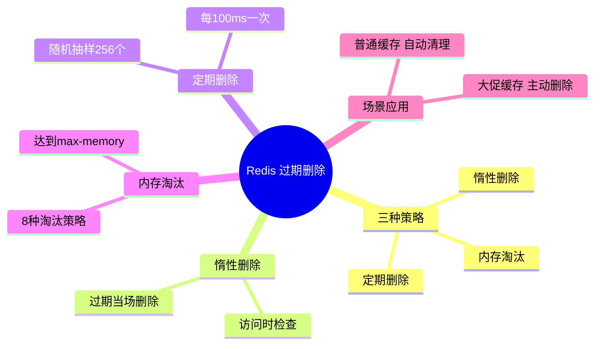

# Redis 过期删除策略

> **场景**：Redis 缓存设计  
> **核心设计要点**：惰性删除、定期删除、内存淘汰策略、内存水位

---

## 🎯 场景引入

**Redis 过期删除策略解决什么问题？**
```
一句话：设置了过期时间的 key，到底什么时候被真正删除？
```

**生活化比喻**：
就像餐厅的优惠券——你以为到期了就自动消失，其实有三种情况：
1. 你去使用时，服务员才发现过期了（惰性删除）
2. 餐厅每天打烊后统一清理过期券（定期删除）
3. 券太多仓库放不下了，按规则强制扔掉一些（内存淘汰）

**核心特点**：Redis 不会立刻删除所有过期数据，而是用**惰性 + 定期**的组合策略平衡性能与清理效率。

---

## 💎 核心要点速览

### 核心观点（3 个关键点）

**1. 惰性删除：访问时才检查**
```
只有你主动查询 key 时，Redis 才顺带检查有没有过期
过期了 → 当场删除并返回空
没过期 → 返回数据

生活化比喻：
就像查食品保质期，只有你拿起食品时才会看生产日期
躺在货架上没人理的食品，过期了也躺在那里
```

**2. 定期删除：随机抽样清理**
```
Redis 每隔一段时间（默认 100ms）随机抽取一批设置了过期时间的 key
检查其中过期的并批量删除

生活化比喻：
就像超市理货员每隔一段时间随机检查一批商品的保质期
把过期的挑出来扔掉
```

**3. 内存淘汰：达到上限时强制清理**
```
当 Redis 内存占用达到 max-memory 上限时
哪怕数据没过期，也会按配置的淘汰规则删掉部分数据

生活化比喻：
就像仓库满了，不管货物过没过期，都要扔掉一些腾空间
```

---

## 🚀 一句话精华

> **Redis 过期删除 = 惰性删除（访问时检查）+ 定期删除（随机抽样）+ 内存淘汰（达到上限时强制清理）**

---

## 一、为什么大家会觉得"立刻删除"？

### 📊 错觉来源

**生活化比喻**：
```
给 key 设置过期时间后，到期再去访问就会返回空
给人的直观感受是：数据到点就被删掉了

但实际上：
这是惰性删除在起作用
只有你主动查询时，Redis 才顺带检查过期
如果过期 key 一直没人访问，就会一直躺在内存里
```



---

## 二、惰性删除详解

### 📊 工作原理

**生活化比喻**：
```
就像查电话号码：
你问朋友"小明的电话是多少？"
朋友翻开通讯录，看到小明的条目已经过期了
朋友说"这个号码过期了"，然后把它划掉

如果你不问，朋友永远不会主动划掉这个过期号码
```

```go
// 伪代码展示惰性删除逻辑
func get(key string) (string, error) {
    entry := redisDB[key]

    // 检查是否过期
    if entry.expireTime < time.Now() {
        delete(redisDB, key) // 惰性删除
        return "", nil
    }

    return entry.value, nil
}
```

### 关键点

- ✅ 只在访问时检查
- ✅ 过期 key 无人访问就继续占用内存
- ✅ 性能高（不用主动扫描）

---

## 三、定期删除详解

### 📊 工作原理

**生活化比喻**：
```
就像超市理货员：
每隔一段时间（默认 100ms）随机检查一批商品
把过期的挑出来扔掉

不是检查所有商品（太慢）
而是随机抽样（平衡性能和清理效率）
```



### 关键点

- ✅ 默认每 100ms 执行一次
- ✅ 随机抽取 256 个设置了过期时间的 key
- ✅ 删除其中过期的 key
- ✅ 如果过期 key 比例 > 25%，继续下一轮抽样

---

## 四、内存淘汰策略

### 📊 8 种淘汰策略

**生活化比喻**：
```
内存淘汰就像仓库管理：
仓库满了（达到 max-memory），不管货物过没过期，都要扔掉一些

淘汰规则：
- noeviction：不淘汰（直接返回错误，像仓库满了就不收货）
- allkeys-lru：淘汰最近最少使用的 key（像扔掉最久没动的货物）
- allkeys-lfu：淘汰最不常用的 key（像扔掉使用次数最少的货物）
- allkeys-random：随机淘汰（像闭着眼睛扔）
- volatile-lru：只在设置了过期时间的 key 中淘汰 LRU
- volatile-lfu：只在设置了过期时间的 key 中淘汰 LFU
- volatile-random：只在设置了过期时间的 key 中随机淘汰
- volatile-ttl：淘汰剩余存活时间最短的 key
```

| 策略 | 淘汰范围 | 淘汰规则 | 适用场景 |
|------|---------|---------|---------|
| **noeviction** | 不淘汰 | 返回错误 | 不允许丢失数据 |
| **allkeys-lru** | 所有 key | 最近最少使用 | **最常用** ⭐⭐⭐⭐⭐ |
| **allkeys-lfu** | 所有 key | 最不常用 | Redis 4.0+ |
| **allkeys-random** | 所有 key | 随机 | 特殊场景 |
| **volatile-lru** | 过期 key | LRU | 缓存 + 持久化混合 |
| **volatile-lfu** | 过期 key | LFU | Redis 4.0+ |
| **volatile-random** | 过期 key | 随机 | 特殊场景 |
| **volatile-ttl** | 过期 key | TTL 最短 | 优先淘汰快过期的 |

---

## 五、真实项目场景

### 📊 场景 1：普通业务缓存

```
热点数据：设置合理的过期时间
配合惰性 + 定期删除
大部分过期数据被及时清理
不用额外干预
```

### 📊 场景 2：大促临时缓存

```
活动结束后：大量过期 key 没人访问
内存残留问题：过期数据占满内存
解决方案：
- 主动批量删除
- 配置合适的内存淘汰策略
- 监控内存水位
```



---

## 六、技术要点深入探讨

```mermaid
graph TB
    subgraph Q1["Q1: 过期数据立刻删除吗?"]
        A1[不是] --> A2[惰性删除]
        A2 --> A3[定期删除]
        A3 --> A4[内存淘汰]
    end

    subgraph Q2["Q2: 为什么不用主动扫描?"]
        B1[全表扫描太慢] --> B2[影响性能]
        B2 --> B3[随机抽样平衡]
    end

    subgraph Q3["Q3: 内存满了怎么办?"]
        C1[触发淘汰策略] --> C2[按规则删除数据]
        C2 --> C3[腾出空间]
    end

    subgraph Q4["Q4: 如何避免内存溢出?"]
        D1[设置 max-memory] --> D2[配置淘汰策略]
        D2 --> D3[监控内存水位]
    end

    style Q1 fill:#FFE4E1
    style Q2 fill:#E0FFFF
    style Q3 fill:#F0E68C
    style Q4 fill:#DDA0DD
```



### 技术解析

**Q1: Redis 过期的数据是立刻被删除的吗？**
> 不是。Redis 采用**惰性删除 + 定期删除**的组合策略。惰性删除是访问时才检查过期，定期删除是每 100ms 随机抽样清理。只有当内存达到上限触发淘汰策略时，才会强制清理更多数据。

**Q2: 为什么不用主动扫描所有过期 key？**
> 全表扫描太慢，会影响 Redis 的高性能。随机抽样可以在性能和清理效率之间取得平衡。默认每 100ms 抽取 256 个 key，如果过期比例 > 25% 就继续下一轮。

**Q3: 内存满了怎么办？**
> 触发内存淘汰策略。常用的是 allkeys-lru，淘汰最近最少使用的 key。也可以根据业务选择 allkeys-lfu 或 volatile-ttl 等策略。

**Q4: 如何避免内存溢出？**
> 设置合理的 max-memory 上限，配置合适的淘汰策略，监控内存水位。大促场景要主动批量删除过期数据，避免过期数据堆积。

---

## 七、方案总结



---

## 八、生产环境 Checklist

| 类别 | 检查项 | 状态 | 生活化比喻 |
|------|--------|------|-----------|
| **删除策略** | 惰性删除（默认开启） | ⬜ | 使用时检查 |
| | 定期删除（默认开启） | ⬜ | 定期理货 |
| **内存管理** | 设置 max-memory | ⬜ | 仓库容量上限 |
| | 配置淘汰策略（allkeys-lru） | ⬜ | 扔掉最久没动的 |
| **监控** | 监控内存水位 | ⬜ | 仓库占用率 |
| | 监控过期 key 数量 | ⬜ | 过期商品数量 |
| **特殊场景** | 大促后主动清理 | ⬜ | 活动后大扫除 |
| | 告警机制 | ⬜ | 库存预警 |

---

## 九、总结（一句话带走）

### 🎯 一句话总结

> **Redis 过期删除 = 惰性删除（访问时检查）+ 定期删除（随机抽样）+ 内存淘汰（达到上限时强制清理）**

### 🧠 核心记忆点

1. **不是立刻删除**：过期数据可能还在内存里占着空间
2. **惰性删除**：访问时才检查过期，过期当场删除
3. **定期删除**：每 100ms 随机抽样 256 个 key，批量删除过期的
4. **内存淘汰**：达到 max-memory 时按规则强制删除数据
5. **推荐策略**：allkeys-lru（淘汰最近最少使用的 key）
6. **监控要点**：内存水位、过期 key 数量、淘汰策略触发情况
