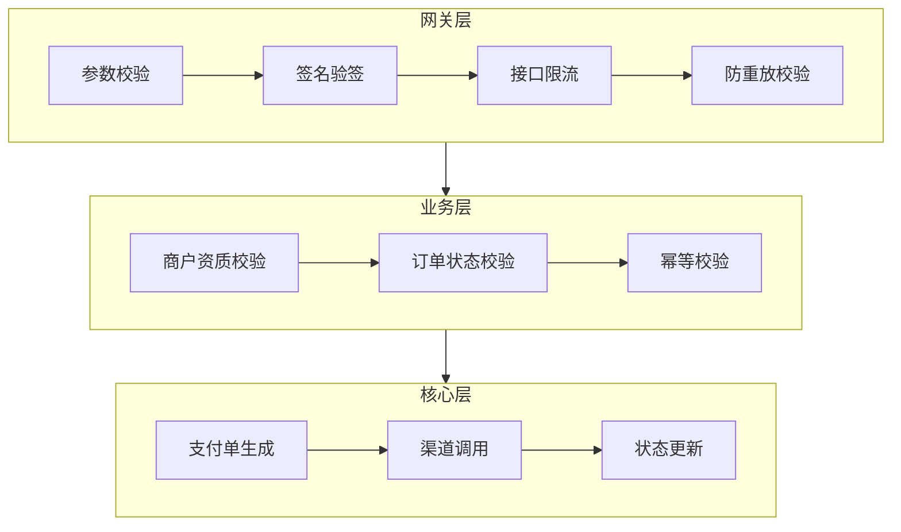
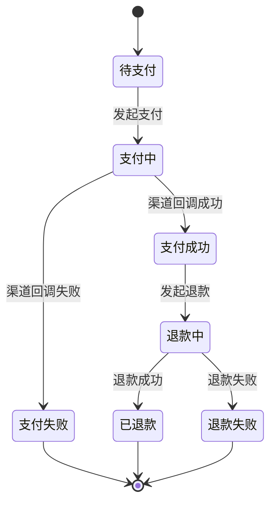
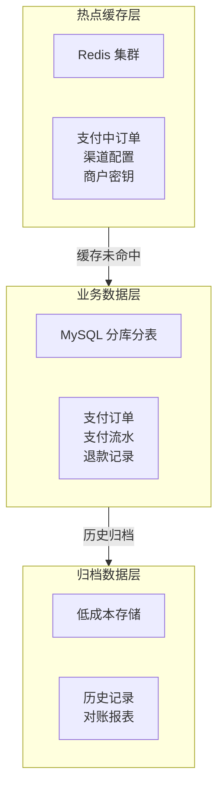
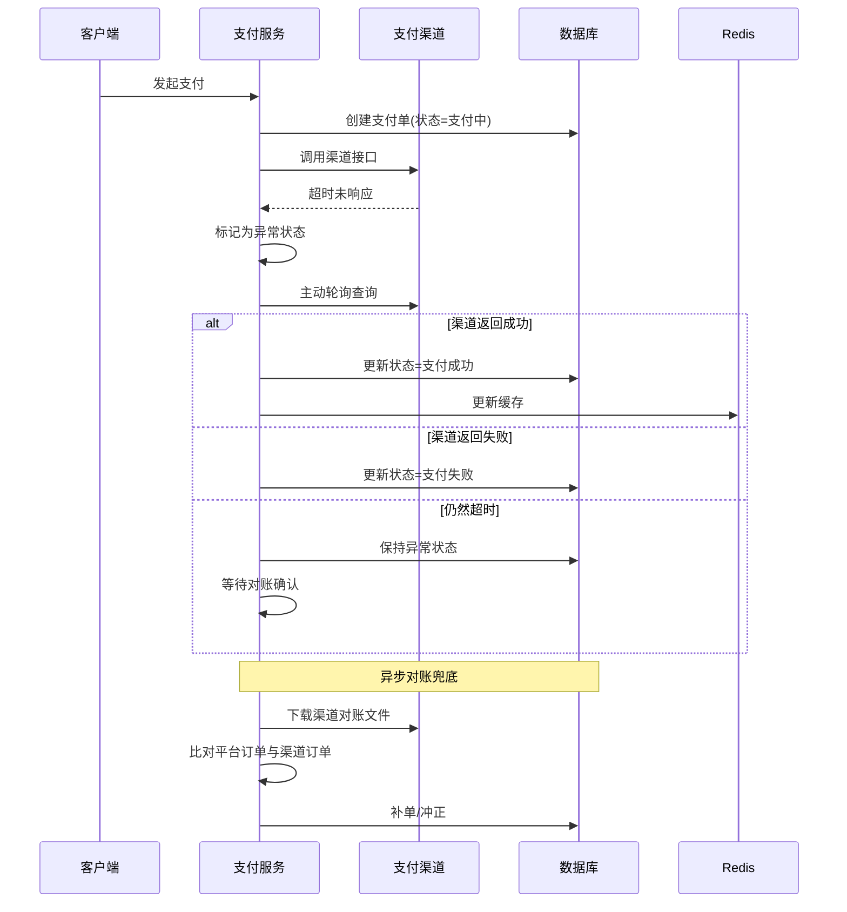
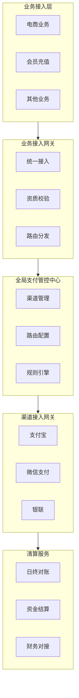
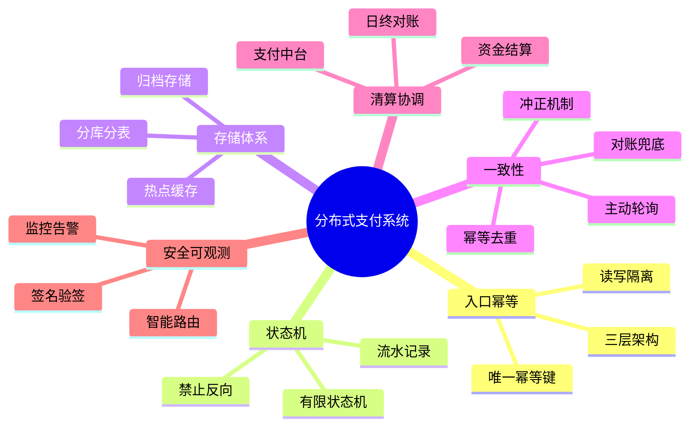

# 分布式支付系统设计

> **场景**：后端系统设计 / 高并发架构  
> **核心设计要点**：幂等设计、状态机、存储体系、一致性保障、清算对账、安全可观测

---

## 🎯 场景引入

**分布式支付系统解决什么问题？**
```
一句话：把简单的"对接第三方支付接口"变成高可靠、强一致、可追溯的分布式资金系统
```

**生活化比喻**：
就像开一家银行——不只是会转账就行，还要有：
- 前台（入口分层 + 幂等校验）
- 账本（状态机 + 流水记录）
- 金库（多级存储 + 分库分表）
- 风控（一致性保障 + 异常兜底）
- 对账（清算结算 + 审计追溯）

**核心特点**：渠道对接是表象，资金安全是内核。只会调支付接口 = 有表象没内核。

---

## 💎 核心要点速览

### 核心观点（6 个关键设计）

**1. 入口分层与幂等设计**
```
网关层：参数校验、签名验签、限流、防重放
业务层：商户资质校验、订单状态校验、幂等校验
核心层：支付单生成、渠道调用、状态更新

关键：全区唯一幂等键 = 商户订单号 + 操作类型
```

**2. 状态机设计**
```
用有限状态机统一管理支付全流程
定义：待支付 → 支付中 → 支付成功/失败 → 退款中 → 已退款
禁止状态反向流转
每次变更生成流水记录，全程可追溯
```

**3. 存储体系**
```
热点缓存层：Redis 集群（支付中订单、渠道配置）
业务数据层：MySQL 分库分表（支付订单、流水）
归档数据层：低成本存储（历史记录、对账报表）
```

**4. 一致性保障**
```
调用超时：主动轮询机制（不依赖单次回调）
重复回调：幂等键自动去重
结果未知：标记异常状态 + 对账确认
失败补偿：异步对账自动补单 + 冲正流水
```

**5. 清算协调**
```
全局支付管控中心：渠道管理、路由配置
业务接入网关：各业务线快速接入
渠道接入网关：统一调度渠道能力
清算服务：日终对账、资金结算、财务对接
```

**6. 安全与可观测性**
```
安全：全链路签名验签、敏感信息加密、审计日志
成本：渠道智能路由（低费率优先）、资源按需调度
可观测：支付成功率、失败率、回调延迟、资金异常告警
```

---

## 🚀 一句话精华

> **分布式支付系统 = 入口幂等 + 状态机驱动 + 多级存储 + 一致性兜底 + 清算协调 + 安全可观测**

---

## 一、入口分层与幂等设计

### 📊 三层架构

**生活化比喻**：
```
就像机场安检：
网关层：安检门（参数校验、限流、防重放）
业务层：值机柜台（资质校验、订单校验、幂等校验）
核心层：登机口（支付单生成、渠道调用、状态更新）

目的：把重复、非法请求拦截在核心之外
```



### 幂等设计

**生活化比喻**：
```
幂等就像 ATM 取款：
- 同一笔请求（同一张卡、同一个金额、同一个时间戳）提交 10 次
- 只能吐一次钱
- 靠什么？全区唯一幂等键

技术实现：
- 幂等键 = 商户订单号 + 操作类型
- 用数据库唯一索引或 Redis 去重
- 读写链路隔离：查询走缓存，支付走核心
```

```go
// 幂等性实现示例
type PaymentIdempotent struct {
    redis *redis.Client
    db    *gorm.DB
}

func (p *PaymentIdempotent) Check(orderID string, opType string) (bool, error) {
    idempotentKey := fmt.Sprintf("%s:%s", orderID, opType)

    // 1. Redis 快速去重
    ok, err := p.redis.SetNX(idempotentKey, "1", 24*time.Hour).Result()
    if err != nil {
        return false, err
    }
    if !ok {
        return false, nil // 重复请求
    }

    // 2. 数据库唯一索引兜底
    record := &PaymentRecord{
        OrderID:  orderID,
        OpType:   opType,
        IdempotentKey: idempotentKey,
    }
    err = p.db.Create(record).Error
    if err != nil {
        if isDuplicateKeyError(err) {
            return false, nil // 重复请求
        }
        return false, err
    }

    return true, nil // 首次请求
}
```

---

## 二、状态机设计

### 📊 有限状态机

**生活化比喻**：
```
状态机就像快递流转：
- 待支付 → 支付中 → 支付成功/失败
- 支付成功 → 退款中 → 已退款/退款失败
- 每个状态有明确的前置条件和后置动作
- 禁止反向流转（不能从"已退款"回到"支付中"）

每次状态变更都要记录流水：
- 操作前后状态
- 渠道返回
- 操作时间
- 全程可追溯
```



### 代码示例

```go
// 支付状态机
type PaymentStateMachine struct {
    currentState PaymentStatus
    history      []PaymentFlow
}

type PaymentStatus int
const (
    StatusPending PaymentStatus = iota
    StatusPaying
    StatusSuccess
    StatusFailed
    StatusRefunding
    StatusRefunded
    StatusRefundFailed
)

func (m *PaymentStateMachine) Transition(action string, ctx *PaymentContext) error {
    // 1. 校验状态流转合法性
    if !m.isValidTransition(m.currentState, action) {
        return errors.New("invalid state transition")
    }

    // 2. 执行状态变更
    newState := m.getNextState(m.currentState, action)

    // 3. 记录流水
    flow := &PaymentFlow{
        OrderID:    ctx.OrderID,
        FromStatus: m.currentState,
        ToStatus:   newState,
        Action:     action,
        ChannelRes: ctx.ChannelResponse,
        CreatedAt:  time.Now(),
    }

    // 4. 持久化（事务保证原子性）
    err := m.db.Transaction(func(tx *gorm.DB) error {
        // 更新订单状态
        if err := tx.Model(&PaymentOrder{}).
            Where("id = ?", ctx.OrderID).
            Update("status", newState).Error; err != nil {
            return err
        }

        // 记录流水
        if err := tx.Create(flow).Error; err != nil {
            return err
        }

        return nil
    })

    if err != nil {
        return err
    }

    m.currentState = newState
    m.history = append(m.history, *flow)
    return nil
}
```

---

## 三、存储体系

### 📊 三级存储

**生活化比喻**：
```
三级存储就像图书馆：
热点缓存层：阅览室的热门书（Redis，最快，容量小）
业务数据层：书库的常用书（MySQL 分库分表，快，容量中等）
归档数据层：地下室的旧书（低成本存储，慢，容量大）

根据访问频率和重要性分层存储
```



### 分库分表策略

```go
// 分库分表规则
type ShardingRule struct {
    DBCount  int // 库数量（如 16）
    TBCount  int // 每库表数量（如 256）
}

func (r *ShardingRule) GetDBIndex(userID int64) int {
    return int(userID % int64(r.DBCount))
}

func (r *ShardingRule) GetTBIndex(orderID int64) int {
    return int(orderID % int64(r.TBCount))
}

// 表结构
type PaymentOrder struct {
    ID        int64     `gorm:"primaryKey"`
    OrderID   int64     `gorm:"uniqueIndex"`
    UserID    int64     `gorm:"index"`
    Amount    int64     // 金额（分）
    Status    int       // 状态
    ChannelID int       // 渠道 ID
    CreatedAt time.Time
    UpdatedAt time.Time
}
```

---

## 四、一致性保障与异常兜底

### 📊 全链路异常设计

**生活化比喻**：
```
一致性保障就像免疫系统：
- 调用超时：主动轮询（不依赖单次回调）
- 重复回调：幂等键自动去重
- 结果未知：标记异常 + 对账确认
- 失败补偿：异步对账自动补单 + 冲正流水

核心思维：资金一致优先
```



### 冲正机制

```go
// 冲正流水生成
func (s *PaymentService) Reverse(orderID int64, reason string) error {
    // 1. 查询原订单
    order, err := s.db.GetOrder(orderID)
    if err != nil {
        return err
    }

    // 2. 生成冲正流水
    reverseFlow := &PaymentFlow{
        OrderID:    orderID,
        FromStatus: order.Status,
        ToStatus:   StatusRefunded,
        Action:     "REVERSE",
        Amount:     -order.Amount, // 负数表示冲正
        Reason:     reason,
        CreatedAt:  time.Now(),
    }

    // 3. 事务保证原子性
    return s.db.Transaction(func(tx *gorm.DB) error {
        // 更新订单状态
        if err := tx.Model(order).Update("status", StatusRefunded).Error; err != nil {
            return err
        }

        // 记录冲正流水
        if err := tx.Create(reverseFlow).Error; err != nil {
            return err
        }

        return nil
    })
}
```

---

## 五、分布式协商与清算结算

### 📊 支付中台架构

**生活化比喻**：
```
支付中台就像银行总行：
- 全局支付管控中心：总行（渠道管理、路由配置）
- 业务接入网关：各分行（电商、充值等业务线）
- 渠道接入网关：各支行（对接支付宝、微信等渠道）
- 清算服务：对账中心（日终对账、资金结算）

好处：业务线快速接入，渠道统一管理，资金集中清算
```



---

## 六、安全、成本与可观测性

### 📊 生产级考量

**生活化比喻**：
```
生产级考量就像开车：
安全：安全带 + 气囊 + 刹车（签名验签 + 加密 + 审计）
成本：油耗优化（渠道智能路由，低费率优先）
可观测：仪表盘 + 行车记录仪（监控 + 告警 + 日志）
```

| 维度 | 关键措施 | 生活化比喻 |
|------|---------|-----------|
| **安全** | 全链路签名验签 | 身份证验证 |
| | 敏感信息加密 | 保险箱 |
| | 高金额二次校验 | 大额转账确认 |
| | 全量审计日志 | 行车记录仪 |
| **成本** | 渠道智能路由 | 比价购物 |
| | 成功率动态切换 | 备用方案 |
| | 资源按需调度 | 按需开灯 |
| **可观测** | 支付成功率监控 | 仪表盘 |
| | 失败率告警 | 故障灯 |
| | 回调延迟监控 | 计时器 |
| | 资金异常告警 | 报警器 |

---

## 七、深度设计问题

```mermaid
graph TB
    subgraph Q1["Q1: 如何保证幂等?"]
        A1[唯一幂等键] --> A2[Redis+数据库双保险]
        A2 --> A3[读写链路隔离]
    end

    subgraph Q2["Q2: 状态机怎么设计?"]
        B1[有限状态机] --> B2[禁止反向流转]
        B2 --> B3[每次变更记录流水]
    end

    subgraph Q3["Q3: 一致性怎么保障?"]
        C1[主动轮询] --> C2[幂等去重]
        C2 --> C3[异常标记]
        C3 --> C4[对账兜底]
    end

    subgraph Q4["Q4: 如何处理掉单?"]
        D1[主动轮询渠道] --> D2[对账补单]
        D2 --> D3[冲正机制]
    end

    subgraph Q5["Q5: 如何降本?"]
        E1[渠道智能路由] --> E2[成功率动态切换]
        E2 --> E3[资源按需调度]
    end

    style Q1 fill:#FFE4E1
    style Q2 fill:#E0FFFF
    style Q3 fill:#F0E68C
    style Q4 fill:#DDA0DD
    style Q5 fill:#90EE90
```



### 技术解析

**Q1: 如何保证幂等？**
> 用全区唯一幂等键 = 商户订单号 + 操作类型。Redis SetNX 快速去重 + 数据库唯一索引兜底。读写链路隔离，查询走缓存，支付走核心。

**Q2: 状态机怎么设计？**
> 用有限状态机统一管理支付全流程。定义待支付、支付中、支付成功/失败、退款中、已退款等核心状态，禁止状态反向流转。每次状态变更都生成流水记录，操作前后状态、渠道返回、操作时间全程可追溯。

**Q3: 一致性怎么保障？**
> 调用超时主动轮询渠道状态，不依赖单次回调。重复回调通过幂等键自动去重。结果未知标记异常状态，通过对账最终确认。失败补偿通过异步对账自动补单，出现多扣错扣生成冲正流水反向回滚。

**Q4: 如何处理掉单？**
> 主动轮询机制定时查询渠道支付状态。对账服务每日核对平台资金与渠道资金，生成对账报表。发现掉单自动补单，出现多扣错扣生成冲正流水。

**Q5: 如何降本？**
> 渠道智能路由，同费率下优先选低成本渠道。根据成功率动态切换渠道。非核心链路用低成本资源，核心链路保障高配，资源按需调度。

---

## 八、方案总结



---

## 九、生产环境 Checklist

| 类别 | 检查项 | 状态 | 生活化比喻 |
|------|--------|------|-----------|
| **入口幂等** | 三层架构 | ⬜ | 机场安检 |
| | 唯一幂等键 | ⬜ | ATM 取款 |
| | 读写链路隔离 | ⬜ | 查询走缓存 |
| **状态机** | 有限状态机 | ⬜ | 快递流转 |
| | 禁止反向流转 | ⬜ | 单向通行 |
| | 流水记录 | ⬜ | 行车记录仪 |
| **存储体系** | 热点缓存（Redis） | ⬜ | 阅览室 |
| | 分库分表（MySQL） | ⬜ | 书库 |
| | 归档存储 | ⬜ | 地下室 |
| **一致性** | 主动轮询 | ⬜ | 免疫系统 |
| | 幂等去重 | ⬜ | 防重复提交 |
| | 对账兜底 | ⬜ | 体检 |
| | 冲正机制 | ⬜ | 纠错机制 |
| **清算协调** | 支付中台 | ⬜ | 银行总行 |
| | 日终对账 | ⬜ | 对账中心 |
| | 资金结算 | ⬜ | 财务对接 |
| **安全可观测** | 签名验签 | ⬜ | 身份证验证 |
| | 智能路由 | ⬜ | 比价购物 |
| | 监控告警 | ⬜ | 仪表盘 |

---

## 十、总结（一句话带走）

### 🎯 一句话总结

> **分布式支付系统 = 入口幂等 + 状态机驱动 + 多级存储 + 一致性兜底 + 清算协调 + 安全可观测**

### 🧠 核心记忆点

1. **入口幂等**：三层架构（网关、业务、核心），唯一幂等键防重复
2. **状态机**：有限状态机统一管理，禁止反向流转，每次变更记录流水
3. **存储体系**：热点缓存 + 分库分表 + 归档存储，三级分层
4. **一致性**：主动轮询 + 幂等去重 + 对账兜底 + 冲正机制
5. **清算协调**：支付中台统一管理，日终对账资金结算
6. **安全可观测**：签名验签 + 智能路由 + 监控告警
