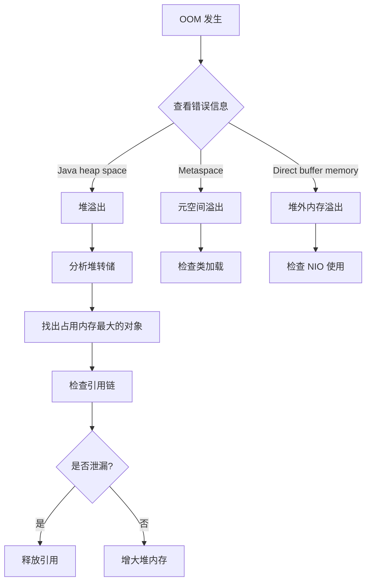
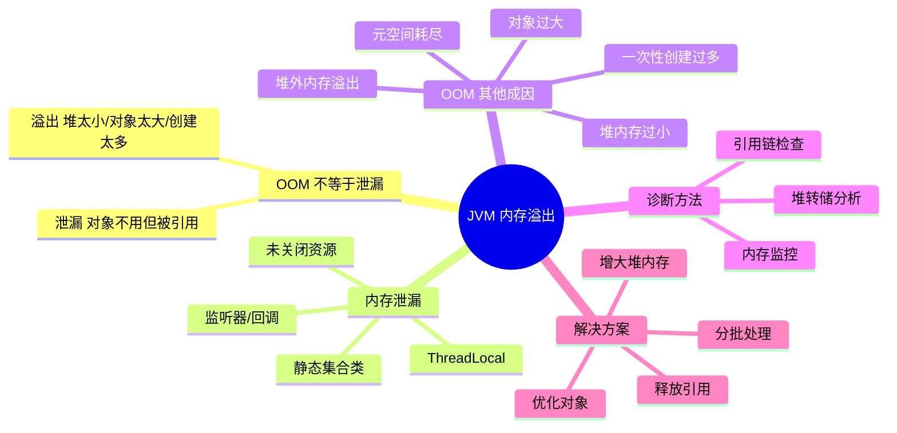

# JVM 内存溢出与内存泄漏

> **场景**：JVM 性能调优与故障诊断  
> **核心设计要点**：内存溢出（OOM）、内存泄漏、GC 机制、堆内存管理

---

## 🎯 场景引入

**JVM 内存溢出与内存泄漏解决什么问题？**
```
一句话：内存溢出（OOM）不等于内存泄漏，要分清原因才能对症下药
```

**生活化比喻**：
就像房间满了东西：
- **内存泄漏**：你不用的东西还占着地方（对象不用但仍被引用，GC 无法回收）
- **内存溢出**：房间本身太小，或者一次性塞太多东西（堆内存设置过小、对象过大）

**核心特点**：OOM 不一定是泄漏，可能是业务需要的对象就很大，或者 JVM 堆内存设置过小。

---

## 💎 核心要点速览

### 核心观点（4 个关键点）

**1. 内存泄漏：对象不用但仍被引用**
```
定义：对象不再使用，但仍存在强引用，GC 无法回收
表现：内存持续上涨，泄漏积累后引发 OOM
生活化比喻：你不用的东西还占着地方，房间越来越满
```

**2. OOM 其他成因（不是泄漏）**
```
堆内存设置过小：房间本身太小
对象过大：业务需要的对象就很大
一次性创建大量对象：一次性塞太多东西
元空间耗尽：类加载器加载了太多类
堆外内存占满：直接内存溢出
```

**3. 如何诊断？**
```
查看 OOM 错误信息：区分是堆溢出还是元空间溢出
分析堆转储文件（heap dump）：找出占用内存最大的对象
检查引用链：看哪些对象被意外持有引用
监控内存使用：JVisualVM、JConsole 等工具
```

**4. 解决方案**
```
内存泄漏：释放不必要的引用，使用弱引用
堆内存不足：增大堆内存（-Xmx）
对象过大：优化数据结构，分批处理
一次性创建过多：对象池、流式处理
```

---

## 🚀 一句话精华

> **JVM 内存溢出 ≠ 内存泄漏：泄漏是对象不用但仍被引用，溢出可能是堆太小、对象太大、一次性创建太多**

---

## 一、内存泄漏详解

### 📊 什么是内存泄漏？

**生活化比喻**：
```
内存泄漏就像：
你在房间里放了一堆东西，有些你已经不用了
但你没有扔掉它们，它们还占着地方
房间越来越满，最后放不下新东西了

技术定义：
对象不再使用，但仍存在强引用
GC 无法回收这些对象
内存持续上涨，泄漏积累后引发 OOM
```

### 常见内存泄漏场景

| 场景 | 原因 | 生活化比喻 | 解决方案 |
|------|------|-----------|---------|
| **静态集合类** | 静态变量持有的对象不会被 GC | 把东西放在公共区域，永远不扔 | 及时清理集合 |
| **未关闭的资源** | 数据库连接、IO 流未关闭 | 水龙头没关，水一直流 | try-with-resources |
| **监听器/回调** | 注册了监听器但没取消 | 订了报纸但没取消订阅 | 及时取消注册 |
| **ThreadLocal** | 线程池复用线程，ThreadLocal 未清理 | 衣柜里残留上一个租客的衣服 | 用完必须 remove |
| **内部类持有外部类** | 非静态内部类持有外部类引用 | 小房间连着大房间，小房间不扔大房间也不能扔 | 使用静态内部类 |

### 代码示例

```go
// ❌ 错误示例：静态集合导致内存泄漏
type BadCache struct {
    data map[string]interface{}
}

var globalCache = &BadCache{data: make(map[string]interface{})}

func (c *BadCache) Set(key string, value interface{}) {
    c.data[key] = value // 永远不会被清理
}

// ✅ 正确示例：使用带过期时间的缓存
type GoodCache struct {
    data   map[string]CacheItem
    mu     sync.RWMutex
}

type CacheItem struct {
    Value     interface{}
    ExpireAt  time.Time
}

func (c *GoodCache) Set(key string, value interface{}, ttl time.Duration) {
    c.mu.Lock()
    defer c.mu.Unlock()
    c.data[key] = CacheItem{
        Value:    value,
        ExpireAt: time.Now().Add(ttl),
    }
}

func (c *GoodCache) Get(key string) (interface{}, bool) {
    c.mu.RLock()
    defer c.mu.RUnlock()
    item, ok := c.data[key]
    if !ok || time.Now().After(item.ExpireAt) {
        return nil, false
    }
    return item.Value, true
}

// 定期清理过期数据
func (c *GoodCache) Cleanup() {
    c.mu.Lock()
    defer c.mu.Unlock()
    now := time.Now()
    for key, item := range c.data {
        if now.After(item.ExpireAt) {
            delete(c.data, key)
        }
    }
}
```

---

## 二、OOM 其他成因（不是泄漏）

### 📊 堆内存设置过小

**生活化比喻**：
```
就像房间本身太小
你只租了一个 10 平米的房间
放不了多少东西就满了

技术原因：
JVM 堆内存设置过小（-Xmx 参数）
解决方案：增大堆内存
```

```bash
# 查看当前堆内存配置
java -XX:+PrintFlagsFinal -version | grep MaxHeapSize

# 增大堆内存
java -Xms2g -Xmx4g -jar app.jar
```

### 📊 对象过大

**生活化比喻**：
```
就像你有一个超大的家具
虽然只有一件，但占了一大半房间

技术原因：
业务需要的对象就很大（如大数组、大字符串）
解决方案：优化数据结构，分批处理
```

### 📊 一次性创建大量对象

**生活化比喻**：
```
就像你一次性买了太多东西
虽然每件都不大，但一起塞进来房间就满了

技术原因：
一次性创建大量对象（如循环中创建临时对象）
解决方案：对象池、流式处理
```

```go
// ❌ 错误示例：一次性创建大量对象
func badProcess() {
    data := make([]string, 10000000) // 一次性创建 1000 万个对象
    for i := 0; i < 10000000; i++ {
        data[i] = fmt.Sprintf("item_%d", i)
    }
    // 处理 data...
}

// ✅ 正确示例：分批处理
func goodProcess() {
    batchSize := 10000
    for i := 0; i < 10000000; i += batchSize {
        batch := make([]string, batchSize)
        for j := 0; j < batchSize && i+j < 10000000; j++ {
            batch[j] = fmt.Sprintf("item_%d", i+j)
        }
        // 处理 batch...
    }
}
```

### 📊 元空间耗尽

**生活化比喻**：
```
元空间就像房间的"图纸库"
存放类的元数据（类结构、方法信息等）
如果加载了太多类，图纸库就满了

技术原因：
动态生成大量类（如 CGLIB 代理、反射）
解决方案：检查类加载器，避免重复加载
```

### 📊 堆外内存溢出

**生活化比喻**：
```
堆外内存就像房间外面的储物间
DirectByteBuffer 使用的是堆外内存
如果堆外内存占满，也会抛出 OOM

技术原因：
NIO 直接内存使用过多
解决方案：限制直接内存大小（-XX:MaxDirectMemorySize）
```

---

## 三、如何诊断内存问题？

### 📊 诊断步骤

**生活化比喻**：
```
诊断内存问题就像医生看病：
1. 看症状：查看 OOM 错误信息
2. 做检查：分析堆转储文件（heap dump）
3. 找病因：检查引用链，找出占用内存最大的对象
4. 开药方：根据病因选择解决方案
```



### 工具推荐

| 工具 | 用途 | 生活化比喻 |
|------|------|-----------|
| **jmap** | 生成堆转储文件 | 给房间拍照 |
| **jhat** | 分析堆转储文件 | 看照片找问题 |
| **JVisualVM** | 可视化监控 | 实时监控摄像头 |
| **JConsole** | JMX 监控 | 遥控器 |
| **MAT** | Eclipse 内存分析 | 专业侦探工具 |

### 命令行示例

```bash
# 生成堆转储文件
jmap -dump:format=b,file=heapdump.hprof <pid>

# 查看堆内存使用情况
jmap -heap <pid>

# 查看对象占用情况
jmap -histo <pid> | head -20

# 查看 GC 情况
jstat -gc <pid> 1000
```

---

## 四、解决方案总结

### 📊 针对性解决

| 问题类型 | 解决方案 | 生活化比喻 |
|---------|---------|-----------|
| **内存泄漏** | 释放不必要的引用，使用弱引用 | 扔掉不用的东西 |
| **堆内存不足** | 增大堆内存（-Xmx） | 换个大房间 |
| **对象过大** | 优化数据结构，分批处理 | 把大东西拆小 |
| **一次性创建过多** | 对象池、流式处理 | 分批搬运 |
| **元空间耗尽** | 检查类加载器，避免重复加载 | 整理图纸库 |
| **堆外内存溢出** | 限制直接内存大小 | 限制储物间大小 |

---

## 五、技术要点深入探讨

```mermaid
graph TB
    subgraph Q1["Q1: OOM 一定是泄漏吗?"]
        A1[不是] --> A2[可能是堆太小]
        A2 --> A3[可能是对象太大]
        A3 --> A4[可能是一次性创建太多]
    end

    subgraph Q2["Q2: 如何诊断内存泄漏?"]
        B1[生成堆转储] --> B2[分析对象占用]
        B2 --> B3[检查引用链]
    end

    subgraph Q3["Q3: 如何避免内存泄漏?"]
        C1[及时释放引用] --> C2[使用弱引用]
        C2 --> C3[关闭资源]
        C3 --> C4[清理 ThreadLocal]
    end

    subgraph Q4["Q4: 堆内存怎么调优?"]
        D1[增大堆内存] --> D2[优化对象大小]
        D2 --> D3[分批处理]
    end

    style Q1 fill:#FFE4E1
    style Q2 fill:#E0FFFF
    style Q3 fill:#F0E68C
    style Q4 fill:#DDA0DD
```



### 技术解析

**Q1: JVM 内存溢出就一定是内存泄漏吗？**
> 不是。内存溢出（OOM）不一定是内存泄漏。泄漏是指对象不再使用但仍存在强引用，GC 无法回收。OOM 的其他成因包括：堆内存设置过小、对象本身很大、一次性创建大量对象、元空间耗尽、堆外内存占满等。

**Q2: 如何诊断内存泄漏？**
> 首先生成堆转储文件（jmap -dump），然后用 MAT 或 JVisualVM 分析，找出占用内存最大的对象，检查引用链，看哪些对象被意外持有引用。监控内存使用趋势，如果内存持续上涨不下降，很可能是泄漏。

**Q3: 如何避免内存泄漏？**
> 及时释放不必要的引用，使用弱引用（WeakReference）持有缓存对象。关闭资源（数据库连接、IO 流）使用 try-with-resources。ThreadLocal 用完必须 remove。避免静态集合类持有大量对象。

**Q4: 堆内存怎么调优？**
> 增大堆内存（-Xmx 参数），优化对象大小（使用基本类型代替包装类），分批处理大数据集（不要一次性创建大量对象），使用对象池复用对象。监控 GC 情况，调整新生代和老年代比例。

---

## 六、方案总结



---

## 七、生产环境 Checklist

| 类别 | 检查项 | 状态 | 生活化比喻 |
|------|--------|------|-----------|
| **内存泄漏** | 静态集合类清理 | ⬜ | 公共区域清理 |
| | 资源关闭（try-with-resources） | ⬜ | 关水龙头 |
| | ThreadLocal remove | ⬜ | 清理衣柜 |
| | 监听器取消注册 | ⬜ | 取消订阅 |
| **堆内存** | 合理设置 -Xmx | ⬜ | 房间大小 |
| | 监控堆使用率 | ⬜ | 监控占用率 |
| | GC 日志分析 | ⬜ | 查看清理记录 |
| **对象优化** | 避免大对象 | ⬜ | 拆分大家具 |
| | 分批处理 | ⬜ | 分批搬运 |
| | 对象池复用 | ⬜ | 重复使用 |
| **监控告警** | 内存使用告警 | ⬜ | 库存预警 |
| | OOM 告警 | ⬜ | 故障报警 |
| | 堆转储备份 | ⬜ | 现场保护 |

---

## 八、总结（一句话带走）

### 🎯 一句话总结

> **JVM 内存溢出 ≠ 内存泄漏：泄漏是对象不用但仍被引用，溢出可能是堆太小、对象太大、一次性创建太多**

### 🧠 核心记忆点

1. **内存泄漏**：对象不再使用，但仍存在强引用，GC 无法回收
2. **OOM 其他成因**：堆内存过小、对象过大、一次性创建过多、元空间耗尽、堆外内存溢出
3. **诊断方法**：生成堆转储 → 分析对象占用 → 检查引用链 → 监控内存趋势
4. **解决方案**：释放引用、增大堆内存、优化对象大小、分批处理
5. **常见泄漏场景**：静态集合类、未关闭资源、ThreadLocal、监听器/回调
